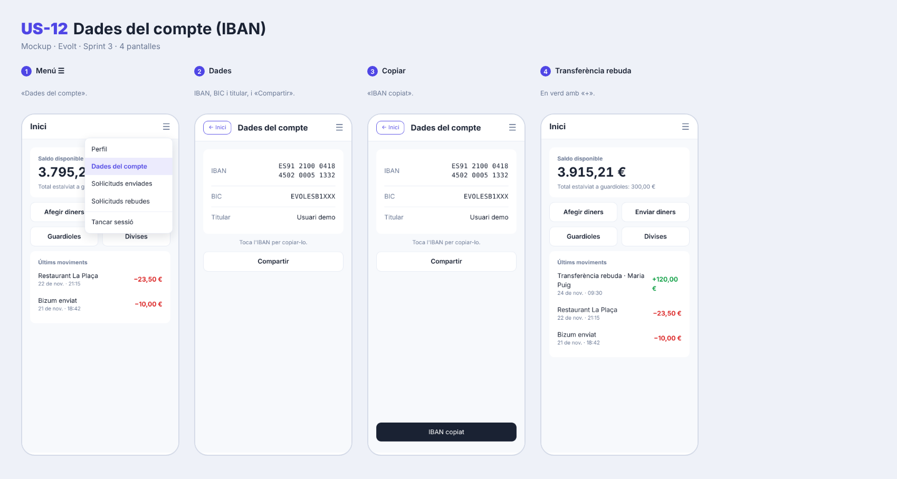

### US-12 · Dades del compte (IBAN) (SP 2 · VP 5 · Prioritat Mitjana)

COM: client estàndard
VULL: consultar el meu IBAN
PER: poder rebre transferències d'altres bancs.

Perfil: client estàndard amb el compte actiu.

Assumptes:
- Cada usuari té un IBAN espanyol fix al seed, amb el dígit de control correcte, i el BIC és el mateix per a tothom (decisió D, 24/11)
- La transferència d'un altre banc es simula amb una ruta de desenvolupament, com la recàrrega de prova
- L'IBAN es pot copiar i compartir

Criteris d'acceptació:
1. Al menú ☰ hi ha «Dades del compte» (capçalera «← Inici» · «Dades del compte»)
2. Una targeta mostra, una sota l'altra i amb l'etiqueta a l'esquerra: «IBAN» en grups de 4 caràcters (24 en total, per exemple «ES91 2100 0418 4502 0005 1332»), «BIC» («EVOLESB1XXX») i «Titular» (el nom de l'usuari; sense nom, l'@usuari)
3. Cada usuari té el seu IBAN, sempre el mateix, amb el dígit de control correcte; dos usuaris no tenen mai el mateix
4. En tocar l'IBAN es copia sense espais, i a baix surt durant 2 s «IBAN copiat»
5. «Compartir» (botó blanc) obre el menú del mòbil amb el text «IBAN: ES91 2100 0418 4502 0005 1332 · BIC: EVOLESB1XXX · Titular: Usuari demo», amb l'IBAN en grups de 4; si el navegador no ho permet, copia aquest text i surt «Dades copiades»
6. Una transferència d'un altre banc (simulada amb una ruta de desenvolupament) suma l'import al saldo principal i surt a Inici i a Moviments en verd: «Transferència rebuda · <ordenant>» i «+120,00 €»
7. A la bústia arriba «Has rebut 120,00 € de <ordenant>.»
8. Si no es poden carregar les dades surt «S'ha produït un error inesperat. Torna-ho a provar més tard.» amb el botó «Reintentar»

Casos especials:
- Cada usuari té un IBAN espanyol fix al seed, amb el dígit de control correcte; el BIC és el mateix per a tothom (decisió D)
- La transferència d'un altre banc es simula amb una ruta de desenvolupament, com la recàrrega de prova; no hi ha cap connexió amb bancs reals
- La transferència d'un altre banc es demostra a preproducció, si la TR06.5 hi activa les rutes de desenvolupament, o en local. A producció no s'activa mai, perquè sumaria diners a qualsevol IBAN (decisió del PO, 26/11, P96 a #358)

Estimació: SP 2 · VP 5 · Prioritat Mitjana

Seguiment: issue #251 · èpica EP-02 (#265) · targeta del Trello US-12.

Revisió del 26/11 (decisions del PO a #358): el text de «Compartir» porta l'IBAN en grups de 4 (en tocar l'IBAN es continua copiant sense espais), i l'avís de la bústia acaba amb punt. La transferència d'un altre banc es demostra a preproducció, si la TR06.5 hi activa les rutes de desenvolupament, o en local; a producció no s'activa mai, perquè sumaria diners a qualsevol IBAN (P96).

Mockups (fets abans de programar, 25/11/2026; HTML a `docs/us/_mockup/src/`, PNG a `docs/us/img/`):

1. **US-12-acces-menu** — Menú ☰ amb «Dades del compte».
2. **US-12-dades-compte** — «Dades del compte»: IBAN en grups de 4, BIC i titular.
3. **US-12-iban-copiat** — En tocar l'IBAN: «IBAN copiat».
4. **US-12-transferencia-rebuda** — Inici amb una transferència d'un altre banc.

