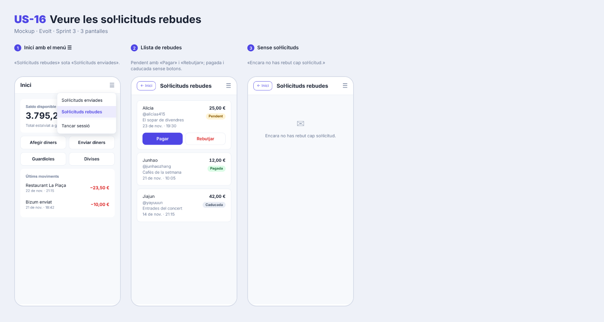

### US-16 · Veure les sol·licituds rebudes (SP 1 · VP 5 · Prioritat Mitjana)

COM: client estàndard
VULL: veure les sol·licituds de diners que he rebut
PER: saber qui em demana diners i quant.

Perfil: client estàndard que ha rebut alguna sol·licitud (US-15).

Assumptes:
- «Sol·licituds rebudes» s'obre des del menú, sota «Sol·licituds enviades» (decisió B, 24/11)
- Pagar és la US-39 i rebutjar és la US-40
- Al seed, l'usuari de la demo té sol·licituds rebudes en els quatre estats

Criteris d'acceptació:
1. Al menú ☰, sota «Sol·licituds enviades», hi ha «Sol·licituds rebudes», que obre /requests/received (capçalera «← Inici» · «Sol·licituds rebudes»). Inici es queda amb els 4 botons
2. Cada sol·licitud rebuda és una targeta, la més nova a dalt: a l'esquerra el nom i, a sota en gris, l'@usuari, el concepte i la data («23 de nov. · 19:30»); a la dreta l'import en negreta i l'etiqueta d'estat: «Pendent» (groc), «Pagada» (verd), «Rebutjada» (vermell) o «Caducada» (gris)
3. Una sol·licitud passa a «Caducada» a partir del dia 7 (dia natural de Madrid), com a la US-15
4. Només les «Pendent» tenen, a baix i un al costat de l'altre, els botons «Pagar» (lila ple, US-39) i «Rebutjar» (blanc amb el text en vermell, US-40). Les altres no tenen cap botó
5. Sense cap sol·licitud rebuda surt una icona grisa i «Encara no has rebut cap sol·licitud.»
6. Si no es pot carregar la llista surt «S'ha produït un error inesperat. Torna-ho a provar més tard.» amb el botó «Reintentar»

Casos especials:
- «Caducada» no es desa: es deriva en llegir, pel dia natural de Madrid, igual que a la US-15 (una sol·licitud del 14 de nov. es veu «Caducada» des de les 00:00 del 21 de nov.)
- Si la US-39 o la US-40 encara no estan fetes, el botó corresponent no surt: la US-16 es pot demostrar sola amb la llista, els estats i l'estat buit
- **Dada de demo:** al seed, l'usuari de la demo rep quatre sol·licituds, una en cada estat (`req-03` a `req-06`). La «Pagada» (`req-05`) no té cap moviment, i per això el saldo de la demo es queda en 3.795,21 € (decisió del PO, 26/11, P92 a #357). Per veure un pagament de veritat, es paga la «Pendent» (US-39)

Estimació: SP 1 · VP 5 · Prioritat Mitjana

Seguiment: issue #247 · èpica EP-03 (#266) · targeta del Trello US-16.

Revisió del 25/11: La US-16 original («Respondre a una sol·licitud») es divideix en US-16 (veure), US-39 (pagar) i US-40 (rebutjar).

Revisió del 26/11 (decisió del PO, P92 a #357): al seed, l'usuari de la demo rep quatre sol·licituds, una en cada estat (`req-03` a `req-06`). La «Pagada» (`req-05`) no té cap moviment, i per això el saldo de la demo es queda en 3.795,21 €. Per veure un pagament de veritat, es paga la «Pendent» (US-39).

Mockups (fets abans de programar, 25/11/2026; HTML a `docs/us/_mockup/src/`, PNG a `docs/us/img/`):

1. **US-16-acces-menu** — Inici amb el menú ☰ obert: «Sol·licituds rebudes» sota «Sol·licituds enviades».
2. **US-16-sollicituds-rebudes** — Llista: una pendent amb «Pagar» i «Rebutjar», una pagada i una caducada.
3. **US-16-sollicituds-rebudes-buides** — Sense cap sol·licitud rebuda.

