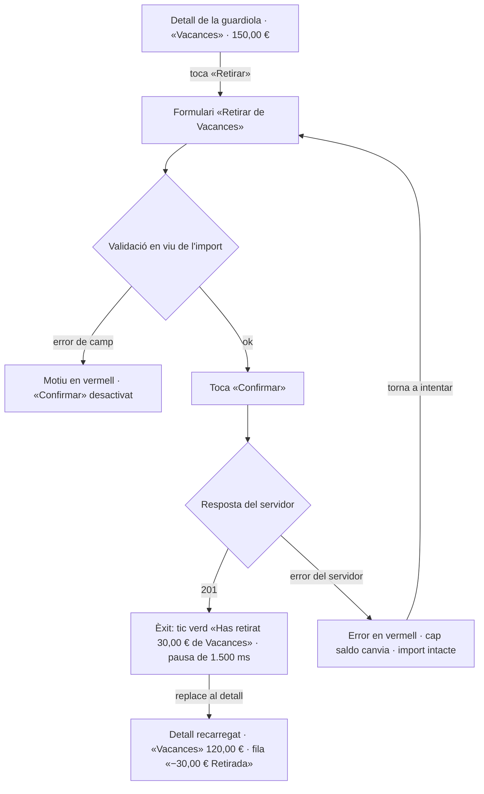

# US-19 · Retirar diners d'una guardiola

> **Sprint 2 · Bloc Estalvi · 3 punts · 9 h · T19.1–T19.4 · Dependència: US-17 (guardioles) i US-18 (aportar, que és el mirall) · Comparteix el contracte amb US-20 (T19.1) · Estat: especificació**

> Convencions d'aquest document: tot el que no existeix al repositori es marca **`a crear`**; tota decisió que el PO encara no ha confirmat es marca **[PROPOSTA — pendent de validar]**. Els textos entre «» són literals i es copien tal qual al codi (apòstrof recte `'` dins de les cadenes, com a `frontend/src/models/errorMessages.ts`). Els imports es mostren en format `1.250,50 €` i les dates en format `11 d’oct. · 21:15`, sortides de `formatCents` i `formatDateTime` (`frontend/src/models/money.ts` i `frontend/src/models/date.ts`), que són l'única font de format.

---

## 1. Valor, supòsits i àmbit

### 1.1 Declaració de valor

Targeta a `docs/P1/trello-backlog.md` (US-19, línies 489–522), literal:

```
COM: client estàndard amb guardioles
VULL: retirar diners d'una guardiola al saldo principal
PER: fer servir els diners estalviats quan els necessiti.

Perfil: client estàndard amb almenys una guardiola amb saldo.

Assumptes:
- El saldo de la guardiola baixa i el principal puja
- Es registra un moviment de retirada
- L'import ha de ser més gran que 0
- No es pot retirar més del que té la guardiola

Estimació: SP 3 · VP 6 · Prioritat Alta
```

Criteris d'acceptació del PO (`docs/P1/trello-backlog.md`, línies 514–521), literals:

```
A la pantalla d'una guardiola hi ha el botó "Retirar", que obre la pantalla "Retirar de <nom de la guardiola>"
A dalt es veu el saldo que té la guardiola
L'import ha de ser més gran que 0 i no més gran que el saldo de la guardiola; si no, la casella es posa vermella, surt el motiu en vermell i el botó "Confirmar" queda desactivat
En confirmar, el saldo de la guardiola baixa i el principal puja exactament el mateix import
Surt un tic verd amb "Has retirat X € de <nom>"
A l'historial de la guardiola surt la retirada en vermell amb "−" i el concepte "Retirada"
Si el servidor falla, surt el missatge d'error en vermell i cap dels dos saldos canvia
Si la guardiola té 0,00 €, el botó "Retirar" surt desactivat (gris clar)
```

Criteris d'acceptació detallats del backlog (`docs/P1/backlog.md`, US-19, línies 201–217), literals:

```
1. L'usuari és al detall d'una guardiola amb saldo > 0
2. Toca "Retirar"
3. S'obre la pantalla de retirada amb: camp d'import, saldo de la guardiola visible
4. Introdueix un import (ex. 20 €)
5. Toca "Confirmar retirada"
6. **Validació:**
   - Import ≤ 0 → error "Introdueix un import positiu"
   - Import > saldo de la guardiola → error "Saldo insuficient a la guardiola"
   - Guardiola a 0 → CTA desactivat o error "Aquesta guardiola està buida"
7. **Èxit:** la guardiola mostra el nou saldo (anterior − import); el saldo principal augmenta en el mateix import
8. **Èxit:** es mostra confirmació "Has retirat 20 € de Vacances"
9. **Èxit:** el moviment queda registrat (data, import, tipus "Retirada", guardiola origen)
10. **Èxit:** des de la home, l'usuari veu el saldo principal actualitzat
11. **Error backend:** missatge "No s'ha pogut completar la retirada. Torna-ho a provar" i cap saldo s'ha modificat
12. **No funcionals:** operació atòmica; si l'objectiu es trenca per la retirada, no cal bloquejar (això és EP-12 més endavant)
```

Encàrrec del sprint (`Tasques del Sprint 2 · F3-Evolt.pdf`, bloc «Bloc Estalvi», títol «US-19 Retirar diners d'una guardiola · 3 punts · 9 h»), literal:

> | Tasca | Fase | Hores | Què cal fer | Fet quan | Responsable |
> |---|---|---|---|---|---|
> | T19.1 Contracte de retirar i progrés (US-19 i US-20) a docs/api.md i proves | E | 2 | Secció de docs/api.md per a la retirada i per al percentatge i l'estat de les guardioles, i les proves a docs/proves-estalvi.md. | La PR del contracte està fusionada amb la revisió de l'altra parella. | |
> | T19.2 Retirada atòmica de la guardiola al saldo, amb l'historial (backend) | G | 3 | Com l'aportació de la US-18 però al revés: la guardiola baixa, el saldo puja i es registren el moviment i la retirada, tot o res. | Els tests cobreixen tot el saldo, un cèntim de més (error i cap canvi) i que saldo + guardioles no canvia. | |
> | T19.3 Botó «Retirar» i pantalla «Retirar de <nom>» amb validacions | G | 3 | Botó al detall (gris amb 0,00 €), saldo de la guardiola a dalt, import validat, tic verd i error del servidor. | Retirar 30 € de Vacances la deixa a 120 € i l'historial mostra «−30,00 € Retirada». | |
> | T19.4 Revisar US-19 | R | 1 | Executar les proves d'acceptació i revisar les PR de la US-19. | Les proves passen i el PO l'accepta al navegador. | |

Valor entregat, mesurable:

1. Un client estàndard pot treure els diners d'una guardiola cap al saldo principal i veure els dos saldos actualitzats a l'instant, amb una sola operació.
2. La retirada deixa rastre als dos llocs on toca: un moviment `income` al compte principal («Retirada de <nom>») i una entrada `expense` a l'historial de la guardiola («Retirada»).
3. Mai es pot treure més del que té la guardiola, i cap retirada no deixa els saldos a mitges: o canvien els dos, o no en canvia cap.
4. Amb la guardiola a 0,00 € el botó «Retirar» surt desactivat (gris), de manera que l'usuari no arriba a obrir una pantalla on no pot fer res.

### 1.2 Supòsits

| # | Supòsit | Font |
|---|---|---|
| S1 | L'usuari surt del token de sessió (`Authorization: Bearer`); cap petició envia `X-User-Id`. | `docs/api.md` §2 i §8.2; comentari de capçalera de `frontend/src/services/apiClient.ts` |
| S2 | Les rutes noves són **protegides**: `frontend/src/router/accessGuard.ts` redirigeix a `login` qualsevol ruta sense `meta.public` i sense sessió. | `frontend/src/router/accessGuard.ts` |
| S3 | Els imports viatgen com a **enters en cèntims** i només es tornen euros a la presentació, amb `formatCents` / `eurosToCents`. | `docs/api.md` §1; `frontend/src/models/money.ts` |
| S4 | La retirada és el **mirall exacte de l'aportació** (US-18, §9.4 del contracte): mateixa forma de resposta, mateix ordre de validacions, mateix «tot o res», amb els papers invertits (la guardiola baixa, el compte puja). | T19.2 («Com l'aportació de la US-18 però al revés»); `backend/app/services/pot_service.py`, funció `contribute` |
| S5 | No hi ha cap ruta per llegir una guardiola sola (`GET /api/pots/{potId}` no existeix, comentari de `frontend/src/viewmodels/usePotViewModel.ts`): la guardiola arriba de `GET /api/pots` i es tria per `id`. | `frontend/src/viewmodels/usePotViewModel.ts`, línies 22–24 |
| S6 | La retirada **no toca l'XP** en aquest sprint: la gamificació no és a l'abast (igual que l'aportació, provat a A-20 de `docs/proves-estalvi.md`). La regla del backlog «retirar abans de 7 dies resta XP» és d'EP-11/EP-12, fora de l'Sprint 2. | `docs/P1/backlog.md` (§US-19, AC 12 i línia 313); A-20 de `docs/proves-estalvi.md` |
| S7 | La retirada **pot deixar la guardiola per sota de l'objectiu** (i fins i tot treure-la d'un «Objectiu assolit»): l'objectiu és una meta, no un límit. En fusionar-se, US-20 (T20.1/T20.2) en recalcula el progrés. | `docs/P1/backlog.md` AC 12; A-15 de `docs/proves-estalvi.md` per analogia |
| S8 | La retirada **no compta per al límit diari de recàrrega** (`kind` intern `"other"`, com l'aportació). | `backend/app/models/movement.py` (`KIND_OTHER`); §9.4 de `docs/api.md` |
| S9 | Arquitectura MVVM sense Pinia: un ViewModel per pantalla, cap crida a `fetch` ni a un servei des d'un `.vue`. | `AGENTS.md` §2.3 |
| S10 | Els mocks estan encesos per defecte (`VITE_USE_MOCKS` absent o `true`); només un `false` explícit els apaga. | `frontend/src/mocks/index.ts`, `frontend/.env.example` |
| S11 | El rellotge del backend és `now_madrid()` (`ZoneInfo("Europe/Madrid")`, sense microsegons) i els tests el poden fixar amb el paràmetre `now`. | `backend/app/models/clock.py`; `pot_service.contribute(..., now=None)` |
| S12 | La UI reacciona al `code` de l'error, mai al `message`: el text que veu la persona surt sempre de `frontend/src/models/errorMessages.ts`. | `docs/api.md` §5; `frontend/src/models/errorMessages.ts` |
| S13 | El saldo d'una guardiola és sempre la suma del seu historial, i el saldo del compte és la suma dels seus moviments: aquests dos invariants els fan servir els tests de T19.2. | `docs/api.md` §9.8 |

### 1.3 Contradiccions detectades i resoltes aquí

| On | Què diu | Què diu l'altre document | Resolució (decidida, no oberta) |
|---|---|---|---|
| `docs/P1/backlog.md` AC 8 | «Confirmació "Has retirat 20 € de Vacances"» (sense decimals) | La resta de l'app formata amb `formatCents`: «30,00 €» (C11 de §5; tic de la US-18 «Has aportat 30,00 € a Vacances» a AP-04) | El tic fa servir `formatCents`: **«Has retirat 30,00 € de Vacances»**. Un sol format d'euro a tota l'app. |
| `docs/P1/backlog.md` AC 6 | «Guardiola a 0 → CTA desactivat o error "Aquesta guardiola està buida"» (dues opcions) | Trello (línia 521): «el botó "Retirar" surt desactivat (gris clar)» | **Botó desactivat al detall de la guardiola** (les dues fonts hi coincideixen); no existeix cap text «Aquesta guardiola està buida» a l'app i no se n'afegeix cap de nou. |
| `docs/P1/backlog.md` AC 11 | Error del servidor: «No s'ha pogut completar la retirada. Torna-ho a provar» | `frontend/src/models/errorMessages.ts`: `INTERNAL_ERROR` diu «S'ha produït un error inesperat. Torna-ho a provar més tard.» | Es reutilitza el codi existent i el seu text: **la UI reacciona al `code`, mai al `message`** (S12). No es crea cap text de pantalla nou per a l'error genèric. **[PROPOSTA — pendent de validar amb el PO]** |
| — | Retirar més del que té la guardiola: cap codi d'error no cobreix el cas | `INSUFFICIENT_BALANCE` existeix però el seu text parla del saldo del compte («No tens prou saldo per fer aquesta aportació.») | Codi nou **`INSUFFICIENT_POT_BALANCE`** `a crear` amb el text «La guardiola no té prou saldo per aquesta retirada.» (§7.4). **[PROPOSTA — pendent de validar]** |
| `docs/P1/backlog.md` AC 6 | Textos literals de validació: «Introdueix un import positiu», «Saldo insuficient a la guardiola», «Aquesta guardiola està buida» | `frontend/src/models/errorMessages.ts`: **un sol text per codi**, compartit per totes les pantalles (`INVALID_AMOUNT` ja diu «L'import ha de ser més gran que 0.» i és el mateix text que veu qui recarrega o aporta) | Es reutilitzen els codis i texts existents (`INVALID_AMOUNT`, i el nou `INSUFFICIENT_POT_BALANCE` per al saldo de la guardiola), perquè un text nou per pantalla trencaria la regla «un codi, un text». El significat del PO es conserva (positiu, ≤ saldo, botó desactivat), no la redacció literal. **[PROPOSTA — pendent de validar amb el PO]** |

### 1.4 Fora de l'abast

| Fora de l'abast | Per què | Qui ho porta |
|---|---|---|
| Barra de progrés, percentatge i «Objectiu assolit» | És la US-20; T19.1 només hi deixa el lloc al contracte | US-20 (T20.1, T20.2) |
| XP per estalviar, i la penalització per retirar abans de 7 dies | La gamificació no és a l'abast de l'Sprint 2 | EP-11 / EP-12 |
| Retirada automàtica o programada | No és a cap criteri | — |
| Retirada parcial a una altra guardiola, o entre guardioles | Només existeix guardiola → saldo principal | — |
| Paginació de l'historial | A la demo una guardiola té poques entrades | — |
| Confirmació prèvia abans de retirar («Segur que vols…») | El PO no la demana; el flux és d'un sol pas, com «Aportar» | — |
| Avisos a la bústia simulada per la retirada | No és a cap criteri (l'aportació tampoc no en fa) | — |

---

## 2. Taula de pantalles

**Comprovat al repositori:** `rg -i retir` no troba res ni a `frontend/src` ni a `backend/app` ni a `docs/api.md`. No hi ha cap vista, ViewModel, servei ni endpoint de retirada: tot el que segueix és nou, excepte els fitxers marcats `(edició)`.

| Pantalla | Ruta | Vista Vue (fitxer) | Punt d'entrada | Punt de sortida |
|---|---|---|---|---|
| «Detall de la guardiola» (s'edita; ja existeix) | `/pots/:potId` (`name: 'pot'`) | `frontend/src/views/PotView.vue` (existent) | Botó «Retirar» nou que s'afegeix a la targeta de resum, al costat de «Aportar» | «← Guardioles» (enllaç propi de la vista), «Aportar» → `/pots/:potId/contribute`, botó «Retirar» → `/pots/:potId/withdraw` |
| «Retirar de <nom>» | `/pots/:potId/withdraw` (`name: 'withdraw'`) `a crear` | `frontend/src/views/WithdrawView.vue` `a crear` | Botó «Retirar» del detall | «← Inici» de l'`AppShell` (`back`), enllaç «Cancel·lar» → detall de la guardiola, i tornada automàtica al detall 1,5 s després de l'èxit (mateix patró que `useContributeViewModel`, `CONFIRMATION_MS = 1500`) |

Fitxers de suport (nous `a crear` i edicions marcades `(edició)`; mateixa llista que fan servir §3–§9):

| Fitxer | Capa | Què conté |
|---|---|---|
| `frontend/src/viewmodels/useWithdrawViewModel.ts` (+ `useWithdrawViewModel.test.ts`) | ViewModel | Estat de «Retirar de <nom>»: guardiola, import, validacions en viu, enviament, confirmació |
| `frontend/src/services/potsService.ts` (edició) | Model | Funció `withdraw(potId, amountCents)`, una per endpoint, amb `useMocks()` |
| `frontend/src/models/pot.ts` (edició) | Model | Tipus `Withdrawal` / `WithdrawalJson` (mateixa forma que `Contribution`), i el mapper `fromApiWithdrawal` |
| `frontend/src/mocks/pots.ts` (edició) | Mocks | `mockWithdraw(potId, body)`, amb el mateix ordre de validacions i errors que el backend |
| `frontend/src/router/index.ts` (edició) | Router | Ruta `/pots/:potId/withdraw`, sense `meta.public`, amb `props: true` |
| `frontend/src/views/PotView.vue` (edició) | View | Botó «Retirar» a la targeta de resum (desactivat amb saldo 0) |
| `frontend/src/models/errorMessages.ts` (edició) | Model | Text del codi nou `INSUFFICIENT_POT_BALANCE` |
| `backend/app/routers/pots.py` (edició) | Router | `POST /api/pots/{pot_id}/withdrawals`, `WithdrawalRequest`, `WithdrawalResponse` |
| `backend/app/services/pot_service.py` (edició) | Servei | Funció `withdraw(...)`, germana de `contribute(...)`, amb `_WITHDRAWAL_LOCK` |
| `backend/app/models/pot.py` (edició) | Model | Constant `POT_WITHDRAWAL_CONCEPT = "Retirada"` |
| `backend/app/services/errors.py` (edició) | Servei | Constant `INSUFFICIENT_POT_BALANCE`, amb fila a `ERROR_STATUS` (422) i a `ERROR_MESSAGES` |
| `backend/app/data/seed.py` | Dades | Sense canvis: el seed ja té les guardioles amb saldo que calen per provar |

---

## 3. Flux d'interacció

1. L'usuari autenticat obre el detall d'una guardiola des de «Guardioles» (`/pots` → fila de `PotRow`). La pantalla arrenca amb `isLoading = true` (valor inicial de `usePotViewModel`, comentari «Starts true so the screen never shows an empty pot before the first answer») i mostra `LoadingIndicator`.
2. Arriben `200` de `GET /api/pots` i `GET /api/pots/{potId}/movements`: es pinta el resum (icona de porquet amb el color de la guardiola, «Saldo de la guardiola», import gran amb `MoneyAmount`, «Objectiu: …» si en té), la targeta «Historial» amb `MovementRow` per entrada i els botons «Aportar» (lila, existent) i **«Retirar»** (nou).
3. **Estat buit de l'historial:** si la guardiola no té cap entrada, es veu `EmptyState` «Encara no hi has aportat diners» (copy existent de `PotView.vue`). Amb saldo 0,00 € i sense historial, «Retirar» surt desactivat igualment (regla del saldo, no de l'historial).
4. **Guardiola a 0,00 €:** el botó «Retirar» es mostra **desactivat (gris)**, sense navigar a cap lloc en tocar-lo. «Aportar» continua actiu. És l'únic cas en què «Retirar» no és clicable.
5. Amb saldo > 0: toca «Retirar» → `/pots/:potId/withdraw`. El focus va directe al camp d'import (patró de `ContributeView.vue`: `watch(amountInput, (input) => input?.focus())`).
6. La pantalla «Retirar de <nom>» carrega amb `LoadingIndicator` mentre fa la crida a `GET /api/pots` (només aquesta: el saldo de la guardiola és l'única dada que cal per validar; **no** es mostra el saldo del compte, que no és cap límit aquí). Si la guardiola no hi és, es veu `ErrorState` amb el text de `POT_NOT_FOUND` i «Reintentar».
7. Es pinta el formulari: a dalt, la fila «Saldo de la guardiola» amb el saldo actual (`MoneyAmount`); a sota, el camp «Import» (teclat decimal, sufix `€`, placeholder `0,00`) i el botó «Confirmar» desactivat fins que l'import sigui vàlid.
8. **Validació en viu, mentre s'escriu** (mateix patró que `useContributeViewModel.amountError`): si hi ha error, surt el motiu en vermell sota el camp (`role="alert"`, `aria-invalid="true"`) i «Confirmar» queda desactivat. El text depèn del motiu (§6).
9. Toca «Confirmar» (vàlid): el botó passa a «Enviant…» i el camp es desactiva. `201`: es mostra la targeta d'èxit (`section.card.success`, `role="status"`, tic verd `CircleCheck`) amb «Has retirat 30,00 € de Vacances» i, a sota, els dos saldos nous: «Saldo disponible: <X> · <nom>: <Y>».
10. **1,5 s després de l'èxit**, navegació automàtica (`router.replace`) al detall de la guardiola, que **recarrega en muntar-se** (`onMounted(load)` de `PotView.vue`): el saldo nou i la fila nova de l'historial («Retirada», vermell, `−30,00 €`) ja hi són.
11. Error de l'enviament (`422` de qualsevol codi, `404`, `500` o xarxa): missatge inline sota el botó (`role="alert"`), **no es neteja res** (l'import escrit es queda) i es pot tornar a provar; els saldos pintats no es toquen, perquè el servidor no ha canviat res.
12. «Cancel·lar» (enllaç sota el botó) o «← Inici» de l'`AppShell`: es torna endarrere sense cridar l'API i sense cap efecte.
13. Camí de tornada llarg: detall → «← Guardioles» → la llista (`PotsView.vue`) també recarrega en muntar-se, així que el saldo de la fila ja surt actualitzat; des d'«Inici», `GET /api/home` torna el `balance` pujat i el `totalSaved` baixat exactament el mateix import.

Branques, en una taula:

| Branca | Condició | Resultat visible | Estat de les dades |
|---|---|---|---|
| Èxit de retirada | `201` | Targeta «Has retirat <import> de <nom>» (`<import>` via `formatCents`, C11 de §5) → detall amb saldo nou i fila «Retirada» | Quatre escriptures fetes: saldo del compte, saldo de la guardiola, moviment del compte, entrada de l'historial |
| Error de negoci | `422` (`INVALID_AMOUNT`, `INSUFFICIENT_POT_BALANCE`) | Missatge inline sota el botó, import intacte | Cap canvi |
| Error de guardiola | `404 POT_NOT_FOUND` | Missatge inline; si és en carregar, `ErrorState` de pantalla amb «Reintentar» | Cap canvi |
| Error del servidor o xarxa | `500` / caiguda | Missatge inline en vermell; cap dels dos saldos canvia | Cap canvi |
| Guardiola buida | `pot.balance === 0` al detall | «Retirar» desactivat (gris) | Cap canvi |
| Guardiola inexistent a la càrrega | `pot === null` després de `GET /api/pots` | `ErrorState` «No s'ha trobat la guardiola.» + «Reintentar» | Cap canvi |

---

## 4. Estats

### 4.1 Matriu d'estats de pantalla

**«Detall de la guardiola» (`PotView.vue`, editat)**

| Estat | Quan | Què es veu (component) | Què pot fer l'usuari | Text exacte |
|---|---|---|---|---|
| Carregant | `isLoading === true` (valor inicial del ViewModel) | `LoadingIndicator` | Res | «Carregant…» |
| Error | La càrrega ha fallat | `ErrorState` dins d'una `section.card` | «Reintentar» (torna a `load()`) | El text del codi (`toUserMessage`), p. ex. «No s'ha trobat la guardiola.» |
| Èxit (resum + historial) | `pot !== null` | Targeta de resum (icona, «Saldo de la guardiola», `MoneyAmount`, «Objectiu: …» si en té) + «Historial» amb `MovementRow` per entrada, o `EmptyState` si no n'hi ha | «Aportar» i «Retirar»; tocar una entrada no fa res (l'historial de guardiola no té detall, `MovementRow` sense `to`) | — |
| Desactivat (nou) | `pot.balance === 0` | El botó «Retirar» surt **gris i desactivat** (`disabled`, gris clar); «Aportar» continua normal | Només «Aportar» i navegar | «Retirar» |

**«Retirar de <nom>» (`WithdrawView.vue`, `a crear`)**

| Estat | Quan | Què es veu (component) | Què pot fer l'usuari | Text exacte |
|---|---|---|---|---|
| Carregant | `isLoading === true` (valor inicial, mateix patró que `useContributeViewModel`) | `LoadingIndicator` | Res | «Carregant…» |
| Error de càrrega | `loadError !== null` | `ErrorState` dins d'una `section.card` | «Reintentar» (torna a `load()`) | El text del codi; p. ex. «No s'ha trobat la guardiola.» o «No hi ha connexió amb el servidor. Torna-ho a provar.» |
| Formulari | `pot !== null && pot.balance` conegut | Fila «Saldo de la guardiola» + camp «Import» + botó «Confirmar» + «Cancel·lar» | Escriure, validar, enviar o sortir | §5 |
| Desactivat | `amountError !== null`, o l'import és buit, o `isSubmitting` | Botó «Confirmar» amb `disabled` (opacitat 0,5, com `.button:disabled` a `ContributeView.vue`) | Corregir l'import | «Confirmar» / «Enviant…» |
| Error d'enviament | El `POST` ha fallat | `p.error` sota el botó, `role="alert"` | Corregir i tornar a enviar | El text del codi (§7.4); p. ex. «La guardiola no té prou saldo per aquesta retirada.» |
| Èxit | `confirmation !== null` | `section.card.success` amb `CircleCheck` (tic verd) i `role="status"`; el formulari desapareix | Res; 1,5 s després es torna al detall | «Has retirat 30,00 € de Vacances» |

### 4.2 Cicle de vida dels saldos (invariants de la retirada)

| invariant | Com es manté | On es comprova als tests (T19.2) |
|---|---|---|
| El saldo de la guardiola és la suma del seu historial | L'entrada nova és `expense` amb l'import retirat; la suma torna a donar el saldo nou | `GET /api/pots/{potId}/movements` abans i després |
| El saldo del compte és la suma dels seus moviments | El moviment nou és `income` amb l'import retirat | `GET /api/movements` abans i després |
| `balance + totalSaved` no canvia mai amb una retirada | L'import surt d'un lloc i entra a l'altre | `GET /api/home` abans i després (mirall d'A-02) |
| Cap saldo negatiu | L'import no pot superar el saldo de la guardiola (`INSUFFICIENT_POT_BALANCE`) ni, per construcció, el del compte (el compte només puja) | Retirada de tot el saldo i d'un cèntim de més |
| Tot o res | Les quatre escriptures van amb la llista d'`undo` de `pot_service` (mateix mecanisme que `contribute`); una falla → es desfàn les anteriors → `500 INTERNAL_ERROR` sense canvis | Test amb `monkeypatch` que fa fallar una escriptura a mig camí (mirall d'A-17) |

---

## 5. Copy exacte

Tot el text que veu la persona, congelat. Qualsevol canvi aquí és un canvi de criteri, no d'estil.

| # | Element | Text exacte | On viu | Quan es veu |
|---|---|---|---|---|
| C1 | Botó «Retirar» del detall | «Retirar» | `PotView.vue`, targeta de resum | Saldo > 0 |
| C2 | Botó «Retirar» desactivat | «Retirar» (mateix text, botó `disabled` amb fons gris) | `PotView.vue` | `pot.balance === 0` |
| C3 | Títol de la pantalla de retirada | «Retirar de <nom>» | `WithdrawView.vue`, `<AppShell :title="title">`; `<nom>` és `pot.name` (p. ex. «Retirar de Vacances»); mentre carrega, «Retirar» | Sempre |
| C4 | Fila de dalt del formulari | etiqueta «Saldo de la guardiola» + import amb `MoneyAmount` | `dl` del formulari | Formulari visible |
| C5 | Etiqueta del camp d'import | «Import» | Formulari | Sempre |
| C6 | Placeholder de l'import | «0,00» | `<input>` de l'import | Camp buit |
| C7 | Sufix de l'import | «€» | `<span class="currency" aria-hidden="true">` | Sempre |
| C8 | Botó d'enviar | «Confirmar» | Botó primari | Formulari vàlid |
| C9 | Botó d'enviar, enviant | «Enviant…» | Mateix botó | `isSubmitting === true` (el caràcter és `…`, no `...`) **[PROPOSTA — pendent de validar]**: el mateix text que «Aportar», perquè el patró de càrrega és el mateix; l'alternativa «Retirant…» es descarta per no duplicar copy per una paraula |
| C10 | Enllaç de sortir del formulari | «Cancel·lar» | Enllaç secundari sota el botó | Sempre al formulari |
| C11 | Èxit de retirada | «Has retirat <import> de <nom>» → p. ex. «Has retirat 30,00 € de Vacances» | `section.card.success role="status"`; `<import>` és `formatCents(movement.amount)` | Després del `201` |
| C12 | Saldos sota el tic | «Saldo disponible: <X> · <nom>: <Y>» → p. ex. «Saldo disponible: 3.825,21 € · Vacances: 120,00 €» | `p.success-balances` amb dos `MoneyAmount` | Després del `201` |
| C13 | Error d'import (format) | «Escriu un import en euros, amb 2 decimals com a màxim.» | `p.error` (`AMOUNT_FORMAT_MESSAGE`, ja existent) | En viu, mentre s'escriu |
| C14 | Error d'import (≤ 0) | «L'import ha de ser més gran que 0.» | `p.error` (`INVALID_AMOUNT`, ja existent) | En viu |
| C15 | Error d'import (> saldo de la guardiola) | «La guardiola no té prou saldo per aquesta retirada.» | `p.error` (`INSUFFICIENT_POT_BALANCE` `a crear`) | En viu i, si el servidor el retorna, després del `422` |
| C16 | Error del servidor (genèric) | «S'ha produït un error inesperat. Torna-ho a provar més tard.» | `p.error` (`INTERNAL_ERROR`, ja existent) | `500` o fallo inesperat |
| C17 | Error de xarxa | «No hi ha connexió amb el servidor. Torna-ho a provar.» | `p.error` (`NETWORK_ERROR`, ja existent) | Servidor inabastable |
| C18 | Error de guardiola | «No s'ha trobat la guardiola.» | `p.error` / `ErrorState` (`POT_NOT_FOUND`, ja existent) | `404` en enviar o en carregar |
| C19 | Error de format del cos | «Les dades no són vàlides. Revisa-les i torna-ho a provar.» | `p.error` (`VALIDATION_ERROR`, ja existent) | `422` de format (només hauria d'arribar per una crida manual) |
| C20 | Càrrega | «Carregant…» | `LoadingIndicator` (per defecte del component) | `isLoading` |
| C21 | Botó de reintentar | «Reintentar» | `ErrorState` (per defecte del component) | Hi ha error de càrrega |
| C22 | Enllaç de tornada del detall | «← Guardioles» | `PotView.vue` (existent) | Sempre al detall |
| C23 | Enllaç de tornada de l'`AppShell` | «← Inici» | `AppShell` (`back`) | Sempre a la pantalla de retirada |
| C24 | Estat buit de l'historial | «Encara no hi has aportat diners» | `EmptyState` (existent a `PotView.vue`) | Guardiola sense entrades |
| C25 | Etiqueta de l'objectiu (existent, no es toca) | «Objectiu:» | `PotView.vue` | `pot.target !== null` |

Decisions de copy preses per no inventar res:

- **Cap toast:** l'app no en té cap; l'èxit es mostra amb `section.card.success` + `role="status"` (patró de `ContributeView.vue`) i el fracàs amb `p.error` / `ErrorState`.
- **Cap text nou per al servidor caigut o l'error genèric:** reutilitzen `NETWORK_ERROR` i `INTERNAL_ERROR` de `errorMessages.ts` (contradicció del backlog resolta a §1.3).
- **No hi ha cap text d'ajuda sota el camp d'import:** `ContributeView.vue` tampoc no en té, i les regles són les mateixes (format, > 0); l'error en viu ja explica el que cal.
- El títol C3 fa servir el nom **sense** `@` ni retallar, tal com arriba de l'API (`pot.name`), igual que «Aportar a <nom>» a `useContributeViewModel.title`.

---

## 6. Taula de validacions

L'única font dels límits és el saldo de la guardiola que arriba de l'API (`pot.balance`, cèntims); el backend sempre mana (AGENTS.md §2.6), i el ViewModel repeteix les comprovacions només per respondre més ràpid a la pantalla. **No hi ha cap màxim absolut** (no existeix un `MAX_*` per a retirades, com tampoc per a aportacions): el sostre és el saldo de la guardiola.

| Camp | Regla | Missatge exacte (català) | Quan |
|---|---|---|---|
| Import | Buit (camp sense escriure) | — (cap missatge) | **Client**: `amountError` val `null` i «Confirmar» està `disabled` perquè `cents` és `null` (mateix criteri que `useContributeViewModel`: buit no és error, és «encara no» ) |
| Import | No numèric o amb més de 2 decimals (`eurosToCents` retorna `null`) | «Escriu un import en euros, amb 2 decimals com a màxim.» | **Client** (en viu) + **servidor**: un cos mal format retorna `422 VALIDATION_ERROR`, però un client correcte no hi arriba mai amb aquest text |
| Import | `≤ 0` (`0`, `0,00`, `-5`) | «L'import ha de ser més gran que 0.» | **Client** (en viu; el menys es reporta com a `INVALID_AMOUNT`, igual que a `useContributeViewModel`, línies 44–45) + **servidor** `422 INVALID_AMOUNT` |
| Import | `> pot.balance` (més del que té la guardiola) | «La guardiola no té prou saldo per aquesta retirada.» | **Client** (en viu, contra el `pot.balance` carregat) + **servidor** `422 INSUFFICIENT_POT_BALANCE` `a crear` |
| Import | `= pot.balance` (tot el saldo) | — (vàlid) | Permès explícitament, com l'aportació de tot el saldo (A-06/AP-08): la guardiola queda a 0,00 € |
| Guardiola | No existeix o és d'un altre usuari | «No s'ha trobat la guardiola.» | **Servidor** `404 POT_NOT_FOUND`; en carregar la pantalla (perquè `GET /api/pots` no la retorna) o en enviar |
| Cos de la petició | `amount` falta, no és un enter JSON estricte (`"3000"`, `3000.0`, `3000.5`, `true`) | «Les dades no són vàlides. Revisa-les i torna-ho a provar.» | **Servidor** `422 VALIDATION_ERROR` (el `StrictInt` del Pydantic, com `ContributionRequest`) |
| Servidor caigut | Xarxa o `500` | «No hi ha connexió amb el servidor. Torna-ho a provar.» / «S'ha produït un error inesperat. Torna-ho a provar més tard.» | **Client**, a partir de `NETWORK_ERROR` / `INTERNAL_ERROR` |

Ordre de les validacions **del client** (en viu, s'aturen a la primera): format → `≤ 0` → `> saldo de la guardiola`. És el mateix ordre del servidor (§7.2), perquè la pantalla mai anunciï un motiu que el servidor no donaria.

Notes:

- **Import obligatori**: no té missatge propi. Sense import vàlid, «Confirmar» està `disabled` i no s'envia res (mateix criteri que `canSubmit` a `useContributeViewModel`).
- Els missatges del servidor són orientatius (`docs/api.md` §5); el text que veu la persona surt sempre de `frontend/src/models/errorMessages.ts` a partir del `code`.
- Un canvi de l'import neteja l'error de l'enviament anterior (`watch(amount, …)` de `useContributeViewModel`, línies 62–64).

---

## 7. Integració amb l'API

Aquest apartat és el text que la T19.1 porta a `docs/api.md` (juntament amb el percentatge i l'estat de la US-20, que no es toca aquí). Proposta de canvis al contracte:

- Secció nova: **`### 9.6bis` → renumerada com a `## 9` ampliada**: nova subsecció `9.6` «`POST /api/pots/{potId}/withdrawals`» i les actuals 9.6–9.8 passen a 9.7–9.9 **[PROPOSTA — pendent de validar amb qui manté `docs/api.md`]**. L'alternativa (secció `## 11` separada, com la US-15) es descarta perquè tot el bloc Estalvi viu a la §9.
- **Propostes del contracte, numeració:** `docs/api.md` §7 diu que «les noves continuen a partir de la P47»; la P47 és de la US-15 (T15.1, en curs) i la **P48–P52 ja són reservades per la US-25** (`docs/us/US-25.md` §7). Les d'aquesta US continuen, doncs, a partir de la **P53**, i porten la marca fins que s'aproven amb la PR de la T19.1.
- **Una** fila nova a la taula de codis de §5 i una a la taula d'errors de §9.7 (avui; passa a §9.8 amb la nova §9.6).
- `docs/proves-estalvi.md` guanya la secció «US-19 · Retirar diners d'una guardiola» amb les taules API i pantalla (germanes de P-xx/A-xx/AP-xx).

Endpoints que la US-19 **consumeix** (tots reals, existents avui):

| Mètode i ruta | Èxit | Qui el fa servir | On és al codi |
|---|---|---|---|
| `GET /api/pots` | `200` | Detall i pantalla de retirada (trobar la guardiola per `id`) | `backend/app/routers/pots.py`, `get_pots` |
| `GET /api/pots/{potId}/movements` | `200` | Detall (historial) | `backend/app/routers/pots.py`, `get_pot_movements` |
| `GET /api/home` | `200` | Necessari només per als tests d'invariants (`balance`, `totalSaved`) | `backend/app/routers/home.py` |

Endpoint que la US-19 **crea**:

| Mètode i ruta | Èxit | Història |
|---|---|---|
| `POST /api/pots/{potId}/withdrawals` | `201` | US-19 · `a crear` (§7.2) |

Totes són **rutes protegides** i resolen l'usuari de la sessió (`docs/api.md` §8.2; `current_user_id` a `backend/app/routers/current_user.py`). Segueixen les convencions de §1 del contracte: claus en camelCase, imports en cèntims enters i dates ISO 8601 amb el desplaçament de Madrid.

### 7.1 GET /api/pots i GET /api/pots/{potId}/movements (existents, resum del contracte)

- `GET /api/pots` → `200 { items: Pot[] }`, en ordre de creació; `Pot` = `{ id, name, balance, target, color }` amb `balance` i `target` en cèntims i `color` de la llista tancada (`docs/api.md` §9.1–§9.2; `backend/app/routers/pots.py`, `PotResponse`).
- `GET /api/pots/{potId}/movements` → `200 { items }` de la més recent a la més antiga; cada entrada `{ id, amount, concept, date, type }` amb `type` des del punt de vista de la guardiola (`docs/api.md` §9.5; `PotMovementResponse`).
- Guardiola inexistent o d'un altre usuari → `404 POT_NOT_FOUND`, sense distingir el motiu (P11 del contracte).

### 7.2 POST /api/pots/{potId}/withdrawals  (a crear)

Retira diners d'una guardiola cap al compte principal (US-19). **[PROPOSTA — pendent de validar]**

**Cos de la petició:** `{ amount }`

| Camp | Tipus | Descripció |
|---|---|---|
| `amount` | integer | Import de la retirada en cèntims. Obligatori. Enter JSON estricte, com a P5: `"3000"`, `3000.0` i `3000.5` → `422 VALIDATION_ERROR`. |

**Resposta `201`:** `{ balance, pot, movement }` — **exactament la mateixa forma que la resposta de les aportacions** (§9.4), perquè el frontend reutilitza el patró de `useContributeViewModel` i pinta els dos saldos nous sense demanar res més. **[PROPOSTA P53 — pendent de validar]** (mirall de la P27 de l'aportació)

| Camp | Tipus | Descripció |
|---|---|---|
| `balance` | integer | Saldo **nou** del compte principal, en cèntims (ara més gran que abans). |
| `pot` | `Pot` | La guardiola amb el saldo nou (més petit que abans). |
| `movement` | `Movement` | El moviment que s'ha creat al compte principal. |

**Ordre de les validacions** (s'aturen a la primera; és el mirall de §9.4): **[PROPOSTA P54 — pendent de validar]** (mirall de la P28 de l'aportació)

1. Format del cos: `amount` falta o no és un enter JSON estricte → `VALIDATION_ERROR`.
2. La guardiola no existeix o és d'un altre usuari → `POT_NOT_FOUND`. Resposta idèntica en tots dos casos, i un `potId` amb qualsevol format (`abc`) també dona `POT_NOT_FOUND`.
3. `amount ≤ 0` → `INVALID_AMOUNT` (el mateix codi que a la recàrrega i a l'aportació).
4. `amount` més gran que el **saldo de la guardiola** → `INSUFFICIENT_POT_BALANCE` `a crear` (422). **Es comprova el saldo de la guardiola, no el del compte**: el compte només puja, així que mai és el límit.

**Regles:**

- **Tot o res** (mateix criteri que US-18, criteris 7–8). Una retirada fa quatre canvis: el saldo del compte, el saldo de la guardiola, un moviment nou al compte i una entrada nova a l'historial de la guardiola. O es fan tots quatre, o no se'n fa cap. Si una escriptura falla a mig camí, es desfàn les anteriors abans de deixar sortir l'error (`500 INTERNAL_ERROR`).
- **Moviment del compte principal.** Cada retirada crea, en la mateixa operació, un moviment del compte (així el saldo del compte continua sent la suma dels seus moviments). **[PROPOSTA P55 — pendent de validar]**: és el mirall de la P29 de l'aportació, amb els papers invertits; la forma del moviment és la de §3 del contracte (`type`, `icon`, `counterparty`, `status`, `reference`):
  - `type: "income"` (els diners **entren** al compte);
  - `amount` igual a la retirada;
  - `concept: "Retirada de <nom de la guardiola>"`, p. ex. `"Retirada de Vacances"`; `a crear` el patró, seguint `"Aportació a <nom>"` de §9.4;
  - `icon: "savings"` (valor existent de la llista de §3 del contracte);
  - `date`: el moment de la retirada (`now_madrid()`);
  - `counterparty: null`, `status: "completed"` i una `reference` nova (`EVT-NNNNNN`), com tots els moviments nous;
  - `kind` intern `"other"`, perquè no compti per al límit diari de recàrrega.
- **Entrada de l'historial de la guardiola.** Una entrada nova amb (forma de §9.5; la P55 cobreix també aquesta entrada perquè són les dues cares del mateix moviment):
  - `concept: "Retirada"` `a crear` (constant `POT_WITHDRAWAL_CONCEPT`, germana de `POT_CONTRIBUTION_CONCEPT = "Aportació"` a `backend/app/models/pot.py`);
  - `amount` igual a la retirada (sempre `> 0`, com totes les entrades);
  - `type: "expense"`: des del punt de vista de la **guardiola**, els diners **surten**; el frontend la pinta en vermell amb «−» (comportament existent de `MovementRow.vue` per a `expense`).
- Retirar **exactament** tot el saldo de la guardiola està permès (el criteri diu «no més gran que el saldo de la guardiola»): la guardiola queda a `0`.
- Es pot retirar d'una guardiola que ha arribat a l'objectiu, i es pot deixar per sota: l'objectiu és una meta, no un límit (S7). US-20 recalcularà el progrés en llegir.
- La retirada **no dona XP** en aquest sprint (S6).
- Dues retirades alhora s'apliquen una darrere l'altra, sota un pany (`_WITHDRAWAL_LOCK`, germà de `_CONTRIBUTION_LOCK` a `pot_service.py`): la segona es valida amb el saldo que ha deixat la primera. Mai una guardiola negativa.
- Amb Firestore (`STORAGE=firestore`): les quatre escriptures van dins d'una **transacció** (`FirestoreAtomic`), com l'aportació.

**Petició:**

```http
POST /api/pots/pot-01/withdrawals HTTP/1.1
Content-Type: application/json
Authorization: Bearer <token>

{
  "amount": 3000
}
```

**Resposta `201`** (sessió de l'usuari 1; saldo anterior del compte: `379521` = 3.795,21 €; saldo anterior de `pot-01`: `15000` = 150,00 €; rellotge `2026-11-03T10:00:00+01:00`):

```json
{
  "balance": 382521,
  "pot": {
    "id": "pot-01",
    "name": "Vacances",
    "balance": 12000,
    "target": 100000,
    "color": "blue"
  },
  "movement": {
    "id": "mov-31",
    "amount": 3000,
    "concept": "Retirada de Vacances",
    "date": "2026-11-03T10:00:00+01:00",
    "type": "income",
    "icon": "savings",
    "counterparty": null,
    "status": "completed",
    "reference": "EVT-000031"
  }
}
```

Un cop aterri la T20.1 (US-20), el camp `pot` de la resposta també portarà `percentage` i `goalStatus` (camps `a crear` a la US-20 §7); l'exemple de dalt és anterior a aquests camps.

Efecte immediat (taula com la de §9.6 del contracte avui, que passa a §9.7 amb la nova §9.6):

| | `balance` | `totalSaved` | `balance + totalSaved` |
|---|---|---|---|
| Abans | `379521` | `30000` | `409521` |
| Després | `382521` | `27000` | `409521` |

I l'historial de `pot-01` passa a tenir **dues** entrades (la més nova primer):

```json
{
  "items": [
    { "id": "pmov-04", "amount": 3000, "concept": "Retirada", "date": "2026-11-03T10:00:00+01:00", "type": "expense" },
    { "id": "pmov-01", "amount": 15000, "concept": "Saldo inicial", "date": "2026-10-04T10:00:00+02:00", "type": "income" }
  ]
}
```

(Si l'aportació d'exemple de §9.4 s'hagués fet abans, `pmov-04` seria l'aportació i la retirada seria `pmov-05`; la numeració és global i per ordre de creació.)

### 7.3 Errors existents que ja cobreix la ruta (cites del contracte)

`VALIDATION_ERROR` (422), `POT_NOT_FOUND` (404) i `INVALID_AMOUNT` (422) ja són a la taula de codis de `docs/api.md` §5 i implementats a `backend/app/services/errors.py` i `frontend/src/models/{apiError,errorMessages}.ts`. La retirada **no en defineix de nous** per a aquests casos.

### 7.4 Codi d'error nou i reacció de la UI

| `code` | HTTP | Missatge (backend, orientatiu) | Reacció de la UI |
|---|---|---|---|
| `INSUFFICIENT_POT_BALANCE` `a crear` | 422 | «La guardiola no té prou saldo per aquesta retirada.» | Missatge en vermell sota el camp d'import (`role="alert"`); el botó «Confirmar» queda desactivat mentre l'import superi el saldo (el client ja ho hauria aturat en viu); **cap saldo canvia** |

Proposta nova a la taula de codis de `docs/api.md` §5 (i a la taula d'errors, §9.8 amb la nova §9.6; avui és la §9.7): **[PROPOSTA P56 — pendent de validar]** — `INSUFFICIENT_POT_BALANCE`, 422, perquè el `INSUFFICIENT_BALANCE` existent té un text fix que parla del saldo del **compte** (P28, aportació) i reutilitzar-lo diria el contrari del que passa.

**El codi nou s'ha d'afegir a TRES llocs**, o no arriba mai a la pantalla (mateix mecanisme que la US-15, §7.5):

| Lloc | Fitxer | Què s'hi afegeix |
|---|---|---|
| 1. Backend | `backend/app/services/errors.py` | La constant `INSUFFICIENT_POT_BALANCE = "INSUFFICIENT_POT_BALANCE"`, una fila a `ERROR_STATUS` (`: 422`) i una a `ERROR_MESSAGES` |
| 2. Frontend, tipus | `frontend/src/models/apiError.ts` | El codi a l'array tancat `API_ERROR_CODES` (si no hi és, `isApiError` el descarta i l'error es converteix en `INTERNAL_ERROR`) |
| 3. Frontend, text | `frontend/src/models/errorMessages.ts` | Una entrada a `MESSAGES` amb «La guardiola no té prou saldo per aquesta retirada.» |

`frontend/src/models/errorMessages.test.ts` (existent) ha de cobrir el codi nou. `MESSAGES` és un `Record<ApiErrorCode, string>`, així que el compilador no deixa compilar si el codi s'afegeix a `API_ERROR_CODES` i no a `MESSAGES`; al backend, `ERROR_STATUS` / `ERROR_MESSAGES` són un `dict` i demanen una prova explícita a `backend/tests/test_errors.py`.

**Important:** la UI reacciona al `code`, **mai** al `message`. Regla del contracte (`docs/api.md` §5): «El frontend decideix què fa a partir del **`code`** (i de `details`), **mai** a partir del text de `message`.»

### 7.5 Mocks del frontend (mateixes regles que l'API)

`mockWithdraw(potId, body)` a `frontend/src/mocks/pots.ts` `a crear`, germana de `mockContribute` (línies 120–138): mateix ordre de validacions (format → `POT_NOT_FOUND` via `findPot` → `INVALID_AMOUNT` → `INSUFFICIENT_POT_BALANCE`), mateixos codis i mateixos texts d'error, i les quatre escriptures amb `recordAccountMovement(`Retirada de ${pot.name}`, 'income', 'savings', amount, now)`, `pot.balance -= amount` i l'entrada d'historial amb `type: 'expense'` i concepte «Retirada». Els mocks estan encesos per defecte (`VITE_USE_MOCKS` absent o `true`), així que la pantalla funciona avui sense backend.

---

## 8. Taula acció → reacció → resposta → toast/redirecció

| Acció | Reacció a la pantalla | Crida API | Resposta èxit | Resposta error (missatge/toast/redirecció) |
|---|---|---|---|---|
| Obrir el detall d'una guardiola | `isLoading = true` → `LoadingIndicator` «Carregant…» | `GET /api/pots` + `GET /api/pots/{potId}/movements` (en paral·lel, com `usePotViewModel`) | `200` → resum + historial; «Retirar» actiu si `balance > 0`, gris si `0,00 €` | `ErrorState` + «Reintentar»; amb `pot === null`, «No s'ha trobat la guardiola.». **Sense redirecció** |
| Tocar «Retirar» al detall (saldo > 0) | Navega a `/pots/:potId/withdraw`; el focus va al camp d'import | Cap crida pròpia (la pantalla carrega) | — | — |
| Tocar «Retirar» al detall (saldo 0,00 €) | Res: el botó està `disabled` (gris) | Cap | — | — |
| Obrir «Retirar de <nom>» | `isLoading = true` → «Carregant…» | `GET /api/pots` | `200` → formulari amb «Saldo de la guardiola» | `ErrorState` «No s'ha trobat la guardiola.» o el text de xarxa + «Reintentar». **Sense redirecció** |
| Escriure l'import | Validació en viu; si hi ha motiu, `p.error` vermell i «Confirmar» `disabled` | Cap crida (tot és local, contra el saldo ja carregat) | — | — |
| Tocar «Confirmar» (vàlid) | Botó → «Enviant…»; camp `disabled` | `POST /api/pots/{potId}/withdrawals` | `201` → tic verd «Has retirat 30,00 € de Vacances» + «Saldo disponible: 3.825,21 € · Vacances: 120,00 €», i **redirecció (`replace`) al detall al cap de 1,5 s** | `422 INVALID_AMOUNT` / `422 INSUFFICIENT_POT_BALANCE` / `422 VALIDATION_ERROR` / `404 POT_NOT_FOUND` / `500` / xarxa → missatge inline sota el botó (`role="alert"`), import intacte, saldos intactes, **sense redirecció** |
| Tocar «Cancel·lar» | Torna al detall sense fer res | Cap | — | — |
| Tornar al detall després de l'èxit | La pantalla recarrega en muntar-se (`onMounted(load)`) | `GET /api/pots` + `GET /api/pots/{potId}/movements` | `200` → saldo nou i fila «Retirada» vermella amb `−30,00 €` la primera | `ErrorState` + «Reintentar» |
| «Reintentar» (qualsevol `ErrorState`) | Torna a l'estat `Carregant` i repeteix **exactament** la mateixa crida | La mateixa d'abans | Es pinta el resultat | Si torna a fallar, el mateix missatge; no s'acumulen |

Notes:

- No hi ha **cap toast** a l'app: la columna «toast» d'aquesta taula sempre val «no». L'èxit és el tic verd de `section.card.success` + `role="status"` i el fracàs és `p.error` / `ErrorState`, com a `TopUpView.vue`, `ContributeView.vue` i tota la resta.
- Les úniques redireccions del flux són: detall → `/pots/:potId/withdraw` (tocar «Retirar»), la tornada automàtica `replace` al detall després de l'èxit, i les de navegació pròpies (`← Guardioles`, `← Inici`, `Cancel·lar`).
- L'única crida que **canvia dades** del flux és `POST /api/pots/{potId}/withdrawals`.

---

## 9. Requisits no funcionals

**Accessibilitat**

- Camp d'import amb `<label for>` sempre visible (mai només placeholder), `aria-invalid="true"` quan hi ha error i `aria-describedby` apuntant a l'error (`id="withdrawal-error"`, patró `amount-error` de `TopUpView.vue` / `contribution-error` de `ContributeView.vue`).
- Èxit amb `role="status"` (anunci educat, no interromp); errors amb `role="alert"`.
- El botó «Retirar» desactivat és un `<button :disabled>` **real** (no un enllaç amb estil gris): un lector de pantalla l'anuncia com a botó no disponible i no és enfocable amb `Tab` fins a lloc buit. **[PROPOSTA — pendent de validar]**: mentre està desactivat, afegir `aria-disabled` no cal (no hi ha `aria-disabled` sense `disabled`, criteri igual que a §9 de la US-15).
- El color no és mai l'única prova: la retirada de l'historial porta el signe `−` **i** el color vermell, i «Retirar» desactivat es reconeix per la manca de resposta al clic, no només pel gris. El tic verd porta el text complet «Has retirat 30,00 € de Vacances».
- Les icones decoratives van amb `aria-hidden="true"` (el `€` del camp d'import, la icona del porquet).
- El botó «Confirmar» desactivat té `opacity: 0.5` i `cursor: not-allowed`, com `.button:disabled` de `ContributeView.vue`.
- El focus entra al camp d'import en muntar-se la pantalla (`watch(amountInput, (input) => input?.focus())`, patró de `ContributeView.vue`).

**Contrast**

- Tot el text ha de complir **≥ 4,5:1** amb els tokens de `frontend/src/style.css`: text `#1a2233` sobre fons `#ffffff` (15,9:1 ✓), text secundari `#6c7a96` sobre blanc (**4,3:1**: no arriba al 4,5:1 per a text petit, per això els textos petits crítics fan servir `var(--color-text)`), errors `var(--color-error)` `#dc2626` sobre blanc (**4,8:1** ✓).
- La fila de l'historial en vermell fa servir `var(--color-expense)` `#dc2626` (4,8:1 sobre blanc) i porta el signe `−`, així que no depèn del color.
- El botó «Retirar» desactivat (gris amb opacitat) és un control **exempt** del 4,5:1 (WCAG 1.4.3, controls desactivats), però el seu text manté el color normal del botó amb la mateixa opacitat 0,5 que la resta de botons desactivats de l'app, perquè es reconegui com el mateix patró.
- Botó primari: blanc sobre `var(--color-primary)` `#4f46e5` (6,3:1 ✓), com «Aportar» i «Confirmar».

**Mida i tacte**

- Objectiu tàctil mínim **44 × 44 px** per al botó «Retirar» del detall, el botó «Confirmar» i l'enllaç «Cancel·lar» (padding generós, com els `.button` existents amb `padding: 0.75rem`).

**Responsive**

- Base **390 px** d'ample (iPhone 12/13/14). Cap element tallat ni scroll horitzontal: `min-width: 0` als flex del formulari (precedent de `.balance-row dt` i `.input` a `ContributeView.vue`).
- La fila «Saldo de la guardiola» amb un nom llarg («Regal d'aniversari») fa el·lipsi amb `text-overflow: ellipsis`, com la fila equivalent d'«Aportar».
- `AppShell` ja limita el contingut a `max-width: 48rem` i centra.

**Dates, diners i format**

- Les dates de l'historial es pinten amb `formatDateTime` (`frontend/src/models/date.ts`): `11 d’oct. · 21:15`, sempre en hora de Madrid (`Europe/Madrid`), mai amb `toLocaleString` ad hoc.
- Els imports es pinten amb `formatCents` (`frontend/src/models/money.ts`): `3000` → «30,00 €», `382521` → «3.825,21 €»; amb signe, `formatSignedCents(3000, 'negative')` → «−30,00 €» (el signe és el caràcter `−`, U+2212, ja definit a `SIGN_TEXT`).
- Cap text concatenat a mà al `.vue`: el tic el composa el ViewModel amb `formatCents`, com fa `useContributeViewModel` (línia 91).
- «Avui» i el moment de la retirada els decideix el servidor amb `now_madrid()`; el client no calcula res.

**Rendiment i xarxa**

- La pantalla de retirada fa **una** crida en carregar (`GET /api/pots`; sense historial: no el cal) i **una** en enviar. El detall en fa dues, en paral·lel, com avui.
- Cap crida des d'un `.vue`: només des del ViewModel, a través del servei i de `apiClient` (AGENTS.md §2.3).
- Cap paginació ni scroll infinit: a la demo una guardiola té poques entrades.

**Idioma**

- Tot el text en català, imports `1.250,50 €`, dates `11 d’oct. · 21:15`. Cap string en anglès visible (els comentaris de codi poden ser en anglès, com a la resta del repo).

**Seguretat**

- Ningú no pot retirar d'una guardiola d'un altre usuari: `404` sense distingir «no existeix» de «no és teva» (mateix comportament que l'aportació, A-10/A-11).
- Els ids són opacs (`pot-01`, `mov-31`, `pmov-04`) i el frontend no els interpreta.
- El backend mana: cap saldo negatiu és possible ni amb dues peticions alhora (pany + validació dins del pany).

**Proves**

- ViewModel amb `.test.ts` al costat (`useWithdrawViewModel.test.ts`): estats carregant/error/formulari, validacions en viu (els sis motius de §6), `canSubmit`, enviament amb èxit i confirmació, enviament amb error que no esborra l'import, i la tornada al detall després de la pausa de 1,5 s.
- Backend (`backend/tests/`, miralls dels tests d'aportació): retirada feliç (els quatre canvis), retirada de **tot** el saldo, un cèntim de més → error i cap canvi, `0`/negatiu → `INVALID_AMOUNT`, cos mal format → `VALIDATION_ERROR`, `pot-99` i guardiola d'un altre usuari → `404`, simultànies sota el pany, `monkeypatch` d'una escriptura fallida a mig camí (res es queda a mitges), i els invariants «saldo = suma de moviments», «guardiola = suma del seu historial» i «`balance + totalSaved` constant».
- Cap prova depèn del rellotge real: `now` s'injecta al servei, com a `contribute(..., now=None)`.

---

## 10. Criteris d'acceptació

Estil escollit: Gherkin en català amb `Donat` / `Quan` / `Cal que` / `I Cal que`, i un sol `Feature:`. **N'hi ha exactament tres.** Les quantitats fan servir les dades del seed (`docs/proves-estalvi.md` §Dades de partida): saldo principal de l'usuari 1 **3.795,21 €** (`379521`) i guardiola `pot-01` «Vacances» amb **150,00 €** (`15000`).

```gherkin
Feature: Retirar diners d'una guardiola

  Escenari: AC1 · Retirada feliç de punta a punta
    Donat que estic autenticat com a client estàndard, tinc 3.795,21 € al saldo principal i la guardiola «Vacances» amb 150,00 €
    Quan toco «Retirar» al detall de «Vacances», escriu 30 a la pantalla «Retirar de Vacances» i toco «Confirmar»
    Cal que la guardiola «Vacances» queda amb 120,00 € i el saldo principal puja a 3.825,21 €
    I Cal que l'historial de «Vacances» mostra una entrada nova, la primera, amb «−30,00 €» i el concepte «Retirada»
    I Cal que el compte principal té un moviment nou amb el concepte «Retirada de Vacances» de tipus income per 30,00 €
    I Cal que la suma saldo principal + guardioles continua essent 4.095,21 €

  Escenari: AC2 · Protecció d'invariants: no es pot retirar més del que té la guardiola
    Donat que la guardiola «Vacances» té 150,00 € i el saldo principal té 3.795,21 €
    Quan faig aquestes crides a l'API a `POST /api/pots/pot-01/withdrawals` (`amount` 20000 i 0, i els cossos `{"amount": -500}` i `{"amount": "abc"}`, a més d'un cos `{"amount":"3000"}`)
    Cal que totes les crides acaben en error (INSUFFICIENT_POT_BALANCE 422, INVALID_AMOUNT 422 i VALIDATION_ERROR 422, segons el cas)
    I Cal que cap saldo no canvia: «Vacances» segueix amb 150,00 €, el saldo principal amb 3.795,21 €, la suma continua essent 4.095,21 € i ni l'historial de la guardiola ni el llistat de moviments del compte guanyen cap entrada

  Escenari: AC3 · Estat consistent i persistent després de la retirada i d'una recàrrega
    Donat que acabo de retirar 30,00 € de «Vacances» amb èxit
    Quan recarrego el detall de «Vacances», la llista de «Guardioles» i «Inici» (sense refrescar res a mà)
    Cal que els tres llocs mostrin el mateix: «Vacances» 120,00 €, saldo principal 3.825,21 € i total estalviat 270,00 €
    I Cal que l'historial de «Vacances» suma exactament 120,00 € i el saldo del compte continua sent la suma dels seus moviments
    I Cal que una segona sessió que llegeixi les mateixes rutes (GET /api/pots, GET /api/pots/pot-01/movements, GET /api/home) vegi exactament aquests valors, sense cap dependència de l'estat del client
```

Correspondència amb els criteris del PO (§1.1):

| Criteri del PO | On es verifica |
|---|---|
| Botó «Retirar» que obre «Retirar de <nom>», amb el saldo de la guardiola a dalt | AC1 (i §2, §3 passos 5–7, §5 C1–C4) |
| Import > 0 i ≤ saldo de la guardiola; casella vermella, motiu en vermell i «Confirmar» desactivat | AC2 (invariant) i §6 (els missatges i els estats són de §5 i §4.1, no de l'AC) |
| En confirmar, guardiola ↓ i principal ↑ exactament el mateix import | AC1 i AC3 |
| Tic verd «Has retirat X € de <nom>» | AC1 (el text exacte és a §5 C11) |
| Historial en vermell amb «−» i el concepte «Retirada» | AC1 (comportament de `MovementRow` per a `expense`) |
| Si el servidor falla, cap dels dos saldos canvia | AC2 (mateix «tot o res», mirall d'A-16/A-17) |
| Guardiola a 0,00 € → «Retirar» desactivat (gris clar) | §2 (estat Desactivat) i §4.1 — és presentació, i per això no és un AC |

No es fan servir com a criteri d'acceptació afirmacions basades només en l'aparença d'un element, en l'aparició d'un avís o en la coincidència literal del text amb la maqueta. El copy, el color i els estats de pantalla es fixen a §4, §5 i §6, no a l'AC.

---

## 11. Maquetes

Maquetes d'aquesta història (els tres HTML es renderitzen a PNG amb les comandes de més avall; aquest apartat en fixa el contingut — mínim de la plantilla: pantalla principal, estat d'error/buit i estat d'èxit):

| Fitxer HTML | Imatge | Què mostra |
|---|---|---|
| `docs/us/_mockup/src/US-19-detall-guardiola.html` | `docs/us/img/US-19-detall-guardiola.png` | El detall de «Vacances» amb la targeta de resum (icona de porquet blau `#2563eb`, «Saldo de la guardiola», 150,00 €, «Objectiu: 1.000,00 €»), els dos botons — «Aportar» (lila `#4f46e5`) i «Retirar» (secundari amb vora) — i la targeta «Historial» amb l'única entrada del seed («Saldo inicial» · «4 d’oct. · 10:00» · «+150,00 €» en verd). Els estats carregant, error i «Retirar» desactivat amb guardiola a 0,00 € no es representen en cap PNG: queden fixats a §4.1 |
| `docs/us/_mockup/src/US-19-retirar-vacances.html` | `docs/us/img/US-19-retirar-vacances.png` | «Retirar de Vacances» en l'estat de **validació en viu**: saldo de la guardiola a dalt (150,00 €), camp «Import» amb «200» i vora vermella, motiu en vermell «La guardiola no té prou saldo per aquesta retirada.», botó «Confirmar» desactivat (opacitat 0,5) i enllaç «Cancel·lar». Els estats carregant, error de càrrega, «Enviant…» i error del servidor no es representen: queden fixats a §4.1 i §8 |
| `docs/us/_mockup/src/US-19-retirada-feta.html` | `docs/us/img/US-19-retirada-feta.png` | L'**estat d'èxit** de la retirada, amb el patró de `section.card.success role="status"` de `ContributeView.vue`: appbar «Retirar de Vacances» i enllaç «← Inici» al contingut (C3/C23), targeta centrada amb el tic verd (`CircleCheck`, 40 px, `#16a34a`), el text «Has retirat 30,00 € de Vacances» (C11) i la línia de saldos «Saldo disponible: 3.825,21 € · Vacances: 120,00 €» (C12) |

Diagrama de flux de la interacció (els textos dels nodes són els de §4, §5 i §8):



Com es fan:

- **HTML estàtic, només visual.** Cap JavaScript, cap crida a l'API, cap estat: són una imatge navegable per acordar la pantalla amb el PO.
- **390 × 844**, renderitzat a **2x** (PNG de 780 × 1688) perquè el text es llegeixi a la revisió.
- **Autocontinguts: tot el CSS va en un `<style>` dins de cada HTML.** No depenen de cap full d'estils compartit: **cap `<link>` a `docs/us/_mockup/base.css`** (un altre company l'està editant en paral·lel); les maquetes `US-XX-*.html` de `docs/us/_mockup/src/` segueixen aquesta regla. Cap JavaScript, només visual (estàtic, sense interacció).
- Fan servir els mateixos tokens de disseny que l'app, copiats de `frontend/src/style.css`: fons `#f7f9fc`, targetes blanques `#ffffff` amb `border-radius: .75rem` (`--radius: 0.75rem`), text `#1a2233`, text secundari `#6c7a96`, vores `#e6ebf4`, lila principal `#4f46e5`, verd `#16a34a` per als ingressos, vermell `#dc2626` per a despeses i errors, blau de pot `#2563eb` (`--color-pot-blue`) per a la icona de «Vacances», i la tipografia del sistema (`system-ui, -apple-system, "Segoe UI", Roboto, Helvetica, Arial, sans-serif`).

Mida de sortida: **PNG 780×1688** (390×844 a 2x). Ordre de render:

```
chromium --headless=new --disable-gpu --hide-scrollbars --force-device-scale-factor=2 --window-size=390,844 --screenshot=<png absolut> file://<html absolut>
```

Exemple complet d'una de les tres (ruta real d'aquesta màquina):

```
/opt/helium-0.15.5.1-x86_64_linux/helium --headless=new --disable-gpu --hide-scrollbars --force-device-scale-factor=2 --window-size=390,844 --screenshot=/home/itram/Uni/Projectes/ES/GIT/F3-Evolt/docs/us/img/US-19-detall-guardiola.png file:///home/itram/Uni/Projectes/ES/GIT/F3-Evolt/docs/us/_mockup/src/US-19-detall-guardiola.html
```

A la màquina de desenvolupament el binari de Playwright és **absent** i no hi ha cap `chromium` al `PATH`; el renderitzat s'ha verificat amb `/opt/helium-0.15.5.1-x86_64_linux/helium` (Chromium embarcat) amb les mateixes flags, i dona PNG de 780×1688 (mateix mètode que la US-25, `docs/us/US-25.md` §11).

Les maquetes són una ajuda visual: si la maqueta i aquest document no coincideixen, mana aquest document (i el PO decideix el canvi).

---

## 12. Enllaços i Definition of Done

**Enllaços permanents**

| Què | On |
|---|---|
| Targeta de la US-19 al tauler | [Trello](https://trello.com/b/LxXzo6NC/kanban) (columna del Sprint 2; card «US-19 Retirar diners d'una guardiola», labels `Fina`, `Alta`, `Estalvi`, `P2`) — URL de la card concreta `pendent` |
| Tasques del sprint | [GitHub Project](https://github.com/users/IzanFarreny47/projects/2) |
| Repositori | `UB-ES-F3-2026/F3-Evolt` |
| Contracte | [`docs/api.md`](../api.md) — ampliació de la `## 9. Guardioles` (§7.2 d'aquest document) |
| Proves d'acceptació | [`docs/proves-estalvi.md`](../proves-estalvi.md) — secció nova «US-19 · Retirar diners d'una guardiola» (T19.1) |
| Backlog | [`docs/P1/trello-backlog.md`](../P1/trello-backlog.md) (US-19, línies 489–522) i [`docs/P1/backlog.md`](../P1/backlog.md) (US-19, línies 187–251) |

**Issues T19.1–T19.4** `a crear` al GitHub Project. No existeixen encara (cap número ni URL citable avui; els números coneguts més propers són els del bloc Estalvi anterior, p. ex. T17.1 = issue #71). Convenció de títol, segons `.github/ISSUE_TEMPLATE/tasca.md` (`title: "TXX.Y "`):

| Tasca | Títol de la issue | Fase | Número |
|---|---|---|---|
| T19.1 | `T19.1 Contracte de retirar i progrés (US-19 i US-20) a docs/api.md i proves` | E | `pendent` |
| T19.2 | `T19.2 Retirada atòmica de la guardiola al saldo, amb l'historial (backend)` | G | `pendent` |
| T19.3 | `T19.3 Botó «Retirar» i pantalla «Retirar de <nom>» amb validacions` | G | `pendent` |
| T19.4 | `T19.4 Revisar US-19` | R | `pendent` |

Per trobar-les: filtrar el projecte per `US-19` o pel prefix `T19.`.

**PR**

| Camp | Valor |
|---|---|
| Branca | `feature/US-19-retirar-diners-guardiola`, des de `develop` |
| Base | `develop` |
| Títol | `feat(savings): retirar diners d'una guardiola US-19` (`scope` = `savings`, el bloc Estalvi; és a la llista de scopes permesos de `AGENTS.md` §5) |
| Cos | Què, per què, mapa AC1–AC3, captures de les dues pantalles, i la llista de fitxers `a crear` d'aquest document |
| Revisió | ≥ 1 company; la PR del contracte (T19.1) es revisa amb «l'altra parella» (nota del PDF) |
| CI | El check `ci` verd (Ruff, pytest, ESLint, type-check, Vitest, build) |

**Definition of Done per tasca**

**T19.1 · Contracte (E, 2 h)**

- [ ] `docs/api.md` guanya la ruta `POST /api/pots/{potId}/withdrawals` dins de la `## 9` amb §7.2 d'aquest document (cos, resposta, ordre de validacions, regles, exemples), l'efecte sobre `GET /api/home` (taula abans/després) i les files de codis de §5 i de la taula d'errors (§9.8 amb la nova §9.6; avui és la §9.7).
- [ ] El lloc del percentatge i l'estat de la US-20 queda previst al contracte (amb la US-20 com a propietària).
- [ ] `docs/proves-estalvi.md` guanya la secció «US-19» amb taules API i pantalla, amb els esperats calculats a partir del seed (retirada de 30 € sobre `pot-01`).
- [ ] PR del contracte fusionada amb la revisió de l'altra parella.
- [ ] Els punts no confirmats porten la marca **[PROPOSTA — pendent de validar]**.

**T19.2 · Backend (G, 3 h)**

- [ ] `withdraw(...)` a `backend/app/services/pot_service.py`: mateix patró que `contribute` (pany `_WITHDRAWAL_LOCK`, llista d'`undo`, quatre escriptures, `now` injectable).
- [ ] `POST /api/pots/{pot_id}/withdrawals` a `backend/app/routers/pots.py` amb `WithdrawalRequest` (`StrictInt`) i `WithdrawalResponse` (`{ balance, pot, movement }`).
- [ ] `POT_WITHDRAWAL_CONCEPT = "Retirada"` a `backend/app/models/pot.py`; moviment del compte `income` amb «Retirada de <nom>» i `icon: "savings"`, entrada d'historial `expense`.
- [ ] `INSUFFICIENT_POT_BALANCE` (422) a `backend/app/services/errors.py` (`ERROR_STATUS` i `ERROR_MESSAGES`) + test a `backend/tests/test_errors.py`.
- [ ] Tests nous a `backend/tests/test_pot_withdrawals.py` `a crear`, seguint el patró de `backend/tests/test_pot_contributions.py` (36 tests, inclosos el de retirada per sobre del saldo sense cap canvi, el de *rollback* d'una escriptura fallida a mig camí i el de dos alhora): tot el saldo, un cèntim de més (error i cap canvi), `0`/negatiu, cos mal format, guardiola inexistent o d'un altre usuari, dos alhora, i els invariants «saldo + guardioles constant», «guardiola = suma del seu historial», «compte = suma dels seus moviments» (el «Fet quan» del PDF).
- [ ] Retirar no compta per al límit diari de recàrrega (test explícit).

**T19.3 · Frontend (G, 3 h)**

- [ ] `WithdrawView.vue` (`/pots/:potId/withdraw`, `props: true`) + `useWithdrawViewModel.ts` (+ `.test.ts`, seguint el patró d'injecció de dependències de `frontend/src/viewmodels/useContributeViewModel.test.ts`), rutes protegides a `router/index.ts`.
- [ ] Botó «Retirar» a `PotView.vue`: secundari amb saldo > 0, `disabled` gris amb saldo 0,00 €.
- [ ] Validacions en viu de §6 (buit, no numèric, ≤ 0, > saldo de la guardiola), amb els texts de `errorMessages.ts`; «Confirmar» desactivat fins que l'import sigui vàlid.
- [ ] Tic verd amb «Has retirat X € de <nom>» i els dos saldos nous; tornada `replace` al detall al cap de 1,5 s, que recarrega i mostra la fila «Retirada» amb `−`.
- [ ] `INSUFFICIENT_POT_BALANCE` a `API_ERROR_CODES` i a `MESSAGES` (el compilador ho exigeix) + `errorMessages.test.ts`.
- [ ] Mock `mockWithdraw` a `mocks/pots.ts` amb el mateix ordre de validacions i errors que l'API, i `withdraw()` a `potsService.ts`.
- [ ] Estats carregant / error / formulari / desactivat / èxit de §4.1, amb els textos de §5.

**T19.4 · Revisió (R, 1 h)**

- [ ] Les proves d'acceptació de `docs/proves-estalvi.md` (secció US-19) executades (API i pantalla) i AC1–AC3 verificats.
- [ ] Les PR de la US-19 revisades (una per tasca), amb ≥ 1 aprovació i el check `ci` verd.
- [ ] El PO accepta al navegador: retirar 30,00 € de «Vacances», veure el tic verd, el saldo a 120,00 €, l'historial amb «−30,00 € Retirada», «Inici» amb saldo 3.825,21 € i total estalviat 270,00 €; i comprovar que «Emergències» no ha canviat i que una guardiola a 0,00 € té «Retirar» desactivat.
- [ ] Cap fitxer fora de l'abast de la US tocat; cap llibreria nova; cap dada inventada al seed (el seed no canvia).

**Comandes de verificació** (les mateixes que el CI):

```bash
cd backend && python -m pytest tests/ -q
cd backend && ruff check .
cd frontend && npm run check
```

`npm run check` encadena `eslint`, `vue-tsc --noEmit`, `vitest run` i `vite build` (`frontend/package.json`).
