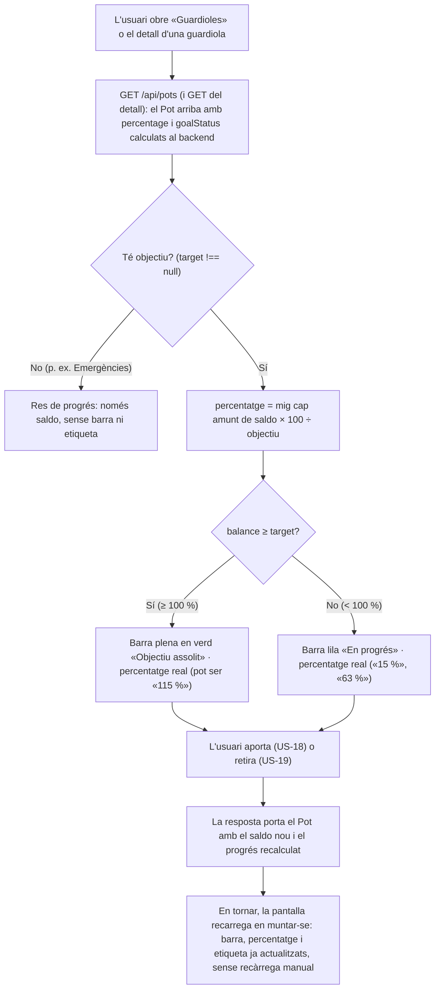

# US-20 · Veure progrés i objectiu assolit

> **Sprint 2 · Bloc Estalvi · 3 punts · 7 h · T20.1–T20.3 · Dependència: T19.1 (el contracte del percentatge i de l'estat, de la US-19, que també cobreix aquesta història) i US-19 (la retirada, per al flux «després de retirar») · Estat: especificació**

> Convencions d'aquest document: tot el que no existeix al repositori es marca **`a crear`**; tota decisió que el PO encara no ha confirmat es marca **[PROPOSTA — pendent de validar]**. Els textos entre «» són literals i es copien tal qual al codi (apòstrof recte `'` dins de les cadenes, com a `frontend/src/models/errorMessages.ts`). Els imports es mostren en format `1.250,50 €` (sortida de `formatCents`, `frontend/src/models/money.ts`), les dates en format `11 d’oct. · 21:15` (`formatDateTime`, `frontend/src/models/date.ts`) i els percentatges en format `15 %` (enter, sense decimals), que seran l'única font de format.

---

## 1. Valor, supòsits i àmbit

### 1.1 Declaració de valor

Targeta a `docs/P1/trello-backlog.md` (línies 526–545), literal:

```
COM: client estàndard amb guardioles amb objectiu
VULL: veure el progrés cap a cada objectiu i saber quan l'he assolit
PER: mantenir la motivació d'estalviar i celebrar les metes.

Perfil: client estàndard amb almenys una guardiola que té objectiu.

Assumptes:
- Sense objectiu no hi ha barra de progrés
- Progrés = saldo / objectiu, en percentatge arrodonit a l'enter
- Quan el saldo arriba a l'objectiu, la guardiola passa a "Objectiu assolit"
- Es connecta amb la gamificació (EP-11 i EP-12)

Estimació: SP 3 · VP 5 · Prioritat Alta
```

Criteris d'acceptació del PO (`docs/P1/trello-backlog.md`, bloc de les línies 551–558), literals:

```
La pantalla d'una guardiola amb objectiu mostra el saldo i l'objectiu (per exemple "120,00 € de 500,00 €"), una barra de progrés i el percentatge
La part plena de la barra, en lila, correspon al percentatge: amb un 24 %, la barra està plena una quarta part aproximadament
Si el saldo és menor que l'objectiu, surt l'etiqueta grisa "En progrés"
Si el saldo arriba o passa l'objectiu, la barra es posa verda i surt l'etiqueta verda "Objectiu assolit"
A la llista de guardioles, cada guardiola amb objectiu té una barra petita sota el nom
Les guardioles sense objectiu no tenen barra, només el saldo
Després d'aportar o retirar, la barra i el percentatge ja surten actualitzats
El percentatge també surt escrit amb números (per exemple "24 %"), no només com a barra
```

El detall complet de la història a `docs/P1/backlog.md` (línies 255–291) afegeix tres regles que el tauler no diu, literals:

> - La guardiola pot tenir objectiu o no; sense objectiu, no es mostra barra de progrés (només saldo)
> - 8. El progrés s'actualitza després d'una aportació (US-18) o retirada (US-19) sense necessitat de re-carregar manualment (o amb refresh explícit acceptable a la demo)
> - 9. **Error / buit:** guardiola sense dades de progrés no mostra barra trencada; mostra saldo correcte

Encàrrec del sprint (`Tasques del Sprint 2 · F3-Evolt.pdf`, bloc «US-20 Veure progrés i objectiu assolit · 3 punts · 7 h», dins del «Bloc Estalvi · 25 h»), literal:

> | Tasca | Fase | Hores | Què cal fer | Fet quan | Responsable |
> |---|---|---|---|---|---|
> | T20.1 Percentatge i estat «Objectiu assolit» a les respostes de guardioles (backend) | G | 2 | Afegir a `Pot` el percentatge arrodonit a l'enter i l'estat quan té objectiu, si el contracte de la T19.1 ho posa al backend. | Els tests cobreixen sense objectiu, saldo igual a l'objectiu i més del 100 %. | |
> | T20.2 Barra de progrés, percentatge i etiqueta al detall i a la llista | G | 4 | Barra lila (verda en arribar), «X € de Y €», el % en números i «En progrés» o «Objectiu assolit»; barra petita a la llista i res sense objectiu. | Vacances mostra «15 %» i «En progrés», i després d'aportar o retirar la barra ja surt actualitzada. | |
> | T20.3 Revisar US-20 | R | 1 | Executar les proves d'acceptació i revisar les PR de la US-20. | Les proves passen i el PO l'accepta al navegador. | |

Nota d'àmbit del bloc, literal:

> Revisa la parella de Pagaments. La US-15 hi és com a proposta, perquè aquest bloc té marge.

Valor entregat, mesurable:

1. Cada guardiola amb objectiu mostra a la llista i al detall quant en falta: «150,00 € de 1.000,00 €», una barra al 15 % i el número «15 %».
2. L'estat és sempre un dels dos: «En progrés» (saldo menor que l'objectiu) o «Objectiu assolit» (saldo igual o superior), mai cap altre ni cap barra trencada.
3. Un objectiu superat se celebra amb la barra i l'etiqueta en verd, i el percentatge mostra el valor real (pot ser més del 100 %).
4. Després d'aportar (US-18) o retirar (US-19), la barra i el percentatge surten ja actualitzats sense cap acció de la persona.
5. Les guardioles sense objectiu no canvien res: només saldo, com avui.

### 1.2 Supòsits

| # | Supòsit | Font |
|---|---|---|
| S1 | L'usuari surt del token de sessió (`Authorization: Bearer`); cap petició envia `X-User-Id`. | `docs/api.md` §2 i §8.2; comentari de capçalera de `frontend/src/services/apiClient.ts` |
| S2 | **No hi ha cap pantalla ni ruta nova.** Les dues pantalles d'aquesta història ja existeixen: `/pots` i `/pots/:potId` a `frontend/src/router/index.ts` (línies 28 i 30), totes dues protegides per `frontend/src/router/accessGuard.ts` (cap `meta.public`). | `frontend/src/router/index.ts` |
| S3 | El percentatge i l'estat **es calculen al backend, una sola vegada**, i arriben com a camps de l'objecte `Pot` de totes les respostes de guardioles. El frontend **mai** els recalcula a partir de `balance` i `target` (una regla de negoci, un sol lloc: AGENTS.md §2.6). La condició del PDF («si el contracte de la T19.1 ho posa al backend») es resol aquí a favor del backend, i la T19.1 ha de portar aquest contracte. | T20.1; §7.2 d'aquest document |
| S4 | Un objectiu és sempre un enter de cèntims `> 0`, o `null` si no n'hi ha. Un objectiu de `0` o negatiu **no pot existir mai**: `Pot.__post_init__` ho rebutja («target ha de ser > 0», `backend/app/models/pot.py`, línies 40–44) i `create_pot` retorna `INVALID_TARGET` (`backend/app/services/pot_service.py`, línies 84–85). Per això la divisió del percentatge no pot dividir mai entre zero. | `backend/app/models/pot.py`; `docs/api.md` §9.3 |
| S5 | El percentatge s'arrodoneix **a l'enter, mig cap amunt** (62,5 → 63). El PO diu només «arrodonit a l'enter»; es fixa mig cap amunt perquè sigui decidit i testejable, i perquè el `round()` de Python és bancari (62,5 → 62) i donaria un resultat contrari a la intuïció del PO. **[PROPOSTA — pendent de validar]** | PO (trello, línia 541); §4.2 i §7.2 |
| S6 | El percentatge **pot passar de 100** i es mostra el valor real («115 %»); la barra, visualment, queda sempre plena (no es pinta mai més enllà del 100 %). El PDF demana el cas «més del 100 %» als tests; cap document diu com es pinta la barra, i aquesta és la regla que es proposa. **[PROPOSTA — pendent de validar]** | T20.1 «Fet quan»; §4.2 |
| S7 | Els imports viatgen com a **enters en cèntims** i només es tornen euros a la presentació, amb `formatCents` / `eurosToCents`. | `docs/api.md` §1; `frontend/src/models/money.ts` |
| S8 | Arquitectura MVVM sense Pinia: la vista només llegeix el que li dona el ViewModel; cap crida a `fetch` ni a un servei des d'un `.vue`. | `AGENTS.md` §2.3 |
| S9 | Els mocks estan encesos per defecte (`VITE_USE_MOCKS` absent o `true`) i han de retornar **exactament** la mateixa forma que l'API, camps nous inclosos (Liskov, AGENTS.md §2.7). | `frontend/src/mocks/index.ts`, `frontend/.env.example` |
| S10 | El botó «Retirar» i la pantalla de retirada són de la **US-19** (T19.2/T19.3). Aquesta història només en consumeix la conseqüència: quan es torna del detall, la pantalla ja recarrega sola. | T19.2, T19.3; §3 pas 10 |
| S11 | No hi ha gamificació a l'Sprint 2: la celebració de l'objectiu assolit és **només** la barra verda i l'etiqueta verda «Objectiu assolit». XP, insígnies i notificacions de celebració són EP-11 i EP-12. | Trello, línia 543; `docs/api.md` §9.4 («aportar no dona XP») |
| S12 | El rellotge del backend és `now_madrid()` i les dates ISO 8601 amb el desplaçament de Madrid; no afecta el percentatge, però sí que manté la coherència de l'historial que es compara als criteris. | `backend/app/models/clock.py`; `docs/api.md` §1 |
| S13 | Les tres guardioles del seed no canvien de nom, saldo, objectiu ni color (`pot-01` Vacances 150,00 € / 1.000,00 € `blue`; `pot-02` Emergències 100,00 € / — `orange`; `pot-03` Regal d'aniversari 50,00 € / 80,00 € `pink`), perquè en depenen els tests i els exemples d'aquest document. | `docs/api.md` §9.8; `docs/proves-estalvi.md` «Dades de partida»; `frontend/src/mocks/seed.ts`, línies 61–69 |

### 1.3 Fora de l'abast i contradiccions resolgudes

**Tres contradiccions o buits dels documents, resolts aquí (decidits, no oberts):**

1. **El verd contra la guia d'estil.** T20.2 diu «Barra lila (verda en arribar)» i el criteri del PO (línia 554) «la barra es posa verda i surt l'etiqueta verda "Objectiu assolit"». Però `docs/api.md` §9.1 (P22) diu: «No hi ha verd ni vermell: la guia d'estil els reserva per als ingressos, les despeses i els errors», i la llista tancada de colors de guardiola no té verd. Conciliació (mateix patró que US-15, §4.3): la llista tancada de colors **no canvia** — el verd no és un color de guardiola triable, és el color de **l'estat de progrés** demanat explícitament pel PO, i es fa servir el token d'ingrés `#16a34a` per a la barra i un verd fosc `#166534` sobre fons tenyit per al text de l'etiqueta (6,4:1 de contrast; el token `#16a34a` com a text només dona 3,3:1 i no arriba al 4,5:1). **[PROPOSTA — pendent de validar amb el PO]**, com al precedent de «Pagada» de la US-15.
2. **El nombre i la barra divergeixen per sobre del 100 %.** El PO demana «arrodonit a l'enter» i «més del 100 %» als tests (T20.1), però cap document diu si una barra al 115 % s'engreixa o es talla. Regla fixada aquí: **el percentatge escrit sempre mostra el valor real** (per exemple «125 %», i el mateix val per a l'etiqueta d'estat), **la barra es pinta plena** (el farciment no passa mai del 100 % de l'ample de la pista). **[PROPOSTA — pendent de validar]**
3. **La celebració.** `docs/P1/backlog.md`, criteri 5, diu «badge o text destacat +, si hi ha gamificació preparada, notificació/celebració». La gamificació no és a l'Sprint 2 (S11): la celebració de la demo és l'etiqueta verda «Objectiu assolit» amb la barra verda. Cap missatge d'enhorabona, cap modal, cap notificació. La US-25 va fixar el mateix criteri per als èxits de pantalla: targeta informativa, sense soroll.

Fora de l'abast d'aquesta US, explícitament:

| Fora de l'abast | Per què | Qui ho porta |
|---|---|---|
| Crear o editar l'objectiu d'una guardiola | Ja existeix: `POST /api/pots` amb `target` (US-17, §9.3); editar no és a cap criteri | US-17 / fora de l'abast de l'Sprint 2 |
| La pantalla i la ruta de retirada, i el botó «Retirar» del detall | És la US-19 (T19.2/T19.3) | US-19 |
| XP, insígnies, reptes o notificació de celebració | Gamificació EP-11 i EP-12 | Fora de l'abast de l'Sprint 2 |
| Tancar una guardiola i passar els diners al saldo quan s'assoleix l'objectiu | Ho menciona `docs/P1/Team Specification.md` (línia 208), però no és a cap criteri del PO de l'Sprint 2 | Fora de l'abast |
| Calcular el percentatge al frontend des de `balance` / `target` | Seria la mateixa regla en dos llocs (AGENTS.md §2.6) i contra S3; el PDF la posa al backend | — |
| Pantalla, ruta o component de navegació nous | Els criteris només parlen del detall i de la llista, que ja existeixen | — |
| Paginació, cerca o filtres a la llista de guardioles | A la demo un usuari té poques guardioles (§9.2) | — |
| Guardioles en altres divises o compartides | EP-06 i EP-09 | Fora de l'abast |

---

## 2. Taula de pantalles

**Aquesta història no crea cap pantalla: edita dues de existents i crea un component.** Comprovat al repositori: no hi ha cap barra de progrés, percentatge ni etiqueta d'estat a `frontend/src/components/` (no hi ha cap `Progress*`), a `PotView.vue` / `PotsView.vue` / `PotRow.vue`, ni al model `Pot` (`frontend/src/models/pot.ts` només té `id`, `name`, `balance`, `target`, `color`). Al backend, `PotResponse` (`backend/app/routers/pots.py`, línies 25–42) té exactament aquests cinc camps, i `docs/api.md` §9.1 els mateixos. Tot el que segueix és nou o és una edició.

| Pantalla | Ruta | Vista Vue (fitxer) | Punt d'entrada | Punt de sortida |
|---|---|---|---|---|
| «Guardioles» (llista) | `/pots` (`name: 'pots'`, `router/index.ts` línia 28) | `frontend/src/views/PotsView.vue` **existent, edició** | Accés «Guardioles» des d'Inici (`HomeView.vue`, línies 53–55); URL directa | «← Inici» de l'`AppShell` (`back`, `AppShell.vue` línia 15); fila de guardiola → `/pots/:potId`; «Crear guardiola» → `/pots/new` |
| «<nom de la guardiola>» (detall) | `/pots/:potId` (`name: 'pot'`, `props: true`, línia 30) | `frontend/src/views/PotView.vue` **existent, edició** | Fila de «Guardioles» (`PotRow.vue`, enllaç a `name: 'pot'`) | «← Guardioles» (`back-link`, línia 24); «Aportar» → `/pots/:potId/contribute` (línies 43–45); botó «Retirar» **`a crear (US-19)`** |
| Barra de progrés (no és una pantalla ni una ruta) | — | `frontend/src/components/PotProgress.vue` **`a crear`**: el primer component de barra del repositori; el fan servir el detall (mida gran) i la llista (mida petita) | Secció resum de `PotView.vue` i fila de `PotRow.vue` | Cap: és informativa, no clicable |

Fitxers de suport (mateixa llista que fan servir §3–§9):

| Fitxer | Capa | Què conté |
|---|---|---|
| `frontend/src/components/PotProgress.vue` **`a crear`** (+ `PotProgress.test.ts`) | View | Barra amb pista, farciment, percentatge i etiqueta d'estat; `props`: `percent` (int, pot ser `> 100`), `status` (`'in_progress' \| 'achieved'`), `compact` (llista); sense objectiu no es munta |
| `frontend/src/models/pot.ts` (edició) | Model | `Pot` / `PotJson` guanyen `percentage` i `goalStatus`; mappers; `GOAL_STATUS_LABELS` («En progrés» / «Objectiu assolit») |
| `frontend/src/models/money.ts` (edició) | Model | `formatPercent(percent: number): string` — enter sense decimals + « %» (l'única font del format «15 %») |
| `frontend/src/views/PotView.vue` (edició) | View | Bloc de progrés a la targeta resum, entre «Objectiu:» i «Aportar» |
| `frontend/src/components/PotRow.vue` (edició) | View | Barra petita i percentatge sota el nom quan `target !== null`; res quan no n'hi ha |
| `frontend/src/viewmodels/usePotViewModel.ts`, `usePotsViewModel.ts` | ViewModel | **Sense canvis de codi**: el `Pot` ja arriba amb els camps nous; només `.test.ts` ampliat per afirmar que els camps arriben i que no es recalculen |
| `frontend/src/mocks/pots.ts` (edició) + `frontend/src/mocks/pots.test.ts` (edició) | Mocks | La mateixa fórmula que el backend, aplicada a `mockPots`, `mockCreatePot` i `mockContribute` (Liskov, S9) |
| `backend/app/models/pot.py` (edició) | Model | `progress_of(pot: Pot) -> tuple[int \| None, str \| None]`: la fórmula, un sol lloc (§7.2) |
| `backend/app/routers/pots.py` (edició) | Router | `PotResponse` amb `percentage` i `goalStatus`; `from_pot` els omple amb `progress_of` |
| `backend/tests/` (edició) | Tests | Tests de T20.1: sense objectiu, saldo igual a l'objectiu i més del 100 % (literal del PDF) |
| `docs/api.md` (edició — **T19.1**) | Contracte | §9.1 amb els dos camps nous; §9.2/§9.3/§9.4 amb els exemples actualitzats |
| `docs/proves-estalvi.md` (edició — **T19.1** i T20.1) | Proves | Secció «US-20 · Progrés i objectiu assolit» amb les taules API i pantalla (com les de US-17/US-18) |

---

## 3. Flux d'interacció

1. L'usuari autenticat toca l'accés «Guardioles» a Inici (`HomeView.vue`, línies 53–55) i arriba a `/pots`. La pantalla arrenca amb `isLoading = true` (valor inicial de `usePotsViewModel`: «Starts true so the empty state never flashes before the first answer») i mostra `LoadingIndicator` amb el text «Carregant…».
2. Arriba `200` amb la llista: es pinta una fila `PotRow` per guardiola, en ordre de creació (la més antiga primer, §9.2). Cada fila amb objectiu mostra, a sota del nom, la barra petita amb el farciment lila i el percentatge en xifres («15 %»); cada fila sense objectiu es queda com avui: només icona, nom, saldo i fletxa.
3. Si no hi ha cap guardiola, es veu `EmptyState` «Encara no tens cap guardiola» amb l'enllaç «Crear guardiola» (comportament existent de `PotsView.vue`, línies 27–30). Si la càrrega falla, `ErrorState` amb el text del codi i «Reintentar» (línies 23–25).
4. Toca la fila de Vacances → `/pots/pot-01`. El detall arrenca amb `isLoading = true` i recarrega sempre en muntar-se (`onMounted(load)`, amb el comentari del codi: «Every visit reloads, so a contribution shows up when coming back from «Aportar»»).
5. El detall mostra la targeta resum: icona de guardiola en el color seu, «Saldo de la guardiola» amb `MoneyAmount`, i, **com que Vacances té objectiu**, el bloc de progrés nou: «150,00 € de 1.000,00 €» (dos `MoneyAmount` units pel literal « de »), la barra amb el farciment lila al 15 %, el percentatge «15 %» en xifres i l'etiqueta «En progrés».
6. Sota el resum, «Historial» amb `MovementRow` per entrada (la més recent primer) o `EmptyState` «Encara no hi has aportat diners» si no en té cap. Aquesta part no canvia.
7. Toca «Aportar» → `/pots/pot-01/contribute` (US-18, pantalla existent). Després de confirmar, la pantalla d'aportar mostra el tic verd «Has aportat 30,00 € a Vacances» i, 1,5 s després, torna amb `router.replace` al detall (`useContributeViewModel.ts`, `CONFIRMATION_MS = 1500` i `goToPot`, línies 11, 100–102, 129).
8. En tornar, `onMounted(load)` recarrega: el detall mostra «180,00 € de 1.000,00 €», la barra al 18 % i «18 %». **Cap recàrrega manual** (criteri 8 del backlog): la recàrrega en muntar-se ja ho garanteix, i la resposta `201` de l'aportació porta el `pot` amb el progrés nou (§7.1).
9. Amb la US-19 fusionada, el mateix passa després de «Retirar»: el detall recarrega i la barra baixa (per exemple 1.150,00 € → 900,00 € de 1.000,00 €: de «Objectiu assolit» i barra verda plena a «90 %» i «En progrés»).
10. Un objectiu assolit es veu així: el saldo arriba o passa l'objectiu → el farciment de la barra passa a verd i queda **plena** (encara que el percentatge sigui «115 %»), i l'etiqueta passa a «Objectiu assolit» en verd. Torna a «En progrés» amb lila si una retirada o un canvi baixen el saldo per sota de l'objectiu.
11. Una guardiola sense objectiu (Emergències) no canvia res: al detall no hi ha ni barra, ni percentatge, ni etiqueta ni la línia «Objectiu:»; només «Saldo de la guardiola», «Aportar» i l'historial (criteri 7 del backlog). A la llista, fila sense barra.
12. Tornada: «← Guardioles» al detall, «← Inici» a la llista. `AppShell` ja ho fa (`back-link` de `PotView.vue` línia 24; `AppShell.vue` línia 15).

Branques, en una taula:

| Branca | Condició | Resultat visible | Estat de les dades |
|---|---|---|---|
| Llista amb guardioles | `200` amb `items` | Files amb saldo; amb objectiu, barra petita + % | Cap canvi (només lectura) |
| Llista buida | `200` amb `{ "items": [] }` | «Encara no tens cap guardiola» + «Crear guardiola» | Cap canvi |
| Detall amb objectiu | `pot.target !== null` | Bloc de progrés complet (§5 C12–C15) | Cap canvi |
| Detall sense objectiu | `pot.target === null` | Només saldo + «Aportar» + historial | Cap canvi |
| Objectiu assolit | `balance ≥ target` | Barra plena verda + «Objectiu assolit» + % real (pot ser `> 100`) | Cap canvi |
| Detall inexistent o d'un altre | `POT_NOT_FOUND` (404) | `ErrorState` «No s'ha trobat la guardiola.» + «Reintentar» (comportament actual, `usePotViewModel.ts` línia 26) | Cap canvi |
| Error de xarxa o del servidor | `4xx` / `5xx` / sense connexió | `ErrorState` amb el text del codi + «Reintentar» | Cap canvi |
| Tornar d'aportar o retirar | `router.replace` al detall | Recarrega sola; barra, % i etiqueta actualitzats | Saldo i historial nous |

---

## 4. Estats

### 4.1 Matriu d'estats de pantalla

**«Guardioles» (`PotsView.vue`)**

| Estat | Quan | Què es veu (component) | Què pot fer l'usuari | Text exacte |
|---|---|---|---|---|
| Carregant | `isLoading === true`, valor inicial del ViewModel (mateix patró que `usePotsViewModel`) | `LoadingIndicator` | Res | «Carregant…» |
| Error | La càrrega ha fallat | `ErrorState` dins d'una `section.card`, amb botó | «Reintentar» (torna a `load()`) | El text del codi (`toUserMessage`), p. ex. «No hi ha connexió amb el servidor. Torna-ho a provar.» |
| Buit | `!isLoading && error === null && pots.length === 0` (`isEmpty`) | `EmptyState` + enllaç estil `.create` | «Crear guardiola» | «Encara no tens cap guardiola» |
| Èxit amb objectiu | Fila amb `pot.target !== null` | `PotRow`: icona, **nom amb barra petita i «15 %» a sota**, saldo (`MoneyAmount`), fletxa | Obrir el detall | «15 %» |
| Èxit sense objectiu | Fila amb `pot.target === null` | `PotRow` com avui: icona, nom, saldo, fletxa; **res de progrés** | Obrir el detall | — |
| Èxit assolit | Fila amb `balance ≥ target` | Barra petita plena i **verda**, % real (pot ser «115 %») | Obrir el detall | «115 %» |

**«<nom de la guardiola>» (`PotView.vue`)**

| Estat | Quan | Què es veu (component) | Què pot fer l'usuari | Text exacte |
|---|---|---|---|---|
| Carregant | `isLoading === true` (valor inicial) | `LoadingIndicator` | Res | «Carregant…» |
| Error | La càrrega ha fallat o la guardiola no és de l'usuari | `ErrorState` dins d'una `section.card` | «Reintentar» | El text del codi; «No s'ha trobat la guardiola.» per a `POT_NOT_FOUND` |
| Èxit amb objectiu, en progrés | `pot.target !== null && balance < target` | Resum + bloc de progrés: «150,00 € de 1.000,00 €», barra lila al 15 %, «15 %», etiqueta «En progrés»; «Aportar»; historial | Aportar; (US-19) Retirar; navegar | §5 |
| Èxit amb objectiu, assolit | `pot.balance ≥ pot.target` | Barra plena i verda, % real («115 %»), etiqueta «Objectiu assolit» | Aportar (permès, §9.4 P30); (US-19) Retirar | §5 |
| Èxit sense objectiu | `pot.target === null` | Resum **sense** línia «Objectiu:» i **sense** bloc de progrés: només saldo, «Aportar» i historial | Aportar | — |
| Confirmació d'aportació | En tornar de `/pots/:potId/contribute` | La pantalla ja recarrega sola (`onMounted(load)`); no hi ha cap targeta extra al detall | Res | «Has aportat 30,00 € a Vacances» (a la pantalla d'aportar, US-18) |

### 4.2 Càlcul del progrés (la fórmula, un sol lloc)

La regla viu **una sola vegada al backend**, a `progress_of(pot)` (`backend/app/models/pot.py`, `a crear`, edició), i el router la crida des de `PotResponse.from_pot` (`backend/app/routers/pots.py`, línies 34–42), de manera que **totes** les respostes amb un `Pot` (llistar, crear, aportar, i la retirada de la US-19 quan existeixi) porten els camps sense repetir la fórmula (AGENTS.md §2.8). Els mocks la repliquen a `frontend/src/mocks/pots.ts` (Liskov, S9). El frontend **mai** la recalcula (S3).

```
percentatge(pot) =   null,                                  si pot.target és null
                     mig_cap_amunt(pot.balance × 100 ÷ pot.target),  en cas contrari

estat(pot) =        null,                     si pot.target és null
                    "achieved",               si pot.balance ≥ pot.target
                    "in_progress",            en cas contrari
```

Mig cap amunt amb enters (el `round()` de Python és bancari i donaria 62 per a 62,5):

```
percentatge = (pot.balance * 200 + pot.target) // (pot.target * 2)
```

Taula d'exemples (totes amb el seed, S13):

| Situació | `balance` (cèntims) | `target` (cèntims) | `percentage` | `goalStatus` | Es veu |
|---|---|---|---|---|---|
| `pot-01` Vacances (seed) | `15000` | `100000` | `15` | `"in_progress"` | «15 %» · «En progrés» · barra lila al 15 % |
| `pot-03` Regal d'aniversari (seed) | `5000` | `8000` | `63` (62,5, mig cap amunt, **[PROPOSTA]**) | `"in_progress"` | «63 %» · «En progrés» |
| Saldo zero | `0` | `8000` | `0` | `"in_progress"` | «0 %» · «En progrés» · barra buida |
| Saldo igual a l'objectiu | `100000` | `100000` | `100` | `"achieved"` | «100 %» · «Objectiu assolit» · barra plena verda |
| Més del 100 % | `125000` | `100000` | `125` | `"achieved"` | «125 %» · «Objectiu assolit» · barra **plena** (no al 125 %) |
| Sense objectiu (`pot-02` Emergències) | `10000` | `null` | `null` | `null` | Res de progrés: només saldo |

Invariants que han de complir els tests (T20.1):

1. `target ≤ 0` és **impossible**: el model ho rebutja (`Pot.__post_init__`) i `create_pot` retorna `INVALID_TARGET` (S4). No hi ha mai divisió entre zero ni cap `NaN`.
2. Sense objectiu, `percentage` i `goalStatus` valen `null` (les claus **sempre hi són**, com `cancelledAt` a la US-15) i el frontend no munta el bloc de progrés.
3. `percentage` és un enter `≥ 0` i **pot ser `> 100`**; no es limita mai a 100.
4. `goalStatus` només pot valer `"in_progress"` o `"achieved"` (o `null`); no hi ha cap tercer estat.
5. El percentatge no es **desa**: es calcula en cada resposta a partir de `balance` i `target`, que són l'única font de veritat. Si el saldo canvia, el percentatge canvia sol.
6. El saldo d'una guardiola és la suma del seu historial (§9.8): per això la coherència entre barra, percentatge i historial dels criteris és automàtica, no una comprovació extra.
7. La pista de la barra (l'ample total) representa sempre el 100 %: el farciment es limita visualment a `100 %` encara que `percentage` sigui més gran (S6). El percentatge **escrit** mai no es limita.

### 4.3 Etiqueta i color per estat

| Estat | Fons de l'etiqueta | Text de l'etiqueta | Contrast text/fons | Farciment de la barra | Contrast del farciment |
|---|---|---|---|---|---|
| «En progrés» | `var(--color-border)` (`#e6ebf4`) | `var(--color-text)` (`#1a2233`) | **13,3:1** ✓ | Lila `var(--color-primary)` (`#4f46e5`) | 5,3:1 sobre la pista `#e6ebf4` ✓ (no text) |
| «Objectiu assolit» | `#e8f6ee` | `#166534` | **6,4:1** ✓ | Verd `var(--color-income)` (`#16a34a`) | 3,3:1 sobre la targeta blanca quan és plena ✓ (no text; ≥ 3:1 de WCAG 1.4.11) |
| Sense objectiu | No hi ha etiqueta ni barra | | | | |

Notes de color que cal no perdre:

- **El verd i la guia d'estil** (contradicció 1 de §1.3): el verd és de l'**estat**, no de la llista tancada de colors de guardiola, que no canvia. La conciliació és **[PROPOSTA — pendent de validar amb el PO]**.
- El text de l'etiqueta «Objectiu assolit» **no** fa servir `var(--color-income)` (`#16a34a`) perquè com a text sobre `#e8f6ee` dona 3,0:1 i sobre blanc 3,3:1: cap dels dos arriba al 4,5:1. Per això escriu `#166534` sobre fons tenyit (6,4:1), el mateix patró que «Pagada» a la US-15 §4.3.
- `var(--color-muted)` (`#6c7a96`) sobre blanc dona **4,3:1 i no arriba al 4,5:1** per a text petit: el percentatge en xifres es pinta amb `var(--color-text)` i `font-weight: 600`, no en gris.
- L'etiqueta **sempre porta el text de l'estat**: el color no és mai l'únic senyal (criteri 10 del backlog). El canvi lila → verd sempre va acompanyat del canvi de text «En progrés» → «Objectiu assolit».
- Els textos de l'estat viuen a `frontend/src/models/pot.ts` (`GOAL_STATUS_LABELS`), no al `.vue`.

---

## 5. Copy exacte

Tot el text que veu la persona, congelat. Qualsevol canvi aquí és un canvi de criteri, no d'estil.

| # | Element | Text exacte | On viu | Quan es veu |
|---|---|---|---|---|
| C1 | Títol de la llista | «Guardioles» | `PotsView.vue`, `<AppShell title="…">` (existent) | Sempre |
| C2 | Enllaç de tornada de la llista | «← Inici» | `AppShell.vue` (`back`, línia 15) | Sempre |
| C3 | Estat buit de la llista | «Encara no tens cap guardiola» | `EmptyState` de `PotsView.vue` (existent) | `isEmpty` |
| C4 | CTA de l'estat buit | «Crear guardiola» | `PotsView.vue` (existent, línies 29 i 38–41) | `isEmpty` i al final de la llista |
| C5 | Títol del detall | El nom de la guardiola, p. ex. «Vacances»; «Guardiola» mentre no hi ha dades | `usePotViewModel.ts`, `title` (existent, línia 15) | Sempre |
| C6 | Enllaç de tornada del detall | «← Guardioles» | `PotView.vue` (existent, línia 24) | Sempre |
| C7 | Etiqueta del saldo | «Saldo de la guardiola» | `PotView.vue` (existent, línia 37) | Sempre |
| C8 | Línia d'objectiu del detall | «Objectiu:» | `PotView.vue` (existent, línia 40) | Només `pot.target !== null` |
| C9 | Import de l'objectiu | `1.000,00 €` (via `MoneyAmount` / `formatCents`) | `PotView.vue` (existent, línies 39–42) | Només amb objectiu |
| C10 | CTA d'aportar | «Aportar» | `PotView.vue` (existent, línies 43–45) | Sempre |
| C11 | Etiqueta de l'historial | «Historial» | `PotView.vue` (existent, línia 49) | Sempre |
| C12 | Historial buit | «Encara no hi has aportat diners» | `EmptyState` de `PotView.vue` (existent, línia 53) | Sense entrades |
| C13 | Progrés «X € de Y €» | «150,00 € de 1.000,00 €» — el literal és només la paraula « de » entre dos `MoneyAmount`; **cap import concatenat a mà** | Bloc de progrés de `PotView.vue` **`a crear`** | Només amb objectiu |
| C14 | Percentatge del detall | «15 %» (enter sense decimals, espai abans de `%`; via `formatPercent` **`a crear`** a `models/money.ts`) | `PotProgress.vue` **`a crear`** | Només amb objectiu; pot ser «125 %» |
| C15 | Etiqueta d'estat, en progrés | «En progrés» | `GOAL_STATUS_LABELS.in_progress` (`models/pot.ts` **`a crear`**; literal del PDF i del PO) | `balance < target` |
| C16 | Etiqueta d'estat, assolit | «Objectiu assolit» | `GOAL_STATUS_LABELS.achieved` **`a crear`** | `balance ≥ target` |
| C17 | Percentatge a la llista | «15 %» (mateix `formatPercent`) | `PotRow.vue` **edició** | Fila amb objectiu |
| C18 | Nom accessible de la barra | «Progrés de Vacances cap a l'objectiu» — format «Progrés de <nom> cap a l'objectiu» | `PotProgress.vue` (`aria-label`) **`a crear`** | Cada barra (detall i llista) |
| C19 | Valor accessible de la barra | «15 % de l'objectiu» — `aria-valuetext` | `PotProgress.vue` **`a crear`** | Cada barra; amb més del 100 %, «125 % de l'objectiu» |
| C20 | Càrrega | «Carregant…» | `LoadingIndicator` (per defecte del component) | `isLoading` |
| C21 | Error de càrrega del detall | «No s'ha trobat la guardiola.» | `MESSAGES.POT_NOT_FOUND` (`errorMessages.ts` línia 19, existent) | `POT_NOT_FOUND` |
| C22 | Error de xarxa o del servidor | «No hi ha connexió amb el servidor. Torna-ho a provar.» / «S'ha produït un error inesperat. Torna-ho a provar més tard.» | `MESSAGES.NETWORK_ERROR` / `MESSAGES.INTERNAL_ERROR` (existents) | La càrrega falla |
| C23 | Botó de reintentar | «Reintentar» | `ErrorState` (per defecte del component) | Hi ha error |

Decisions de copy preses per no inventar res:

- **Cap text nou de celebració** («Enhorabona…»): la celebració és l'etiqueta «Objectiu assolit» i la barra verda (S11). El PO no demana cap missatge més al tauler (§1.3, contradicció 3).
- C13 no és un string format a mà: són dos `MoneyAmount` (`formatCents`) amb la paraula « de » al mig, perquè cada import ja el formata el component (i el mode ocult `••••` de `MoneyAmount` segueix funcionant a cada meitat).
- El percentatge és **text sempre visible** (criteri del PO, línia 558): la barra no substitueix mai el número.
- Cap toast a l'app: el patró d'èxit és `section.card.success` + `role="status"` (US-15 §8) i aquí ni tan sols cal: el canvi es veu a la barra en tornar.

---

## 6. Taula de validacions

Aquesta història **no té cap camp d'entrada**: és de lectura. Per això la taula de validacions és la dels invariants del contracte i dels errors del servidor. Límits, en un sol lloc: la fórmula a `progress_of` (`backend/app/models/pot.py`, `a crear`) i `target > 0` a `Pot.__post_init__` (existent). El backend sempre mana (AGENTS.md §2.6).

| Camp | Regla | Missatge exacte (català) | Quan |
|---|---|---|---|
| `target` | `null` (guardiola sense objectiu) | No n'hi ha: el bloc de progrés no es munta; la pantalla mostra només saldo | **Client**, en muntar (`pot.target === null`); el backend ja envia `percentage: null` i `goalStatus: null` |
| `target` | `≤ 0` | «L'objectiu ha de ser més gran que 0.» | **Servidor** `422 INVALID_TARGET` (existent), només en crear (§9.3); **mai** en llegir: no pot existir una guardiola amb `target ≤ 0` (S4) |
| `percentage` | No és un enter `≥ 0` | No n'hi ha: és impossible per contracte — la fórmula entera de §7.2 no pot produir ni decimals ni negatius amb `balance ≥ 0` i `target > 0`; el client el mostra tal qual | **Client**, amb guard de renderització (`v-if="pot.percentage !== null"`): si el camp falta o no és un número, el bloc no es munta i no hi ha mai `NaN` a la pantalla |
| `percentage` | `> 100` | No n'hi ha: és un valor vàlid; es mostra el real («125 %») i la barra queda plena | **Client**, sempre (S6) |
| `goalStatus` | Valor fora de `"in_progress"` \| `"achieved"` \| `null` | No n'hi ha: sense etiqueta (el color no pot arribar sol a la pantalla) | **Client**, guard de renderització (mateix patró que `isPotColor`, que retorna el color per defecte amb un valor desconegut) |
| Guardiola | No existeix o és d'un altre usuari | «No s'ha trobat la guardiola.» | **Servidor** `404 POT_NOT_FOUND` (existent, §9.7); la pantalla ja ho tracta (`usePotViewModel.ts` línia 26) |
| Sessió | Token absent, desconegut o caducat | «Cal iniciar sessió.» / «La sessió s'ha tancat per inactivitat.» | **Servidor** `401 UNAUTHENTICATED` / `SESSION_EXPIRED`; redirecció a `login` per `onSessionEnded` (`router/index.ts` línies 46–48, existent) |

Notes:

- **Ordre de lectura del client**: cap validació d'entrada, perquè no hi ha entrada. Els únics guards són els de renderització de la taula de dalt, i el seu efecte és «no muntar el bloc», mai «mostrar un error».
- Els missatges del servidor són orientatius (`docs/api.md` §5); el text que veu la persona surt sempre de `frontend/src/models/errorMessages.ts` a partir del `code`.
- Cap codi d'error nou (§7.3): el 404 i el 500 ja existeixen i ja estan als tres llocs (backend, `API_ERROR_CODES`, `MESSAGES`).

---

## 7. Integració amb l'API

**Cap ruta nova.** El que canvia és l'objecte `Pot` de `docs/api.md` §9.1, que guanya dos camps derivats. La decisió de contracte és de la **T19.1** (que cobreix US-19 i US-20, literal del PDF: «Secció de docs/api.md per a la retirada i per al percentatge i l'estat de les guardioles»), i la implementació backend és la **T20.1** («si el contracte de la T19.1 ho posa al backend»). Proposta de secció per a `docs/api.md`: ampliar **§9.1** amb els dos camps, amb una proposta numerada a continuació de l'última acceptada (P46; el número exacte el fixa la T19.1 en coordinació amb la US-19, **P57+ a confirmar (P53–P56 són de la US-19)**).

Endpoints que consumeix aquesta història (tots reals, de `backend/app/routers/pots.py` i `docs/api.md` §9):

| Mètode i ruta | Èxit | Estat | Història |
|---|---|---|---|
| `GET /api/pots` | `200` | Existent (`pots.py` línies 124–129; `docs/api.md` §9.2). El cos guanya els camps nous a cada `Pot` | US-20 · §7.1 |
| `POST /api/pots` | `201` | Existent (§9.3). L'objecte retornat també porta els camps nous: `percentage: 0` i `goalStatus: "in_progress"` si neix amb `target`, `null` i `null` si no | US-17 |
| `POST /api/pots/{potId}/contributions` | `201` | Existent (§9.4). El `pot` de la resposta porta el progrés **ja actualitzat** amb el saldo nou | US-18 · US-20 |
| `GET /api/pots/{potId}/movements` | `200` | Existent (§9.5). Sense canvis | US-18 |
| Retirada (proposta de la US-19: `POST /api/pots/{potId}/withdrawals`) | `201` | **`a crear (US-19)`**, T19.2. El seu `pot` de resposta també ha de portar els camps nous | US-19 |

Totes són **rutes protegides** i resolen l'usuari de la sessió (`docs/api.md` §8.2). Segueixen les convencions de §1: claus en camelCase, imports en cèntims enters i dates ISO 8601 amb el desplaçament de Madrid.

### 7.1 Els camps nous de `Pot`  (a crear — T19.1 contracte, T20.1 backend)

Dos camps derivats, calculats **en cada resposta** a partir de `balance` i `target` (§7.2); no s'emmagatzemen mai. Les claus **sempre hi són**, fins i tot quan valen `null` (mateix patró que `counterparty` i `cancelledAt`).

| Camp | Tipus | Notes |
|---|---|---|
| `percentage` | integer \| `null` | Percentatge arrodonit a l'enter, **mig cap amunt** (S5). `null` quan no hi ha objectiu. Pot ser `> 100` (mai no es limita). |
| `goalStatus` | `"in_progress"` \| `"achieved"` \| `null` | `"achieved"` quan `balance ≥ target`; `"in_progress"` quan `balance < target`; `null` sense objectiu. |

**Per què aquests noms** **[PROPOSTA — pendent de validar]**: `percentage` és el terme del PO («el percentatge arrodonit a l'enter»); s'evita `status` sol perquè `Movement.status` ja significa una altra cosa (`"completed"` / `"pending"`, §3) i `goalStatus` lliga l'estat a l'objectiu. Els valors JSON són en anglès minúscula, com tots els enums del contracte (`income`/`expense`, `completed`/`pending`); l'etiqueta catalana la posa el frontend (`GOAL_STATUS_LABELS`), igual que `Movement.status` es pinta «Completat»/«Pendent».

**Resposta `200` de `GET /api/pots`** amb el seed (les tres guardioles de §9.8, camps nous marcats):

```json
{
  "items": [
    {
      "id": "pot-01",
      "name": "Vacances",
      "balance": 15000,
      "target": 100000,
      "color": "blue",
      "percentage": 15,
      "goalStatus": "in_progress"
    },
    {
      "id": "pot-02",
      "name": "Emergències",
      "balance": 10000,
      "target": null,
      "color": "orange",
      "percentage": null,
      "goalStatus": null
    },
    {
      "id": "pot-03",
      "name": "Regal d'aniversari",
      "balance": 5000,
      "target": 8000,
      "color": "pink",
      "percentage": 63,
      "goalStatus": "in_progress"
    }
  ]
}
```

- `pot-03`: `5000 × 100 ÷ 8000 = 62,5` → **63** amb mig cap amunt (**[PROPOSTA]**, S5). Amb el `round()` de Python, bancari, seria 62: per això la fórmula entera de §7.2 és part del contracte, no un detall d'implementació.
- `pot-02`: sense objectiu, els dos camps valen `null` (les claus hi són).

**Resposta `201` de `POST /api/pots/{potId}/contributions`** (aportació de 1.000,00 € a Vacances ja amb 150,00 €, exemple de §9.4 adaptat; saldo anterior: `379521`, menys `100000`):

```json
{
  "balance": 279521,
  "pot": {
    "id": "pot-01",
    "name": "Vacances",
    "balance": 115000,
    "target": 100000,
    "color": "blue",
    "percentage": 115,
    "goalStatus": "achieved"
  },
  "movement": {
    "id": "mov-31",
    "amount": 100000,
    "concept": "Aportació a Vacances",
    "date": "2026-11-03T10:00:00+01:00",
    "type": "expense",
    "icon": "savings",
    "counterparty": null,
    "status": "completed",
    "reference": "EVT-000031"
  }
}
```

- El `pot` de la resposta porta el progrés **del saldo nou** (115000 → «115 %», «Objectiu assolit», barra plena): amb aquesta resposta la pantalla d'aportar podria actualitzar la barra sense tornar a demanar res, i el detall, en tornar, recarrega (§3 pas 8).
- Es pot aportar a una guardiola que ja ha arribat a l'objectiu, o que el passaria (§9.4, P30): per això `percentage > 100` és un valor normal i testejat (T20.1, «més del 100 %»).

### 7.2 On es calcula (backend, un sol lloc; mocks que repliquen)

**Backend.** La funció única és a `backend/app/models/pot.py` (edició) — al costat de `Pot`, sense dependències de FastAPI (capa model):

```python
# backend/app/models/pot.py  (a crear, edició — T20.1)
GOAL_STATUS_IN_PROGRESS = "in_progress"
GOAL_STATUS_ACHIEVED = "achieved"

def progress_of(pot: Pot) -> tuple[int | None, str | None]:
    """Percentatge (enter, mig cap amunt) i estat de l'objectiu (US-20, T20.1).

    Sense objectiu els dos valen None; amb objectiu el percentatge pot passar
    de 100 (el mostra el frontend; la barra queda plena).
    """
    if pot.target is None:
        return (None, None)
    # Mig cap amunt amb enters: round() de Python és bancari (62,5 → 62).
    percentage = (pot.balance * 200 + pot.target) // (pot.target * 2)
    status = GOAL_STATUS_ACHIEVED if pot.balance >= pot.target else GOAL_STATUS_IN_PROGRESS
    return (percentage, status)
```

`PotResponse.from_pot` (`backend/app/routers/pots.py`, línies 34–42) afegeix `percentage=…, goalStatus=…` des d'aquesta funció. Cap servei ni repositori no la crida: el càlcul és derivat i de lectura, no té efectes secundaris ni cal atòmicament.

**Frontend.** `fromApiPot` (`frontend/src/models/pot.ts`, línies 99–107) mapa els dos camps nous; el ViewModel i la vista **no** recalculen res (S3):

```ts
// frontend/src/models/pot.ts  (a crear, edició)
export type GoalStatus = 'in_progress' | 'achieved'
export const GOAL_STATUS_LABELS: Record<GoalStatus, string> = {
  in_progress: 'En progrés',
  achieved: 'Objectiu assolit',
}
```

**Mocks.** `frontend/src/mocks/pots.ts` (edició) aplica la mateixa fórmula en retornar: a `mockPots` (línia 56), a `mockCreatePot` (línia 70) i a `mockContribute` (línia 137, el `pot` de la resposta). Com que el backend calcula en llegir i els mocks guarden `PotJson` sencera, la manera més senzilla i fidel és calcular els dos camps al punt de retorn, no en desar. `frontend/src/mocks/pots.test.ts` (edició) ha d'afirmar els tres casos del PDF: sense objectiu, saldo igual a l'objectiu i més del 100 %.

**Què no cal fer:** no s'afegeix cap camp a la base de dades ni a Firestore (col·lecció `pots` de §9.8): els documents guarden `balance` i `target` i res més; el percentatge no és desat ni a memòria ni a Firestore.

### 7.3 Errors i reacció de la UI

**Cap codi d'error nou.** Aquesta història no afegeix petició, paràmetre ni validació d'entrada; els codis que pot veure són els de lectura de guardioles (taula de §5 de `docs/api.md`, bloc «Codis de l'estalvi», i §9.7 (avui; passa a §9.8 amb la nova §9.6)). El cos d'error és sempre `{ code, message, details? }` (§5): el frontend decideix a partir del `code`, **mai** del `message`.

| `code` | HTTP | Ruta | Quan | Reacció de la UI |
|---|---|---|---|---|
| `POT_NOT_FOUND` | 404 (existent) | `GET /api/pots/{potId}/movements` (i la retirada de la US-19) | La guardiola no existeix o és d'un altre usuari | `ErrorState` amb «No s'ha trobat la guardiola.» + «Reintentar» (comportament actual de `usePotViewModel.ts` línia 26; sense redirecció) |
| `NETWORK_ERROR` | — | Qualsevol | No hi ha connexió amb el servidor | `ErrorState` amb «No hi ha connexió amb el servidor. Torna-ho a provar.» + «Reintentar» |
| `INTERNAL_ERROR` | 500 | Qualsevol | Error inesperat (inclosa la simulació T08.2) | `ErrorState` amb «S'ha produït un error inesperat. Torna-ho a provar més tard.» + «Reintentar» |
| `UNAUTHENTICATED` / `SESSION_EXPIRED` | 401 | Qualsevol | Sessió absent o tancada per inactivitat (5 min) | Redirecció a `login` (`onSessionEnded`, `router/index.ts` línies 46–48, existent) |

Notes:

- A la llista, `GET /api/pots` no té cap error de negoci possible: o `200` amb `{ items }` (potser buit), o error de transport/500. Per això l'estat d'error de `PotsView.vue` és genèric (§4.1).
- El detall llegeix dues coses amb `Promise.all` (`usePotViewModel.ts` línies 22–24): `getPots()` i `getPotMovements(potId)`. Si la segona respon `POT_NOT_FOUND`, el missatge és el de C21; si la primera falla, el de C22. Comportament existent, sense canvis.
- **El 404 mai no distingeix** «no existeix» de «no és teva» (§9.4, P33): cap pantalla no en diu res més.

---

## 8. Taula acció → reacció immediata → resposta del servidor → toast/redirecció

| Acció | Reacció a la pantalla | Crida API | Resposta èxit | Resposta error (missatge/toast/redirecció) |
|---|---|---|---|---|
| Obrir «Guardioles» des d'Inici | `isLoading = true` (valor inicial) → `LoadingIndicator` «Carregant…» | `GET /api/pots` | `200 { items }` → files amb saldo; amb objectiu, barra petita + «15 %»; sense objectiu, fila com avui; si és buit, `EmptyState` «Encara no tens cap guardiola» + «Crear guardiola» | `ErrorState` amb el text del codi + «Reintentar». **Sense redirecció** |
| Tocar la fila d'una guardiola amb objectiu | Navegació immediata a `/pots/:potId` (enllaç de tota la fila, `PotRow.vue`) | (la càrrega la fa el detall) | `200 { items }` + `200 { items }` (historial) → bloc de progrés complet | `ErrorState` «No s'ha trobat la guardiola.» (404) o el text del codi + «Reintentar». **Sense redirecció** |
| Tocar la fila d'una guardiola sense objectiu | El mateix, però el detall surt sense bloc de progrés | Ídem | Ídem, amb `percentage: null` | Ídem |
| Tornar del detall a la llista («← Guardioles») | Navegació; la llista recarrega sola en muntar-se (`onMounted(load)`) | `GET /api/pots` | `200` → la barra petita ja surt amb el saldo actual | `ErrorState` + «Reintentar». **Sense redirecció** |
| «Aportar» des del detall | Navegació a `/pots/:potId/contribute` (pantalla de la US-18, existent) | `POST /api/pots/{potId}/contributions` (la fa la US-18) | `201` → tic verd «Has aportat 30,00 € a Vacances» i, 1,5 s després, `router.replace` al detall; en muntar-se, recarrega i la barra surt al 18 % | Els errors els mostra la pantalla d'aportar (US-18); el detall no canvia |
| (US-19) «Retirar» des del detall | Navegació a la pantalla de retirada **`a crear (US-19)`** | La retirada (US-19) | En tornar, el detall recarrega: saldo, barra, percentatge i etiqueta actualitzats (p. ex. «90 %» i «En progrés» després de retirar) | Els errors els mostra la pantalla de retirada (US-19) |
| Recarregar la pàgina (F5) a qualsevol de les dues pantalles | El mateix que obrir-la: càrrega inicial | La mateixa de la pantalla | El mateix resultat; barra, percentatge i etiqueta coherents amb l'historial | `ErrorState` + «Reintentar». **Sense redirecció** |
| «Reintentar» (llista o detall) | Torna a l'estat `Carregant` i repeteix **exactament** la mateixa crida | La mateixa d'abans | Es pinta el resultat | Si torna a fallar, el mateix missatge; no s'acumulen |

Notes:

- No hi ha **cap toast** a l'app: l'èxit es veu a la barra i el fracàs amb `ErrorState`. La columna «toast» d'aquesta taula sempre val «no».
- No hi ha **cap redirecció pròpia** d'aquesta història: les úniques navegacions són les que ja fan la llista, el detall i l'`AppShell`, i la tornada automàtica de «Aportar» (US-18, `router.replace`).
- Cap acció d'aquesta història **escriu** res: totes les crides són de lectura, excepte les que fan les pantalles d'aportar (US-18) i retirar (US-19).

---

## 9. Requisits no funcionals

**Accessibilitat**

- **La barra és un `role="progressbar"`**, amb `aria-valuemin="0"`, `aria-valuemax="100"` i `aria-valuenow` amb el percentatge **limitat a 100** quan el valor real el passa (el rang del rol és 0–100; el valor real surt al text visible i a `aria-valuetext`). `aria-valuetext="15 % de l'objectiu"` (C19) i `aria-label="Progrés de Vacances cap a l'objectiu"` (C18). Sense objectiu, el component no es munta: no hi ha cap `progressbar` fantasma.
- **El percentatge és text sempre visible** (criteri del PO, línia 558; criteri 10 del backlog): la barra i el color mai no són l'única informació. L'etiqueta d'estat també porta text («En progrés» / «Objectiu assolit»); quan canvia el color, canvia el text.
- Les barres **no són focusables ni interactives**: són informatives, i l'ordre de lectura del detall és saldo → progrés → botó «Aportar» → historial. Les files segueixen sent un sol enllaç complet (`PotRow.vue`, `<router-link>` que envolta tota la fila).
- Els imports manten els atributs del mode ocult: `MoneyAmount` amb `hidden` mostra `••••` amb `role="img"` i `aria-label="Import ocult"` (`MoneyAmount.vue`, línia 21); cada meitat de C13 el conserva.
- Icones decoratives (`PiggyBank`, `ChevronRight`) amb `aria-hidden="true"` (com ara, `PotRow.vue`).
- Res de text nou amb contrast insuficient: vegeu la taula de §4.3; el percentatge va en `var(--color-text)` (`#1a2233` sobre blanc, **15,9:1**), mai en `var(--color-muted)` (4,3:1, per sota del 4,5:1 demanat).

**Contrast (valors calculats amb la fórmula WCAG 2.x sobre els tokens de `frontend/src/style.css`, línies 1–19)**

| Parella | Contrast | Ús |
|---|---|---|
| Blanc sobre lila `#4f46e5` | 6,3:1 | (referència del botó «Aportar», no canvia) |
| `#1a2233` sobre `#e6ebf4` | 13,3:1 | Text de l'etiqueta «En progrés» ✓ |
| `#166534` sobre `#e8f6ee` | 6,4:1 | Text de l'etiqueta «Objectiu assolit» ✓ |
| Lila `#4f46e5` sobre pista `#e6ebf4` | 5,3:1 | Farciment de la barra en progrés ✓ (no text, ≥ 3:1) |
| Verd `#16a34a` sobre blanc | 3,3:1 | Farciment de la barra assolida (plena) ✓ (no text, ≥ 3:1) |
| Verd `#16a34a` sobre pista `#e6ebf4` | 2,8:1 | **No arriba a 3:1**: per això el farciment verd només es fa servir **plena** (al 100 % no hi ha vora fill/pista visible i el contrast que compta és contra la targeta blanca, 3,3:1) |
| `var(--color-muted)` `#6c7a96` sobre blanc | 4,3:1 | **Insuficient per a text petit**: el percentatge no va en gris |

**Mida i tacte**

- Cap element interactiu nou: les barres no es toquen. Les files segueixen complint l'objectiu tàctil de 44 × 44 px (la fila de `PotRow` fa ~60 px amb l'alta de la icona de 2,5 rem més el `padding` de `0.625rem`); «Aportar» i «Crear guardiola» no canvien.
- La barra petita de la llista té una altra zona de toc **reservada**: l'amplada mínima de la pista és 4 px d'alçada visual dins d'una fila de ~60 px; no és clicable i no roba el toc a l'enllaç de la fila.

**Responsive**

- Base **390 px** d'ample (iPhone 12/13/14). Cap element tallat ni scroll horitzontal: a `PotRow.vue` el nom ja té `min-width: 0` amb el·lipsi (`overflow: hidden; text-overflow: ellipsis`, línies 58–64) i la barra petita viu **dins de la columna del nom** (nom i barra en columna, amb `min-width: 0` a la columna), per no retallar el saldo ni la fletxa.
- Al detall, la barra ocupa tot l'ample de la targeta (`max-width` de l'`AppShell`, 48 rem) i els tres elements («X € de Y €», barra, «15 %» + etiqueta) s'apilen en columna; amb text llarg, «1.250,50 € de 1.000.000,00 €» no desborda (`white-space: nowrap` de `MoneyAmount` + `flex-wrap` del bloc si cal).
- L'etiqueta d'estat és una píndola curta (`.75rem` de font, `padding` reduït): mai no força la fila a dues línies a 390 px.

**Rendiment i xarxa**

- **Cap crida nova**: la llista fa la seva única `GET /api/pots` i el detall les seves dues de sempre amb `Promise.all` (`usePotViewModel.ts` línies 22–24). El percentatge arriba dins del `Pot` que ja viatja.
- El càlcul és O(1) per guardiola i es fa al servidor; el frontend només pinta.
- Cap `setTimeout`, cap interval, cap sondeig: l'actualització després d'aportar o retirar ve de la recàrrega en muntar-se (`onMounted(load)`), que ja existeix.
- Cap crida des d'un `.vue`: només des del ViewModel, a través del servei i de `apiClient` (AGENTS.md §2.3).

**Idioma i format**

- Tot el text en català; imports `1.250,50 €` (via `formatCents`), percentatge `15 %` (via `formatPercent`, enter sense decimals i espai abans de `%`, com els exemples «24 %» i «15 %» del PO), dates `11 d’oct. · 21:15` (via `formatDateTime` a l'historial, que no canvia). Cap text concatenat a mà al `.vue` (C13 són dos `MoneyAmount` + « de »; C14/C17 venen de `formatPercent`).

**Seguretat i privacitat**

- El percentatge és una dada derivada dels camps que ja viatgen (`balance`, `target`): no en filtra ni en destapa cap de nova; ningú no pot veure el progrés de les guardioles d'un altre (`POT_NOT_FOUND` sense distingir el motiu).
- No s'hi desa res: ni percentatge ni estat, ni a memòria ni a Firestore (§7.2).

**Proves**

- Backend (T20.1): sense objectiu (`null`, `null`), saldo zero, saldo igual a l'objectiu (`100`, `achieved`), **més del 100 %** (`125`, `achieved`), i l'arrodoniment mig cap amunt amb el cas límit del seed (`pot-03`: 62,5 → 63). Que cap resposta desa ni altera `balance`/`target`.
- Mocks (T20.2): `pots.test.ts` amb els mateixos tres casos del PDF, perquè la demo amb `VITE_USE_MOCKS` es comporti igual que el backend.
- ViewModels: `usePotViewModel.test.ts` i `usePotsViewModel.test.ts` (edició) afirmen que els camps nous arriben a la vista sense recàlcul; `PotProgress.test.ts` `a crear` (barra plena amb `> 100`, `aria-*` correctes, no muntada sense objectiu).
- Cap prova ha de dependre del rellotge real: el percentatge no depèn del temps, i les dates de l'historial ja s'injecten (`now` del servei).

---

## 10. Criteris d'acceptació

Estil escollit: Gherkin en català amb `Donat` / `Quan` / `Cal que` / `I Cal que`, i un sol `Feature:`. **N'hi ha exactament tres.**

```gherkin
Feature: Veure el progrés i l'objectiu assolit d'una guardiola

  Escenari: AC1 · Progrés de punta a punta amb les guardioles del seed
    Donat que estic autenticat com a Usuari 1 i que Vacances té 150,00 € d'un objectiu d'1.000,00 €
    Quan obro «Guardioles» i entro al detall de Vacances
    Cal que la llista mostra la barra petita i «15 %» a sota del nom de Vacances, i que Emergències (sense objectiu) no mostra cap barra
    I Cal que el detall mostra «150,00 € de 1.000,00 €», una barra plena al 15 %, «15 %» i l'etiqueta «En progrés»
    I Cal que, després d'aportar 30,00 € des de «Aportar» i tornar al detall, surt «180,00 € de 1.000,00 €», «18 %» i la barra al 18 %, sense cap recàrrega manual

  Escenari: AC2 · Invariants del percentatge
    Donat que el percentatge es calcula sempre com a saldo × 100 ÷ objectiu, arrodonit a l'enter (mig cap amunt), al backend
    Quan miro Regal d'aniversari (50,00 € de 80,00 €) i, després d'aportar 1.000,00 € a Vacances, aquesta queda en 1.150,00 € d'un objectiu d'1.000,00 €
    Cal que Regal d'aniversari mostra «63 %» (62,5 arrodonit mig cap amunt)
    I Cal que a Vacances goalStatus val achieved, el percentatge és «115 %» i l'etiqueta és «Objectiu assolit», sense cap error, NaN ni barra trencada
    I Cal que Emergències no mostra barra, percentatge ni etiqueta, perquè un objectiu de 0 o negatiu és impossible (el contracte el rebutja amb INVALID_TARGET) i sense objectiu els camps percentage i goalStatus valen null

  Escenari: AC3 · Consistència després d'un moviment i després de recarregar
    Donat que Vacances té 1.150,00 € d'1.000,00 € amb l'etiqueta «Objectiu assolit»
    Quan li retiro 250,00 € amb la US-19, torno al detall, recarrego la pàgina i torno a obrir «Guardioles»
    Cal que el saldo (900,00 €), la barra, el percentatge («90 %»), l'etiqueta («En progrés») i l'historial, amb l'entrada «Retirada» de −250,00 €, coincideixen al detall i a la llista, abans i després de la recàrrega
    I Cal que el saldo del compte principal ha pujat exactament 250,00 € i que la suma del saldo i de les guardioles no ha canviat
    I Cal que Emergències (sense objectiu) continua mostrant només el seu saldo, sense barra, després de la recàrrega
```

Correspondència amb els criteris del PO (§1.1):

| Criteri del PO | On es verifica |
|---|---|
| Saldo + objectiu («120,00 € de 500,00 €»), barra i percentatge al detall | AC1 (i §5 C13–C14) |
| La part plena lila correspon al percentatge | AC1 (barra al 15 %) i AC2 (plena verda amb 115 %) |
| «En progrés» si el saldo és menor que l'objectiu | AC1 i AC3 |
| «Objectiu assolit» amb barra verda si arriba o passa | AC2 |
| Barra petita a la llista per a les amb objectiu | AC1 i AC3 |
| Sense objectiu, només saldo (detall i llista) | AC1, AC2 i AC3 |
| Actualització després d'aportar o retirar, sense recarregar manualment | AC1 (aportar) i AC3 (retirar + recàrrega) |
| Percentatge escrit amb números, no només barra | AC1, AC2 i AC3 («15 %», «63 %», «115 %», «90 %») |
| Arrodonit a l'enter | AC2 (62,5 → 63) |

No es fan servir com a criteri d'acceptació afirmacions basades només en l'aparença d'un element, en l'aparició d'un avís o en la coincidència literal del text amb la maqueta. El color, el text i el copy es fixen a §4.3 i §5, no a l'AC; els ACs diuen sempre **el valor** que es veu (saldo, percentatge, estat), que és el que el PO pot comprovar al navegador.

---

## 11. Maquetes

Fitxers previstos per a aquesta història (si ja existeixen al repositori, aquest apartat en fixa el contingut i no cal tornar-los a crear):

| Fitxer HTML | Imatge | Què mostra |
|---|---|---|
| `docs/us/_mockup/src/US-20-detall-guardiola-progres.html` | `docs/us/img/US-20-detall-guardiola-progres.png` | **Pantalla principal.** El detall de «Vacances» amb el saldo «150,00 €», «150,00 € de 1.000,00 €», la barra lila plena al 15 %, el «15 %» en xifres i l'etiqueta «En progrés»; sota, «Aportar» i l'historial amb «Saldo inicial» (4 d'oct. · 10:00) |
| `docs/us/_mockup/src/US-20-llista-guardioles-progres.html` | `docs/us/img/US-20-llista-guardioles-progres.png` | **Pantalla secundària (llista).** La llista «Guardioles» amb les tres files del seed: Vacances i Regal d'aniversari amb la barra petita i el percentatge sota el nom (15 % i 63 %, **sense etiqueta d'estat**: a la llista la fila és només barra petita + %), i Emergències sense cap barra, només el saldo |
| `docs/us/_mockup/src/US-20-objectiu-assolit.html` | `docs/us/img/US-20-objectiu-assolit.png` | **Estat d'èxit.** El detall de «Vacances» amb l'objectiu assolit: saldo «1.150,00 €», «1.150,00 € de 1.000,00 €», barra **plena** (100 % visual, limitat encara que el percentatge real sigui més gran) en verd `#16a34a`, «115 %» en xifres i etiqueta verda «Objectiu assolit» (`#166534` sobre `#e8f6ee`, §4.3): el cas «més del 100 %» de T20.1/T20.2 |

Diagrama de flux de la història (la fórmula de §4.2, un sol lloc al backend):



Com es fan:

- **HTML estàtic, només visual.** Cap JavaScript, cap crida a l'API, cap estat: són una imatge navegable per acordar la pantalla amb el PO.
- **390 × 844**, renderitzat a **2x** (PNG de 780 × 1688) perquè el text es llegeixi a la revisió. Comanda (Playwright no és disponible; el renderitzador del projecte és Helium):

```bash
/opt/helium-0.15.5.1-x86_64_linux/helium --headless=new --disable-gpu --hide-scrollbars \
  --force-device-scale-factor=2 --window-size=390,844 \
  --screenshot=docs/us/img/US-20-detall-guardiola-progres.png \
  file://$PWD/docs/us/_mockup/src/US-20-detall-guardiola-progres.html
```

- **Autocontinguts: tot el CSS va en un `<style>` dins de cada HTML.** No enllacen `docs/us/_mockup/base.css` ni cap altre full compartit.
- Fan servir els mateixos tokens de disseny que l'app, copiats de `frontend/src/style.css` (línies 1–19): fons `#f7f9fc`, targetes blanques `#ffffff` amb `border-radius: .75rem`, text `#1a2233`, text secundari `#6c7a96`, vores `#e6ebf4`, lila principal `#4f46e5` per a la barra en progrés i els botons, verd `#16a34a` per a la barra assolida (plena) i `#166534` sobre `#e8f6ee` per a l'etiqueta «Objectiu assolit», i la tipografia del sistema (`system-ui, -apple-system, "Segoe UI", Roboto, Helvetica, Arial, sans-serif`).
- La maqueta del detall mostra l'estat «En progrés» al 15 % (el «Fet quan» del PDF) i la de la llista, les tres files del seed; l'estat «Objectiu assolit» (barra verda plena i etiqueta verda, amb el cas «més del 100 %») té maqueta pròpia: `US-20-objectiu-assolit.html`. Les tres cobreixen el mínim de `_plantilla.md` §11 (pantalla principal + pantalla secundària + estat d'èxit; l'estat d'error/buit no té maqueta perquè ja existeix a l'app (§4.1) i aquesta US no en canvia cap text ni disseny).

Les maquetes són una ajuda visual: si la maqueta i aquest document no coincideixen, mana aquest document (i el PO decideix el canvi).

---

## 12. Enllaços i Definition of Done

**Enllaços permanents**

| Què | On |
|---|---|
| Targeta de la US-20 al tauler | [Trello](https://trello.com/b/LxXzo6NC/kanban) (columna del Sprint 2; `docs/P1/trello-backlog.md`, línies 526–558) |
| Tasques del sprint | [GitHub Project](https://github.com/users/IzanFarreny47/projects/2) |
| Repositori | `UB-ES-F3-2026/F3-Evolt` |
| Contracte | [`docs/api.md`](../api.md) — ampliació de §9.1 amb `percentage` i `goalStatus` (la porta la **T19.1**) |
| Proves d'acceptació | [`docs/proves-estalvi.md`](../proves-estalvi.md) — secció «US-20 · Progrés i objectiu assolit» **`a crear`** (T19.1 hi afegeix la retirada i el progrés; T20.1, els tests del percentatge) |
| Backlog | [`docs/P1/trello-backlog.md`](../P1/trello-backlog.md) (US-20, línies 526–558) i [`docs/P1/backlog.md`](../P1/backlog.md) (US-20, línies 255–291) |

**Issues T20.1–T20.3** `a crear` al GitHub Project. No existeixen encara: no se citen números ni URL (pendent). Convenció de títol, segons `.github/ISSUE_TEMPLATE/tasca.md` (`title: "TXX.Y "`):

| Tasca | Títol de la issue | Fase |
|---|---|---|
| T20.1 | `T20.1 Percentatge i estat «Objectiu assolit» a les respostes de guardioles (backend)` | G |
| T20.2 | `T20.2 Barra de progrés, percentatge i etiqueta al detall i a la llista` | G |
| T20.3 | `T20.3 Revisar US-20` | R |

Per trobar-les: filtrar el projecte per `US-20` o pel prefix `T20.`.

**PR**

| Camp | Valor |
|---|---|
| Branca | `feature/US-20-progres-objectiu-assolit`, des de `develop` |
| Base | `develop` |
| Títol | `feat(savings): veure progrés i objectiu assolit US-20` (`scope` = `savings`, el bloc Estalvi; és a la llista de scopes permesos de `AGENTS.md` §5) |
| Cos | Què, per què, mapa AC1–AC3, captures de les dues pantalles, i la llista de fitxers nous i editats d'aquest document |
| Revisió | ≥ 1 company; el bloc el revisa «la parella de Pagaments» (nota del PDF del Bloc Estalvi); el contracte el revisen backend i frontend (AGENTS.md §2.1) |
| CI | El check `ci` verd (Ruff, pytest, ESLint, type-check, Vitest, build) |

**Definition of Done per tasca**

**T20.1 · Percentatge i estat al backend (G, 2 h)** — *condicionada al contracte de la T19.1*

- [ ] `docs/api.md` §9.1 guanya `percentage` (integer \| `null`) i `goalStatus` (`"in_progress"` \| `"achieved"` \| `null`), amb la fórmula de §7.2 (mig cap amunt) i els exemples actualitzats; la proposta queda numerada (P57+ a confirmar; P53–P56 són de la US-19) i aprovada per PR.
- [ ] `progress_of(pot)` a `backend/app/models/pot.py` amb la fórmula entera de §7.2; `PotResponse.from_pot` (`backend/app/routers/pots.py`) els retorna a **totes** les respostes amb `Pot`.
- [ ] Res no es desa: ni a memòria ni a Firestore (col·lecció `pots` sense canvis).
- [ ] Tests: sense objectiu (`null`, `null`), saldo zero, saldo igual a l'objectiu (`100`, `achieved`), **més del 100 %** (`125`, `achieved`) i el cas límit de l'arrodoniment (`pot-03`: 62,5 → 63) — literal del «Fet quan» del PDF.
- [ ] Els tests afirmen que `balance` i `target` no canviaren mai i que el saldo del compte i el total no es toquen (només lectura).

**T20.2 · Barra, percentatge i etiqueta al detall i a la llista (G, 4 h)**

- [ ] `PotProgress.vue` (`a crear`, + `.test.ts`): `role="progressbar"`, `aria-valuemin/max/now`, `aria-valuetext` i `aria-label` de §5 C18–C19; farciment lila i, amb `goalStatus === 'achieved'`, verd **plena** encara que `percentage > 100`; etiqueta amb text sempre; sense `target`, el component no es munta.
- [ ] `PotView.vue` (edició): bloc de progrés entre «Objectiu:» i «Aportar» amb «150,00 € de 1.000,00 €» (dos `MoneyAmount` + « de »), «15 %» via `formatPercent` i l'etiqueta de `GOAL_STATUS_LABELS`.
- [ ] `PotRow.vue` (edició): barra petita i percentatge sota el nom amb objectiu; res sense objectiu; el nom manté el·lipsi i `min-width: 0` a 390 px.
- [ ] `models/pot.ts` i `models/money.ts` (edició): tipus, `GOAL_STATUS_LABELS`, `formatPercent`; els mappers no recalculen res.
- [ ] `mocks/pots.ts` (edició) amb la mateixa fórmula als tres punts de retorn i `pots.test.ts` (edició) amb els tres casos del PDF.
- [ ] Estats carregant / buit / error de §4.1 sense regressió, i `.test.ts` dels dos ViewModels ampliat per afirmar que els camps arriben sense recàlcul.
- [ ] Vacances mostra «15 %» i «En progrés», i després d'aportar o retirar la barra ja surt actualitzada (literal del «Fet quan» del PDF).

**T20.3 · Revisió (R, 1 h)**

- [ ] Les proves d'acceptació de `docs/proves-estalvi.md` (secció US-20) executades (API i pantalla) i AC1–AC3 verificats.
- [ ] Les PR de la US-20 revisades (una per tasca), amb ≥ 1 aprovació i el check `ci` verd.
- [ ] El PO accepta al navegador: obrir «Guardioles» (Vacances 15 % amb barra petita, Emergències sense barra), obrir el detall (barra al 15 % i «En progrés»), aportar 30,00 € i veure 18 % en tornar; amb la US-19, retirar i veure la barra baixar; amb saldo ≥ objectiu, veure «Objectiu assolit» amb la barra verda plena.
- [ ] Cap fitxer fora de l'abast de la US tocat; cap llibreria nova; el seed no canvia ni noms ni saldos ni objectius (S13).

**Comandes de verificació** (les mateixes que el CI):

```bash
cd backend && python -m pytest tests/ -q
cd backend && ruff check .
cd frontend && npm run check
```

`npm run check` encadena `eslint`, `vue-tsc --noEmit`, `vitest run` i `vite build` (`frontend/package.json`).
