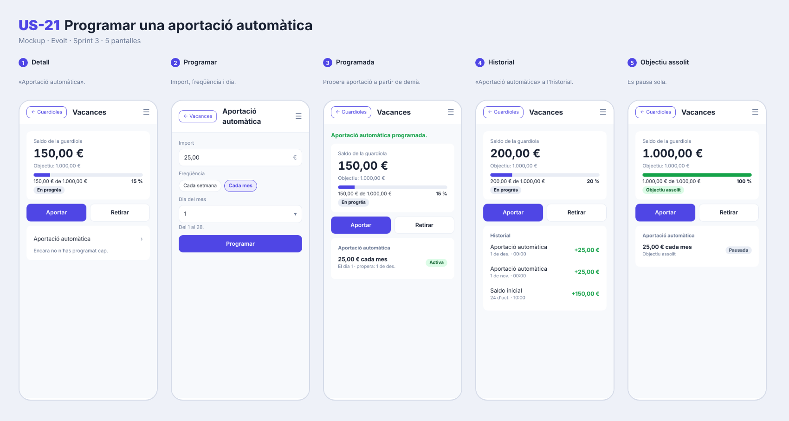

### US-21 · Programar una aportació automàtica (SP 3 · VP 6 · Prioritat Mitjana)

COM: client estàndard amb guardioles
VULL: programar una aportació automàtica a una guardiola
PER: estalviar de forma constant sense pensar-hi.

Perfil: client estàndard que ja té almenys una guardiola.

Assumptes:
- Freqüència setmanal o mensual
- Les aportacions que ja toquen es fan en llegir les dades, com la caducitat de la US-15; no hi ha cap tasca programada (decisió E, 24/11)
- El dia es compta en hora de Madrid
- Pausar, editar i eliminar són la US-41

Criteris d'acceptació:
1. Al detall de la guardiola, sota «Aportar» i «Retirar», hi ha la targeta «Aportació automàtica ›» amb «Encara no n'has programat cap.»
2. El formulari «Aportació automàtica» té «Import» (en euros, amb 2 decimals com a màxim), «Freqüència» («Cada setmana» o «Cada mes») i «Dia» (de dilluns a diumenge si és setmanal; del 1 al 28 si és mensual), i el botó lila «Programar». «Programar» queda desactivat fins que hi ha import i dia; amb import ≤ 0 surt «L'import ha de ser més gran que 0.»
3. En programar no es comprova el saldo. Surt «Aportació automàtica programada.» i torna al detall, on la targeta mostra «25,00 € cada mes», «El dia 1 · propera: 1 de des.» i l'etiqueta «Activa». Cada guardiola en té com a màxim una
4. La primera aportació és el primer dia programat a partir de demà: si la programo avui amb el dia d'avui, avui no es fa
5. Un cop passat el dia programat (des de les 00:00 de Madrid), la propera vegada que obro l'app l'import ja ha passat del saldo principal a la guardiola, amb el concepte «Aportació automàtica» i la data del dia programat. Si n'han passat diversos, se'n fa una per cada dia, de la més antiga a la més nova
6. El saldo es comprova en fer cada aportació. Si no n'hi ha prou, aquella no es fa ni es torna a intentar, i a la bústia arriba «No s'ha pogut fer l'aportació automàtica a <nom>: saldo insuficient»
7. Una aportació automàtica compta com una aportació normal: actualitza el progrés (US-20) i dona XP (US-23), dins del màxim del dia
8. Quan la guardiola arriba a l'objectiu, l'aportació automàtica es pausa sola: la targeta mostra l'etiqueta «Pausada» amb «Objectiu assolit» a sota, i a la bústia arriba «<nom> ha arribat a l'objectiu: s'ha pausat l'aportació automàtica»
9. Si s'elimina la guardiola, també s'elimina la seva aportació automàtica
10. Error del servidor o de xarxa: «S'ha produït un error inesperat. Torna-ho a provar més tard.» / «No hi ha connexió amb el servidor. Torna-ho a provar.» sota el botó; no es programa res

Casos especials:
- **Primer dia:** la primera aportació és el primer dia programat a partir de demà. Exemple: avui és el 25 de nov. i programo «cada mes, el dia 25» → la primera és el 25 de des.
- **Execució:** no hi ha cap tasca de fons; les aportacions pendents es fan en llegir les dades (decisió E), de la més antiga a la més nova, i cadascuna comprova el saldo en aquell moment
- **Sense saldo:** aquella aportació se salta (no es reintenta) i arriba l'avís a la bústia; les següents es continuen fent
- **Objectiu assolit:** quan una aportació (automàtica o manual) fa arribar la guardiola a l'objectiu, l'aportació automàtica passa a «Pausada» i no se'n fa cap més fins que es reprèn (US-41)
- Els dies 29, 30 i 31 no es poden triar perquè no existeixen tots els mesos

Estimació: SP 3 · VP 6 · Prioritat Mitjana

Seguiment: issue #252 · èpica EP-04 (#267) · targeta del Trello US-21.

Revisió del 25/11: La US-21 original es divideix en US-21 (programar) i US-41 (pausar, editar i eliminar). S'hi afegeixen la regla del primer dia i la pausa en assolir l'objectiu.

Mockups (fets abans de programar, 25/11/2026; HTML a `docs/us/_mockup/src/`, PNG a `docs/us/img/`):

1. **US-21-boto-detall** — Detall de la guardiola amb «Aportació automàtica».
2. **US-21-programar** — Formulari: import, freqüència i dia.
3. **US-21-programada** — Detall amb l'aportació programada: «25,00 € cada mes», propera i «Activa».
4. **US-21-historial** — Historial de la guardiola amb «Aportació automàtica».
5. **US-21-objectiu-assolit** — La guardiola arriba a l'objectiu: l'aportació es pausa sola.

