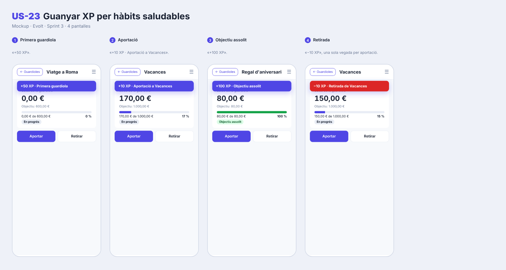

### US-23 · Guanyar XP per hàbits saludables (SP 3 · VP 7 · Prioritat Mitjana)

COM: client estàndard
VULL: guanyar XP quan faig accions financeres saludables
PER: sentir-me motivat a mantenir bons hàbits d'estalvi.

Perfil: client estàndard.

Assumptes:
- Els XP i els límits diaris són en un sol fitxer de configuració del backend; el panell de l'administrador és l'EP-15 (decisió F, 24/11)
- Valors: primera guardiola +50 XP, aportació +10 XP (màxim 3 per dia), objectiu assolit +100 XP
- L'historial d'XP és a «Perfil» (US-24); aquesta història es demostra amb els avisos «+X XP»

Criteris d'acceptació:
1. Guanyo XP en: crear la primera guardiola de la meva vida (+50 XP; si ja en tenia alguna, no), aportar a una guardiola (+10 XP, com a màxim 3 aportacions amb XP per dia) i assolir l'objectiu d'una guardiola (+100 XP, una sola vegada per guardiola encara que hi torni a arribar)
2. Els XP de cada acció i el màxim per dia són en un sol fitxer de configuració del backend; canviar-los no demana tocar cap pantalla
3. Quan guanyo XP surt a dalt, sobre la pantalla on soc, un avís lila amb «+X XP · <motiu>» durant 3 s (per exemple «+10 XP · Aportació a Vacances»); se'n va sol o en tocar-lo
4. Si una aportació fa assolir l'objectiu surten els dos avisos, primer «+10 XP · Aportació a <nom>» i després «+100 XP · Objectiu assolit»
5. Un cop fetes 3 aportacions amb XP en un dia, les següents es fan igual però no donen XP ni surt l'avís. El dia es compta en hora de Madrid
6. Enviar, demanar, pagar o rebutjar sol·licituds i canviar divises no donen XP
7. Si retiro d'una guardiola menys de 7 dies després d'una aportació que em va donar XP, es resten els XP d'aquella aportació (la més recent de la guardiola que encara no s'havia restat) i surt l'avís vermell «−10 XP · Retirada de <nom>». Cada aportació només es resta una vegada: una segona retirada resta la següent aportació, si n'hi ha, i si no, no resta res. Els XP mai baixen de 0
8. Els XP es guarden al servidor: tancar la sessió o entrar des d'un altre dispositiu no els canvia

Casos especials:
- **Primera guardiola:** només dona +50 XP si l'usuari no n'havia creat mai cap (els usuaris del seed que ja en tenen no els reben)
- **Retirades:** cada aportació que va donar XP es pot restar una sola vegada. Exemple: aporto 3 vegades a Vacances el mateix dia (+30 XP) i en retiro dues vegades → −10 i −10; una tercera retirada resta els últims 10; una quarta no resta res
- Una aportació que no va donar XP (perquè ja n'hi havia 3 aquell dia) no resta res en retirar
- Les aportacions automàtiques (US-21) donen XP com les manuals, dins del màxim de 3 al dia

Estimació: SP 3 · VP 7 · Prioritat Mitjana

Seguiment: issue #249 · èpica EP-05 (#268) · targeta del Trello US-23.

Revisió del 25/11: L'historial d'XP passa a la US-24. S'aclareix que cada aportació només es resta una vegada i què és la «primera guardiola».

Mockups (fets abans de programar, 25/11/2026; HTML a `docs/us/_mockup/src/`, PNG a `docs/us/img/`):

1. **US-23-primera-guardiola** — Avís en crear la primera guardiola.
2. **US-23-avis-xp** — Avís «+10 XP · Aportació a Vacances» en tornar al detall.
3. **US-23-objectiu-assolit** — Avís en assolir l'objectiu (US-20).
4. **US-23-retirada** — Retirada menys de 7 dies després d'aportar: avís vermell.

