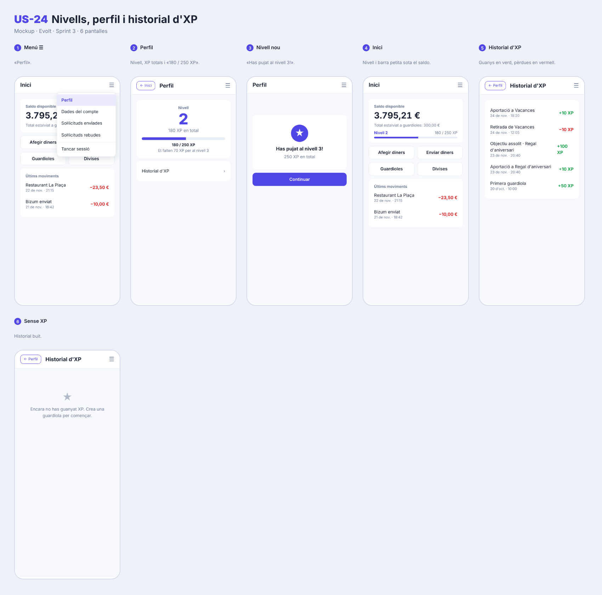

### US-24 · Nivells, perfil i historial d'XP (SP 4 · VP 6 · Prioritat Mitjana)

COM: client estàndard
VULL: pujar de nivell en acumular XP i veure com els he guanyat
PER: veure el meu progrés financer a llarg termini.

Perfil: client estàndard.

Assumptes:
- Depèn de la US-23 (XP)
- La taula de nivells és al mateix fitxer de configuració que els XP: 1 amb 0 XP, 2 amb 100, 3 amb 250, 4 amb 450 i 5 amb 700
- L'historial d'XP ve de la US-23 (revisió del 25/11)

Criteris d'acceptació:
1. Els nivells són al mateix fitxer de configuració que els XP: 1 amb 0 XP, 2 amb 100, 3 amb 250, 4 amb 450 i 5 amb 700. Un usuari nou comença al nivell 1 amb 0 XP («0 / 100 XP»)
2. Al menú ☰ hi ha «Perfil» (capçalera «← Inici» · «Perfil»)
3. «Perfil» mostra «Nivell» i el número en gran en lila, a sota «X XP en total», la barra lila de progrés amb «180 / 250 XP» i «Et falten 70 XP per al nivell 3»; a baix, la fila «Historial d'XP ›». Al nivell 5 (el màxim) la barra surt plena i diu «Has arribat al nivell màxim»
4. Quan una acció fa arribar els XP al mínim del nivell següent pujo de nivell sol: després de l'avís «+X XP» surt la pantalla de celebració amb una estrella lila, «Has pujat al nivell X!», «X XP en total» i el botó lila «Continuar», que torna a la pantalla on era. Si en pujo dos de cop, diu el nivell final
5. A Inici, sota el saldo i «Total estalviat a guardioles», surt «Nivell X» en lila i a la dreta «180 / 250 XP», amb una barra petita a sota; en tocar-la s'obre «Perfil»
6. Si perdo XP (US-23) el nivell no baixa, i la barra mostra els XP que falten des del total actual
7. «Historial d'XP» mostra una fila per canvi: el motiu, la data («24 de nov. · 18:20») i a la dreta els XP, en verd amb «+» o en vermell amb «−», el més recent a dalt
8. Sense cap canvi, «Historial d'XP» diu «Encara no has guanyat XP. Crea una guardiola per començar.»
9. Si no es pot carregar «Perfil» o l'historial surt «S'ha produït un error inesperat. Torna-ho a provar més tard.» amb el botó «Reintentar»

Casos especials:
- Taula de nivells: 1 → 0 XP · 2 → 100 XP · 3 → 250 XP · 4 → 450 XP · 5 → 700 XP (màxim)
- El nivell és el més alt el mínim del qual és ≤ als XP totals actuals, però mai baixa: es guarda el nivell més alt assolit
- L'historial d'XP mostra totes les entrades (guanys i pèrdues) de la US-23, la més recent a dalt

Estimació: SP 4 · VP 6 · Prioritat Mitjana

Seguiment: issue #250 · èpica EP-05 (#268) · targeta del Trello US-24.

Revisió del 25/11: S'hi afegeix l'historial d'XP, que abans era a la US-23.

Mockups (fets abans de programar, 25/11/2026; HTML a `docs/us/_mockup/src/`, PNG a `docs/us/img/`):

1. **US-24-acces-menu** — Menú ☰ amb «Perfil».
2. **US-24-perfil** — «Perfil»: nivell en gran, XP totals i barra cap al nivell següent.
3. **US-24-inici-nivell** — Inici amb el nivell i la barra petita sota el saldo.
4. **US-24-nivell-pujat** — Celebració en pujar de nivell.
5. **US-24-historial-xp** — «Historial d'XP»: guanys en verd i pèrdues en vermell, el més recent a dalt.
6. **US-24-historial-xp-buit** — Historial d'XP sense cap canvi.

