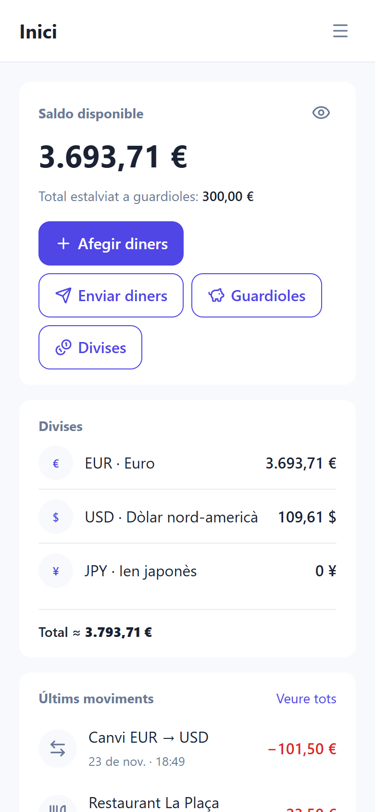
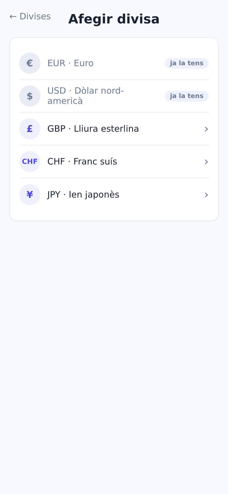
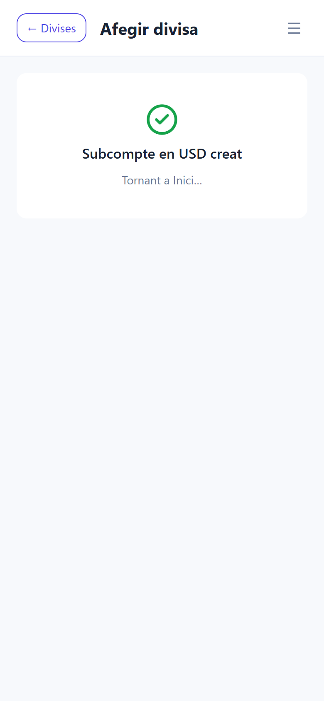

# US-25 · Afegir subcompte en divisa

Sprint 2 · Bloc Multidivisa · 4 punts · 12 h · Etiquetes: Fina, Mitjana, Multidivisa, P6 · Tasques: T25.1 (E, 2 h), T25.2 (G, 4 h), T25.3 (G, 4 h), T25.4 (R, 2 h)

> **Dependències.** La **US-26** (eliminar subcompte en divisa) i la **US-27** (canviar entre divises) depenen d'aquesta història: totes dues necessiten el model `Subaccount` amb `{id, user_id, code, balance}`, les rutes `GET /api/subaccounts` i `GET /api/currencies` de l'apartat 7, el seed amb `sub-01` (EUR) i `sub-02` (USD) i la conversió a euros de la secció 7 (`totalEurCents`). Sense la T25.1 aprovada, ni la US-26 ni la US-27 es poden començar.

## 1. Declaració de valor

```
COM A (AS A): client estàndard
VULL (I WANT TO): afegir un subcompte en una divisa nova
PER (SO I CAN): tenir saldo en aquesta moneda i gestionar-la per separat.
```

### Assumptes

- **(a) Un sol subcompte per divisa i usuari (invarianta).** La clau única és la parella `(user_id, code)`. Si l'usuari ja té `USD`, la fila `USD` de la pantalla «Afegir divisa» surt en gris i el servidor respon `422 CURRENCY_EXISTS` a qualsevol `POST /api/subaccounts` amb `{"code":"USD"}`. La invariant es comprova al servei, no només a la UI.
- **(b) El subcompte neix amb saldo `0`.** El `POST /api/subaccounts` no accepta cap camp de saldo: el cos només té `code`. El `balance` de la resposta és sempre `0`. No hi ha cap manera d'obrir un subcompte amb diners; els diners hi arriben amb el canvi de la US-27.
- **(c) El compte en EUR és el compte principal.** El subcompte `EUR` (`isMain: true`) existeix des del registre (P19 de `docs/api.md`) i **mai** es pot eliminar: la US-26 el protegeix amb `422 MAIN_ACCOUNT_NOT_DELETABLE` i el missatge «El compte en euros no es pot eliminar.». Aquesta US no permet crear ni eliminar l'EUR.
- **(d) Llista TANCADA de divises.** No es pot afegir cap codi que no sigui en aquesta taula de 5 files, en aquest ordre (l'ordre és el de la llista de la pantalla «Afegir divisa»). El tipus fix és cap a EUR i s'expressa en unitats de l'1/10.000: `1 unitat menor = tipus / 10000 cèntims d'EUR` (per a `JPY`: `5700 / 10000 = 0,5700` cèntims per ien, és a dir `0,0057 €`).

  | Codi | Nom (català) | Símbol | Decimals | Tipus fix cap a EUR |
  |---|---|---|---|---|
  | EUR | Euro | € | 2 | 10000 (1:1, exacte) |
  | USD | Dòlar nord-americà | $ | 2 | 9123 (1 USD = 0,9123 €) |
  | GBP | Lliura esterlina | £ | 2 | 11680 (1 GBP = 1,1680 €) |
  | CHF | Franc suís | CHF | 2 | 10355 (1 CHF = 1,0355 €) |
  | JPY | Ien japonès | ¥ | 0 | 5700 (1 JPY = 0,5700 cèntims = 0,0057 €) |

  Els tipus són **fixos i hardcodejats** (no es consulta cap API de tipus de canvi). Amb `JPY`, `decimals: 0`: el `balance` es desa en iens sencers (no en cèntims) i la conversió aplica igualment el tipus `5700`.
- **(e) Sense límit extra de subcomptes.** Com a molt, l'usuari té **4 subcomptes en divisa estrangera + el compte principal EUR = 5 comptes** (l'EUR és una de les 5 divises de la llista: és el compte principal, i no compta com a subcompte estranger). No s'afegeix cap paràmetre de configuració ni cap comprovació de nombre màxim: la llista tancada de 5 divises amb un subcompte per divisa ja és el topall, i duplicar-lo amb un altre límit numèric crearia una segona regla que podria contradir la primera.
- **(f) El total es mostra aproximat en euros.** A «Inici», a sota de la llista de divises, el peu diu «Total ≈ 1.540,20 €» (amb EUR `125050` i USD `31755`; amb el seed del compte sense subcomptes en divisa diu «Total ≈ 1.250,50 €»). És la suma en euros de tots els subcomptes (EUR inclòs) amb l'arrodoniment de la secció 7, calculada al backend (`totalEurCents`) i només formatada al frontend.
- **(g) La comissió del canvi queda pendent del PO abans de la T25.1.** El preamble del bloc Multidivisa del PDF del Sprint 2 exigeix que el PO decideixi la comissió abans de tancar el contracte. Aquesta US documenta el camp `commissionBps` (secció 7) amb el valor `0` a l'exemple, marcat `[pendent de decisió del PO abans de T25.1]`. La US-27 l'exercita.

## 2. Taula de pantalles

| Ruta | Vista/component (ruta real) | Punt d'entrada | Punt de sortida |
|---|---|---|---|
| `/` | `frontend/src/views/HomeView.vue` | arrencada de l'app / `router.replace('/')` després del tic verd | tocar «Divises» → `/divises` |
| `/divises` | `frontend/src/views/CurrenciesView.vue` (fila: `frontend/src/components/CurrencyRow.vue`) | tocar «Divises» a Inici | «Afegir divisa» → `/divises/afegir`; «← Inici» enrere → `/` |
| `/divises/afegir` | `frontend/src/views/AddCurrencyView.vue` | tocar «Afegir divisa» a `/divises` | triar divisa → POST → tic → `router.replace('/')`; «← Divises» enrere → `/divises` |

Notes:

- **A crear:** la ruta `/divises`, les vistes `CurrenciesView.vue`, `AddCurrencyView.vue`, `CurrencyRow.vue`, els ViewModels `useCurrenciesViewModel.ts` i `useAddCurrencyViewModel.ts`, els models `frontend/src/models/currency.ts` i `frontend/src/models/subaccount.ts`, els serveis `frontend/src/services/currenciesService.ts` (`getCurrencies`), `frontend/src/services/subaccountsService.ts` (`getSubaccounts`, `createSubaccount` i `deleteSubaccount` **(US-26)**) i `frontend/src/services/exchangesService.ts` (`createExchange` **(US-27)**) —un servei per recurs, com `frontend/src/services/potsService.ts`— i el mòdul de dades `frontend/src/mocks/subaccounts.ts`. Cap d'aquests serveis no s'ha d'implementar sencer en aquesta US: `deleteSubaccount` (**US-26**) i `createExchange` (**US-27**) es declaren aquí perquè el contracte és compartit, però només `getCurrencies`, `getSubaccounts` i `createSubaccount` tenen UI i ús a la US-25.
- **A modificar:** `frontend/src/views/HomeView.vue` (botó «Divises», card «Divises» i el segon `GET`), `frontend/src/viewmodels/useHomeViewModel.ts` (carrega els subcomptes amb `Promise.all`), `frontend/src/components/AppShell.vue` (propostes `backTo`/`backLabel` perquè l'enllaç d'enrere pugui dir «← Divises»), `frontend/src/components/MoneyAmount.vue` (prop opcional `currency`), `frontend/src/models/money.ts` (`formatMinor`), `frontend/src/router/index.ts` (dues rutes), `frontend/src/models/apiError.ts`, `frontend/src/models/errorMessages.ts`, `frontend/src/mocks/index.ts` i `frontend/src/mocks/seed.ts`. La resta de rutes i vistes citades en aquest document existeixen avui, inclòs `frontend/src/router/accessGuard.ts`, que no canvia.
- En aquesta US només es **llista** i s'**afegeix**. **Eliminar és la US-26**; el `DELETE /api/subaccounts/{subaccountId}` es defineix aquí perquè la T25.1 ho demana (una sola PR de contracte per a les tres US), però la UI de l'apartat 2 no l'exerceix.
- A `frontend/src/router/index.ts` (existent) s'afegeixen dues rutes: `{ path: '/divises', name: 'currencies', component: CurrenciesView }` i `{ path: '/divises/afegir', name: 'add-currency', component: AddCurrencyView }`. Cap de les dues porta `meta: { public: true }`: passen pel `accessGuard` existent (`frontend/src/router/accessGuard.ts`).

## 3. Flux d'interacció

1. L'usuari és a «Inici». (`GET /api/home` i `GET /api/subaccounts` ja han respost; el botó «Divises» és dins la card «Saldo disponible», al costat de «Afegir diners» i «Guardioles».)
2. Toca el botó «Divises».
3. S'obre `/divises` amb els seus subcomptes (EUR primer, perquè la resposta porta `isMain: true`) i el botó «Afegir divisa» a sota de la llista.
4. Toca «Afegir divisa».
5. S'obre `/divises/afegir` amb la llista de les 5 divises; les que ja té surten en gris i deshabilitades amb «ja la tens».
6. Toca «USD · Dòlar nord-americà» (els altres botons estan desactivats).
7. Es fa `POST /api/subaccounts` amb `{"code":"USD"}`; en respondre `201` la View pinta `<section class="card success" role="status">` amb `<CircleCheck class="success-icon" :size="40" />` (de `@lucide/vue`) i el text «Subcompte en USD creat», exactament com la confirmació de `frontend/src/views/TopUpView.vue`.
8. Al cap d'1,5 s (la constant `CONFIRMATION_MS = 1500` de `frontend/src/viewmodels/useAddCurrencyViewModel.ts`, la mateixa que fa servir `useTopUpViewModel.ts`) el ViewModel fa `router.replace('/')` i l'app torna sola a «Inici».
9. A «Inici» hi apareix la fila «USD · Dòlar nord-americà» amb «0,00 $» i el peu «Total ≈ 1.250,50 €» si abans l'usuari només tenia EUR amb `125050`: `125050 + floor(0 × 9123 ÷ 10000 + 0,5) = 125050 + 0 = 125050` → «Total ≈ 1.250,50 €». **Un subcompte amb saldo 0 no mou el total aproximat.** Si el mateix usuari ja tingués `USD` amb `balance: 31755` (i per tant afegís una tercera divisa amb saldo 0), el peu seria «Total ≈ 1.540,20 €» abans i després d'afegir-la: `125050 + 28970 + 0 = 154020` → «Total ≈ 1.540,20 €».

## 4. Matriu d'estats

| Pantalla | Estat | Com es veu | Component/atribut |
|---|---|---|---|
| `/` (HomeView) | carregant (GET en curs) | spinner centrat amb «Carregant…» | `<LoadingIndicator />` (`frontend/src/components/LoadingIndicator.vue`, ja porta `role="status"`) |
| `/` (HomeView) | error de càrrega | icona d'alerta, text i botó «Reintentar» | `<ErrorState :message="error" @retry="load" />` (`frontend/src/components/ErrorState.vue`, amb `<p role="alert">` a dins) |
| `/` (HomeView) | sense moviments (existent, no canvia) | icona de bústia i «Encara no tens moviments» | `<EmptyState />` amb el missatge per defecte de `frontend/src/components/EmptyState.vue` |
| `/` (HomeView) | èxit de la càrrega | card «Saldo disponible» + card «Divises» (una fila per subcompte) + peu «Total ≈ 1.540,20 €» + card «Últims moviments» | `MoneyAmount` per fila amb la prop `currency` (`frontend/src/components/MoneyAmount.vue`, **a modificar**: prop opcional `currency` — quan hi és fa `formatMinor(cents, currency)`; sense la prop continua amb `formatCents` i «€»); al peu, «Total ≈ » + `<MoneyAmount :cents="totalEurCents" :hidden="isHidden" />` (el prefix és un text literal sempre visible i el component formata el número amb `formatCents`). Els imports de la card «Divises» (les files i el peu del total) honoren el toggle de visibilitat existent: `:hidden="isHidden"` de `useBalanceVisibility`, igual que el saldo principal i el `totalSaved` |
| `/divises` (CurrenciesView) | carregat (l'usuari té almenys un subcompte en divisa estrangera; la llista comença per la fila de l'EUR, que és `isMain`) | card amb una fila per compte, «CODI · Nom» + import formatat («EUR · Euro» «1.250,50 €», «USD · Dòlar nord-americà» «317,55 $») i, a sota, el botó «Afegir divisa» | files de `frontend/src/components/CurrencyRow.vue` amb `formatMinor(balance, currency)`; imports sempre visibles (aquesta pantalla no té toggle d'ocultació) |
| `/divises` (CurrenciesView) | carregant | spinner centrat amb «Carregant…» | `<LoadingIndicator />` |
| `/divises` (CurrenciesView) | buit (només EUR, cap subcompte en divisa) | icona de bústia i «Encara no tens cap subcompte en divisa.» + botó «Afegir divisa» | `<EmptyState message="Encara no tens cap subcompte en divisa." />` |
| `/divises` (CurrenciesView) | error de càrrega | text «No s'han pogut carregar les divises. Torna-ho a provar.» dins `<p role="alert">` i botó «Reintentar» | `<ErrorState :message="loadErrorMessage" @retry="load" />` (on `loadErrorMessage` és la constant amb el text de la fila anterior) |
| `/divises/afegir` (AddCurrencyView) | carregant | spinner centrat amb «Carregant…» | `<LoadingIndicator />` |
| `/divises/afegir` (AddCurrencyView) | error de càrrega | «No s'han pogut carregar les divises. Torna-ho a provar.» + «Reintentar» | `<ErrorState>` |
| `/divises/afegir` (AddCurrencyView) | desactivat (divisa ja tinguda) | fila en gris amb `USD · Dòlar nord-americà` i, a la dreta, la píndola «ja la tens»; no fa cap crida | `<CurrencyRow :disabled="currency.owned" />` amb classe `.row-disabled`, la píndola `.badge-owned` amb el text «ja la tens», `aria-disabled="true"` i `aria-label="Afegir subcompte en USD"` |
| `/divises/afegir` (AddCurrencyView) | totes tingudes (les 5 divises de la llista amb subcompte) | sense cap fila seleccionable i, a sobre de la llista, «Ja tens totes les divises disponibles.» | `<EmptyState message="Ja tens totes les divises disponibles." />` |
| `/divises/afegir` (AddCurrencyView) | afegint (`isAdding`) | la fila tocada mostra el spinner petit al lloc de la píndola; la resta de files, deshabilitades | `LoadingIndicator` amb `inline` a la fila; `pointer-events: none` al `<ul>` mentre `isAdding` |
| `/divises/afegir` (AddCurrencyView) | èxit (`201`) | card d'èxit amb el tic verd de 40 px, «Subcompte en USD creat» i, a sota, «Tornant a Inici…» | `<section class="card success" role="status">` amb `<CircleCheck class="success-icon" :size="40" />`, com `frontend/src/views/TopUpView.vue`; el retard de 1500 ms i el `router.replace('/')` són a `useAddCurrencyViewModel.ts` (**a crear**) |
| `/divises/afegir` (AddCurrencyView) | error `422 CURRENCY_EXISTS` | alerta en línia sota la llista amb «Ja tens un subcompte en aquesta divisa.»; les files tornen a ser tocables | `<p role="alert">` amb el text de `messageForCode('CURRENCY_EXISTS')`; `isAdding` torna a `false` |
| `/divises/afegir` (AddCurrencyView) | error `422 CURRENCY_NOT_SUPPORTED` | alerta en línia amb «Aquesta divisa no és a la llista de divises disponibles.» | `<p role="alert">` |

## 5. Copy exacte

| Element | Text exacte | On apareix |
|---|---|---|
| Botó d'Inici | `Divises` | card «Saldo disponible» de `HomeView.vue`, tercer botó de `.actions` |
| Títol de pantalla | `Divises` | `AppShell title="Divises"` de `CurrenciesView.vue` |
| Botó | `Afegir divisa` | sota la llista de subcomptes de `/divises` |
| Títol de pantalla | `Afegir divisa` | `AppShell title="Afegir divisa"` de `AddCurrencyView.vue` |
| Fila de llista | `EUR · Euro` | `/divises` i `/divises/afegir` |
| Fila de llista | `USD · Dòlar nord-americà` | `/divises` i `/divises/afegir` |
| Fila de llista | `GBP · Lliura esterlina` | `/divises` i `/divises/afegir` |
| Fila de llista | `CHF · Franc suís` | `/divises` i `/divises/afegir` |
| Fila de llista | `JPY · Ien japonès` | `/divises` i `/divises/afegir` |
| Import d'un subcompte nou | `0,00 $` | fila USD de la card «Divises» d'Inici (plantilla: número amb 2 decimals + espai + símbol) |
| Peu de total (amb USD) | `Total ≈ 1.540,20 €` | peu de la card «Divises» d'Inici, amb EUR `125050` i USD `31755` |
| Peu de total (només EUR) | `Total ≈ 1.250,50 €` | peu de la card «Divises» d'Inici, amb EUR `125050` i cap subcompte en divisa |
| Tic verd | `Subcompte en USD creat` | card d'èxit de `/divises/afegir` (plantilla `Subcompte en {code} creat`) |
| Sota el tic | `Tornant a Inici…` | card d'èxit de `/divises/afegir`, sota «Subcompte en USD creat» |
| Estat desactivat | `ja la tens` | píndola `.badge-owned` a la dreta de la fila d'una divisa que ja té subcompte, a `/divises/afegir` |
| Estat buit de `/divises` | `Encara no tens cap subcompte en divisa.` | `/divises` quan només hi ha el compte principal EUR |
| Estat amb totes les divises tingudes | `Ja tens totes les divises disponibles.` | `/divises/afegir` quan les 5 divises de la llista ja tenen subcompte (cap fila seleccionable) |
| Error de càrrega | `No s'han pogut carregar les divises. Torna-ho a provar.` | `<p role="alert">` de `/divises` i de `/divises/afegir` |
| Error duplicat | `Ja tens un subcompte en aquesta divisa.` | alerta en línia de `/divises/afegir` |
| Error fora de llista | `Aquesta divisa no és a la llista de divises disponibles.` | alerta en línia de `/divises/afegir` |
| Botó d'enrere de `/divises` | `← Inici` | barra superior de `/divises` (`AppShell` amb `back`) |
| Botó d'enrere de `/divises/afegir` | `← Divises` | barra superior de `/divises/afegir` (`AppShell` amb el destí i el text personalitzats; `aria-label="Enrere"`) |

## 6. Taula de validacions

| Camp | Regla | Missatge exacte (codi HTTP) | Quan |
|---|---|---|---|
| `code` | obligatori i no buit | `Les dades de la petició no són vàlides.` (`VALIDATION_ERROR`, 422) — text literal de `ERROR_MESSAGES` a `backend/app/services/errors.py` | en rebre un cos buit, `null`, sense `code`, o amb `code` buit o que no sigui string: el schema del router declara `code: StrictStr = Field(min_length=1)`, i Pydantic converteix el buit o el tipus incorrecte en `VALIDATION_ERROR` 422 |
| `code` | dins la llista tancada (EUR, USD, GBP, CHF, JPY) | `Aquesta divisa no és a la llista de divises disponibles.` (`CURRENCY_NOT_SUPPORTED`, 422) | en crear, primer pas del servei, abans de mirar si ja existeix |
| `code` | sense subcompte previ d'aquest usuari | `Ja tens un subcompte en aquesta divisa.` (`CURRENCY_EXISTS`, 422) | en crear, segon pas del servei (el client ja ho evita deshabilitant la fila, però el servidor revalida) |
| (cap) | cap de subcomptes | sense error propi | la llista tancada és el topall (5 comptes: 4 divises estrangeres + l'EUR principal); no hi ha cap comprovació de nombre |
| `subaccountId` | existeix i és de l'usuari | `No s'ha trobat el subcompte.` (`SUBACCOUNT_NOT_FOUND`, 404) | en eliminar — **referència US-26 (fora de l'abast d'aquesta US)** |
| `balance` | saldo ≠ 0 no es pot eliminar | `Només pots eliminar un subcompte amb saldo 0.` (`SUBACCOUNT_NOT_EMPTY`, 422) | en eliminar — **referència US-26 (fora de l'abast d'aquesta US)** |
| `code` | el compte EUR no es pot eliminar | `El compte en euros no es pot eliminar.` (`MAIN_ACCOUNT_NOT_DELETABLE`, 422) | en eliminar — **referència US-26 (fora de l'abast d'aquesta US)** |
| `amount` | saldo suficient a l'origen | `No tens saldo suficient en aquesta divisa.` (`INSUFFICIENT_BALANCE`, 422) | en canviar — **referència US-27** |
| `sourceCode` / `targetCode` | divises diferents | `L'origen i la destinació han de ser divises diferents.` (`SAME_CURRENCY`, 422) | en canviar — **referència US-27** |
| `amount` | import mínim del canvi | `L'import és massa petit per canviar.` (`AMOUNT_TOO_SMALL`, 422) | en canviar — **referència US-27** |

## 7. Integració amb l'API

Aquest contracte compleix les convencions de `docs/api.md` (§1 i §5): els imports viatgen **en cèntims sencers** (`125050` = 1.250,50 €), les claus JSON van en **`camelCase`** (`totalEurCents`, `isMain`, `balance`), les dates són **ISO 8601 amb desplaçament de `Europe/Madrid`** (`2026-11-15T18:30:00+01:00`, precisió de segons), el cos d'error és **`{code, message, details?}`** amb la clau `details` **omesa quan és buida** (P6), i **el frontend branca pel `code`, mai pel `message`** (`docs/api.md` §5). **Aquest contracte també serveix per a la US-26 i la US-27 (T25.1).**

### 7.1 Endpoints

| Mètode | Ruta | Èxit | Errors | Estat |
|---|---|---|---|---|
| `GET` | `/api/currencies` | 200 amb `{ items }` (5 files) | 401 `UNAUTHENTICATED` / 500 `INTERNAL_ERROR` | **a crear** · [PROPOSTA P48 — pendent de validar] |
| `GET` | `/api/subaccounts` | 200 amb `{ items, totalEurCents }` | 401 `UNAUTHENTICATED` / 500 `INTERNAL_ERROR` | **a crear** · [PROPOSTA P48 — pendent de validar] |
| `POST` | `/api/subaccounts` | 201 amb l'objecte `Subaccount` sol | 422 `CURRENCY_NOT_SUPPORTED` / 422 `CURRENCY_EXISTS` / 401 / 500 | **a crear** · [PROPOSTA P49 — pendent de validar] |
| `DELETE` | `/api/subaccounts/{subaccountId}` | 204 amb cos buit | 404 `SUBACCOUNT_NOT_FOUND` / 422 `SUBACCOUNT_NOT_EMPTY` / 422 `MAIN_ACCOUNT_NOT_DELETABLE` / 401 / 500 | **a crear (US-26)** · [PROPOSTA P50 — pendent de validar] |
| `POST` | `/api/exchanges` | 201 amb l'objecte `Exchange` sol | 422 `INSUFFICIENT_BALANCE` / 422 `SAME_CURRENCY` / 422 `AMOUNT_TOO_SMALL` / 401 / 500 | **a crear (US-27)** · [PROPOSTA P51 — pendent de validar] |

Les cinc rutes porten `Authorization: Bearer <token>` (el `apiClient` de `frontend/src/services/apiClient.ts` ja hi posa la capçalera) i pengen del prefix `/api` declarat una sola vegada a `backend/app/main.py`.

**Propostes del contracte** (es numeren a partir de la P48, tal com indica `docs/api.md` §7; totes cinc es validen en aprovar la PR de la T25.1). P47 queda reservada per al contracte de la US-15 (T15.1), en curs en una altra sessió.

| # | Apartat | Proposta |
|---|---|---|
| P48 | §7.1 | Rutes de llista: `GET /api/currencies` i `GET /api/subaccounts` responen `{ items }`, i el de divises retorna `{ items: [{ code, name, symbol, decimals, owned }] }`, on `owned` és un booleà **per usuari** (`true` si ja té subcompte en aquella divisa) — és el que permet pintar la fila en gris. El de subcomptes afegeix `totalEurCents`. |
| P49 | §7.1 | `POST /api/subaccounts` respon `201` amb l'objecte `Subaccount` sol, sense embolcall, i el cos només accepta `{ code }`. |
| P50 | §7.1 | `DELETE /api/subaccounts/{subaccountId}` respon `204` amb cos buit, i un subcompte amb saldo ≠ 0 o el compte EUR no s'esborren (US-26). |
| P51 | §7.1 | `POST /api/exchanges` rep `{ sourceCode, targetCode, amount }` i respon `201` amb `{ id, sourceCode, targetCode, sourceAmount, targetAmount, rateBps, commissionBps, createdAt }`. |
| P52 | §7.1 | S'afegeix `"DELETE"` a `allow_methods` de `CORSMiddleware` a `backend/app/main.py`, que avui és exactament `["GET", "POST"]` (línia 183); sense això el navegador bloqueja la US-26. També cal afegir `apiDelete` (**US-26**) a `frontend/src/services/apiClient.ts`, on `RequestOptions.method` avui només accepta `'GET'` i `'POST'`. |

### 7.2 Cossos exactes

`GET /api/currencies` → `200`:

```json
{"items":[{"code":"EUR","name":"Euro","symbol":"€","decimals":2,"owned":true},{"code":"USD","name":"Dòlar nord-americà","symbol":"$","decimals":2,"owned":false},{"code":"GBP","name":"Lliura esterlina","symbol":"£","decimals":2,"owned":false},{"code":"CHF","name":"Franc suís","symbol":"CHF","decimals":2,"owned":false},{"code":"JPY","name":"Ien japonès","symbol":"¥","decimals":0,"owned":false}]}
```

`GET /api/subaccounts` → `200`:

```json
{"items":[{"id":"sub-01","code":"EUR","name":"Euro","symbol":"€","balance":125050,"isMain":true},{"id":"sub-02","code":"USD","name":"Dòlar nord-americà","symbol":"$","balance":31755,"isMain":false}],"totalEurCents":154020}
```

`POST /api/subaccounts` amb cos `{"code":"GBP"}` → `201`:

```json
{"id":"sub-03","code":"GBP","name":"Lliura esterlina","symbol":"£","balance":0,"isMain":false}
```

`POST /api/subaccounts` amb cos `{"code":"USD"}` quan ja existeix → `422`:

```json
{"code":"CURRENCY_EXISTS","message":"Ja tens un subcompte en aquesta divisa."}
```

`POST /api/subaccounts` amb cos `{"code":"XYZ"}` → `422`:

```json
{"code":"CURRENCY_NOT_SUPPORTED","message":"Aquesta divisa no és a la llista de divises disponibles."}
```

`DELETE /api/subaccounts/sub-02` → `204`, cos buit (0 bytes).

`POST /api/exchanges` amb cos `{"sourceCode":"USD","targetCode":"EUR","amount":1000}` → `201`:

```json
{"id":"exc-01","sourceCode":"USD","targetCode":"EUR","sourceAmount":1000,"targetAmount":912,"rateBps":9123,"commissionBps":0,"createdAt":"2026-11-15T18:30:00+01:00"}
```

> `commissionBps` queda `[pendent de decisió del PO abans de T25.1]`: l'exemple el fixa a `0` («Sense comissió»), però el valor definitiu el decideix el PO abans de tancar el contracte. La US-25 el documenta; la US-27 l'exercita. `rateBps` és el tipus en base 10.000 (les mateixes unitats que la columna «Tipus fix cap a EUR» de la secció 1): `9123` vol dir `1 USD = 0,9123 €`. `sourceAmount`/`targetAmount` són sempre positius i en unitats menors de la seva pròpia divisa.

### 7.3 Arrodoniment del total ≈ en euros

Regla (backend, una sola implementació a `backend/app/services/subaccount_service.py`):

1. Per a cada subcompte, `centsEur = floor(minor × tipus ÷ 10000 + 0,5)` — arrodoniment a l'alça a la meitat. En enters i sense floats: `centsEur = (minor * rate + 5000) // 10000`. **Mai** `round()` de Python, perquè fa arrodoniment bancari (a l'enter parell) i donaria `28970` o `28971` segons el cas.
2. Es sumen els `centsEur` de **tots** els subcomptes de l'usuari, EUR inclòs (tipus `10000`, que dona exactament el mateix `minor`).
3. El backend retorna `totalEurCents` ja calculat. El frontend **no converteix**: només fa `formatCents(totalEurCents)`.

Exemple comprovat amb `EUR 125050` i `USD 31755` (tipus `9123`):

- USD: `31755 × 9123 = 289.700.865`; `÷ 10000 = 28.970,0865`; `+ 0,5 = 28.970,5865`; `floor = 28970` cèntims (289,70 €). Amb enters: `(289700865 + 5000) // 10000 = 28970`.
- EUR: `(125050 × 10000 + 5000) // 10000 = (1250500000 + 5000) // 10000 = 125050`.
- Total: `125050 + 28970 = 154020` → `formatCents(154020)` → «Total ≈ 1.540,20 €».

JPY (`decimals: 0`): el `balance` s'emmagatzema en **iens sencers** (no en cèntims) i la conversió aplica el tipus `5700` igualment. Exemple: `1234 ¥` → `(1234 × 5700 + 5000) // 10000 = (7033800 + 5000) // 10000 = 703` cèntims (7,03 €). A la UI es formata «1.234 ¥» (sense decimals).

### 7.4 Codis d'error

| Codi | HTTP | Missatge exacte | Reacció exacta de la UI |
|---|---|---|---|
| `CURRENCY_NOT_SUPPORTED` | 422 | `Aquesta divisa no és a la llista de divises disponibles.` | alerta en línia `<p role="alert">` a `/divises/afegir`, sense navegació i sense toast |
| `CURRENCY_EXISTS` | 422 | `Ja tens un subcompte en aquesta divisa.` | alerta en línia `<p role="alert">` a `/divises/afegir`, sense navegació i sense toast |
| `SUBACCOUNT_NOT_FOUND` | 404 | `No s'ha trobat el subcompte.` | alerta en línia i `router.replace('/divises')` |
| `SUBACCOUNT_NOT_EMPTY` | 422 | `Només pots eliminar un subcompte amb saldo 0.` | alerta en línia a `/divises` (US-26) |
| `MAIN_ACCOUNT_NOT_DELETABLE` | 422 | `El compte en euros no es pot eliminar.` | alerta en línia a `/divises` (US-26) |
| `INSUFFICIENT_BALANCE` | 422 | `No tens saldo suficient en aquesta divisa.` | alerta en línia a la pantalla de canvi (US-27) |
| `SAME_CURRENCY` | 422 | `L'origen i la destinació han de ser divises diferents.` | alerta en línia a la pantalla de canvi (US-27) |
| `AMOUNT_TOO_SMALL` | 422 | `L'import és massa petit per canviar.` | alerta en línia a la pantalla de canvi (US-27) |

Regles de reacció, iguals per a tots vuit codis: `401` → redirecció a `/login` pel mecanisme existent `onSessionEnded` de `frontend/src/services/session.ts`, ja connectat a `frontend/src/router/index.ts`; qualsevol `422` → alerta en línia `role="alert"` a la pantalla on s'ha fet l'acció, sense navegació i sense toast; `404` → alerta en línia i tornada a `/divises`; `500` o `NETWORK_ERROR` → `ErrorState` amb el botó «Reintentar».

On s'afegeixen els codis:

- `frontend/src/models/apiError.ts`: `CURRENCY_NOT_SUPPORTED` i `CURRENCY_EXISTS` a `API_ERROR_CODES` (són els dos codis d'aquesta US). Amb la US-26 s'hi afegeixen `SUBACCOUNT_NOT_FOUND`, `SUBACCOUNT_NOT_EMPTY` i `MAIN_ACCOUNT_NOT_DELETABLE`; amb la US-27, `SAME_CURRENCY` i `AMOUNT_TOO_SMALL`.
- `frontend/src/models/errorMessages.ts`: les mateixes claus a `MESSAGES: Record<ApiErrorCode, string>` amb els textos exactes de la taula de dalt.
- `backend/app/services/errors.py`: les mateixes constants amb el seu text, més les entrades corresponents a `ERROR_STATUS` (422, i 404 per a `SUBACCOUNT_NOT_FOUND`) i a `ERROR_MESSAGES`.

> **Nota sobre `INSUFFICIENT_BALANCE`:** el codi ja existeix avui a les tres bandes, amb el text de les guardioles («No tens prou saldo per fer aquesta aportació.» a `backend/app/services/errors.py` i `frontend/src/models/errorMessages.ts`). Com que `ERROR_MESSAGES` i `MESSAGES` tenen un sol text per codi, la US-27 ha de decidir abans de la seva T27.1 entre reutilitzar el text actual o canviar-lo; el text «No tens saldo suficient en aquesta divisa.» d'aquesta taula és la proposta de la US-27 i no s'implementa a la T25.2.

### 7.5 Model intern

- `backend/app/models/subaccount.py` (**a crear**): dataclass `Subaccount { id: str, user_id: int, code: str, balance: int }`. `balance` va en unitats menors de la divisa: cèntims per a EUR/USD/GBP/CHF i iens sencers per a JPY. La resposta JSON té més camps que el dataclass: el router compon `name` i `symbol` des de la taula de `backend/app/models/currency.py` (**a crear**: la llista tancada de l'apartat 1) i calcula `isMain = (code == "EUR")`; el dataclass es queda `{id, user_id, code, balance}`.
- `backend/app/models/currency.py` (**a crear**): la llista tancada com a constant única (com `POT_COLORS` a `backend/app/models/pot.py`), amb una entrada per codi: `name`, `symbol`, `decimals` i `rate_per_10k` (`10000`, `9123`, `11680`, `10355`, `5700`).
- Repositoris parells, com la resta del projecte: `backend/app/repositories/subaccount.py` (**a crear**, protocol `SubaccountRepository` + implementació en memòria) i `backend/app/repositories/firestore/subaccount.py` (**a crear**), amb la col·lecció `subaccounts` i l'id de document `{userId}_{code}` (per exemple `1_USD`), que fa complir la invariant (a) a nivell d'emmagatzematge.
- Ids `sub-01`, `sub-02`, `sub-03`, `sub-04` i `sub-05` (el nombre màxim possible: 5 comptes, un per divisa de la llista tancada), que surten del comptador del seed (`backend/app/data/seed.py`, **a modificar**: usuari 1 → `sub-01` EUR `125050` + `sub-02` USD `31755`; usuari 2 → `sub-01` EUR `0`). El comptador és **per usuari** (`next_subaccount_number[user_id]`), perquè el document de Firestore ja porta l'usuari al nom i la US-26 esborra per id dins de l'usuari; per això el primer subcompte nou de l'usuari 1 és `sub-03`. `frontend/src/mocks/seed.ts` (**a modificar**) i `frontend/src/mocks/subaccounts.ts` (**a crear**) reprodueixen exactament aquestes dades, i la capa de mocks amb estat per usuari `frontend/src/mocks/index.ts` (**a modificar**: `mockCurrencies`, `mockSubaccounts`, `mockCreateSubaccount`, amb reinici a `onMockUserChange`) és la que consumeixen els serveis a través de `@/mocks`.
- `backend/app/services/subaccount_service.py` (**a crear**) amb l'ordre de validació en crear: 1) `code` dins la llista tancada → si no, `CURRENCY_NOT_SUPPORTED`; 2) ja existeix `(user_id, code)` → si sí, `CURRENCY_EXISTS`. El `balance` inicial és sempre `0`.
- Routers seguits del patró de `backend/app/routers/pots.py` (existent): schemas Pydantic **dins el router**, `StrictStr` al `code`, dependències `Depends(current_user_id)` i `Depends(atomic)`, i escriptures atòmiques amb `run.run(...)` (comptador + document, tot o res a Firestore). Fitxers: `backend/app/routers/currencies.py`, `backend/app/routers/subaccounts.py` i `backend/app/routers/exchanges.py` (**a crear**), inclosos a `backend/app/main.py` amb `app.include_router(..., prefix="/api")`.
  - Diferència conscient respecte de `pots.py`: allà el color fora de la llista tancada és un `VALIDATION_ERROR` (`field_validator` de Pydantic); aquí la divisa fora de la llista ha de ser `CURRENCY_NOT_SUPPORTED`, que és un error de negoci. Per tant el `field_validator` **no** valida la llista i la comprova el servei; `StrictStr` continua donant `VALIDATION_ERROR` per a un `code` que no sigui string.

## 8. Acció → reacció → resposta → toast/redirecció

| Acció de l'usuari | Reacció immediata de la UI | Resposta de l'API | Toast / redirecció |
|---|---|---|---|
| tocar «Divises» a Inici | navega a `/divises` i mostra `LoadingIndicator` fins que `GET` respon | `GET /api/subaccounts` → 200 | sense toast |
| tocar «Afegir divisa» a `/divises` | navega a `/divises/afegir` i mostra `LoadingIndicator` | `GET /api/currencies` → 200 | sense toast |
| tocar una divisa lliure | `isAdding = true`: la fila mostra el spinner i la resta de files queden bloquejades (el doble toc no envia dos `POST`) | `POST /api/subaccounts` → 201 | card `<section class="card success" role="status">` amb el tic verd; el ViewModel `useAddCurrencyViewModel.ts` espera 1500 ms i fa `router.replace('/')` |
| tocar una divisa «ja la tens» | res: la fila és deshabilitada (`aria-disabled="true"`), no hi ha gest | sense resposta, cap crida | sense toast |
| `POST` respon 422 `CURRENCY_EXISTS` | alerta en línia `role="alert"` amb «Ja tens un subcompte en aquesta divisa.» i `isAdding = false` | 422 | sense navegació i sense toast |
| `POST` respon 422 `CURRENCY_NOT_SUPPORTED` | alerta en línia `role="alert"` amb «Aquesta divisa no és a la llista de divises disponibles.» | 422 | sense navegació i sense toast |
| `GET` falla (500 o `NETWORK_ERROR`) | `ErrorState` amb el text de `toUserMessage` i el botó «Reintentar» que torna a cridar `load()` | 500 o sense xarxa | sense navegació i sense toast |
| recarregar `/` | `Promise.all([getHome(), getSubaccounts()])` i `LoadingIndicator` fins que responen les dues | `GET /api/home` i `GET /api/subaccounts` → 200 | sense toast |

**Nota:** l'app **no té cap toast ni cap modal** (verificat: no hi ha cap coincidència de `toast` ni de `modal` a tot `frontend/src` ni a `backend/app`). Tota la retroalimentació és una card `role="status"` (el bloc `<section class="card success">` del tic verd, igual que `frontend/src/views/TopUpView.vue`, i el `LoadingIndicator`), una alerta `role="alert"` (errors de formulari i càrrega) o un `ErrorState` amb reintent. Cap temporitzador no viu a la View: el retard de 1,5 s és al ViewModel (`useAddCurrencyViewModel.ts`, com `useTopUpViewModel.ts`).

## 9. Requisits no funcionals

- **Accessibilitat.** El tic verd va dins un contenidor `role="status"` (s'anuncia en aparèixer); tots els errors van dins `<p role="alert">`; les files grises porten `aria-disabled="true"` i `aria-label="Afegir subcompte en USD"` (el nom de la divisa a l'etiqueta); en canviar de ruta es fa focus al `<h1>` de la vista amb un `router.afterEach` nou a `frontend/src/router/index.ts` (el fitxer ja en té un per a `touchSession()`; s'hi afegeix el segon). El color no és mai l'únic indicador: la fila grisa porta el text «ja la tens» i la paraula «Divises» del botó no depèn del color.
- **Contrast** (ratis calculats amb la fórmula WCAG 2.1 `(L1 + 0,05) ÷ (L2 + 0,05)` sobre els colors del disseny: fons `#f7f9fc`, superfície `#ffffff`, text `#1a2233`, primari `#4f46e5`, verd `#16a34a`, gris `#6c7a96`):
  - `#1a2233` sobre `#ffffff` = **15,90:1** i sobre `#f7f9fc` = **15,08:1**: és el color de tot el text de cos, dels noms de fila i del text de la píndola «ja la tens» (15,90:1 ≥ 4,5:1).
  - Blanc sobre `#4f46e5` = **6,29:1**: text dels botons primaris «Divises» i «Afegir divisa» (≥ 4,5:1).
  - Verd del tic `#16a34a` sobre blanc = **3,30:1**: prou per a una icona de 40 px (llindar 3:1 per a elements gràfics), i per això el tic va sempre acompanyat del text «Subcompte en USD creat».
  - `#6c7a96` sobre `#ffffff` = **4,32:1** i sobre `#f7f9fc` = **4,10:1**: aquest to es reserva per a (a) components desactivats o inactius, que WCAG 1.4.3 eximeix del mínim de 4,5:1 (la fila grisa i la píndola «ja la tens» de `/divises/afegir`), i (b) metadades secundàries. El text de cos actiu es pinta amb `#1a2233` (**15,90:1** sobre blanc, **15,08:1** sobre `#f7f9fc`); cal tenir present que `frontend/src/views/HomeView.vue` ja pinta `.saved` (0,875 rem) amb `--color-muted`, herència de la guia existent que aquesta US no toca.
- **Visibilitat dels imports (T07.10).** A «Inici», els imports de la card «Divises» de la US-25 honoren el toggle existent de `frontend/src/viewmodels/useBalanceVisibility.ts`: cada `MoneyAmount` de la card i el peu del total porten `:hidden="isHidden"`, exactament com el saldo principal i el `totalSaved` de `HomeView.vue`. El peu del total és «Total ≈ » + `<MoneyAmount :cents="totalEurCents" :hidden="isHidden" />`: el prefix és un text literal sempre visible i el component formata el número amb `formatCents` (o mostra «••••» si el toggle està activat). A les pantalles noves `/divises` i `/divises/afegir` **no hi ha cap toggle d'ocultació**: la llista de comptes i els imports es mostren sempre visibles.
- **Touch targets.** Les files de `/divises` i `/divises/afegir` fan com a mínim **56 px** d'alçada (`min-height: 56px`, la mateixa mida que la fila dels mockups); el botó «Afegir divisa» i els botons d'acció fan **48 px**; cap element tocable baixa de **44 px**.
- **Responsive.** Una sola columna a **390 px** d'ample, sense scroll horitzontal (`overflow-x: hidden` al contenidor de la pantalla); els imports porten `font-variant-numeric: tabular-nums` (ja és el costum de `frontend/src/views/TopUpView.vue`, `frontend/src/views/ContributeView.vue` i `frontend/src/views/CreatePotView.vue`) perquè les xifres no ballin en canviar de valor.
- **Rendiment.** Dos `GET` en paral·lel amb `Promise.all` a Inici; com a màxim **5 files** a cada llista (les 5 divises de la llista tancada, amb l'EUR com a compte principal), així que no hi ha virtualització ni debounce ni paginació.
- **Formatat numèric per divisa.** L'EUR continua passant per `formatCents` de `frontend/src/models/money.ts` («1.250,50 €»). Per a la resta **no** es fa servir `Intl.NumberFormat('ca-ES', {style:'currency', currency:'USD'})`: l'ICU decideix el símbol i la seva posició (amb l'ICU d'aquesta màquina, `ca-ES` + `USD` retorna «317,55 USD», no «317,55 $»), i la US exigeix exactament el símbol de la columna Símbol de la secció 1. La funció nova és `formatMinor(minor, currency)` a `frontend/src/models/money.ts` (**a modificar**): formata el número pla amb `Intl.NumberFormat('ca-ES', { minimumFractionDigits: currency.decimals, maximumFractionDigits: currency.decimals })` i hi afegeix el símbol amb un espai entremig. Resultats exactes: `formatMinor(0, USD)` → «0,00 $»; `formatMinor(31755, USD)` → «317,55 $»; `formatMinor(0, JPY)` → «0 ¥»; `formatMinor(1234, JPY)` → «1.234 ¥». Per a EUR, `formatMinor` delega en `formatCents` i retorna «1.250,50 €».

## 10. Criteris d'acceptació

### AC-1 · camí feliç (afegir USD)

- **Donada** una sessió amb només el compte principal EUR amb saldo `125050` («1.250,50 €») i cap subcompte en divisa,
- **Quan** des de la llista d'«Afegir divisa» trio «USD · Dòlar nord-americà»,
- **Llavors** l'app torna a «Inici» amb un subcompte nou «USD · Dòlar nord-americà» amb saldo `0`, és a dir «0,00 $»,
- **I** el peu de la card de divises mostra «Total ≈ 1.250,50 €» perquè 0 USD afegeix 0 € al total.

### AC-2 · protecció d'invariants (duplicat i divisa fora de llista)

- **Donat** un usuari que ja té el subcompte USD,
- **Quan** intento crear un altre subcompte amb `{"code":"USD"}`,
- **Llavors** el servidor respon `422` `CURRENCY_EXISTS` amb «Ja tens un subcompte en aquesta divisa.»,
- **I** a «Inici» i a la llista de divises només hi ha UN subcompte USD (cap duplicat),
- **I quan** intento crear un subcompte amb `{"code":"XYZ"}`,
- **Llavors** el servidor respon `422` `CURRENCY_NOT_SUPPORTED` amb «Aquesta divisa no és a la llista de divises disponibles.»,
- **I** cap dels dos intents modifica cap saldo ni el «Total ≈ 1.540,20 €».

### AC-3 · estat, persistència i propagació

- **Donat** un subcompte USD creat amb saldo `0`,
- **Quan** es recarrega l'app amb `STORAGE=firestore` i també amb el repositori en memòria,
- **Llavors** el subcompte USD amb saldo `0` persisteix en ambdós repositoris i a la llista de divises USD hi apareix en gris amb «ja la tens»,
- **I quan** el saldo USD passa a `31755` i es torna a carregar Inici,
- **Llavors** el peu mostra «Total ≈ 1.540,20 €» perquè `125050 + floor(31755 × 9123 ÷ 10000 + 0,5) = 125050 + 28970 = 154020`.

> **Prohibit com a criteri d'acceptació:** Cap AC es basa en l'aspecte visual ni en la semblança amb un mockup. Un criteri vàlid afirma un valor, un codi, un estat o una resposta de l'API; si no, no es pot comprovar.

## 11. Mockups

Inici (`/`): comptes mixts, amb les files «EUR · Euro» i «USD · Dòlar nord-americà» i el peu «Total ≈ 1.540,20 €»:



`/divises/afegir`: la llista de divises amb les ja tingudes en gris i la píndola «ja la tens»:



`/divises/afegir` amb la confirmació: la card d'èxit amb el tic verd i «Subcompte en USD creat»:



- Els tres PNG viuen a `docs/us/img/` amb aquests noms exactes: `US-25-inici-multidivisa.png`, `US-25-llista-divises.png` i `US-25-afegir-divisa-tic.png`.
- Les fonts HTML són `docs/us/_mockup/src/US-25-inici-multidivisa.html`, `docs/us/_mockup/src/US-25-llista-divises.html` i `docs/us/_mockup/src/US-25-afegir-divisa-tic.html`. Cada fitxer és **autònom**: porta el seu CSS dins d'un `<style>` propi (cap full d'estil extern), no té JavaScript, és només visual (estàtic, sense interacció) i està maquetat per a un viewport de 390×844 px.
- Mida de sortida: **PNG 780×1688** (390×844 a 2x). La forma **oficial** de generar-los és `docs/us/_mockup/render.sh` (vegeu `docs/us/_plantilla.md`, apartat 11): dos arguments, l'HTML i el PNG, i el script ja tria el navegador (`helium` al `PATH`, `/opt/helium-*/helium`, el Chromium local o qualsevol chromium del `PATH`), comprova que el fitxer de sortida existeix i avisa si les mides no són 780×1688.

  ```
  docs/us/_mockup/render.sh docs/us/_mockup/src/US-25-inici-multidivisa.html docs/us/img/US-25-inici-multidivisa.png
  ```

  Un cop per a cada mockup, amb les mateixes rutes:

  ```
  docs/us/_mockup/render.sh docs/us/_mockup/src/US-25-llista-divises.html docs/us/img/US-25-llista-divises.png
  docs/us/_mockup/render.sh docs/us/_mockup/src/US-25-afegir-divisa-tic.html docs/us/img/US-25-afegir-divisa-tic.png
  ```
- Equivalent manual (les mateixes flags que executa `render.sh`), si el script no es pot fer servir:

  ```
  chromium --headless=new --disable-gpu --hide-scrollbars --force-device-scale-factor=2 --window-size=390,844 --screenshot=<png absolut> file://<html absolut>
  ```

  Amb el navegador d'aquesta màquina (ruta real, cap `chromium` al `PATH`):

  ```
  /opt/helium-0.15.5.1-x86_64_linux/helium --headless=new --disable-gpu --hide-scrollbars --force-device-scale-factor=2 --window-size=390,844 --screenshot=/home/itram/Uni/Projectes/ES/GIT/F3-Evolt/docs/us/img/US-25-inici-multidivisa.png file:///home/itram/Uni/Projectes/ES/GIT/F3-Evolt/docs/us/_mockup/src/US-25-inici-multidivisa.html
  ```

- No hi ha Playwright instal·lat en aquesta màquina, així que la renderització va sempre per un navegador Chromium local: el que detecta `render.sh`.

## 12. Enllaços i Definition of Done

### Enllaços

- **Trello:** «US-25 · Afegir subcompte en divisa» (font: `docs/P1/trello-backlog.md`, línies 1026–1058).
- **GitHub Issues: per crear**
  - T25.1 «Contracte de subcomptes, eliminar i canvi (US-25, US-26 i US-27) a docs/api.md i proves» (2 h).
  - T25.2 «Subcomptes en divisa: un per divisa, saldo 0 i total aproximat en euros (backend)» (4 h).
  - T25.3 «Botó «Divises», llista de divises i subcomptes a Inici» (4 h).
  - T25.4 «Revisar US-25» (2 h).
- **PRs:** `[PR per omplir]` per al contracte, `[PR per omplir]` per al backend i `[PR per omplir]` per a la UI.

### Definition of Done

- [ ] Contracte P48–P52 aprovat a `docs/api.md` via PR revisada per una parella backend i una frontend.
- [ ] `docs/proves-multidivisa.md` creat amb les proves d'API i de pantalla.
- [ ] Proves de backend verdes en memòria i amb `TEST_STORAGE=firestore`, cobrint els tres casos: divisa repetida (`CURRENCY_EXISTS`), divisa fora de la llista (`CURRENCY_NOT_SUPPORTED`) i total en euros (`154020` amb `125050` + `31755`).
- [ ] UI implementada amb el botó «Divises», la llista amb les files grises («ja la tens»), el tic verd i el peu «Total ≈ 1.540,20 €», amb els 3 AC de la secció 10 passats.
- [ ] Els 3 PNG presents a `docs/us/img/` (`US-25-inici-multidivisa.png`, `US-25-llista-divises.png`, `US-25-afegir-divisa-tic.png`), a 780×1688.
- [ ] Revisió T25.4 feta i acceptada pel PO al navegador.
- [ ] Tot el text en català: copy de la UI, missatges d'error, noms de les divises i aquest document.
