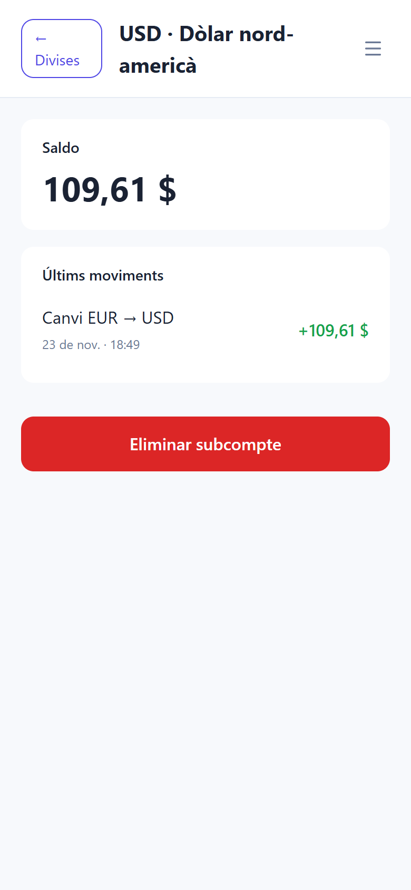
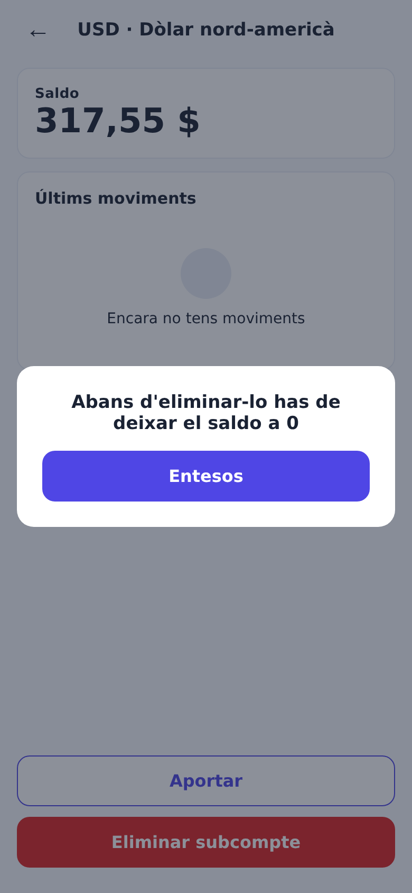
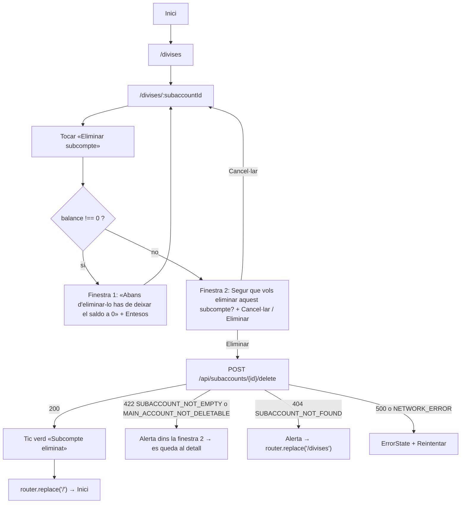

# US-26 · Eliminar subcompte en divisa

Sprint 2 · Bloc Multidivisa · 2 punts · 4 h · Etiquetes: Fina, Mitjana, Multidivisa, P6 · Tasques: T26.1 (G, 1 h), T26.2 (G, 2 h), T26.3 (R, 1 h)

> **Dependències.** Aquesta història depèn de la **US-25** (afegir subcompte en divisa) i de la **T25.1**. El contracte d'aquesta US és una **extensió** de `docs/us/US-25.md` §7, que és la **font de la veritat**: el model `Subaccount {id, user_id, code, balance}`, les rutes `GET /api/subaccounts` i `GET /api/currencies`, el seed amb `sub-01` (EUR `125050`, `isMain: true`) i `sub-02` (USD `31755`), el `totalEurCents 154020`, la taula de tipus de canvi, la regla `formatMinor` i els codis `SUBACCOUNT_NOT_FOUND`, `SUBACCOUNT_NOT_EMPTY` i `MAIN_ACCOUNT_NOT_DELETABLE` es donen per definits aquí i **no es re-deriven**. El preamble del bloc Multidivisa del PDF del Sprint 2 diu que la US-26 i la US-27 depenen de la US-25 i que, abans de la T25.1, el PO ha de decidir la comissió del canvi: la decisió ja presa (**1,5 % amb mínim de 0,50 €, arrodonida a cèntims**) es recull a §7.4 perquè és el contracte comú amb `docs/us/US-27.md`, tot i que aquesta US **no fa cap canvi de saldo per comissió**. Sense la T25.1 aprovada i mergejada no es pot començar la T26.1.

## 1. Declaració de valor

```
COM A (AS A): client estàndard amb subcomptes en divisa
VULL (I WANT TO): eliminar un subcompte en divisa
PER (SO I CAN): netejar la pantalla principal quan ja no necessito aquella moneda.
```

### Assumptes

- **(a) El saldo ha de ser exactament `0`.** No hi ha cap marge: `balance: 1` (0,01 $) ja bloqueja l'eliminació. La comprovació és `balance != 0` al servei i, a la UI, la finestra d'avís de §3 pas 3. Un saldo diferent de zero només es pot buidar amb un canvi de la US-27 (o amb un pagament de la US-28), no des d'aquesta pantalla.
- **(b) El compte en euros (`isMain: true`) no es pot eliminar mai.** El detall del compte EUR es pot obrir (per veure'n el saldo), però el botó «Eliminar subcompte» **no es renderitza** quan `code === 'EUR'`; a més, el servidor defensa el cas amb `422 MAIN_ACCOUNT_NOT_DELETABLE` i el missatge «El compte en euros no es pot eliminar.», perquè la UI no és el lloc on viu la regla.
- **(c) Un subcompte per divisa → en eliminar-lo la divisa torna a estar disponible.** La invariant `(user_id, code)` de la US-25 §1 (a) fa que, un cop esborrat el document `1_USD`, el `owned` d'aquella fila torni a `false` a `GET /api/currencies` i la pantalla «Afegir divisa» la torni a oferir com a triable (sense la píndola «ja la tens»). És el revers exacte de la US-25 i no cal cap codi nou: surt del mateix model.
- **(d) Eliminar *mai* esborra moviments històrics.** L'eliminació esborra **un sol document**: el del subcompte. Els moviments del subcompte (`docs/api.md` §3, `Movement`) es queden a l'historial amb el seu import i el seu símbol, i l'historial continua mostrant-los després d'eliminar el subcompte, de tancar la sessió i de tornar a entrar. Aquesta regla és explícita perquè el contrari (esborrar en cascada) trencaria el registre comptable i faria desaparèixer despeses reals de l'usuari.
- **(e) Contracte = US-25 §7 + la nota POST/DELETE de §7.3.** Les rutes de llista, els cossos de la US-25, la taula de tipus (`EUR 10000 · USD 9123 · GBP 11680 · CHF 10355 · JPY 57`), els `decimals` (2, 2, 2, 2, 0), la regla d'arrodoniment enter `(x + 5000) // 10000` (mai `round()` de Python) i `formatMinor` **no es redefineixen**: es copien de la US-25. L'única ruta nova d'aquesta US és l'eliminació, i es defineix com un `POST` amb cos JSON per no haver de canviar el CORS ni `apiClient` (vegeu §7.3).
- **(f) Estimació i abast.** SP 2 · VP 4 · 4 h (T26.1 backend 1 h, T26.2 pantalla 2 h, T26.3 revisió 1 h), extretes de la targeta del backlog (`docs/P1/trello-backlog.md`, línies 1060–1087). Aquesta US **només elimina**: no crea subcomptes (US-25), no canvia saldos (US-27) i no toca la llista de divises més enllà de fer-ne les files un enllaç al detall. Tot el que toca la pantalla de la US-25 està marcat «additiu respecte de la US-25; coordinar a la T25.1».

## 2. Taula de pantalles

| Ruta | Vista/component (ruta real) | Punt d'entrada | Punt de sortida |
|---|---|---|---|
| `/` | `frontend/src/views/HomeView.vue` | arrencada de l'app i `router.replace('/')` després del tic verd de l'eliminació | tocar «Divises» → `/divises` |
| `/divises` | `frontend/src/views/CurrenciesView.vue` (fila: `frontend/src/components/CurrencyRow.vue`) | tocar «Divises» a Inici | tocar la fila d'un subcompte → `/divises/:subaccountId` (**additiu respecte de la US-25; coordinar a la T25.1**); «Afegir divisa» → `/divises/afegir` (US-25); «← Inici» enrere → `/` |
| `/divises/:subaccountId` | `frontend/src/views/SubaccountView.vue` i `frontend/src/viewmodels/useSubaccountViewModel.ts` (**a crear, T26.2**) | tocar la fila del subcompte a `/divises` | èxit de l'eliminació → `router.replace('/')`; `404` → `router.replace('/divises')`; «←» (`aria-label="Enrere"`) enrere → `/divises` |
| overlay sobre `/divises/:subaccountId` (no és una ruta) | `frontend/src/components/ConfirmDialog.vue` (**a crear, T26.2**) | botó «Eliminar subcompte» del detall | «Entesos» / «Cancel·lar» → es tanca, sense cap petició; «Eliminar» → `POST /api/subaccounts/{subaccountId}/delete` |

Notes:

- **Ruta nova.** A `frontend/src/router/index.ts` (existent) s'afegeix una sola ruta, **després** de les rutes estàtiques de la US-25 (`/divises` i `/divises/afegir`), perquè si no `/divises/afegir` cauria dins del paràmetre i es llegiria com un `subaccountId`:

  ```ts
  { path: '/divises/:subaccountId', name: 'subaccount', component: SubaccountView, props: true }
  ```

  Porta `props: true` (com `/movements/:movementId`) perquè la View no llegeixi la ruta, i **no** porta `meta: { public: true }`: passa pel `accessGuard` existent (`frontend/src/router/accessGuard.ts`).
- **Botó d'enrere.** El botó d'enrere de la ruta nova reutilitza el composable existent `frontend/src/viewmodels/useGoBack.ts` (mateix patró que `MovementDetailView` i `PotView`); aquesta US **no inventa cap mecanisme nou** de navegació enrere.
- **A crear:** `frontend/src/views/SubaccountView.vue`, `frontend/src/viewmodels/useSubaccountViewModel.ts`, `frontend/src/components/ConfirmDialog.vue` (el **primer** diàleg de l'app, API a §8) i la funció `deleteSubaccount` de `frontend/src/services/subaccountsService.ts` — el fitxer ja es declara a la US-25 §2 com a servei compartit de les tres US; aquí **només** s'hi implementa `deleteSubaccount`. Si la T25.2 no ha creat `frontend/src/mocks/subaccounts.ts`, aquesta US el crea amb `mockSubaccounts` i `mockDeleteSubaccount` (a `frontend/src/mocks/index.ts`, amb reinici a `onMockUserChange`).
- **A modificar (additiu respecte de la US-25; coordinar a la T25.1):** `CurrenciesView.vue` (la fila del subcompte passa a ser un `RouterLink` al detall; el compte EUR també s'hi pot tocar, però el seu detall no porta botó d'eliminació), `frontend/src/models/apiError.ts` i `frontend/src/models/errorMessages.ts` (tres codis nous, §7.5), i `frontend/src/components/AppShell.vue` si la T25.1 accepta les props `backTo`/`backLabel` que la US-25 proposa, perquè l'enllaç d'enrere pugui dir «← Divises» i no «← Inici».
- **A `/divises` no canvia res més:** l'ordre de les files (EUR primer), `formatMinor`, l'estat buit, l'estat de càrrega i l'estat d'error són exactament els de la US-25 §4.

## 3. Flux d'interacció

1. L'usuari és a `/divises` (la llista de subcomptes de la US-25, carregada amb `GET /api/subaccounts`) i toca la fila del subcompte que vol eliminar — per exemple la de «USD · Dòlar nord-americà» amb «317,55 $».
2. El ViewModel obre `/divises/sub-02` (`router.push`) i el detall pinta la capçalera `USD · Dòlar nord-americà` (`AppShell :title`), el saldo amb `formatMinor(balance, currency)` («317,55 $», o «0,00 $» si és zero) i, a sota, el botó vermell «Eliminar subcompte». Si la navegació és directa (URL escrita a mà o recàrrega), el ViewModel fa `GET /api/subaccounts` i en tria el de la ruta: el contracte de la US-25 no té `GET /api/subaccounts/{id}`, i la llista té com a molt 5 files (§9 rendiment).
3. Toca «Eliminar subcompte». **Si `balance !== 0`**: s'obre la **finestra 1**, amb el títol «Abans d'eliminar-lo has de deixar el saldo a 0» i un **únic** botó «Entesos» (lila, `--color-primary`). No es fa cap petició, no canvia cap saldo i el subcompte continua igual. **Si `balance === 0`**: s'obre la **finestra 2**, amb la pregunta «Segur que vols eliminar aquest subcompte?» i dos botons: «Cancel·lar» (contorn, tanca) i «Eliminar» (vermell, `#dc2626`).
4. A la finestra 2, «Eliminar» posa `isDeleting = true`: el botó passa a dir «Eliminant…» i queda desactivat (`disabled`), i «Cancel·lar» també, de manera que un doble toc no envia dos `POST`. Llavors es fa `POST /api/subaccounts/sub-02/delete` amb cos buit (`apiPost(path, {})`; el cos no s'usa i el servidor no en llegeix cap camp).
5. `200` amb `{"deleted":true,"subaccountId":"sub-02"}` → es tanca la finestra i la View pinta `<section class="card success" role="status">` amb `<CircleCheck class="success-icon" :size="40" />` i el text «Subcompte eliminat», exactament com la confirmació de `frontend/src/views/TopUpView.vue`. Al cap de `CONFIRMATION_MS = 1500` ms (la mateixa constant que `useTopUpViewModel.ts` i `useAddCurrencyViewModel.ts`) el ViewModel fa `router.replace('/')`: el subcompte ja no surt a la card de divises d'Inici ni a `/divises`, i la divisa torna a estar disponible a «Afegir divisa» (`owned: false`).
6. `422 SUBACCOUNT_NOT_EMPTY` (el saldo va canviar entre la càrrega i la confirmació: algú hi va ingressar diners en una altra pantalla o pestanya) → `isDeleting = false`, la finestra 2 **segueix oberta** i a dins hi surt una alerta `<p role="alert">` amb «Només pots eliminar un subcompte amb saldo 0.»; el saldo del detall es recarrega perquè l'usuari vegi el valor nou.
7. `404 SUBACCOUNT_NOT_FOUND` → alerta `<p role="alert">` amb «No s'ha trobat el subcompte.» i `router.replace('/divises')` immediat (sense temporitzador: no hi ha res a celebrar).
8. `500` o `NETWORK_ERROR` → la finestra es tanca, `isDeleting = false` i el cos del detall es substitueix per `ErrorState` amb «No s'han pogut carregar les divises. Torna-ho a provar.» i el botó «Reintentar», que torna a cridar `load()`.

## 4. Matriu d'estats

| Pantalla | Estat | Com es veu | Component/atribut |
|---|---|---|---|
| `/divises/:subaccountId` (SubaccountView) | carregant (`GET` en curs) | spinner centrat amb «Carregant…» | `<LoadingIndicator />` (`frontend/src/components/LoadingIndicator.vue`; ja porta `role="status"`) |
| `/divises/:subaccountId` (SubaccountView) | error de càrrega (`500` o `NETWORK_ERROR`) | icona d'alerta, «No s'han pogut carregar les divises. Torna-ho a provar.» i botó «Reintentar» | `<ErrorState :message="loadErrorMessage" @retry="load" />` (`frontend/src/components/ErrorState.vue`, amb `<p role="alert">` a dins) |
| `/divises/:subaccountId` (SubaccountView) | `404 SUBACCOUNT_NOT_FOUND` (id inexistent o d'un altre usuari) | alerta «No s'ha trobat el subcompte.» i navegació immediata a `/divises` | `<p role="alert">` a la vista + `router.replace('/divises')` al ViewModel |
| `/divises/:subaccountId` (SubaccountView) | èxit de càrrega, saldo `0` | capçalera `USD · Dòlar nord-americà`, «0,00 $» i botó vermell «Eliminar subcompte» | `AppShell :title` amb la plantilla `{code} · {nom}`; `<MoneyAmount :cents="balance" :currency="currency" />` (`formatMinor`); `<button type="button" class="danger">` |
| `/divises/:subaccountId` (SubaccountView) | èxit de càrrega, saldo `31755` | «317,55 $» i el mateix botó | idem |
| `/divises/:subaccountId` (SubaccountView) | èxit de càrrega, compte principal (`code === 'EUR'`) | la card del saldo («1.250,50 €») i **cap** botó d'eliminació: el node no existeix, no és un botó desactivat | `v-if="subaccount.code !== 'EUR'"` al botó (i `v-if` també al diàleg, que no s'arriba a muntar) |
| `/divises` (CurrenciesView) | buit després d'eliminar l'últim subcompte en divisa | «Encara no tens cap subcompte en divisa.» + «Afegir divisa» (estat de la US-25); la card d'Inici queda només amb la fila «EUR · Euro» i el peu «Total ≈ 1.250,50 €» | `<EmptyState message="Encara no tens cap subcompte en divisa." />` (component i text de la US-25 §4) |
| `/divises/afegir` (AddCurrencyView) | la divisa eliminada torna a ser triable | la fila ja no surt en gris ni porta la píndola «ja la tens»; la resta de files, igual que a la US-25 | `owned: false` a `GET /api/currencies`; `<CurrencyRow :disabled="currency.owned" />` |
| `/divises/afegir` (AddCurrencyView) | totes les divises tingudes (per exemple, després de tornar a afegir l'eliminada) | «Ja tens totes les divises disponibles.» | `<EmptyState message="Ja tens totes les divises disponibles." />` (estat de la US-25; aquesta US no el canvia) |
| `/divises/:subaccountId` | **finestra 1** oberta (saldo ≠ 0) | títol «Abans d'eliminar-lo has de deixar el saldo a 0» i un únic botó «Entesos» | `ConfirmDialog` amb `:single-button="true"`, `confirm-tone="primary"`, `confirm-label="Entesos"` i sense `cancel-label` |
| `/divises/:subaccountId` | **finestra 2** oberta (saldo = 0) | «Segur que vols eliminar aquest subcompte?» + «Cancel·lar» i «Eliminar» (vermell) | `ConfirmDialog` amb `confirm-label="Eliminar"`, `confirm-tone="danger"`, `cancel-label="Cancel·lar"` |
| `/divises/:subaccountId` | enviant (`isDeleting`) | el botó de confirmació diu «Eliminant…» i està desactivat; «Cancel·lar» també; el doble toc no envia dos `POST` (el `disabled` del `<button>` bloqueja el segon esdeveniment) | prop `busy` de `ConfirmDialog`; `isDeleting` viu a `useSubaccountViewModel.ts` |
| `/divises/:subaccountId` | èxit (`200`) | card d'èxit amb el tic verd de 40 px i «Subcompte eliminat» i, al cap de 1500 ms, `router.replace('/')` | `<section class="card success" role="status">` amb `<CircleCheck class="success-icon" :size="40" />`, com `frontend/src/views/TopUpView.vue`; el retard viu al ViewModel |
| `/divises/:subaccountId` | error del `POST` (`422`) | la finestra 2 segueix oberta amb `<p role="alert">` a dins (text de §7.5) i `isDeleting = false` | prop `busy` a `false`; l'alerta va al slot del `ConfirmDialog` (una `<p role="alert">` que hi posa el pare) |
| `/divises/:subaccountId` | desactivat | mentre `isDeleting`, «Eliminar» i «Cancel·lar» són `disabled`; al detall del compte EUR el botó «Eliminar subcompte» **no es renderitza mai** | `:disabled="busy"` a `ConfirmDialog`; `v-if` del botó |

## 5. Copy exacte

| Element | Text exacte | On apareix | Notes |
|---|---|---|---|
| Botó d'eliminació | `Eliminar subcompte` | detall del subcompte, sota el saldo | permanent; fons `#dc2626` (`var(--color-expense)`), text blanc, 48 px d'alçada |
| Títol de la finestra 1 | `Abans d'eliminar-lo has de deixar el saldo a 0` | finestra 1 (saldo ≠ 0) | condicional |
| Botó de la finestra 1 | `Entesos` | finestra 1, **únic** botó, lila (`--color-primary`) | condicional |
| Pregunta de la finestra 2 | `Segur que vols eliminar aquest subcompte?` | finestra 2 (saldo = 0) | condicional |
| Botó de la finestra 2 | `Cancel·lar` | finestra 2, botó secundari (contorn) | condicional |
| Botó de la finestra 2 | `Eliminar` | finestra 2, botó vermell (`#dc2626`) | condicional |
| Botó en curs | `Eliminant…` | finestra 2 mentre `isDeleting` | transitori |
| Tic d'èxit | `Subcompte eliminat` | card `role="status"` del detall | transitori (1500 ms) |
| Títol de la pantalla | `USD · Dòlar nord-americà` | `AppShell title` del detall | permanent; plantilla `{code} · {nom}`, amb `EUR · Euro`, `GBP · Lliura esterlina`, `CHF · Franc suís` i `JPY · Ien japonès` |
| Títol de la card de moviments | `Últims moviments` | detall del subcompte, títol de la card de moviments | copy del component existent, visibles al mockup |
| Estat buit de moviments | `Encara no tens moviments` | detall del subcompte sense moviments, missatge per defecte de `EmptyState.vue` | copy del component existent, visibles al mockup |
| Botó d'enrere | `←` | barra superior del detall (`AppShell`) | permanent; `aria-label="Enrere"` (l'`AppShell` d'avui pinta «← Inici» amb text; si la T25.1 accepta `backLabel`, el text és «← Divises» i l'`aria-label` no canvia) |
| Subcompte inexistent | `No s'ha trobat el subcompte.` | alerta del detall abans de `router.replace('/divises')` | condicional (`404`) |
| Saldo no zero al servidor | `Només pots eliminar un subcompte amb saldo 0.` | alerta **dins** la finestra 2 | condicional (`422 SUBACCOUNT_NOT_EMPTY`) |
| Defensa del compte principal | `El compte en euros no es pot eliminar.` | **no** es dona mai a la UI (el botó no es renderitza a l'EUR); només surt a la resposta de l'API | condicional (`422 MAIN_ACCOUNT_NOT_DELETABLE`) |
| Error de càrrega | `No s'han pogut carregar les divises. Torna-ho a provar.` | `ErrorState` del detall | condicional; és el text de la US-25 §5, literal |
| Botó de reintent | `Reintentar` | `ErrorState` | condicional |
| Estat buit de `/divises` | `Encara no tens cap subcompte en divisa.` | `/divises` quan només hi ha el compte principal EUR | condicional; text de la US-25 |
| Estat amb totes les divises tingudes | `Ja tens totes les divises disponibles.` | `/divises/afegir` quan les 5 divises ja tenen subcompte | condicional; text de la US-25 |
| Peu de total (seed) | `Total ≈ 1.540,20 €` | peu de la card «Divises» d'Inici amb EUR `125050` i USD `31755` | permanent amb el seed |
| Peu de total (només EUR) | `Total ≈ 1.250,50 €` | peu de la card «Divises» d'Inici després d'eliminar l'últim subcompte en divisa (un subcompte amb saldo 0 no mou el total) | condicional |
| Import d'un subcompte buit | `0,00 $` | detall d'un USD amb saldo `0` | condicional; `formatMinor(0, USD)` |
| Import del seed | `317,55 $` | detall de `sub-02` (saldo `31755`) | permanent amb el seed; `formatMinor(31755, USD)` |
| Import sense decimals | `1.234 ¥` | detall d'un JPY amb saldo `1234` | condicional; `decimals: 0` |
| Error de xarxa | `No hi ha connexió amb el servidor. Torna-ho a provar.` | `ErrorState` quan falla el `fetch` | condicional; text literal de `MESSAGES.NETWORK_ERROR` a `frontend/src/models/errorMessages.ts` |
| Error de validació (frontend) | `Les dades no són vàlides. Revisa-les i torna-ho a provar.` | alerta del detall si el servei respon `422 VALIDATION_ERROR` | condicional; text literal de `MESSAGES.VALIDATION_ERROR` |

## 6. Taula de validacions

| Camp | Regla | Missatge exacte (codi HTTP) | Quan |
|---|---|---|---|
| `balance` | exactament `0` | **client:** finestra 1 amb «Abans d'eliminar-lo has de deixar el saldo a 0» (sense codi, sense petició). **servidor:** `Només pots eliminar un subcompte amb saldo 0.` (`SUBACCOUNT_NOT_EMPTY`, 422) | en tocar «Eliminar subcompte» amb `balance !== 0`; el servidor el torna a comprovar sempre, perquè el saldo pot haver canviat entre la càrrega i la confirmació |
| `code` | el compte principal (`EUR`, `isMain: true`) no s'elimina mai | `El compte en euros no es pot eliminar.` (`MAIN_ACCOUNT_NOT_DELETABLE`, 422) | el botó no es renderitza al detall de l'EUR (§4); el servidor ho comprova com a defensa, després de `SUBACCOUNT_NOT_FOUND` i abans de `SUBACCOUNT_NOT_EMPTY` |
| `subaccountId` | existeix i és de l'usuari de la sessió | `No s'ha trobat el subcompte.` (`SUBACCOUNT_NOT_FOUND`, 404) | en eliminar, primer pas després de la validació de format: un id d'un altre usuari dona el mateix `404` que un id inexistent (no es filtra l'existència) |
| `subaccountId` (format) | string no buit, `^sub-\d{2}$` | backend: `Les dades de la petició no són vàlides.` (`VALIDATION_ERROR`, 422) — text literal de `ERROR_MESSAGES` a `backend/app/services/errors.py`. frontend: `Les dades no són vàlides. Revisa-les i torna-ho a provar.` (`MESSAGES.VALIDATION_ERROR` a `frontend/src/models/errorMessages.ts`) | abans de tocar el repositori: el schema del router declara `subaccount_id: StrictStr` amb un patró de ruta, i un id que no encaixa no arriba al servei |
| `balance` (total) | el total aproximat no es desa | sense error: `totalEurCents` es recalcula a cada `GET /api/subaccounts` sumant els subcomptes vius | després d'eliminar; no hi ha cap camp de total a l'store |

## 7. Integració amb l'API

Aquest contracte **hereta** les convencions de `docs/api.md` (§1 i §5) i les de la US-25 §7: imports en **cèntims sencers** (`125050` = 1.250,50 €), claus JSON en **`camelCase`**, dates **ISO 8601 amb desplaçament de `Europe/Madrid`**, cos d'error **`{code, message, details?}`** amb `details` **omesa quan és buida**, i el frontend branca pel **`code`**, mai pel `message`. Només s'especifica el que és nou respecte de `docs/us/US-25.md`; tot el que no surt aquí és exactament el de la US-25.

### 7.1 Endpoints

| Mètode | Ruta | Èxit | Errors | Estat |
|---|---|---|---|---|
| `GET` | `/api/subaccounts` | 200 amb `{ items, totalEurCents }` | 401 `UNAUTHENTICATED` / 500 `INTERNAL_ERROR` | **a crear a la T25.1** · [PROPOSTA P48 — pendent de validar]; aquesta US **només la consumeix** (no la redefineix) |
| `POST` | `/api/subaccounts/{subaccountId}/delete` | 200 amb `{ deleted, subaccountId }` | 422 `VALIDATION_ERROR` / 404 `SUBACCOUNT_NOT_FOUND` / 422 `MAIN_ACCOUNT_NOT_DELETABLE` / 422 `SUBACCOUNT_NOT_EMPTY` / 401 / 500 | **a crear** (T26.1) · [PROPOSTA P53 — pendent de validar] |
| `GET` | `/api/currencies` | 200 amb `{ items }` | 401 / 500 | **a crear a la T25.1** · [PROPOSTA P48]; es consulta només per comprovar que la divisa torna a estar disponible (AC-1) |

Totes tres rutes porten `Authorization: Bearer <token>` (el `apiClient` ja hi posa la capçalera) i pengen del prefix `/api` declarat una sola vegada a `backend/app/main.py`.

**Propostes del contracte** (es numeren a continuació de la P52 de la US-25; es validen en aprovar la PR de la T25.1, que és la que tanca el contracte comú):

| # | Apartat | Proposta |
|---|---|---|
| P53 | §7.1 | `POST /api/subaccounts/{subaccountId}/delete` respon `200` amb `{ deleted: true, subaccountId }` —el cos és **obligatori** perquè `apiPost` de `frontend/src/services/apiClient.ts` sempre parseja JSON i un `204` sense cos es converteix en `INTERNAL_ERROR` («Every endpoint answers with a JSON body; anything else is a server fault»)—, i la resposta concilia el `DELETE … → 204` de la P50 de la US-25 (vegeu la nota de reconciliació de §7.3). |
| P54 | §7.2 | El detall del subcompte **no** estrena cap `GET /api/subaccounts/{id}`: fa servir `GET /api/subaccounts` i en tria la fila, perquè la llista té com a molt 5 files. Si més endavant cal un detall propi, serà una P nova i no un canvi d'aquesta US. |

### 7.2 Cossos exactes

`GET /api/subaccounts` → `200` (cos de la US-25 §7.2, sense cap canvi; és el que llegeix el detall):

```json
{"items":[{"id":"sub-01","code":"EUR","name":"Euro","symbol":"€","balance":125050,"isMain":true},{"id":"sub-02","code":"USD","name":"Dòlar nord-americà","symbol":"$","balance":31755,"isMain":false}],"totalEurCents":154020}
```

`POST /api/subaccounts/sub-03/delete` (GBP amb `balance: 0`) → `200`:

```json
{"deleted":true,"subaccountId":"sub-03"}
```

> `subaccountId` és sempre l'id de la ruta, repetit a la resposta perquè el client no l'hagi de reconstruir. `deleted` és sempre `true` en un `200`: no hi ha cap cas d'èxit parcial.

`POST /api/subaccounts/sub-01/delete` (compte principal EUR) → `422`:

```json
{"code":"MAIN_ACCOUNT_NOT_DELETABLE","message":"El compte en euros no es pot eliminar."}
```

`POST /api/subaccounts/sub-02/delete` (USD amb `balance: 31755`) → `422`:

```json
{"code":"SUBACCOUNT_NOT_EMPTY","message":"Només pots eliminar un subcompte amb saldo 0."}
```

`POST /api/subaccounts/sub-99/delete` (id que no existeix o és d'un altre usuari) → `404`:

```json
{"code":"SUBACCOUNT_NOT_FOUND","message":"No s'ha trobat el subcompte."}
```

`POST /api/subaccounts/xyz/delete` (format d'id no vàlid) → `422`:

```json
{"code":"VALIDATION_ERROR","message":"Les dades de la petició no són vàlides."}
```

### 7.3 Ordre de validacions i atomicitat

El servei (`backend/app/services/subaccount_service.py`, **a modificar**) avalua en aquest ordre exacte, i s'atura al primer error:

1. **Format** de `subaccountId` → `VALIDATION_ERROR` (422). El fa el schema del router (`StrictStr` + patró `^sub-\d{2}$`), abans del servei.
2. **Desconegut o aliè** → `SUBACCOUNT_NOT_FOUND` (404). Es busca el subcompte **dins de l'usuari de la sessió**: un id d'un altre usuari és un `404`, no un `403`, perquè no s'ha de revelar que existeix.
3. **Compte principal** (`code == "EUR"`) → `MAIN_ACCOUNT_NOT_DELETABLE` (422).
4. **Saldo** (`balance != 0`) → `SUBACCOUNT_NOT_EMPTY` (422).
5. **Èxit** = **una sola transacció** que només esborra el document del subcompte, dins de l'`atomic` que injecta el router (`Depends(atomic)`): en memòria `MemoryAtomic` (un `RLock`), a Firestore `FirestoreAtomic` (una transacció de Firestore **més** el `RLock`, amb `MAX_ATTEMPTS = 10`) — els mateixos dos objectes que ja fa servir la resta del projecte a `backend/app/repositories/atomic.py`.

Conseqüències d'aquesta atomicitat:

- **Els moviments no s'esborren mai.** La transacció toca **un sol document** (`subaccounts/{userId}_{code}`). No hi ha esborrat en cascada: els moviments del subcompte continuen a l'historial amb el seu import i el seu símbol (assumpte (d) i AC-3).
- **El `totalEurCents` no es desa.** Es recalcula a cada `GET /api/subaccounts` amb la regla de la US-25 §7.3; per tant, després d'eliminar, el total baixa exactament el valor en euros del subcompte esborrat (zero, si el saldo era `0`).
- **Si la transacció falla** (per exemple, un `MAX_ATTEMPTS` esgotat a Firestore), no s'esborra res i el client rep `500 INTERNAL_ERROR`: no existeix cap estat en què el document desaparegui i el total quedi desactualitzat, perquè el total no és cap dada desada.

> **Reconciliació POST/DELETE.** La US-25 defineix `DELETE /api/subaccounts/{subaccountId}` (P50) i demana afegir `DELETE` al `CORSMiddleware` i un `apiDelete` a `apiClient.ts` (P52), però la US-15 ha documentat que avui `apiClient.ts` i el CORS només admeten `GET` i `POST`. Aquesta US especifica **`POST /api/subaccounts/{subaccountId}/delete`** perquè no cal canviar ni el CORS ni `apiClient` (es fa servir `apiPost`, ja existent) i la resposta porta cos JSON. Cal decidir a la T25.1 quina forma es queda al contracte; si guanya el `DELETE` de la US-25, només canvien el mètode, la ruta i la resposta d'aquesta secció.

### 7.4 Fórmula de comissió i arrodoniment (contracte comú T25.1)

Aquesta US no fa cap canvi de saldo per comissió: la fórmula és del contracte comú (T25.1) i ha de ser **idèntica** a la de `docs/us/US-27.md` (es copia literalment). Decisió del PO abans de la T25.1: **comissió del 1,5 % amb mínim de 0,50 €, arrodonida a cèntims.**

Regles generals:

- Tot es calcula en **enters** (mai `float`), amb arrodoniment **half-up** fent servir `(x + 5000) // 10000` (mai `round()` de Python, que arrodoneix a l'enter parell).
- `tipus[X]` = taula fixa de la US-25 §1, en unitats de 1/10.000 cap a EUR: `EUR 10000 · USD 9123 · GBP 11680 · CHF 10355 · JPY 57`.
- `decimals[X]` = 2 per a EUR/USD/GBP/CHF i 0 per a JPY; la unitat menor (`minor`) són cèntims o iens sencers.
- La comissió la paga qui fa el canvi: es **suma** a l'import canviat i es descompta del subcompte d'origen. La comissió **es queda al sistema**: no es lliura al destí i no es registra com a ingrés; el moviment d'origen registra `amount + comissió`, de manera que es manté l'invariant `saldo == Σ moviments`.

Passos d'un canvi, en ordre exacte (T27.1):

1. `amountEurCents = (amount × tipus[src] + 5000) // 10000` (half-up; es fa servir per a la comissió).
2. **Massa petit:** si `amount × tipus[src] < tipus[tgt]` (el resultat *exacte* és menor que 1 unitat menor del destí) → `AMOUNT_TOO_SMALL`; no es canvia res.
3. `commissionEurCents = max((150 × amountEurCents + 5000) // 10000, 50)` (1,5 % half-up, mínim 50 cèntims = 0,50 €).
4. `commissionSrcMinor = (commissionEurCents × 10000 + tipus[src] // 2) // tipus[src]` (half-up; per a EUR dona exactament `commissionEurCents`).
5. **Saldo:** si `amount + commissionSrcMinor > balance` → `INSUFFICIENT_BALANCE`; no es canvia res.
6. `targetMinor = (amount × tipus[src] + tipus[tgt] // 2) // tipus[tgt]` (half-up del valor exacte).
7. **Transacció única:** origen `−(amount + commissionSrcMinor)`, destí `+targetMinor` i els dos moviments, tot o res.

Tipus mostrat a les pantalles: `rateBps = half-up(10000 × (10^decimals[src] × tipus[src]) ÷ (10^decimals[tgt] × tipus[tgt]))` i la línia es mostra com `1 {símbol src} = R {símbol tgt}` amb `R = half-up(rateBps ÷ 10000, 2 decimals)`. Exemples: EUR→USD `rateBps = 10961`, `R = 1,10` → «1 € = 1,10 $»; USD→EUR `rateBps = 9123`, `R = 0,91` → «1 $ = 0,91 €»; USD→GBP `rateBps = 7811`, `R = 0,78` → «1 $ = 0,78 £».

Exemples treballats (xifres amb el seed de la US-25: EUR `125050`, USD `31755`):

1. **100,00 € → USD**: `amountEurCents = 10000` · comissió = `max((150×10000+5000)//10000, 50)` = `150` = **1,50 €** · es descomptaran `10000 + 150 = 10150` = **101,50 €** · `targetMinor = (10000×10000 + 4561) // 9123 = 10961` = **109,61 $**. Saldos: EUR `125050 → 114900` («1.149,00 €»), USD `31755 → 42716` («427,16 $»), total `154020 → 153870` («Total ≈ 1.538,70 €»): el total aproximat baixa **exactament 1,50 €**, la comissió.
2. **20,00 € → USD**: comissió = `max((150×2000+5000)//10000, 50)` = `max(30, 50)` = `50` = **0,50 €** (aplica el mínim) · es descomptaran **20,50 €** · `targetMinor = (2000×10000 + 4561) // 9123 = 2192` = **21,92 $**.
3. **50,00 $ → GBP** (creuat): `amountEurCents = (5000×9123 + 5000) // 10000 = 4562` · comissió = `max((150×4562+5000)//10000, 50)` = `max(68, 50)` = `68` = **0,68 €** → `commissionSrcMinor = (68×10000 + 4561) // 9123 = 75` = **0,75 $** · es descomptaran **50,75 $** · `targetMinor = (5000×9123 + 5840) // 11680 = 3905` = **39,05 £**.
4. **Massa petit — 0,01 $ → EUR**: `1 × 9123 = 9123 < 10000` → `AMOUNT_TOO_SMALL`; no es canvia res (0,9123 cèntim és menys d'un cèntim).
5. **Saldo insuficient — 100,00 € → USD amb saldo `10000`**: calen `10150 > 10000` → `INSUFFICIENT_BALANCE`; no es canvia res.

> **Nota de reconciliació (JPY).** Amb la fórmula en cèntims de la US-25 §7.3, el valor `57` de la fila JPY dona `1234 ¥ → 0,07 €` en lloc de `7,03 €` (caldria `5700`): hi ha una inconsistència entre l'assumpció (d) i l'exemple 7.3 de la US-25. Els passos de dalt fan servir `tipus` simbòlicament, així que es corregeix a la taula de la US-25/T25.1 sense canviar cap pas. Cap exemple d'aquesta fórmula fa servir JPY.

### 7.5 Codis d'error i reacció de la UI

| Codi | HTTP | Missatge exacte | Reacció exacta de la UI |
|---|---|---|---|
| `SUBACCOUNT_NOT_FOUND` | 404 | `No s'ha trobat el subcompte.` | alerta `<p role="alert">` al detall i `router.replace('/divises')` immediat |
| `SUBACCOUNT_NOT_EMPTY` | 422 | `Només pots eliminar un subcompte amb saldo 0.` | alerta `<p role="alert">` **dins** la finestra 2, que segueix oberta; `isDeleting = false`; el saldo del detall es recarrega |
| `MAIN_ACCOUNT_NOT_DELETABLE` | 422 | `El compte en euros no es pot eliminar.` | alerta `<p role="alert">` dins la finestra (no ha de passar mai: el botó no es renderitza a l'EUR) |
| `VALIDATION_ERROR` | 422 | `Les dades no són vàlides. Revisa-les i torna-ho a provar.` (frontend) / `Les dades de la petició no són vàlides.` (backend) | alerta `<p role="alert">` dins la finestra; `isDeleting = false` |
| `UNAUTHENTICATED` / `SESSION_EXPIRED` | 401 | `Cal iniciar sessió.` / `La sessió s'ha tancat per inactivitat.` | `onSessionEnded` de `frontend/src/services/session.ts` → `router.push('/login')` (mecanisme existent, ja connectat a `frontend/src/router/index.ts`) |
| `INTERNAL_ERROR` | 500 | `S'ha produït un error inesperat. Torna-ho a provar més tard.` | `ErrorState` amb el botó «Reintentar» |
| `NETWORK_ERROR` | — (frontend) | `No hi ha connexió amb el servidor. Torna-ho a provar.` | `ErrorState` amb el botó «Reintentar» |

Regles de reacció, iguals que a la US-25 §7.4: un `422` no navega mai ni fa servir cap toast; un `404` sí que navega (a `/divises`); un `500` o un `NETWORK_ERROR` substitueixen el cos per `ErrorState`.

On s'afegeixen els codis:

- `frontend/src/models/apiError.ts`: `SUBACCOUNT_NOT_FOUND`, `SUBACCOUNT_NOT_EMPTY` i `MAIN_ACCOUNT_NOT_DELETABLE` a `API_ERROR_CODES` (la US-25 §7.4 ja els reserva; aquesta US els activa).
- `frontend/src/models/errorMessages.ts`: les tres claus a `MESSAGES: Record<ApiErrorCode, string>` amb els textos exactes de la taula de dalt.
- `backend/app/services/errors.py`: les tres constants amb el seu text, més `ERROR_STATUS` (404 per a `SUBACCOUNT_NOT_FOUND`; 422 per als altres dos) i `ERROR_MESSAGES`.

## 8. Acció → reacció → resposta → toast/redirecció

| Acció de l'usuari | Reacció immediata de la UI | Resposta de l'API | Toast / redirecció |
|---|---|---|---|
| tocar la fila d'un subcompte a `/divises` | navega a `/divises/:subaccountId` i mostra `LoadingIndicator` fins que el `GET` respon | `GET /api/subaccounts` → 200 | sense toast |
| tocar «Eliminar subcompte» amb saldo ≠ 0 | s'obre la **finestra 1** amb «Abans d'eliminar-lo has de deixar el saldo a 0» i «Entesos»; no es fa cap crida | sense resposta, cap crida | sense toast |
| tocar «Entesos» | la finestra es tanca i el focus torna al botó «Eliminar subcompte» | sense resposta | sense toast |
| tocar «Eliminar subcompte» amb saldo `0` | s'obre la **finestra 2** amb «Segur que vols eliminar aquest subcompte?», «Cancel·lar» i «Eliminar» | sense resposta | sense toast |
| tocar «Cancel·lar» | la finestra es tanca, el subcompte continua igual i el focus torna al botó que la va obrir | sense resposta | sense toast |
| tocar «Eliminar» | `isDeleting = true`: «Eliminant…» i tots dos botons `disabled` (el doble toc no envia dos `POST`) | `POST /api/subaccounts/{subaccountId}/delete` → 200 | `<section class="card success" role="status">` amb el tic de 40 px i «Subcompte eliminat»; `useSubaccountViewModel.ts` espera `CONFIRMATION_MS = 1500` ms i fa `router.replace('/')` |
| `POST` respon 422 `SUBACCOUNT_NOT_EMPTY` | `isDeleting = false`; alerta `role="alert"` **dins** la finestra 2, que segueix oberta; el saldo del detall es recarrega | 422 | sense navegació i sense toast |
| `POST` respon 404 `SUBACCOUNT_NOT_FOUND` | alerta `role="alert"` amb «No s'ha trobat el subcompte.»; `isDeleting = false` | 404 | `router.replace('/divises')` |
| `POST` respon 422 `MAIN_ACCOUNT_NOT_DELETABLE` | alerta `role="alert"` dins la finestra; no ha de passar mai (el botó no existeix a l'EUR) | 422 | sense navegació i sense toast |
| `POST` respon 500 o `NETWORK_ERROR` | la finestra es tanca, `isDeleting = false` i el cos es substitueix per `ErrorState` amb «Reintentar» | 500 o sense xarxa | sense navegació i sense toast |
| `GET` falla (500 o `NETWORK_ERROR`) | `ErrorState` amb el text de `toUserMessage` i «Reintentar», que torna a cridar `load()` | 500 o sense xarxa | sense navegació i sense toast |
| recarregar `/divises/:subaccountId` | `GET /api/subaccounts` i `LoadingIndicator` fins que respon; si l'id ja no hi és → `404` → `/divises` | 200 | sense toast |

**Nota:** l'app **no té cap toast i no té cap modal** avui (verificat a la US-25 §8: no hi ha cap coincidència de `toast` ni de `modal` a `frontend/src` ni a `backend/app`). Per tant, **la finestra de confirmació d'aquesta US és el primer diàleg de l'aplicació** i s'especifica sencer aquí; no s'instal·la cap llibreria. `frontend/src/components/ConfirmDialog.vue` (**a crear, T26.2**):

| Part | Contracte exacte |
|---|---|
| props | `title: string`, `message: string`, `confirmLabel: string`, `confirmTone: 'danger' \| 'primary'`, `cancelLabel?: string`, `singleButton?: boolean` (per defecte `false`), `busy?: boolean` (per defecte `false`) |
| emits | `confirm: []` i `cancel: []` |
| marcatge | `<div class="backdrop">` (fons `rgba(26, 34, 51, 0.5)`) + `<div class="dialog" role="dialog" aria-modal="true" :aria-labelledby="titleId">` amb el `<h2 :id="titleId">`, el `<p>` del missatge i una fila de botons |
| botons | amb `singleButton` es pinta només `confirmLabel` (finestra 1: «Entesos», `confirmTone: 'primary'`). Sense `singleButton`, `cancelLabel` a l'esquerra i `confirmLabel` a la dreta (finestra 2: «Cancel·lar» + «Eliminar», `confirmTone: 'danger'`) |
| `busy` | posa `disabled` als dos botons; el de confirmació mostra el text que rep el pare (la finestra 2 hi passa «Eliminant…») |
| tecles | `Escape` emet `cancel` (a la finestra 1, el pare el tracta com «Entesos»: tancar sense fer res) |
| text | el component no escriu cap text propi: tot el copy ve de les props (§5) |
| slot | el contingut que el pare hi posa dins del diàleg, sota el missatge: és on viu l'alerta `<p role="alert">` dels errors del `POST` (finestra 2) |

Cap temporitzador no viu a la View: el retard de 1,5 s és al ViewModel (`useSubaccountViewModel.ts`, com `useTopUpViewModel.ts` i `useAddCurrencyViewModel.ts`).

## 9. Requisits no funcionals

- **Accessibilitat.** El diàleg porta `role="dialog"`, `aria-modal="true"` i `aria-labelledby` apuntant al seu `<h2>`; en obrir-se, el focus va al botó de confirmació i **queda atrapat** dins del diàleg (Tab i Shift+Tab circulen entre els seus botons); `Escape` el tanca com «Entesos»/«Cancel·lar»; en tancar-se, el focus **torna al botó «Eliminar subcompte»** que el va obrir. Tots els errors van dins `<p role="alert">` (també l'alerta de dins la finestra), el tic va dins `role="status"` i el `LoadingIndicator` ja porta `role="status"`. El color no és mai l'únic indicador: el botó vermell porta el text «Eliminar subcompte», la finestra 1 diu el motiu amb paraules i l'error del `POST` porta el text del codi, no només un contorn vermell.
- **Contrast** (ratis WCAG 2.1 `(L1 + 0,05) ÷ (L2 + 0,05)` amb els colors de `frontend/src/style.css`: fons `#f7f9fc`, superfície `#ffffff`, text `#1a2233`, primari `#4f46e5`, vermell `#dc2626`):
  - Blanc sobre `#4f46e5` = **6,29:1**: botons primaris, i el botó «Entesos» de la finestra 1 (≥ 4,5:1).
  - Blanc sobre `#dc2626` = **4,83:1**: text del botó «Eliminar subcompte» i del botó «Eliminar» de la finestra 2. És el mateix valor que `#dc2626` sobre `#ffffff` (**4,83:1**), que és el que fan servir els missatges d'error `color: var(--color-error)`; tots dos passen el llindar de 4,5:1 per a text normal.
  - `#1a2233` sobre `#ffffff` = **15,90:1**: títol del diàleg, missatge del diàleg i títol de la pantalla.
  - Verd del tic `#16a34a` sobre blanc = **3,30:1**: prou per a la icona de 40 px (llindar 3:1 per a elements gràfics) i sempre acompanyat del text «Subcompte eliminat».
- **Touch targets.** El botó «Eliminar subcompte» fa **48 px** d'alçada; els botons del diàleg, com a mínim **44 px** cadascun; les files de `/divises` continuen fent **56 px** (US-25 §9). Cap element tocable baixa de **44 px**.
- **Responsive.** Una sola columna a **390 px** d'ample, sense scroll horitzontal (`overflow-x: hidden` al contenidor). El diàleg s'adapta amb `max-width: calc(100% - 2rem)` i va centrat sobre el backdrop `rgba(26, 34, 51, 0.5)`; a 390 px els dos botons de la finestra 2 es posen un sota l'altre si no hi caben en una fila.
- **Format numèric per divisa.** El detall formata el saldo amb `formatMinor(minor, currency)` de `frontend/src/models/money.ts` (**a crear a la T25.1**, US-25 §9): «0,00 $», «317,55 $», «1.234 ¥» (JPY, `decimals: 0`). L'EUR passa per `formatCents`: «1.250,50 €». Tots els imports porten `font-variant-numeric: tabular-nums` (costum de `TopUpView.vue`, `ContributeView.vue` i `CreatePotView.vue`). El total aproximat de la card d'Inici és «Total ≈ 1.540,20 €» abans d'eliminar i «Total ≈ 1.250,50 €» després d'eliminar un subcompte amb saldo `0` (un saldo zero no mou el total).
- **Rendiment.** El detall no estrena cap `GET` per id: fa servir la llista, com a molt **5 files** (les 5 divises de la llista tancada). No hi ha paginació, ni debounce, ni caché: dues peticions com a màxim per pantalla (`GET /api/subaccounts` en muntar i el `POST` en confirmar).

## 10. Criteris d'acceptació

### AC-1 · eliminació d'un subcompte amb saldo 0

- **Donat** un usuari amb el compte principal EUR (`sub-01`, `125050`) i un subcompte «USD · Dòlar nord-americà» (`sub-02`) amb saldo `0` («0,00 $»),
- **Quan** des de `/divises` obro el subcompte USD, toco «Eliminar subcompte» i, a la finestra «Segur que vols eliminar aquest subcompte?», toco «Eliminar»,
- **Llavors** l'app torna a «Inici» i el subcompte USD ja no surt a la card de divises (el peu queda «Total ≈ 1.250,50 €» perquè un subcompte amb saldo 0 no mou el total),
- **I** la llista «Afegir divisa» torna a oferir «USD · Dòlar nord-americà» com a disponible (ja no surt en gris amb «ja la tens»).

### AC-2 · protecció de saldo 0,01 $ i del compte en euros

- **Donat** un usuari amb el compte principal EUR i un subcompte USD amb saldo `1` («0,01 $»),
- **Quan** obro el subcompte USD i toco «Eliminar subcompte»,
- **Llavors** es mostra la finestra amb «Abans d'eliminar-lo has de deixar el saldo a 0» i un únic botó «Entesos», no es fa cap petició d'eliminació i el subcompte USD continua a «Inici» amb «0,01 $»,
- **I** si la petició d'eliminació arriba al servidor (per exemple des d'una altra pestanya), aquesta respon `422 SUBACCOUNT_NOT_EMPTY` amb «Només pots eliminar un subcompte amb saldo 0.» i el subcompte continua intacte,
- **I quan** es demana l'eliminació del compte principal EUR (el botó no es renderitza al seu detall; per crida directa a l'API),
- **Llavors** el servidor respon `422 MAIN_ACCOUNT_NOT_DELETABLE` amb «El compte en euros no es pot eliminar.», el compte EUR continua a «Inici» amb el seu saldo i cap altre subcompte queda afectat.

### AC-3 · persistència i moviments històrics

- **Donat** un subcompte «GBP · Lliura esterlina» amb saldo `0` que té moviments històrics al llistat de moviments,
- **Quan** l'elimino, surto de la sessió, torno a entrar i l'app es torna a carregar (tant amb el repositori en memòria com amb `STORAGE=firestore`),
- **Llavors** el subcompte GBP continua sense sortir ni a «Inici» ni a la llista de divises,
- **I** els moviments històrics del GBP continuen al llistat de moviments (l'eliminació esborra el subcompte i **mai** els moviments) i el «Total ≈ … €» ja no inclou cap saldo d'aquest subcompte.

> **Prohibit com a criteri d'acceptació:** cap dels tres criteris es basa en l'aspecte visual ni en la semblança amb un disseny. Un criteri vàlid afirma un valor, un codi, un estat o una resposta de l'API; si no, no es pot comprovar. Els estats, el copy literal i les reaccions als errors d'API són especificació del cos (§4, §5, §6 i §8), no criteris addicionals.

## 11. Mockups

Detall d'un subcompte amb saldo `0` («0,00 $») i el botó vermell «Eliminar subcompte»:



Detall d'un subcompte amb saldo `31755` («317,55 $») i la finestra 1 oberta amb «Abans d'eliminar-lo has de deixar el saldo a 0» i «Entesos»:



- Els dos PNG viuen a `docs/us/img/` amb aquests noms exactes: `US-26-detall-subcompte.png` i `US-26-avis-saldo.png`.
- Les fonts HTML són `docs/us/_mockup/src/US-26-detall-subcompte.html` i `docs/us/_mockup/src/US-26-avis-saldo.html`. Cada fitxer és **autònom**: porta el seu CSS dins d'un `<style>` propi (cap full d'estil extern), no té JavaScript, és només visual (estàtic, sense interacció) i està maquetat per a un viewport de 390×844 px.
- El primer mostra la pantalla del detall sencera: `AppShell` amb «←» i el títol «USD · Dòlar nord-americà», una card amb l'etiqueta «Saldo» i «0,00 $», i a sota el botó vermell «Eliminar subcompte» a tot l'ample. El segon mostra la mateixa pantalla amb el saldo «317,55 $» i, a sobre, el backdrop fosc amb el diàleg de la finestra 1: el títol «Abans d'eliminar-lo has de deixar el saldo a 0» i un únic botó lila «Entesos».
- Mida de sortida: **PNG 780×1688** (390×844 a 2x).
- Renderització: la forma **oficial** és el generador del projecte, `docs/us/_mockup/render.sh` (US-25 §11), que ja existeix. Dos arguments amb **rutes absolutes**, l'HTML i el PNG, i el script comprova que la sortida existeix i que fa 780×1688:

  ```
  docs/us/_mockup/render.sh /home/itram/Uni/Projectes/ES/GIT/F3-Evolt/docs/us/_mockup/src/US-26-detall-subcompte.html /home/itram/Uni/Projectes/ES/GIT/F3-Evolt/docs/us/img/US-26-detall-subcompte.png
  ```

  Un cop per a cada fitxer, amb les rutes corresponents (`US-26-avis-saldo.html` → `US-26-avis-saldo.png`).
- Fallback manual si el script no és disponible (el binari de Playwright és **absent**; es fa servir el navegador local que detecta el projecte):

  ```
  /opt/helium-0.15.5.1-x86_64_linux/helium --headless=new --disable-gpu --hide-scrollbars --force-device-scale-factor=2 --window-size=390,844 --screenshot=/home/itram/Uni/Projectes/ES/GIT/F3-Evolt/docs/us/img/US-26-detall-subcompte.png file:///home/itram/Uni/Projectes/ES/GIT/F3-Evolt/docs/us/_mockup/src/US-26-detall-subcompte.html
  ```

  Les mateixes flags per a cada fitxer, canviant només les dues rutes.
- Aquests dos fitxers són visuals de suport: no són criteris d'acceptació i cap dels tres criteris de §10 no en depèn.

Flux de la pantalla (els nodes segueixen els estats de §4):



Els estats buit i d'error no tenen mockup propi perquè reutilitzen els components existents `EmptyState.vue` i `ErrorState.vue` amb la copy de §4/§5 (mateixa decisió que la US-25).

## 12. Enllaços i Definition of Done

### Enllaços

- **Trello:** «US-26 Eliminar subcompte en divisa» (font: `docs/P1/trello-backlog.md`, línies 1060–1087; la targeta ve just després de la de la US-25, línies 1026–1058).
- **GitHub Issues: per crear**
  - T26.1 «Eliminar un subcompte només amb saldo 0 (backend): saldo 0 sí, saldo 0,01 $ no, compte EUR no» (1 h).
  - T26.2 «Botó «Eliminar subcompte» amb les dues finestres de confirmació» (2 h).
  - T26.3 «Revisar US-26» (1 h).
- **PRs:** `[PR per omplir]` per al backend (T26.1) i `[PR per omplir]` per a la pantalla (T26.2). Branca `feature/us26-eliminar-subcompte` → `develop`.

### Definition of Done

- [ ] Contracte de l'eliminació aprovat a `docs/api.md` (P53 i P54, conciliats amb P50 i P52 de la US-25) via PR revisada per una parella backend i una frontend.
- [ ] `docs/proves-multidivisa.md` amb les proves d'API i de pantalla d'aquesta US: saldo `0` → `200 deleted: true` ✓, saldo `0,01 $` (`balance: 1`) → `422 SUBACCOUNT_NOT_EMPTY` ✗, compte EUR (`sub-01`) → `422 MAIN_ACCOUNT_NOT_DELETABLE` ✗.
- [ ] Proves de backend verdes en memòria i amb `TEST_STORAGE=firestore`, amb els tres casos de dalt i el `404 SUBACCOUNT_NOT_FOUND` d'un id d'un altre usuari.
- [ ] UI implementada amb el detall del subcompte, el botó «Eliminar subcompte», `ConfirmDialog.vue` i les dues finestres, amb els 3 AC de la secció 10 passats.
- [ ] Els 2 PNG presents a `docs/us/img/` (`US-26-detall-subcompte.png`, `US-26-avis-saldo.png`), a 780×1688.
- [ ] Revisió T26.3 feta i acceptada pel PO al navegador.
- [ ] Tot el text en català: copy de la UI, missatges d'error, noms de les divises i aquest document.
