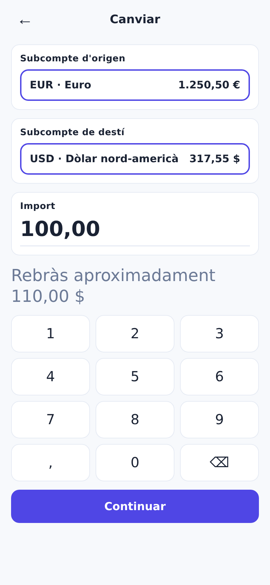
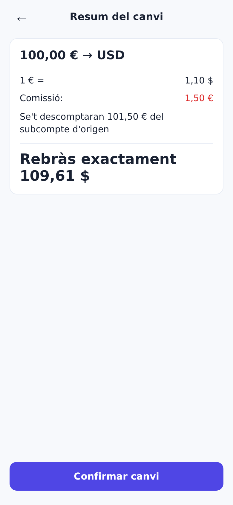
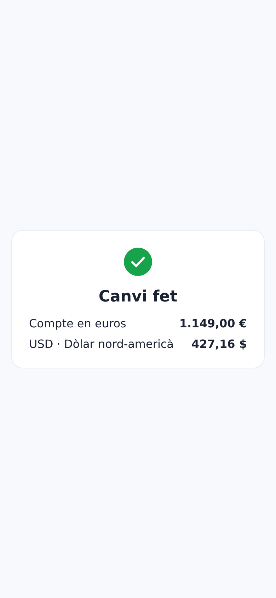

# US-27 · Canviar entre divises

Sprint 2 · Bloc Multidivisa · 5 punts · 10 h · Etiquetes: Fina, Mitjana, Multidivisa, P6 · Tasques: T27.1 (G, 4 h), T27.2 (G, 4 h), T27.3 (R, 2 h)

> **Dependències.** Aquesta història depèn de la **US-25** (afegir subcompte en divisa) i de la **T25.1**. El contracte és **exactament** el de `docs/us/US-25.md` §7 —la font de la veritat— amb **dues extensions** que aquesta US hi afegeix i que es validen a la T25.1: (1) cada fila de `GET /api/currencies` guanya el camp `ratePer10k`, i (2) la resposta de `POST /api/exchanges` guanya `commissionAmount` i `commissionEurCents` (§7.1). El model `Subaccount {id, user_id, code, balance}`, el seed amb `sub-01` (EUR `125050`, `isMain: true`) i `sub-02` (USD `31755`), el `totalEurCents 154020`, la taula de tipus fixos (EUR `10000` · USD `9123` · GBP `11680` · CHF `10355` · JPY `57`), els `decimals` (2, 2, 2, 2, 0), la regla `formatMinor` de la §9 de la US-25 i els codis `UNAUTHENTICATED` i `INTERNAL_ERROR` **no es re-deriven aquí**. La **fórmula de comissió i arrodoniment** de §7.4 és **còpia literal** de `docs/us/US-26.md` §7.4 (contracte comú T25.1) i es comprova byte a byte. Les dues decisions que la US-25 va deixar obertes —el valor de `commissionBps` (§1 (g) i §7.2) i el text de `INSUFFICIENT_BALANCE` (§7.4)— es prenen en aquesta US a §7.4 i §7.6. Sense la T25.1 aprovada i mergejada no es pot començar la T27.1.

## 1. Declaració de valor

```
COM A (AS A): client estàndard amb subcomptes en divisa
VULL (I WANT TO): canviar diners entre les meves divises
PER (SO I CAN): tenir saldo en la moneda que necessito en cada moment.
```

### Assumptes

- **(a) Calen dos subcomptes diferents i saldo a l'origen.** Amb un sol compte (només l'EUR) la pantalla `/canviar` no es pot fer servir: mostra l'estat buit de §4 amb «Necessites dos subcomptes per canviar divises.» i el botó «Divises» cap a `/divises`. Amb dos subcomptes, el saldo mínim per canviar `amount` és `amount + commissionSrcMinor` (pas 5 de la fórmula de §7.4): per canviar `100,00 €` calen `10150` cèntims a l'origen, no `10000`.
- **(b) El tipus i la comissió són sempre visibles abans de confirmar.** El teclat de `/canviar` mostra l'import aproximat que es rebrà (§7.5) i la pantalla de resum mostra, sempre i en aquest ordre, «1 € = 1,10 $», «Comissió: 1,50 €» (o «Sense comissió»), «Se't descomptaran 101,50 € del subcompte d'origen» i «Rebràs exactament 109,61 $» **abans** del botó «Confirmar canvi». No hi ha cap camí que enviï el `POST /api/exchanges` sense passar pel resum: el formulari només navega, no envia res.
- **(c) Un canvi és una sola transacció (T27.1).** Llegir els dos subcomptes, validar, escriure els dos saldos, crear els dos moviments i incrementar el comptador `exc-NN` passen dins d'una sola crida a `atomic.run(...)` (§7.3). Si qualsevol pas falla, **no s'escriu res**: no existeix cap estat amb l'origen descomptat i el destí sense apuntar.
- **(d) Comissió: 1,5 % amb mínim de 0,50 €, arrodonida a cèntims.** Decisió del PO presa abans de la T25.1 (la US-25 la va deixar oberta a §1 (g) i a §7.2 com a `[pendent de decisió del PO abans de T25.1]`; aquí queda fixada com a `commissionBps: 150`). La paga **qui fa el canvi** i **es queda al sistema**: s'afegeix a l'import canviat i es descompta de l'origen, no es lliura al destí i no es registra com a ingrés de ningú. La fórmula sencera és a §7.4.
- **(e) Tipus fixos cap a EUR, sense cap API externa.** Els tipus de la taula de la US-25 §1 estan hardcodejats a `backend/app/models/currency.py` (`rate_per_10k`) i no es consulta cap servei de tipus de canvi. El tipus que ensenya la pantalla es **deriva** d'aquesta taula (§7.4) i el nou camp `ratePer10k` de `GET /api/currencies` és exactament el valor de la taula (EUR `10000`, USD `9123`, GBP `11680`, CHF `10355`, JPY `57`), no un valor recalculat.
- **(f) Origen i destí han de ser divises diferents.** El selector de destí deshabilita la fila del subcompte triat com a origen (`aria-disabled="true"`, sense gest, sense cap crida) i el servidor ho defensa amb `422 SAME_CURRENCY`: la regla no viu a la UI.
- **(g) Estimació i abast.** SP 5 · VP 7 · 10 h (T27.1 backend 4 h, T27.2 pantalles 4 h, T27.3 revisió 2 h), extretes de la targeta del backlog (`docs/P1/trello-backlog.md`, línies 1091–1120). Aquesta US **només canvia saldos entre subcomptes existents**: no crea subcomptes (US-25), no els elimina (US-26), no fa pagaments (US-28) i no introdueix la quota mensual gratuïta (US-29). Tot el que toca fitxers de la US-25 o de la US-26 està marcat «additiu respecte de la US-25; coordinar a la T25.1».

## 2. Taula de pantalles

| Ruta | Vista/component (ruta real) | Punt d'entrada | Punt de sortida |
|---|---|---|---|
| `/divises` | `frontend/src/views/CurrenciesView.vue` (fila: `frontend/src/components/CurrencyRow.vue`) | tocar «Divises» a Inici | botó **«Canviar»** a sota de la llista i al costat d'«Afegir divisa» → `/canviar` (**additiu respecte de la US-25; coordinar a la T25.1**); «Afegir divisa» → `/divises/afegir` (US-25); «← Inici» enrere → `/` |
| `/canviar` | `frontend/src/views/ExchangeView.vue` + `frontend/src/viewmodels/useExchangeViewModel.ts` (**a crear, T27.2**) | botó «Canviar» de `/divises`; enrere des del resum (`/canviar?from=EUR&to=USD&amount=10000`) | «Continuar» → `/canviar/resum?from=EUR&to=USD&amount=10000`; «←» → `/divises` |
| `/canviar/resum` | `frontend/src/views/ExchangeSummaryView.vue` + `frontend/src/viewmodels/useExchangeSummaryViewModel.ts` (**a crear, T27.2**) | query de `/canviar` (`from`, `to`, `amount`, en codis i en unitats menors) | èxit del `POST` → 1500 ms → `router.replace('/')`; «←» → `/canviar?from=EUR&to=USD&amount=10000` amb l'esborrany intacte; `404 SUBACCOUNT_NOT_FOUND` → `router.replace('/divises')` |
| overlay dins de `/canviar/resum` (no és una ruta) | `<section class="card success" role="status">` dins `ExchangeSummaryView.vue` | `201` de `POST /api/exchanges` | cap: al cap de 1500 ms l'app torna sola a Inici |

Notes:

- **Rutes noves.** A `frontend/src/router/index.ts` (existent) s'afegeixen dues rutes **estàtiques**, just després de les estàtiques de la US-25 (`/divises` i `/divises/afegir`) i abans de `/divises/:subaccountId` de la US-26, de manera que totes les rutes estàtiques queden juntes i cap paràmetre no les pot empassar-se:

  ```ts
  { path: '/canviar', name: 'exchange', component: ExchangeView },
  { path: '/canviar/resum', name: 'exchange-summary', component: ExchangeSummaryView },
  ```

  Cap de les dues porta `props: true` (els ViewModels llegeixen `route.query`, no params de ruta) ni `meta: { public: true }`: passen pel `accessGuard` existent (`frontend/src/router/accessGuard.ts`).
- **A crear (frontend).** `frontend/src/views/ExchangeView.vue`, `frontend/src/views/ExchangeSummaryView.vue`, `frontend/src/viewmodels/useExchangeViewModel.ts`, `frontend/src/viewmodels/useExchangeSummaryViewModel.ts`, `frontend/src/components/AmountKeypad.vue` (teclat numèric), `frontend/src/components/SubaccountPicker.vue` (selector d'origen i de destí), `frontend/src/models/exchange.ts` (tipus `Exchange` de la resposta, `EXCHANGE_INSUFFICIENT_MESSAGE` i el mapeig JSON→objecte), `frontend/src/services/exchangeService.ts` (`createExchange`, **a crear**) i `frontend/src/mocks/exchanges.ts` (`mockCreateExchange`, amb reinici a `onMockUserChange` de `frontend/src/mocks/index.ts`). El servei **reutilitza** `frontend/src/services/subaccountsService.ts` (`getSubaccounts`, T25.2) i `frontend/src/services/currenciesService.ts` (`getCurrencies`, T25.2): aquesta US no redefineix cap dels dos.
- **A crear (backend).** `backend/app/models/exchange.py`, `backend/app/services/exchange_service.py` i `backend/app/routers/exchanges.py`.
- **A modificar (additiu respecte de la US-25; coordinar a la T25.1).** `frontend/src/views/CurrenciesView.vue` (el botó «Canviar» a sota de la llista, a l'esquerra d'«Afegir divisa»), `frontend/src/models/currency.ts` (camp `ratePer10k`), `frontend/src/models/apiError.ts` i `frontend/src/models/errorMessages.ts` (dos codis nous, §7.6), `backend/app/routers/currencies.py` (camp `ratePer10k`), `backend/app/services/errors.py` (dos codis nous), `backend/app/main.py` (`app.include_router(exchanges.router, prefix="/api")`), `backend/app/data/seed.py` (comptador `next_exchange_number[user_id]`) i `frontend/src/router/index.ts` (les dues rutes de dalt).
- **Nom del servei.** La US-25 §2 el declara com a `frontend/src/services/exchangesService.ts` (en plural, com `potsService.ts`) i aquí es fixa el nom definitiu `frontend/src/services/exchangeService.ts`; és **un sol fitxer** amb una sola funció `createExchange` i el nom es tanca a la T25.1. No s'han de crear tots dos.
- **Cap ruta d'aquesta US fa servir `DELETE`.** `apiClient.ts` només exposa `apiGet` i `apiPost` (`RequestOptions.method` és `'GET' | 'POST'`) i el `CORSMiddleware` de `backend/app/main.py` només permet `["GET", "POST"]` (US-15, §7.3 de la US-26). El canvi és un `POST` amb cos JSON i no cal tocar cap de les dues coses.

## 3. Flux d'interacció

1. L'usuari és a `/divises` (la llista de subcomptes de la US-25, amb la fila de l'EUR primer) i toca el botó **«Canviar»**, que és a sota de la llista, al costat d'«Afegir divisa».
2. El ViewModel fa `Promise.all([getSubaccounts(), getCurrencies()])` i mostra `LoadingIndicator` fins que responen les dues. Si la llista de subcomptes té **menys de 2 files** (només l'EUR), es pinta l'estat buit de §4 amb «Necessites dos subcomptes per canviar divises.» i el botó «Divises» → `/divises`; no es pinta cap selector ni cap teclat.
3. Amb dos o més subcomptes, es trien **origen (a dalt)** i **destí (a sota)** amb `SubaccountPicker`, que pinta una fila per subcompte amb `{code} · {nom}` i el saldo formatat (`formatMinor`): «EUR · Euro» «1.250,50 €», «USD · Dòlar nord-americà» «317,55 $». A l'origen surt preseleccionada la fila de l'EUR (el compte principal); al destí, el primer subcompte que no és l'origen. La fila del subcompte que ja és l'origen surt **deshabilitada** al selector de destí (i a l'inrevés).
4. S'escriu l'import amb `AmountKeypad`, que només accepta dígits i, si la divisa d'origen té `decimals: 2`, **una** coma decimal amb un màxim de 2 decimals (JPY, `decimals: 0`, no accepta cap coma). El valor viu al ViewModel com a text (`amount` = «100,00») i com a enter en unitats menors (`amountMinor` = `10000`); el teclat impedeix escriure un tercer decimal, o sigui que l'estat invàlid per format no s'hi pot arribar.
5. A sota del teclat, en gris i a 24 px, hi ha la línia «Rebràs aproximadament 110,00 $», recalculada **a cada tecla** amb la fórmula de §7.5 (tipus mostrat de 2 decimals, sense descomptar la comissió, que va a càrrec de l'origen).
6. Es validen en viu l'import i la parella d'origen/destí: si l'import és buit, `0`, no té format vàlid o és massa petit (§6), surt el missatge vermell corresponent i «Continuar» queda desactivat. Amb un import vàlid i origen ≠ destí, «Continuar» s'activa.
7. Es toca «Continuar». **No es fa cap crida a l'API**: el ViewModel navega a `/canviar/resum?from=EUR&to=USD&amount=10000` (codis de divisa i import en unitats menors de l'origen). El resum sobreviu a una recàrrega perquè tot l'esborrany viatja a la query, i «←» torna a `/canviar?from=EUR&to=USD&amount=10000` amb l'esborrany intacte.
8. El resum torna a fer `Promise.all([getSubaccounts(), getCurrencies()])` (per tenir els saldos i els noms frescos del servidor), llegeix `route.query` i pinta, en aquest ordre: la capçalera «Resum del canvi», la línia d'import «100,00 € → USD», «1 € = 1,10 $», «Comissió: 1,50 €» (en vermell; «Sense comissió» si la comissió és `0`), «Se't descomptaran 101,50 € del subcompte d'origen», «Rebràs exactament 109,61 $» (tipus complet `rateBps`, no el mostrat) i el botó lila «Confirmar canvi».
9. Es toca «Confirmar canvi». El ViewModel comprova **en local** que `balance` de l'origen ≥ `sourceAmount` (si no, pinta «No tens prou saldo» en vermell sota el botó i no crida res), posa el botó a «Confirmant…» i `disabled` (un doble toc no envia dos `POST`) i fa `POST /api/exchanges` amb `{"sourceCode":"EUR","targetCode":"USD","amount":10000}`. Amb `201`, la View substitueix el resum per la card `<section class="card success" role="status">` amb `<CircleCheck class="success-icon" :size="40" />` i el text «Canvi fet», a sota «Tornant a Inici…» i els dos saldos nous («1.149,00 €» i «427,16 $»); al cap de `CONFIRMATION_MS = 1500` ms (la mateixa constant que `useTopUpViewModel.ts`) el ViewModel fa `router.replace('/')` i a Inici els dos saldos i el «Total ≈ 1.538,70 €» ja surten actualitzats.
10. Errors: `422 INSUFFICIENT_BALANCE` → «No tens prou saldo» en vermell **sota el botó** (`role="alert"`), el resum no navega, res no canvia i «Confirmar canvi» torna a estar actiu; `422 SAME_CURRENCY`, `422 AMOUNT_TOO_SMALL` i `422 VALIDATION_ERROR` → alerta en línia amb el seu missatge exacte de §6; `404 SUBACCOUNT_NOT_FOUND` → alerta «No s'ha trobat el subcompte.» i `router.replace('/divises')`; `401` → `onSessionEnded` → `/login`; `500` o `NETWORK_ERROR` → `ErrorState` amb «No s'han pogut carregar les divises. Torna-ho a provar.» i el botó «Reintentar».

## 4. Matriu d'estats

| Pantalla | Estat | Com es veu | Component/atribut |
|---|---|---|---|
| `/canviar` (ExchangeView) | carregant (`Promise.all` en curs) | spinner centrat amb «Carregant…» | `<LoadingIndicator />` (`frontend/src/components/LoadingIndicator.vue`; ja porta `role="status"`) |
| `/canviar` (ExchangeView) | **buit** (menys de 2 subcomptes: només l'EUR) | icona de bústia, «Necessites dos subcomptes per canviar divises.» i el botó «Divises» que porta a `/divises` | `<EmptyState message="Necessites dos subcomptes per canviar divises." />` + `<RouterLink to="/divises">` amb el text «Divises»; no es pinta ni el selector ni el teclat |
| `/canviar` (ExchangeView) | error de càrrega (`500` o `NETWORK_ERROR`) | icona d'alerta, «No s'han pogut carregar les divises. Torna-ho a provar.» i botó «Reintentar» | `<ErrorState :message="loadErrorMessage" @retry="load" />` (`frontend/src/components/ErrorState.vue`, amb `<p role="alert">` a dins) |
| `/canviar` (ExchangeView) | èxit de càrrega | etiqueta «Subcompte d'origen» + `SubaccountPicker`; «Subcompte de destí» + `SubaccountPicker`; «Import» + import gran; «Rebràs aproximadament 110,00 $»; `AmountKeypad`; «Continuar» | `AppShell title="Canviar"`; `<MoneyAmount :cents="balance" :currency="currency" />` a cada fila (`formatMinor`) |
| `/canviar` (ExchangeView) | «Continuar» desactivat | el botó lila surt amb `disabled` (opacitat 0,5, sense gest): no navega | `:disabled="!canContinue"`; `canContinue` és `false` amb l'import buit, `0`, amb format invàlid, massa petit o amb origen = destí |
| `/canviar` (ExchangeView) | missatge de validació en viu | línia vermella sota el teclat amb el missatge de §6 («Escriu un import en euros, amb 2 decimals com a màxim.», «L'import és massa petit per canviar.») | `<p class="error" role="alert">`; el text surt del ViewModel |
| `/canviar` (ExchangeView) | destí = origen | la fila del subcompte d'origen, al selector de destí, surt en gris amb `aria-disabled="true"` i no respon a cap toc; no fa cap crida | `<SubaccountPicker :disabled-codes="[sourceCode]" />` amb classe `.row-disabled` |
| `/canviar`: teclat, `decimals` | import amb el màxim de decimals | a EUR/USD/GBP/CHF la tecla «Coma decimal» s'apaga (`disabled`) en arribar a 2 decimals; a JPY no s'hi pot escriure cap coma | `AmountKeypad` amb `:decimals="source.decimals"`; la tecla porta `aria-label="Coma decimal"` |
| `/canviar/resum` (ExchangeSummaryView) | carregant (els dos `GET` en curs) | spinner centrat amb «Carregant…» | `<LoadingIndicator />` |
| `/canviar/resum` (ExchangeSummaryView) | error de càrrega | «No s'han pogut carregar les divises. Torna-ho a provar.» + «Reintentar» | `<ErrorState>` |
| `/canviar/resum` (ExchangeSummaryView) | query invàlida (`from`/`to` que no són de la llista tancada, `amount` no enter > 0, `from === to`) | no es pinta res del resum: es redirigeix immediatament a `/canviar` amb `router.replace('/canviar')` | comprovació al ViewModel abans de pintar; no hi ha alerta perquè no hi ha res a explicar |
| `/canviar/resum` (ExchangeSummaryView) | èxit de càrrega | «Resum del canvi», «100,00 € → USD», «1 € = 1,10 $», «Comissió: 1,50 €» (vermell), «Se't descomptaran 101,50 € del subcompte d'origen», «Rebràs exactament 109,61 $» i «Confirmar canvi» (lila) | `AppShell title="Resum del canvi"`; `<MoneyAmount>` per als imports en EUR i `formatMinor` per als de divisa |
| `/canviar/resum` (ExchangeSummaryView) | èxit (`201`) | card d'èxit amb el tic verd de 40 px, «Canvi fet», «Tornant a Inici…» i els dos saldos nous «1.149,00 €» i «427,16 $»; al cap de 1500 ms `router.replace('/')` | `<section class="card success" role="status">` amb `<CircleCheck class="success-icon" :size="40" />`, com `frontend/src/views/TopUpView.vue`; el retard viu al ViewModel |
| `/canviar/resum` (ExchangeSummaryView) | error `422 INSUFFICIENT_BALANCE` | «No tens prou saldo» en vermell **sota el botó**; el resum segueix a la pantalla, res no canvia i «Confirmar canvi» torna a estar actiu | `<p class="error" role="alert">` sota el botó; `isSubmitting = false`; el text surt del `code` (§7.6) |
| `/canviar/resum` (ExchangeSummaryView) | error `422 SAME_CURRENCY` / `422 AMOUNT_TOO_SMALL` / `422 VALIDATION_ERROR` | alerta en línia amb el missatge del codi; «Confirmar canvi» reactivat | `<p class="error" role="alert">` amb `messageForCode(code)`; `isSubmitting = false` |
| `/canviar/resum` (ExchangeSummaryView) | error `404 SUBACCOUNT_NOT_FOUND` | alerta «No s'ha trobat el subcompte.» i navegació immediata a `/divises` | `<p role="alert">` a la vista + `router.replace('/divises')` al ViewModel |
| `/canviar/resum` (ExchangeSummaryView) | confirmant (`isSubmitting`) | el botó diu «Confirmant…» i està `disabled`; el doble toc no envia dos `POST` | `isSubmitting` viu a `useExchangeSummaryViewModel.ts`; `:disabled="isSubmitting"` |

## 5. Copy exacte

| Element | Text exacte | On apareix | Notes |
|---|---|---|---|
| Títol de pantalla | `Canviar` | `AppShell title="Canviar"` de `ExchangeView.vue` | permanent |
| Botó d'entrada | `Canviar` | `/divises`, sota de la llista, a l'esquerra d'«Afegir divisa» | permanent; **additiu respecte de la US-25; coordinar a la T25.1** |
| Etiqueta del selector | `Subcompte d'origen` | `/canviar`, a sobre del primer `SubaccountPicker` | permanent |
| Etiqueta del selector | `Subcompte de destí` | `/canviar`, a sobre del segon `SubaccountPicker` | permanent |
| Etiqueta de l'import | `Import` | `/canviar`, a sobre de l'import i del teclat | permanent |
| Previsualització | `Rebràs aproximadament {import}` | `/canviar`, sota de l'import i a sobre del teclat | transitori (canvia a cada tecla); gris `#6c7a96`, 24 px, `tabular-nums`; amb el seed i `100,00 €` → `Rebràs aproximadament 110,00 $` |
| Tecles del teclat | `Dígits 7`, `Coma decimal`, `Esborrar` | `aria-label` de les tecles de `AmountKeypad.vue` | permanent; el text visible de les tecles és `7` i `,` i la icona d'esborrar |
| Botó de continuació | `Continuar` | `/canviar`, sota del teclat | permanent; `disabled` mentre l'import no és vàlid |
| Títol del resum | `Resum del canvi` | `AppShell title="Resum del canvi"` de `ExchangeSummaryView.vue` | permanent |
| Capçalera del resum | `{import origen} {símbol origen} → {codi destí}` | `/canviar/resum`, primera línia del cos | permanent; amb el seed i `100,00 €` → `100,00 € → USD` |
| Tipus de canvi | `1 {símbol origen} = {R} {símbol destí}` | `/canviar/resum`, segona línia | permanent; amb el seed i EUR→USD → `1 € = 1,10 $` (`R` = tipus mostrat, 2 decimals, §7.4) |
| Comissió | `Comissió: {import}` | `/canviar/resum`, tercera línia | permanent; en vermell `#dc2626`, per coherència amb el criteri de la US-29 («la comissió que se suma en vermell»); amb el seed i `100,00 €` → `Comissió: 1,50 €` |
| Comissió zero | `Sense comissió` | `/canviar/resum`, al lloc de «Comissió: …» | **condicional**: només quan `commissionAmount === 0`; amb la política del 1,5 % i mínim 0,50 € **no passa mai** a la US-27 (vegeu §7.6, decisió E); el cas zero es pinta amb el color de text normal (`#1a2233`), no en vermell |
| Càrrec a l'origen | `Se't descomptaran {import} del subcompte d'origen` | `/canviar/resum`, quarta línia | permanent; import = `sourceAmount`; amb el seed → `Se't descomptaran 101,50 € del subcompte d'origen` |
| Import exacte | `Rebràs exactament {import}` | `/canviar/resum`, cinquena línia | permanent; import = `targetAmount` amb `formatMinor`; amb el seed → `Rebràs exactament 109,61 $` |
| Botó de confirmació | `Confirmar canvi` | `/canviar/resum`, sota de tot | permanent; fons `#4f46e5` (`--color-primary`), text blanc, 48 px d'alçada |
| Botó en curs | `Confirmant…` | el mateix botó mentre `isSubmitting` | transitori |
| Tic d'èxit | `Canvi fet` | card `role="status"` del resum | transitori (1500 ms), acompanyat de `<CircleCheck :size="40" />` |
| Sota el tic | `Tornant a Inici…` | card d'èxit, sota «Canvi fet» | transitori |
| Saldos nous de l'èxit | `1.149,00 €` i `427,16 $` | card d'èxit del resum | transitori; amb la plantilla `formatCents` / `formatMinor` |
| Saldo insuficient | `No tens prou saldo` | `/canviar/resum`, en vermell **sota el botó** | condicional (`422 INSUFFICIENT_BALANCE`); és el text de la targeta del backlog i **no** el missatge global del codi (decisió D, §7.6) |
| Origen igual a destí | `L'origen i la destinació han de ser divises diferents.` | `/canviar/resum`, alerta en línia | condicional (`422 SAME_CURRENCY`); text literal de `MESSAGES.SAME_CURRENCY` |
| Import massa petit | `L'import és massa petit per canviar.` | `/canviar` (validació en viu) i `/canviar/resum` (alerta) | condicional (`422 AMOUNT_TOO_SMALL`); text literal de `MESSAGES.AMOUNT_TOO_SMALL` |
| Format de l'import (EUR) | `Escriu un import en euros, amb 2 decimals com a màxim.` | `/canviar`, sota del teclat | condicional; text literal de la constant existent `AMOUNT_FORMAT_MESSAGE` de `frontend/src/models/errorMessages.ts` |
| Format de l'import (altres) | `Escriu un import en {nom de la divisa}, amb 2 decimals com a màxim.` | `/canviar`, sota del teclat, amb qualsevol origen que no sigui EUR | condicional; plantilla amb el `name` de la taula de la US-25 (`Escriu un import en dòlar nord-americà, amb 2 decimals com a màxim.`) |
| Format de l'import (JPY) | `Escriu un import en ien japonès, sense decimals.` | `/canviar`, sota del teclat, amb origen JPY | condicional; `decimals: 0` |
| Estat buit | `Necessites dos subcomptes per canviar divises.` | `/canviar` amb menys de 2 subcomptes | condicional |
| Botó de l'estat buit | `Divises` | `/canviar`, sota del missatge de l'estat buit | condicional; porta a `/divises` |
| Error de càrrega | `No s'han pogut carregar les divises. Torna-ho a provar.` | `ErrorState` de `/canviar` i de `/canviar/resum` | condicional; és el text de la US-25 §5, literal |
| Botó de reintent | `Reintentar` | `ErrorState` de les dues pantalles | condicional |
| Botó d'enrere | `←` | barra superior de `/canviar` i de `/canviar/resum` (`AppShell` amb `back`) | permanent; `aria-label="Enrere"` |
| Subcompte inexistent | `No s'ha trobat el subcompte.` | alerta del resum abans de `router.replace('/divises')` | condicional (`404`) |
| Error de validació (frontend) | `Les dades no són vàlides. Revisa-les i torna-ho a provar.` | alerta del resum si el servei respon `422 VALIDATION_ERROR` | condicional; text literal de `MESSAGES.VALIDATION_ERROR` |
| Error de xarxa | `No hi ha connexió amb el servidor. Torna-ho a provar.` | `ErrorState` quan falla el `fetch` | condicional; text literal de `MESSAGES.NETWORK_ERROR` |
| Imports del seed | `1.250,50 €`, `317,55 $`, `0,00 $` | files dels dos selectors i card d'èxit | permanent amb el seed; `formatMinor(31755, USD)` → «317,55 $», `formatMinor(0, USD)` → «0,00 $» |
| Import sense decimals | `1.234 ¥` | fila d'un subcompte JPY amb saldo `1234` | condicional; `decimals: 0` |
| Concepte del moviment d'origen | `Canvi a Dòlar nord-americà` | moviment `expense` de `POST /api/exchanges` (llista i detall de moviments) | permanent; plantilla `Canvi a {nom del destí}`; import `−101,50 €` |
| Concepte del moviment de destí | `Canvi des d'Euro` | moviment `income` de `POST /api/exchanges` | permanent; plantilla `Canvi des de {nom de l'origen}`; import `+109,61 $` |

## 6. Taula de validacions

| Camp | Regla | Missatge exacte (codi HTTP) | Quan |
|---|---|---|---|
| `amount` (format) | enter estric (`StrictInt`), en unitats menors de la divisa d'origen; el teclat limita els decimals a `decimals` de la divisa | **client:** `Escriu un import en euros, amb 2 decimals com a màxim.` (`AMOUNT_FORMAT_MESSAGE`; plantilla per a la resta de divises i variant sense decimals per a JPY). **servidor:** `Les dades de la petició no són vàlides.` (`VALIDATION_ERROR`, 422; el client el llegeix com a `Les dades no són vàlides. Revisa-les i torna-ho a provar.`) | en escriure amb el teclat (el client) i en rebre un cos amb `amount` que no sigui enter (el servidor) |
| `amount` | ≥ 1 unitat menor de l'origen (no `0` ni negatiu) | **client:** cap missatge: «Continuar» queda desactivat. **servidor:** `L'import ha de ser més gran que 0.` (`INVALID_AMOUNT`, 422) | en escriure `0` (el client) i en rebre `amount: 0` o negatiu (el servidor) |
| `sourceCode` / `targetCode` | divises diferents | **client:** la fila del subcompte d'origen surt deshabilitada al selector de destí i «Continuar» no s'activa. **servidor:** `L'origen i la destinació han de ser divises diferents.` (`SAME_CURRENCY`, 422) | en triar el destí (el client) i en rebre `sourceCode === targetCode` (el servidor, si la petició s'arriba a fer) |
| `sourceCode` / `targetCode` | existeix i és de l'usuari de la sessió | `No s'ha trobat el subcompte.` (`SUBACCOUNT_NOT_FOUND`, 404) | en enviar el `POST`: un codi d'una divisa que l'usuari no té dona el mateix `404` que un codi inexistent (no es filtra què té l'usuari) |
| `amount` | el resultat exacte ha de valer com a mínim 1 unitat menor del destí: `amount × tipus[src] ≥ tipus[tgt]` (pas 2 de §7.4) | **client:** `L'import és massa petit per canviar.` en escriure l'import. **servidor:** `L'import és massa petit per canviar.` (`AMOUNT_TOO_SMALL`, 422) | en escriure `0,01 $` amb destí EUR (`1 × 9123 = 9123 < 10000`, menys d'un cèntim) |
| `amount` (saldo) | `amount + commissionSrcMinor ≤ balance` de l'origen (pas 5 de §7.4) | **client:** `No tens prou saldo`, en tocar «Confirmar canvi», calculat amb el saldo local. **servidor:** `INSUFFICIENT_BALANCE` (422) amb el missatge global `No tens prou saldo per fer aquesta aportació.`, que la pantalla **no** ensenya (decisió D, §7.6) | en confirmar amb `100,00 €` i saldo d'origen `10000`: calen `10150` |
| `GET /api/subaccounts` | almenys 2 subcomptes | `Necessites dos subcomptes per canviar divises.` (client, sense codi d'error) | en carregar `/canviar`: la llista té menys de 2 files |
| `from` / `to` / `amount` de la query | `from` i `to` són codis de la llista tancada i diferents, i `amount` és un enter > 0 | cap missatge: `router.replace('/canviar')` | en carregar `/canviar/resum` amb una URL incompleta o manipulada |

## 7. Integració amb l'API

Aquest contracte **hereta** les convencions de `docs/api.md` (§1 i §5) i les de la US-25 §7: imports en **unitats menors senceres** (`125050` = 1.250,50 €; `1234` = 1.234 ¥), claus JSON en **`camelCase`**, dates **ISO 8601 amb desplaçament de `Europe/Madrid`**, cos d'error **`{code, message, details?}`** amb `details` **omesa quan és buida**, i el frontend branca pel **`code`**, mai pel `message` (`docs/api.md` §5). Només s'especifica el que és nou respecte de `docs/us/US-25.md`; tot el que no surt aquí és exactament el de la US-25.

### 7.1 Endpoints

| Mètode | Ruta | Èxit | Errors | Estat |
|---|---|---|---|---|
| `GET` | `/api/subaccounts` | 200 amb `{ items, totalEurCents }` | 401 `UNAUTHENTICATED` / 500 `INTERNAL_ERROR` | **a crear a la T25.1** (P48) · [PROPOSTA — pendent de validar]; aquesta US **només la consumeix** |
| `GET` | `/api/currencies` | 200 amb `{ items }`, cada fila amb el camp nou `ratePer10k` | 401 / 500 | **a crear a la T25.1** (P48 **+ extensió de la US-27**) · [PROPOSTA — pendent de validar] |
| `POST` | `/api/exchanges` | 201 amb l'objecte `Exchange` sol | 422 `VALIDATION_ERROR` / 422 `INVALID_AMOUNT` / 404 `SUBACCOUNT_NOT_FOUND` / 422 `SAME_CURRENCY` / 422 `AMOUNT_TOO_SMALL` / 422 `INSUFFICIENT_BALANCE` / 401 / 500 | **a crear** (P51 **+ extensions de la US-27**; T27.1) · [PROPOSTA — pendent de validar] |

Les tres rutes porten `Authorization: Bearer <token>` (el `apiClient` ja hi posa la capçalera) i pengen del prefix `/api` declarat una sola vegada a `backend/app/main.py`.

**Extensions d'aquesta US al contracte de la T25.1** (es validen a la PR de la T25.1, juntament amb la P48 i la P51 de la US-25):

| # | Apartat | Extensió |
|---|---|---|
| P48 + `ratePer10k` | §7.1, §7.2 | Cada fila de `GET /api/currencies` guanya `"ratePer10k"`: el `tipus` fix de la taula de la US-25 §1, en unitats de 1/10.000 cap a EUR (`EUR 10000`, `USD 9123`, `GBP 11680`, `CHF 10355`, `JPY 57`). És l'**extensió de la US-27 a la P48, de validar a la T25.1**: el teclat necessita el tipus per pintar «Rebràs aproximadament …» i no pot duplicar la taula al client. |
| P51 + `commissionAmount` / `commissionEurCents` | §7.1, §7.2 | La resposta de `POST /api/exchanges` guanya `commissionAmount` (la comissió cobrada, en unitats menors de la divisa d'origen) i `commissionEurCents` (la mateixa comissió, en cèntims d'EUR). És l'**extensió de la US-27 a la P51, de validar a la T25.1**: sense aquests dos camps el resum no pot ensenyar «Comissió: 1,50 €» sense duplicar la fórmula de comissió al client, cosa que trencaria la regla de la casa «una regla de negoci, un sol lloc». |

> **Nota US-15 (mètodes permesos).** `frontend/src/services/apiClient.ts` només exposa `apiGet` i `apiPost` (`RequestOptions.method` és `'GET' | 'POST'`) i el `CORSMiddleware` de `backend/app/main.py` només permet `allow_methods=["GET", "POST"]`; la reconciliació POST/DELETE entre la US-25 i la US-26 la porta la §7.3 de la US-26. **Cap ruta d'aquesta US fa servir `DELETE`**: el canvi és un `POST` amb cos JSON i no cal tocar ni el CORS ni `apiClient`.

### 7.2 Cossos exactes

`GET /api/currencies` → `200` (l'exemple de la US-25 §7.2 **amb el camp nou** `ratePer10k` a cada fila):

```json
{"items":[{"code":"EUR","name":"Euro","symbol":"€","decimals":2,"ratePer10k":10000,"owned":true},{"code":"USD","name":"Dòlar nord-americà","symbol":"$","decimals":2,"ratePer10k":9123,"owned":true},{"code":"GBP","name":"Lliura esterlina","symbol":"£","decimals":2,"ratePer10k":11680,"owned":false},{"code":"CHF","name":"Franc suís","symbol":"CHF","decimals":2,"ratePer10k":10355,"owned":false},{"code":"JPY","name":"Ien japonès","symbol":"¥","decimals":0,"ratePer10k":57,"owned":false}]}
```

`GET /api/subaccounts` → `200` (cos de la US-25 §7.2, sense cap canvi; és el que dona els saldos, els noms i els símbols de les dues pantalles):

```json
{"items":[{"id":"sub-01","code":"EUR","name":"Euro","symbol":"€","balance":125050,"isMain":true},{"id":"sub-02","code":"USD","name":"Dòlar nord-americà","symbol":"$","balance":31755,"isMain":false}],"totalEurCents":154020}
```

`POST /api/exchanges` amb cos `{"sourceCode":"EUR","targetCode":"USD","amount":10000}` → `201`:

```json
{"id":"exc-01","sourceCode":"EUR","targetCode":"USD","sourceAmount":10150,"targetAmount":10961,"rateBps":10961,"commissionBps":150,"commissionAmount":150,"commissionEurCents":150,"createdAt":"2026-11-15T18:30:00+01:00"}
```

> Semàntica exacta dels camps: `amount` (a la petició) és l'import que l'usuari vol canviar, **enter estric** en unitats menors de la divisa d'origen (`10000` = 100,00 €). `sourceAmount` és el **total descomptat de l'origen**, és a dir `amount + commissionAmount` (`10150` = 101,50 €); amb `commissionBps: 0` coincideix amb `amount`, com a l'exemple de la US-25 §7.2. `targetAmount` és l'import **rebut al destí** (`10961` = 109,61 $). `rateBps` és el tipus creuat en base 10.000 (`10961` vol dir `1 EUR = 1,0961 USD`; en sentit invers, USD→EUR dona `9123`, idèntic a l'exemple de la US-25). `commissionBps` és `150` (1,5 %; **resol el «pendent de decisió del PO» de la US-25**). `commissionAmount` i `commissionEurCents` són les dues extensions d'aquesta US: la comissió cobrada, en unitats menors de l'origen i en cèntims d'EUR respectivament. Tots els imports són enters positius i `sourceAmount`/`targetAmount` estan en la unitat menor de la **seva pròpia** divisa.

`POST /api/exchanges` amb cos `{"sourceCode":"EUR","targetCode":"USD","amount":10000}` i saldo d'origen `10000` → `422`:

```json
{"code":"INSUFFICIENT_BALANCE","message":"No tens prou saldo per fer aquesta aportació."}
```

> El `message` és el **global** del codi (el de les guardioles, `backend/app/services/errors.py`), perquè un codi té un sol missatge global a tot el contracte. La pantalla d'aquest canvi **no l'ensenya mai**: `useExchangeSummaryViewModel` el mapa pel `code` i pinta «No tens prou saldo» (decisió D, §7.6).

`POST /api/exchanges` amb cos `{"sourceCode":"USD","targetCode":"USD","amount":1000}` → `422`:

```json
{"code":"SAME_CURRENCY","message":"L'origen i la destinació han de ser divises diferents."}
```

`POST /api/exchanges` amb cos `{"sourceCode":"USD","targetCode":"EUR","amount":1}` → `422`:

```json
{"code":"AMOUNT_TOO_SMALL","message":"L'import és massa petit per canviar."}
```

`POST /api/exchanges` amb cos `{"sourceCode":"GBP","targetCode":"USD","amount":1000}` quan l'usuari no té GBP → `404`:

```json
{"code":"SUBACCOUNT_NOT_FOUND","message":"No s'ha trobat el subcompte."}
```

`POST /api/exchanges` amb cos `{"sourceCode":"EUR","targetCode":"USD","amount":"10000"}` (import com a text) → `422`:

```json
{"code":"VALIDATION_ERROR","message":"Les dades de la petició no són vàlides."}
```

Moviments que crea aquell mateix `201` (dues files noves a l'historial, dins la mateixa transacció; `docs/api.md` §3):

```json
[{"id":"mov-1041","amount":10150,"concept":"Canvi a Dòlar nord-americà","date":"2026-11-15T18:30:00+01:00","type":"expense","icon":"other","currency":"EUR"},{"id":"mov-1042","amount":10961,"concept":"Canvi des d'Euro","date":"2026-11-15T18:30:00+01:00","type":"income","icon":"other","currency":"USD"}]
```

> `id` és el que dona el comptador de moviments existent; les xifres de l'exemple són il·lustratives i el que és contracte és la forma: `type` `expense`/`income`, `amount` positiu en unitats menors, `icon: "other"` (la llista `ICONS` de `frontend/src/models/movement.ts` és tancada) i el camp nou `currency`. El camp `currency` del `Movement` és **[PROPOSTA]** d'aquesta US, amb valor per defecte `"EUR"`, i és **requisit de la US-28** (el seu assumpte diu que «els moviments mostren l'import original, el tipus i la comissió»); la visualització ampliada (tipus i comissió al detall del moviment) queda **fora** de l'abast d'aquesta US.

### 7.3 Ordre de validacions i atomicitat

El servei (`backend/app/services/exchange_service.py`, **a crear**) avalua en aquest ordre exacte i s'atura al primer error. Les validacions de l'1 al 6 es fan **abans d'escriure res**:

1. **Cos de la petició.** `sourceCode` i `targetCode` són `StrictStr` (no buits) i `amount` és `StrictInt`: el schema del router ho declara i un valor d'un altre tipus dona `VALIDATION_ERROR` (422) amb `Les dades de la petició no són vàlides.` abans que el servei s'executi.
2. **Import positiu.** `amount <= 0` → `INVALID_AMOUNT` (422) amb `L'import ha de ser més gran que 0.` (el missatge global que ja existeix a `errors.py` i a `errorMessages.ts`).
3. **Desconegut o aliè.** Origen o destí que no és de la llista tancada, o que no té subcompte de l'usuari de la sessió → `SUBACCOUNT_NOT_FOUND` (404) amb `No s'ha trobat el subcompte.` No es distingeix «no existeix» de «no és teu»: no s'ha de revelar què té l'usuari.
4. **Origen igual a destí.** `sourceCode == targetCode` → `SAME_CURRENCY` (422) amb `L'origen i la destinació han de ser divises diferents.`
5. **Massa petit** (pas 2 de la fórmula de §7.4: `amount × tipus[src] < tipus[tgt]`) → `AMOUNT_TOO_SMALL` (422) amb `L'import és massa petit per canviar.`
6. **Saldo** (pas 5 de la fórmula: `amount + commissionSrcMinor > balance`) → `INSUFFICIENT_BALANCE` (422). El `message` de la resposta és el global.
7. **Transacció**, només si tot l'anterior ha passat.

**Atomicitat.** El servei segueix el patró de `backend/app/services/pot_service.py::contribute`: valida **tot** abans de la primera escriptura, apunta cada escriptura feta a una pila `undo` i, si una qualsevol falla, desfà les anteriors de l'última a la primera dins d'un `except Exception: undo…; raise`. El router l'executa dins d'**una sola** crida `atomic.run(...)` (`Depends(atomic)`) que fa, en aquest ordre i tot o res:

1. Llegeix els dos subcomptes (`subaccounts.get_by_user(user_id, code)`).
2. Torna a validar els passos 3 a 6 amb els valors acabats de llegir (el saldo pot haver canviat des de la càrrega de la pantalla).
3. Escriu el saldo de l'origen a `balance − (amount + commissionAmount)`.
4. Escriu el saldo del destí a `balance + targetAmount`.
5. Crea els dos moviments de §7.2 (origen `expense` amb `amount = sourceAmount`, destí `income` amb `amount = targetAmount`).
6. Incrementa el comptador d'exchanges de l'usuari (`next_exchange_number[user_id]`) i compon l'`id` `exc-NN`.

En memòria és `MemoryAtomic` (un `RLock`); a Firestore és `FirestoreAtomic` (una transacció de Firestore **més** el `RLock`, amb `MAX_ATTEMPTS = 10`), els dos objectes que ja fa servir la resta del projecte a `backend/app/repositories/atomic.py`. Les col·leccions són les de la US-25 (`subaccounts`, amb l'id de document `{userId}_{code}`), més `movements` i `counters` (el comptador `exc-NN`).

Conseqüències d'aquesta atomicitat:

- **Si qualsevol pas falla, no s'escriu res**: no hi ha cap instant en què l'origen estigui descomptat i el destí no apuntat, ni cap instant amb un sol moviment creat. A Firestore això és la garantia de la transacció; en memòria, la del `RLock` i la pila `undo`.
- **L'invariant `saldo == Σ moviments` es manté**, perquè el moviment de l'origen importa `amount + commissionAmount` (el total real descomptat, comissió inclosa) i el del destí importa `targetAmount`. La comissió no genera cap moviment propi: es queda al sistema.
- **El `totalEurCents` no es desa**: es recalcula a cada `GET /api/subaccounts` amb la regla de la US-25 §7.3. Per això, després del canvi de `100,00 €` a USD el total baixa **exactament** els `150` cèntims de la comissió: `154020 → 153870` («Total ≈ 1.538,70 €»).
- **Un `ApiError` no desfà res**: com al `contribute` de les guardioles, els passos 1 a 6 ja han validat abans d'escriure, i un error de negoci surt sense haver tocat cap document.

### 7.4 Fórmula de comissió i arrodoniment (contracte comú T25.1)

Aquesta US no fa cap canvi de saldo per comissió: la fórmula és del contracte comú (T25.1) i ha de ser **idèntica** a la de `docs/us/US-27.md` (es copia literalment). Decisió del PO abans de la T25.1: **comissió del 1,5 % amb mínim de 0,50 €, arrodonida a cèntims.**

Regles generals:

- Tot es calcula en **enters** (mai `float`), amb arrodoniment **half-up** fent servir `(x + 5000) // 10000` (mai `round()` de Python, que arrodoneix a l'enter parell).
- `tipus[X]` = taula fixa de la US-25 §1, en unitats de 1/10.000 cap a EUR: `EUR 10000 · USD 9123 · GBP 11680 · CHF 10355 · JPY 57`.
- `decimals[X]` = 2 per a EUR/USD/GBP/CHF i 0 per a JPY; la unitat menor (`minor`) són cèntims o iens sencers.
- La comissió la paga qui fa el canvi: es **suma** a l'import canviat i es descompta del subcompte d'origen. La comissió **es queda al sistema**: no es lliura al destí i no es registra com a ingrés; el moviment d'origen registra `amount + comissió`, de manera que es manté l'invariant `saldo == Σ moviments`.

Passos d'un canvi, en ordre exacte (T27.1):

1. `amountEurCents = (amount × tipus[src] + 5000) // 10000` (half-up; es fa servir per a la comissió).
2. **Massa petit:** si `amount × tipus[src] < tipus[tgt]` (el resultat *exacte* és menor que 1 unitat menor del destí) → `AMOUNT_TOO_SMALL`; no es canvia res.
3. `commissionEurCents = max((150 × amountEurCents + 5000) // 10000, 50)` (1,5 % half-up, mínim 50 cèntims = 0,50 €).
4. `commissionSrcMinor = (commissionEurCents × 10000 + tipus[src] // 2) // tipus[src]` (half-up; per a EUR dona exactament `commissionEurCents`).
5. **Saldo:** si `amount + commissionSrcMinor > balance` → `INSUFFICIENT_BALANCE`; no es canvia res.
6. `targetMinor = (amount × tipus[src] + tipus[tgt] // 2) // tipus[tgt]` (half-up de l'valor exacte).
7. **Transacció única:** origen `−(amount + commissionSrcMinor)`, destí `+targetMinor` i els dos moviments, tot o res.

Tipus mostrat a les pantalles: `rateBps = half-up(10000 × (10^decimals[src] × tipus[src]) ÷ (10^decimals[tgt] × tipus[tgt]))` i la línia es mostra com `1 {símbol src} = R {símbol tgt}` amb `R = half-up(rateBps ÷ 10000, 2 decimals)`. Exemples: EUR→USD `rateBps = 10961`, `R = 1,10` → «1 € = 1,10 $»; USD→EUR `rateBps = 9123`, `R = 0,91` → «1 $ = 0,91 €»; USD→GBP `rateBps = 7811`, `R = 0,78` → «1 $ = 0,78 £».

Exemples treballats (xifres amb el seed de la US-25: EUR `125050`, USD `31755`):

1. **100,00 € → USD**: `amountEurCents = 10000` · comissió = `max((150×10000+5000)//10000, 50)` = `150` = **1,50 €** · es descomptaran `10000 + 150 = 10150` = **101,50 €** · `targetMinor = (10000×10000 + 4561) // 9123 = 10961` = **109,61 $**. Saldos: EUR `125050 → 114900` («1.149,00 €»), USD `31755 → 42716` («427,16 $»), total `154020 → 153870` («Total ≈ 1.538,70 €»): el total aproximat baixa **exactament 1,50 €**, la comissió.
2. **20,00 € → USD**: comissió = `max((150×2000+5000)//10000, 50)` = `max(30, 50)` = `50` = **0,50 €** (aplica el mínim) · es descomptaran **20,50 €** · `targetMinor = (2000×10000 + 4561) // 9123 = 2192` = **21,92 $**.
3. **50,00 $ → GBP** (creuat): `amountEurCents = (5000×9123 + 5000) // 10000 = 4562` · comissió = `max((150×4562+5000)//10000, 50)` = `max(68, 50)` = `68` = **0,68 €** → `commissionSrcMinor = (68×10000 + 4561) // 9123 = 75` = **0,75 $** · es descomptaran **50,75 $** · `targetMinor = (5000×9123 + 5840) // 11680 = 3905` = **39,05 £**.
4. **Massa petit — 0,01 $ → EUR**: `1 × 9123 = 9123 < 10000` → `AMOUNT_TOO_SMALL`; no es canvia res (0,9123 cèntim és menys d'un cèntim).
5. **Saldo insuficient — 100,00 € → USD amb saldo `10000`**: calen `10150 > 10000` → `INSUFFICIENT_BALANCE`; no es canvia res.

> **Nota de reconciliació (JPY).** Amb la fórmula en cèntims de la US-25 §7.3, el valor `57` de la fila JPY dona `1234 ¥ → 0,07 €` en lloc de `7,03 €` (caldria `5700`): hi ha una inconsistència entre l'assumpció (d) i l'exemple 7.3 de la US-25. Els passos de dalt fan servir `tipus` simbòlicament, així que es corregeix a la taula de la US-25/T25.1 sense canviar cap pas. Cap exemple d'aquesta fórmula fa servir JPY.

> **Aplicació a aquesta US.** El bloc de dalt és la **còpia literal** de `docs/us/US-26.md` §7.4 (33 línies, idèntiques byte a byte) i val per a les dues històries. En llegir-lo cal tenir present que els «aquesta US» del bloc són la US-26, perquè és el text que s'hi copia: on diu que «aquesta US no fa cap canvi de saldo per comissió» vol dir la US-26. A la **US-27 sí que es cobra la comissió** (passos 1 a 7, amb el resultat volcat a les dues escriptures de §7.3). Els exemples treballats d'aquell bloc són els d'aquesta US: `100,00 € → USD` dona `rateBps 10961`, comissió `150` cèntims, `sourceAmount 10150`, `targetAmount 10961`, saldos `125050 → 114900` i `31755 → 42716`, i total `154020 → 153870`.

### 7.5 Previsualització del teclat i tipus mostrat

El teclat ensenya **aproximadament** el que es rebrà perquè fa servir el **tipus mostrat** (2 decimals), mentre que el resum ensenya **exactament** el que es rebrà perquè fa servir el **tipus complet** (`rateBps`). Són dues xifres diferents amb dos propòsits diferents, i totes dues surten de les mateixes dades del servidor: el client **no** calcula cap canvi amb el tipus mostrat per enviar-lo al backend.

Fórmula de la previsualització (frontend, `frontend/src/models/exchange.ts`):

- `R` = tipus mostrat = `half-up(rateBps ÷ 10000)` amb 2 decimals (el mateix `R` de la línia «1 € = 1,10 $» de §7.4).
- `R100` = `R` multiplicat per 100 i arrodonit a enter. Per a EUR→USD, `R = 1,10` → `R100 = 110`.
- `previewMinor = half-up(amount × R × 10^decimals[tgt] ÷ 10^decimals[src])`, tot en enters:

  ```
  previewMinor = (amount × R100 × 10^dec[tgt] + 50 × 10^dec[src]) // (100 × 10^dec[src])
  ```

- `amount` és l'import en unitats menors de l'origen, `dec[tgt]` i `dec[src]` són els `decimals` de la taula de la US-25 (2, 2, 2, 2, 0). Cap `float`: només enters, i `//` com a divisió entera.

Exemple treballat, EUR→USD amb `amount = 10000` (100,00 €): `rateBps = 10961` → `R = 1,10` → `R100 = 110`; `(10000 × 110 × 100 + 50 × 100) // (100 × 100) = (110000000 + 5000) // 10000 = 11000` → «Rebràs aproximadament 110,00 $».

Resum de les dues xifres per al mateix canvi:

| On | Valor | D'on surt | Com es llegeix |
|---|---|---|---|
| `/canviar`, sota el teclat | `11000` → «110,00 $» | tipus **mostrat** `R = 1,10` | «Rebràs aproximadament 110,00 $» (paraula «aproximadament»: el tipus té 2 decimals) |
| `/canviar/resum` | `10961` → «109,61 $» | `targetAmount` del **servidor**, calculat amb `rateBps 10961` | «Rebràs exactament 109,61 $» (paraula «exactament»: és el camp de la resposta) |

Regles que se'n deriven:

- El tipus mostrat és **arrodoniment de presentació**: `1,10 $` és `1,0961 $` arrodonit a 2 decimals. Mai no s'envia al backend ni s'usa per calcular cap import que s'escrigui.
- **Els càlculs del backend mai fan servir el valor mostrat.** El servidor rep `{sourceCode, targetCode, amount}` i recalcula `rateBps`, `targetAmount` i la comissió des dels `tipus` de la taula hardcodejada (§7.4); si la previsualització i el resum no coincideixen, mana el servidor i el resum és el que es desa.
- Amb el destí JPY (`decimals: 0`) la previsualització surt sense decimals («Rebràs aproximadament 11.000 ¥») i la mateixa fórmula funciona perquè `10^0 = 1`.
- La previsualització **no descompta la comissió**: la comissió es cobra a l'origen (`sourceAmount = amount + commissionAmount`) i no resta gens de l'import rebut al destí, així que «Rebràs aproximadament» i «Rebràs exactament» parlen sempre de l'import íntegre que arriba al destí.

### 7.6 Codis d'error i reacció de la UI

| Codi | HTTP | Missatge exacte | Reacció exacta de la UI |
|---|---|---|---|
| `VALIDATION_ERROR` | 422 | `Les dades no són vàlides. Revisa-les i torna-ho a provar.` (frontend) / `Les dades de la petició no són vàlides.` (backend) | alerta en línia `<p role="alert">` al resum; `isSubmitting = false`; sense navegació i sense toast |
| `INVALID_AMOUNT` | 422 | `L'import ha de ser més gran que 0.` | no ha de passar mai (el teclat i «Continuar» ho impedeixen); si arriba, alerta en línia al resum |
| `SUBACCOUNT_NOT_FOUND` | 404 | `No s'ha trobat el subcompte.` | alerta `<p role="alert">` al resum i `router.replace('/divises')` immediat |
| `SAME_CURRENCY` | 422 | `L'origen i la destinació han de ser divises diferents.` | alerta en línia al resum; sense navegació i sense toast; el client ja ho impedeix deshabilitant la fila del destí |
| `AMOUNT_TOO_SMALL` | 422 | `L'import és massa petit per canviar.` | validació en viu a `/canviar` (missatge vermell i «Continuar» desactivat) i alerta en línia al resum si el servidor el torna |
| `INSUFFICIENT_BALANCE` | 422 | `No tens prou saldo per fer aquesta aportació.` (missatge global, **no** el que ensenya la pantalla) | «No tens prou saldo» en vermell **sota el botó** del resum (`role="alert"`); `isSubmitting = false`; «Confirmar canvi» reactivat; sense navegació i sense toast |
| `UNAUTHENTICATED` / `SESSION_EXPIRED` | 401 | `Cal iniciar sessió.` / `La sessió s'ha tancat per inactivitat.` | `onSessionEnded` de `frontend/src/services/session.ts` → `router.push('/login')` (mecanisme existent) |
| `INTERNAL_ERROR` | 500 | `S'ha produït un error inesperat. Torna-ho a provar més tard.` | `ErrorState` amb el botó «Reintentar» |
| `NETWORK_ERROR` | — (frontend) | `No hi ha connexió amb el servidor. Torna-ho a provar.` | `ErrorState` amb el botó «Reintentar» |

> **Decisió D — `INSUFFICIENT_BALANCE` (la que la US-25 §7.4 demanava prendre).** El missatge **global** del codi a `backend/app/services/errors.py` i a `frontend/src/models/errorMessages.ts` es queda **exactament com és avui**: `No tens prou saldo per fer aquesta aportació.`, perquè un codi té **un sol** missatge global i canviar-lo alteraria el copy i els tests existents de les guardioles. La pantalla de canvi **no ensenya mai** aquest missatge global: `useExchangeViewModel` i `useExchangeSummaryViewModel` mapen el `code` a la constant pròpia d'aquesta història, `EXCHANGE_INSUFFICIENT_MESSAGE = 'No tens prou saldo'` (el text de la targeta del backlog), i ho fan **pel `code`**, mai pel `message` (`docs/api.md` §5). Això **rebutja** la proposta «No tens saldo suficient en aquesta divisa.» de la US-25 §7.4, i aquesta és la raó: la US-25 la proposava com a text global del codi, i aquesta US prefereix no tocar el text de les guardioles i donar al canvi el text curt que el PO va aprovar a la targeta.

> **Decisió E — quan es pot veure «Sense comissió».** El resum mostra «Sense comissió» quan `commissionAmount` val `0`. Amb la política del PO (1,5 % amb mínim de 0,50 €) **mai és 0 a la US-27**: qualsevol canvi, per petit que sigui, paga com a mínim 50 cèntims d'EUR. La branca queda **implementada i provada** (test del ViewModel amb la política de comissió mockejada a `commissionBps: 0`, com l'exemple de la US-25 §7.2) i es farà **real a la US-29**, quan la quota mensual gratuïta (1.000 € estàndard / 5.000 € premium) faci que el servidor retorni `commissionAmount: 0` dins la quota. L'alternativa que el PO va deixar sobre la taula —considerar gratuïts els canvis fins a 1.000 €/mes des d'ara— queda **fora de l'abast d'aquesta US**, perquè destrossaria l'INVEST de la US-29 i canviaria els nombres dels tres AC de §10.

On s'afegeixen els codis:

- `backend/app/services/errors.py`: les constants `SAME_CURRENCY` i `AMOUNT_TOO_SMALL` amb el seu text, més `ERROR_STATUS` (422 els dos) i `ERROR_MESSAGES`. `INSUFFICIENT_BALANCE` i `INVALID_AMOUNT` **no es toquen**.
- `frontend/src/models/apiError.ts`: `SAME_CURRENCY` i `AMOUNT_TOO_SMALL` a `API_ERROR_CODES` (la US-25 §7.4 ja els reserva; aquesta US els activa).
- `frontend/src/models/errorMessages.ts`: les dues claus a `MESSAGES: Record<ApiErrorCode, string>` amb els textos exactes de la taula de dalt. La clau `INSUFFICIENT_BALANCE` **no es modifica** (decisió D); el text curt viu a `frontend/src/models/exchange.ts` com a `EXCHANGE_INSUFFICIENT_MESSAGE`.
- **Camp `currency` del `Movement`** (extensió de la US-27, **[PROPOSTA]**): `frontend/src/models/movement.ts` guanya `currency: string` amb `"EUR"` per defecte quan el JSON no el porta, i el mapper el llegeix tolerant (un valor desconegut es queda com a text, no es descarta). És **requisit de la US-28**; la llista i el detall de moviments d'aquesta US no canvien de format.

## 8. Acció → reacció → resposta → toast/redirecció

| Acció de l'usuari | Reacció immediata de la UI | Resposta de l'API | Toast / redirecció |
|---|---|---|---|
| tocar «Canviar» a `/divises` | navega a `/canviar` i mostra `LoadingIndicator` fins que responen les dues crides | `GET /api/subaccounts` i `GET /api/currencies` → 200 | sense toast |
| triar com a destí el mateix subcompte que l'origen | res: la fila és `aria-disabled="true"`, no hi ha gest | sense resposta, cap crida | sense toast |
| escriure un import invàlid (`0`, amb 3 decimals, massa petit) | missatge vermell sota el teclat i «Continuar» desactivat; no es navega | sense resposta, cap crida | sense toast |
| tocar «Continuar» amb un import vàlid | navega a `/canviar/resum?from=EUR&to=USD&amount=10000`; el resum fa els dos `GET` i pinta tipus, comissió i import exacte | `GET /api/subaccounts` i `GET /api/currencies` → 200 | sense toast; **cap `POST` encara** |
| tocar «Confirmar canvi» amb prou saldo | `isSubmitting = true`: el botó diu «Confirmant…» i queda `disabled` (el doble toc no envia dos `POST`) | `POST /api/exchanges` → 201 | `<section class="card success" role="status">` amb el tic de 40 px i «Canvi fet»; `useExchangeSummaryViewModel.ts` espera `CONFIRMATION_MS = 1500` ms i fa `router.replace('/')` |
| tocar «Confirmar canvi» sense prou saldo | comprovació **local**: «No tens prou saldo» en vermell sota el botó, el botó no s'activa i no es fa cap crida | sense resposta, cap crida (si s'arriba a enviar, el servidor respon 422 `INSUFFICIENT_BALANCE`) | sense navegació i sense toast |
| `POST` respon 422 `INSUFFICIENT_BALANCE` | «No tens prou saldo» en vermell **sota el botó**; `isSubmitting = false`; «Confirmar canvi» reactivat; res no canvia | 422 | sense navegació i sense toast |
| `POST` respon 422 `SAME_CURRENCY` / `AMOUNT_TOO_SMALL` / `VALIDATION_ERROR` | alerta en línia `<p role="alert">` amb el missatge del codi; `isSubmitting = false` | 422 | sense navegació i sense toast |
| `POST` respon 404 `SUBACCOUNT_NOT_FOUND` | alerta `role="alert"` amb «No s'ha trobat el subcompte.» | 404 | `router.replace('/divises')` |
| `GET` falla (500 o `NETWORK_ERROR`) | `ErrorState` amb el text de `toUserMessage` i el botó «Reintentar», que torna a cridar `load()` | 500 o sense xarxa | sense navegació i sense toast |
| la sessió ha caducat (`401`) | `apiClient` crida `endSession('inactivity')` o `endSession('unauthenticated')` | 401 `SESSION_EXPIRED` / `UNAUTHENTICATED` | `onSessionEnded` → `router.push('/login')` |
| recarregar `/canviar/resum?from=EUR&to=USD&amount=10000` | el ViewModel llegeix la query, torna a fer els dos `GET` i recalcula tot des del servidor amb els saldos i el tipus actuals | `GET /api/subaccounts` i `GET /api/currencies` → 200 | sense toast |

**Nota:** l'app **no té cap toast i no té cap modal** (verificat a la US-25 §8: no hi ha cap coincidència de `toast` ni de `modal` a `frontend/src` ni a `backend/app`). Tota la retroalimentació d'aquesta US és una card `role="status"` (el tic «Canvi fet», igual que `frontend/src/views/TopUpView.vue`, i el `LoadingIndicator`), una alerta `role="alert"` (la validació en viu, els errors del `POST` i «No tens prou saldo») o un `ErrorState` amb reintent. Cap temporitzador no viu a la View: el retard de 1,5 s és al ViewModel (`useExchangeSummaryViewModel.ts`, com `useTopUpViewModel.ts`).

## 9. Requisits no funcionals

- **Accessibilitat.** El teclat numèric (`AmountKeypad.vue`) és propi: cada tecla és un `<button type="button">` amb el dígit visible i un `aria-label` explícit («Dígits 7», «Coma decimal», «Esborrar»), i no cal cap `inputmode` perquè no hi ha cap `<input>` del sistema. El selector (`SubaccountPicker.vue`) són botons amb el text `{code} · {nom}` i el saldo, `aria-label="Tria subcompte d'origen"` / `aria-label="Tria subcompte de destí"`, i les files deshabilitades porten `aria-disabled="true"`. El tic «Canvi fet» va dins `role="status"` (s'anuncia en aparèixer) i tots els errors dins `<p role="alert">`, inclòs «No tens prou saldo». En canviar de ruta es fa focus al `<h1>` de la vista amb el `router.afterEach` de `frontend/src/router/index.ts` que la US-25 ja preveu. El color no és mai l'únic indicador: «No tens prou saldo» és text amb paraules, la comissió porta l'etiqueta «Comissió:» i la tecla deshabilitada porta `disabled` i no només opacitat.
- **Contrast** (ratis WCAG 2.1 `(L1 + 0,05) ÷ (L2 + 0,05)` amb els colors de `frontend/src/style.css`: fons `#f7f9fc`, superfície `#ffffff`, text `#1a2233`, primari `#4f46e5`, vermell `#dc2626`, verd `#16a34a`, gris `#6c7a96`):
  - `#1a2233` sobre `#ffffff` = **15,90:1**: títols, etiquetes dels selectors, import gran, «Se't descomptaran …», «Rebràs exactament …» i les xifres de les files dels selectors.
  - Blanc sobre `#4f46e5` = **6,29:1**: «Continuar» i «Confirmar canvi» (≥ 4,5:1).
  - `#dc2626` sobre `#ffffff` = **4,83:1**: «Comissió: 1,50 €» i els missatges d'error («No tens prou saldo», «L'import és massa petit per canviar.», format de l'import).
  - Verd del tic `#16a34a` sobre blanc = **3,30:1**: prou per a la icona de 40 px (llindar 3:1 per a elements gràfics) i sempre acompanyat del text «Canvi fet».
  - **`#6c7a96` = 4,32:1 sobre blanc i 4,10:1 sobre `#f7f9fc`, totes dues per sota de 4,5:1**, així que aquest to només es fa servir per a (a) la línia «Rebràs aproximadament 110,00 $», que va a **24 px** (text gran: el llindar baixa a 3:1, i 4,32:1 el passa de sobres) i (b) icones. La resta de textos secundaris (etiquetes, ajudes, «Tornant a Inici…») es pinten amb `#1a2233`.
- **Touch targets.** Les tecles del teclat fan **52–56 px** d'alçada; les files dels dos selectors, com a mínim **56 px** (la mateixa mida que les files de la US-25 §9); «Continuar» i «Confirmar canvi», **48 px**. Cap element tocable baixa de **44 px**.
- **Responsive.** Una sola columna a **390 px** d'ample, sense scroll horitzontal (`overflow-x: hidden` al contenidor de la vista); el teclat ocupa l'ample disponible en 3 columnes de tecles iguals i tots els imports porten `font-variant-numeric: tabular-nums` (costum de `TopUpView.vue`, `ContributeView.vue` i `CreatePotView.vue`) perquè les xifres no ballin en canviar de valor.
- **Format numèric per divisa.** Els imports de divisa passen per `formatMinor(minor, currency)` de `frontend/src/models/money.ts` (US-25 §9): «1.250,50 €», «317,55 $», «427,16 $», «0,00 $», «1.234 ¥» (JPY, `decimals: 0`). L'import de la comissió i el del càrrec a l'origen, que són sempre en cèntims d'EUR, passen per `formatCents`. El teclat admet **exactament** `decimals` decimals per divisa (2 per a EUR/USD/GBP/CHF, cap per a JPY): no és una decisió de la pantalla, sinó del camp `decimals` de `GET /api/currencies`.
- **Rendiment.** Dues peticions en paral·lel amb `Promise.all` en muntar cada pantalla i **una** sola escriptura (`POST /api/exchanges`) en confirmar; no hi ha cap crida per tecla (la previsualització es calcula en memòria), ni debounce, ni paginació. El resum no demana res al servidor en confirmar a part del `POST`: els saldos que comprova són els que ha carregat en muntar.

## 10. Criteris d'acceptació

### AC-1 · canvi de 100,00 € a USD amb comissió

- **Donat** un usuari amb el compte principal EUR (`sub-01`) amb saldo `125050` («1.250,50 €») i el subcompte USD (`sub-02`) amb saldo `31755` («317,55 $»), amb la taula de tipus fixa de la US-25 i la comissió del 1,5 % (mínim 0,50 €),
- **Quan** des de «Canviar» escric `100,00` amb origen EUR i destí USD, toco «Continuar» i, al resum, toco «Confirmar canvi»,
- **Llavors** els dos saldos canvien en **una sola transacció**: l'EUR queda en `114900` («1.149,00 €», és a dir `−101,50 €` = `100,00 €` canviats més `1,50 €` de comissió) i el USD en `42716` («427,16 $», `+109,61 $`),
- **I** es mostra la confirmació «Canvi fet» abans que l'app torni sola a «Inici».

### AC-2 · rebuig: saldo insuficient, origen igual a destí i import massa petit

- **Donat** un usuari amb els subcomptes EUR i USD, i un saldo d'origen de `10000` («100,00 €») per a un canvi de `100,00 €` a USD,
- **Quan** intento confirmar aquest canvi, un canvi amb el mateix subcompte d'origen i de destí, i un canvi de `0,01 $` a EUR,
- **Llavors** l'app rebutja els tres casos amb «No tens prou saldo» (perquè calen `10150 > 10000`), amb «L'origen i la destinació han de ser divises diferents.» (el destí igual a l'origen no es pot triar i, si la petició arriba al servidor, aquest respon `422 SAME_CURRENCY`) i amb «L'import és massa petit per canviar.» (perquè `1 × 9123 < 10000`, menys d'un cèntim),
- **I** cap dels tres intents modifica cap saldo (ni l'origen ni el destí) ni el «Total ≈ … €».

### AC-3 · propagació a tota l'app i persistència

- **Donat** el canvi de `100,00 €` a USD de l'AC-1 confirmat correctament,
- **Quan** reviso «Inici», el detall dels dos subcomptes i la pantalla «Moviments», i després surto de la sessió i torno a entrar a l'app (tant amb el repositori en memòria com amb `STORAGE=firestore`),
- **Llavors** «Inici» mostra `1.149,00 €`, `427,16 $` i «Total ≈ 1.538,70 €» (el total baixa exactament els `150` cèntims de la comissió), el detall de cada subcompte mostra el seu saldo nou i «Moviments» mostra els dos moviments del canvi («Canvi a Dòlar nord-americà» per `−101,50 €` i «Canvi des d'Euro» per `+109,61 $`),
- **I** tot es manté igual després de recarregar.

> **Prohibit com a criteri d'acceptació:** cap dels tres criteris es basa en l'aspecte visual ni en la semblança amb un disseny. Un criteri vàlid afirma un valor, un codi, un estat o una resposta de l'API; si no, no es pot comprovar. Els estats, el copy literal i les reaccions als errors d'API són especificació del cos (§4, §5, §6 i §8), no criteris addicionals.

## 11. Mockups

Formulari `/canviar` amb l'origen EUR («1.250,50 €»), el destí USD («317,55 $»), l'import `100,00`, la línia «Rebràs aproximadament 110,00 $» i el teclat:



Resum del canvi amb «1 € = 1,10 $», «Comissió: 1,50 €», «Se't descomptaran 101,50 € del subcompte d'origen», «Rebràs exactament 109,61 $» i el botó «Confirmar canvi»:



El tic verd «Canvi fet» amb els dos saldos nous («1.149,00 €» i «427,16 $»):



- Els tres PNG viuen a `docs/us/img/` amb aquests noms exactes: `US-27-canviar.png`, `US-27-resum.png` i `US-27-canvi-fet.png`.
- Les fonts HTML són `docs/us/_mockup/src/US-27-canviar.html`, `docs/us/_mockup/src/US-27-resum.html` i `docs/us/_mockup/src/US-27-canvi-fet.html`. Cada fitxer és **autònom**: porta el seu CSS dins d'un `<style>` propi (cap full d'estil extern), no té JavaScript, és només visual (estàtic, sense interacció) i està maquetat per a un viewport de 390×844 px.
- El primer mostra la pantalla sencera de `/canviar`: `AppShell` amb «←» i el títol «Canviar», les etiquetes «Subcompte d'origen» i «Subcompte de destí» amb les files «EUR · Euro» «1.250,50 €» i «USD · Dòlar nord-americà» «317,55 $», l'etiqueta «Import» amb `100,00`, la línia grisa «Rebràs aproximadament 110,00 $», el teclat numèric i el botó «Continuar». El segon mostra `/canviar/resum`: «Resum del canvi», «100,00 € → USD», «1 € = 1,10 $», «Comissió: 1,50 €» en vermell, «Se't descomptaran 101,50 € del subcompte d'origen», «Rebràs exactament 109,61 $» i el botó lila «Confirmar canvi». El tercer mostra la card d'èxit: el tic verd de 40 px, «Canvi fet», «Tornant a Inici…» i els dos saldos «1.149,00 €» i «427,16 $».
- Mida de sortida: **PNG 780×1688** (390×844 a 2x). Els tres PNG d'aquesta US ja estan renderitzats a `docs/us/img/` amb aquesta mida.
- Renderització en aquesta màquina (el binari de Playwright és **absent**; es fa servir el navegador local que detecta el projecte):

  ```
  /opt/helium-0.15.5.1-x86_64_linux/helium --headless=new --disable-gpu --hide-scrollbars --force-device-scale-factor=2 --window-size=390,844 --screenshot=/home/itram/Uni/Projectes/ES/GIT/F3-Evolt/docs/us/img/US-27-canviar.png file:///home/itram/Uni/Projectes/ES/GIT/F3-Evolt/docs/us/_mockup/src/US-27-canviar.html
  ```

  Un cop per a cada fitxer, amb les mateixes flags i les rutes corresponents (`US-27-resum.html` → `US-27-resum.png`, `US-27-canvi-fet.html` → `US-27-canvi-fet.png`). Si existeix `docs/us/_mockup/render.sh` (US-25 §11), és la forma oficial: dos arguments, l'HTML i el PNG, i el script comprova que la sortida existeix i que fa 780×1688.
- Aquests tres fitxers són visuals de suport: no són criteris d'acceptació i cap dels tres criteris de §10 no en depèn.

## 12. Enllaços i Definition of Done

### Enllaços

- **Trello:** «US-27 Canviar entre divises» (font: `docs/P1/trello-backlog.md`, línies 1091–1120; la targeta ve just després de la de la US-26, línies 1060–1087).
- **GitHub Issues: per crear**
  - T27.1 «Canvi atòmic entre subcomptes amb tipus de canvi i comissió (backend): saldo insuficient, origen igual a destí i import que dona menys d'un cèntim» (4 h).
  - T27.2 «Pantalles «Canviar» i «Resum del canvi» amb teclat, previsualització aproximada i tic «Canvi fet»» (4 h).
  - T27.3 «Revisar US-27» (2 h).
- **PRs:** `[PR per omplir]` per al backend (T27.1) i `[PR per omplir]` per a les pantalles (T27.2). Branca `feature/us27-canviar-divises` → `develop`.

### Definition of Done

- [ ] Contracte aprovat a `docs/api.md` (P48 **+ l'extensió `ratePer10k`** i P51 **+ les extensions `commissionAmount`/`commissionEurCents`**) via PR revisada per una parella backend i una frontend.
- [ ] `docs/proves-multidivisa.md` amb les proves d'API i de pantalla d'aquesta US: sense prou saldo (`422 INSUFFICIENT_BALANCE`), origen igual a destí (`422 SAME_CURRENCY`) i un import que dona menys d'un cèntim (`422 AMOUNT_TOO_SMALL`).
- [ ] Proves de backend verdes en memòria i amb `TEST_STORAGE=firestore`, amb el cas feliç de l'AC-1 (`114900` / `42716` / `153870`) i els tres casos de rebuig de l'AC-2.
- [ ] UI implementada amb les dues pantalles, el teclat, el selector, la previsualització, el resum i el tic «Canvi fet», amb els 3 AC de la secció 10 passats.
- [ ] Els 3 PNG presents a `docs/us/img/` (`US-27-canviar.png`, `US-27-resum.png`, `US-27-canvi-fet.png`), a 780×1688.
- [ ] Revisió T27.3 feta i acceptada pel PO al navegador.
- [ ] Tot el text en català: copy de la UI, missatges d'error, noms de les divises i aquest document.
