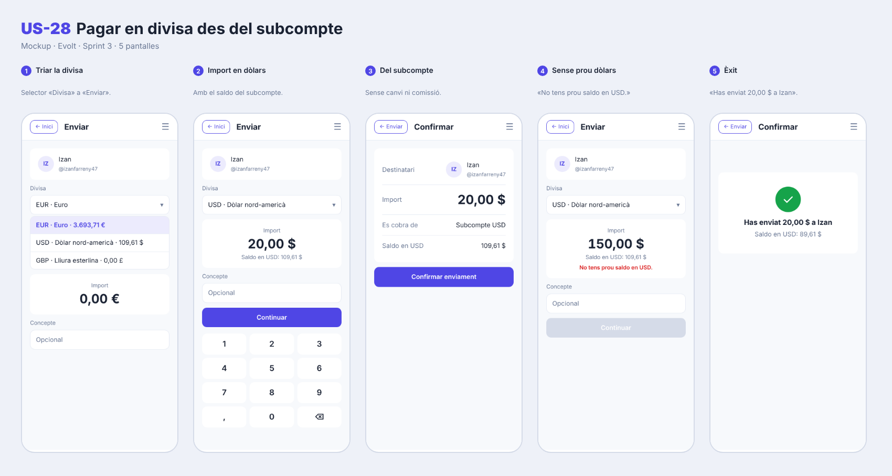

### US-28 · Pagar en divisa des del subcompte (SP 3 · VP 7 · Prioritat Alta)

COM: client estàndard amb subcomptes en divisa
VULL: enviar diners a un altre usuari en una divisa des del meu subcompte
PER: pagar despeses de viatges i compres internacionals amb amics.

Perfil: client estàndard que té almenys un subcompte en divisa (US-25).

Assumptes:
- És un enviament de la US-14 amb una divisa triada (decisió C, 24/11)
- Aquí es paga només des del subcompte d'aquella divisa; pagar des dels euros és la US-42
- Qui rep ho rep en la mateixa divisa si té aquell subcompte; si no, en euros al tipus de canvi, sense comissió
- El límit diari de 1.000,00 € de la US-14 compta l'equivalent en euros

Criteris d'acceptació:
1. A «Enviar» (US-14), si tinc algun subcompte en divisa, sota el destinatari hi ha el selector «Divisa» amb EUR i els meus subcomptes amb el seu saldo (per exemple «USD · Dòlar nord-americà · 109,61 $»); per defecte, EUR. Sense subcomptes no surt i «Enviar» és com a la US-14
2. Amb una divisa triada, l'import s'escriu en aquella divisa amb el símbol al final («20,00 $»; el ien, sense decimals) i a sota, en gris, «Saldo en USD: 109,61 $». Amb l'import a 0, «Continuar» queda desactivat
3. Si el subcompte en té prou, «Confirmar» mostra el destinatari, l'import en la divisa, «Es cobra de: Subcompte USD» i el saldo que hi quedarà. No hi ha comissió
4. Si el subcompte no en té prou, surt en vermell «No tens prou saldo en USD.» i «Continuar» queda desactivat (la US-42 hi afegeix pagar des dels euros)
5. El límit diari de 1.000,00 € de la US-14 compta l'equivalent en euros al tipus de canvi del moment: per sobre surt «Has superat el límit diari de 1.000,00 €.» i «Continuar» queda desactivat
6. En confirmar: tic verd «Has enviat 20,00 $ a Izan» amb el saldo que queda al subcompte; 1,5 s després torna a Inici
7. Qui rep ho rep al seu subcompte d'aquella divisa si el té («+20,00 $»); si no, al compte en euros al tipus de canvi i sense comissió («+18,18 €»). A la seva bústia arriba «<nom> t'ha enviat 20,00 $»
8. A l'historial del subcompte de qui envia surt en vermell «−20,00 $» amb el nom i el concepte
9. Si el saldo o el límit canvien entre «Continuar» i «Confirmar enviament», surt el mateix missatge i no s'envia res
10. Error del servidor o de xarxa: «S'ha produït un error inesperat. Torna-ho a provar més tard.» / «No hi ha connexió amb el servidor. Torna-ho a provar.» sota el botó; no canvia cap saldo

Casos especials:
- Aquesta història només paga des del subcompte de la divisa triada; si no n'hi ha prou, s'atura amb «No tens prou saldo en USD.». Pagar des dels euros és la US-42
- Mai es barregen orígens: o tot del subcompte o tot dels euros
- Qui rep sense subcompte en aquella divisa rep els euros al tipus de canvi sense comissió (exemple: 20,00 $ a 1 € = 1,10 $ → +18,18 €)
- El límit diari de la US-14 compta l'equivalent en euros al tipus del moment (exemple: 20,00 $ compten 18,18 €)

Estimació: SP 3 · VP 7 · Prioritat Alta

Seguiment: issue #248 · èpica EP-06 (#269) · targeta del Trello US-28.

Revisió del 25/11: La US-28 original («Pagaments en divisa») es divideix en US-28 (des del subcompte) i US-42 (des dels euros).

Mockups (fets abans de programar, 25/11/2026; HTML a `docs/us/_mockup/src/`, PNG a `docs/us/img/`):

1. **US-28-enviar-divisa** — «Enviar» amb el selector «Divisa» obert.
2. **US-28-enviar-usd** — «Enviar» amb USD triat i l'import en dòlars.
3. **US-28-confirmar-subcompte** — Es cobra del subcompte en USD: sense canvi ni comissió.
4. **US-28-sense-saldo** — El subcompte en USD no en té prou.
5. **US-28-exit** — Èxit de l'enviament en dòlars.

