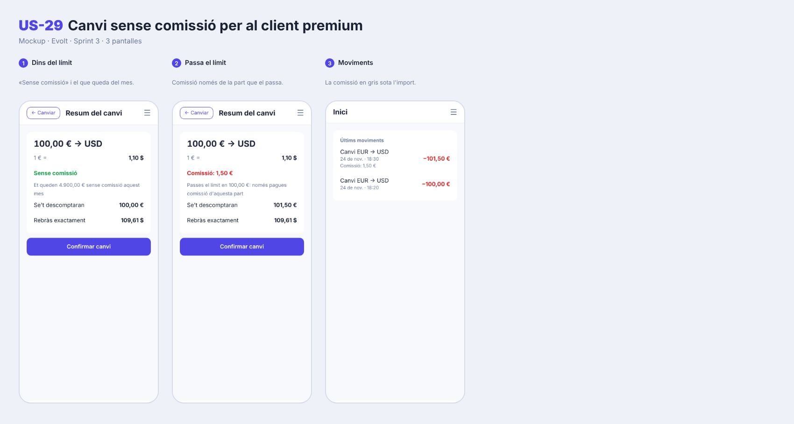

### US-29 · Canvi sense comissió per al client premium (SP 3 · VP 5 · Prioritat Mitjana)

COM: client premium
VULL: tenir un límit mensual de canvi de moneda sense comissió
PER: estalviar diners en les meves operacions internacionals.

Perfil: client premium (límit de 5.000 € al mes sense comissió). El client estàndard no canvia: sempre paga la comissió de la US-27 (1,5 %, mínim 0,50 €) (decisió A, 24/11).

Assumptes:
- Al seed hi ha un usuari premium per a la demo
- Fins al límit del mes, 0 % de comissió; el límit compta l'import en euros de cada canvi
- També compten els pagaments en divisa cobrats dels euros (US-42)
- Un canvi que passa el límit paga comissió només sobre la part que el passa
- El límit torna a començar el dia 1 de cada mes, en hora de Madrid

Criteris d'acceptació:
1. Al seed hi ha un usuari premium per a la demo. Per al client premium, els canvis fins a 5.000,00 € al mes (sumant l'import en euros de cada canvi) no tenen comissió
2. Els pagaments en divisa cobrats dels euros (US-42) compten per al mateix límit, igual que un canvi
3. Mentre no arriba al límit, el resum del canvi (US-27) diu «Sense comissió» en verd en lloc de «Comissió: …» i a sota, en gris, «Et queden X € sense comissió aquest mes»; «Se't descomptaran» és igual a l'import
4. Si un canvi passa el límit, la comissió (1,5 %, mínim 0,50 €) es calcula només sobre la part que el passa, surt en vermell i a sota diu «Passes el límit en X €: només pagues comissió d'aquesta part»
5. Un cop passat el límit, els canvis tenen la comissió normal de la US-27 fins al dia 1 del mes següent a les 00:00 de Madrid
6. Als moviments, els canvis amb comissió la mostren en gris sota l'import; els que no en tenen, no
7. Per al client estàndard no canvia res: el resum mostra sempre la comissió de la US-27 i mai «Sense comissió»
8. El càlcul el fa el servidor: si el límit canvia entre el resum i «Confirmar canvi», s'aplica el que toca i el tic mostra la comissió cobrada

Casos especials:
- **Exemple:** el client premium ja ha canviat 4.900 € aquest mes i ara en canvia 300 €: 100 € van sense comissió i 200 € la paguen (1,5 % de 200 € = 3,00 €)
- El límit compta els canvis (US-27) i els pagaments en divisa cobrats dels euros (US-42); no compten els pagaments des d'un subcompte (US-28), que no tenen canvi
- El client estàndard no té límit sense comissió: sempre paga la comissió de la US-27

Estimació: SP 3 · VP 5 · Prioritat Mitjana

Seguiment: issue #253 · èpica EP-06 (#269) · targeta del Trello US-29.

Revisió del 25/11: S'aclareix que els pagaments en divisa cobrats dels euros (US-42) compten per al límit.

Mockups (fets abans de programar, 25/11/2026; HTML a `docs/us/_mockup/src/`, PNG a `docs/us/img/`):

1. **US-29-resum-sense-comissio** — Client premium per sota del límit: «Sense comissió».
2. **US-29-resum-passa-limit** — Un canvi que passa el límit: comissió només de la part que el passa.
3. **US-29-moviment-comissio** — Moviment posterior al límit amb la comissió en gris.

