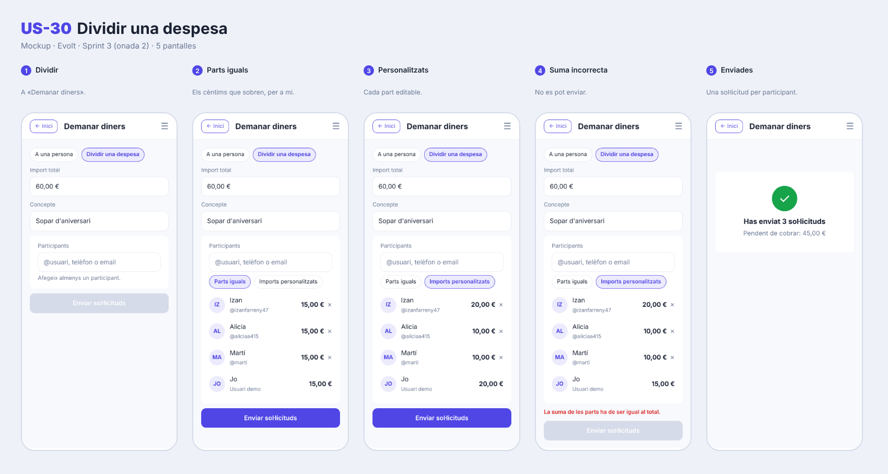

### US-30 · Dividir una despesa (SP 3 · VP 5 · Prioritat Mitjana)

COM: client estàndard
VULL: dividir una despesa amb altres usuaris
PER: no haver de calcular qui em deu què.

Perfil: client estàndard que ha pagat una despesa compartida.

Assumptes:
- Cada participant rep una sol·licitud de la US-15 amb la seva part; la meva part no genera cap sol·licitud
- Com a màxim 9 participants a més de mi (10 persones)
- El seguiment de la despesa és la US-31

Criteris d'acceptació:
1. A «Demanar diners» (`/requests/new`, US-15), a dalt hi ha dos botons de selecció, «A una persona» (per defecte) i «Dividir una despesa». «Dividir una despesa» canvia el formulari: «Import total», «Concepte» i «Participants»
2. A «Participants» hi ha la cerca de la US-13. Cada usuari triat surt en una fila (inicials, nom, «@usuari», la seva part i «×» per treure'l). Un usuari que ja hi és surt en gris a la cerca amb «Ja hi és». Amb 9 participants, la cerca es desactiva i diu «Màxim 9 participants»
3. A sota de la llista hi ha la fila «Jo» amb la meva part. Per defecte, «Parts iguals»: el total es divideix entre els participants i jo, i els cèntims que sobren són per a mi
4. Amb «Imports personalitzats» cada part es pot escriure (en euros, 2 decimals com a màxim). Si la suma no és el total surt «La suma de les parts ha de ser igual al total.»; si una part és 0, «Cada part ha de ser més gran que 0.»
5. «Enviar sol·licituds» queda desactivat fins que hi ha import total (de 0,01 € a 1.000.000,00 €), concepte (d'1 a 140 caràcters), almenys un participant i les parts quadren. Sense cap participant, sota la cerca surt en gris «Afegeix almenys un participant.»
6. En enviar: tic verd «Has enviat 3 sol·licituds» i a sota «Pendent de cobrar: 45,00 €»; 1,5 s després torna a «Sol·licituds enviades» amb la despesa dividida a dalt de tot (US-31)
7. Cada participant rep a la bústia «<nom> et demana 15,00 €: <concepte>.», com a la US-15. No es mou cap diner
8. Es creen totes les sol·licituds o cap: si una falla, no se n'envia cap i les dades del formulari es mantenen
9. «← Inici» (la tornada de la capçalera de la US-15) surt sense enviar res ni preguntar; el que he escrit es perd
10. Error del servidor o de xarxa: «S'ha produït un error inesperat. Torna-ho a provar més tard.» / «No hi ha connexió amb el servidor. Torna-ho a provar.» sota el botó; no s'envia cap sol·licitud

Casos especials:
- **Parts iguals:** 60,00 € entre 3 participants i jo → 15,00 € cadascú. 100,00 € entre 2 participants i jo → 33,33 € cada participant i 33,34 € per a mi
- Si canvio de «Imports personalitzats» a «Parts iguals», les parts es tornen a calcular i es perd el que havia escrit
- No em puc afegir a mi mateix: la cerca de la US-13 no em retorna mai
- Totes les sol·licituds porten el mateix concepte i la mateixa data, i queden lligades a la mateixa despesa dividida (US-31)

Estimació: SP 3 · VP 5 · Prioritat Mitjana

Seguiment: issue #255 · èpica EP-09 (#270) · targeta del Trello US-30.

Revisió del 26/11 (TPO.1 #323): de Mitjana a Fina. Màxim 9 participants; parts iguals amb els cèntims per a mi; tot o res.

Mockups (fets abans de programar, 26/11/2026; HTML a `docs/us/_mockup/src/`, PNG a `docs/us/img/`):

1. **US-30-triar-dividir** — «Demanar diners» amb «Dividir una despesa» triat: import total, concepte i participants.
2. **US-30-parts-iguals** — Tres participants i jo, a parts iguals: 15,00 € cadascú.
3. **US-30-imports-personalitzats** — Imports personalitzats que sumen el total.
4. **US-30-suma-incorrecta** — Les parts no sumen el total: missatge i botó desactivat.
5. **US-30-enviades** — Èxit: una sol·licitud per participant.

