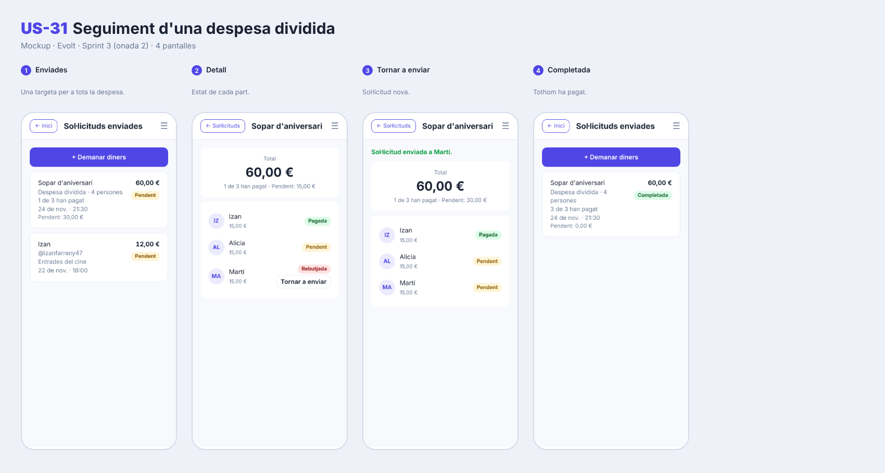

### US-31 · Seguiment d'una despesa dividida (SP 2 · VP 4 · Prioritat Baixa)

COM: client estàndard
VULL: veure qui m'ha pagat la seva part d'una despesa dividida
PER: saber què em falta cobrar.

Perfil: client estàndard que ha dividit una despesa (US-30).

Assumptes:
- Depèn de la US-30
- L'estat de cada part és el de la seva sol·licitud (US-15, US-39, US-40)
- «Completada» vol dir que tothom ha pagat

Criteris d'acceptació:
1. A «Sol·licituds enviades», una despesa dividida surt com una sola targeta: el concepte, a sota en gris «Despesa dividida · 4 persones», «1 de 3 han pagat» i la data; a la dreta el total en negreta i l'etiqueta d'estat; a baix, «Pendent: 30,00 €». Les seves sol·licituds no surten soles a la llista
2. L'etiqueta és «Pendent» (groc) mentre alguna part està pendent; «Completada» (verd) quan totes estan pagades; i «Tancada» (gris) quan ja no n'hi ha cap de pendent però alguna està rebutjada o caducada
3. En tocar la targeta s'obre el detall (capçalera «← Sol·licituds» · el concepte): a dalt el total i «1 de 3 han pagat · Pendent: 30,00 €», i a sota una fila per participant amb inicials, nom, la seva part i l'etiqueta de la seva sol·licitud
4. Les files «Rebutjada» i «Caducada» tenen el botó «Tornar a enviar»: crea una sol·licitud nova de la mateixa part i el mateix concepte, surt «Sol·licitud enviada a Martí.» i la fila passa a «Pendent»
5. Quan una part es paga (US-39), el detall i la targeta s'actualitzen en tornar a la pantalla: «2 de 3 han pagat» i el pendent baixa
6. Els imports pendents només sumen les parts «Pendent»; les rebutjades i caducades no compten com a cobrades
7. Si no es pot carregar el detall surt «S'ha produït un error inesperat. Torna-ho a provar més tard.» amb el botó «Reintentar»
8. Error del servidor o de xarxa: «S'ha produït un error inesperat. Torna-ho a provar més tard.» / «No hi ha connexió amb el servidor. Torna-ho a provar.» sota el botó en «Tornar a enviar»; la fila es queda com estava

Casos especials:
- **Exemple:** «Sopar d'aniversari», 60,00 € entre Izan, Alicia, Martí i jo (15,00 € cadascú). Izan paga → «1 de 3 han pagat · Pendent: 30,00 €». Martí la rebutja → «Pendent: 15,00 €». Alicia paga → no queda cap de pendent i Martí no ha pagat → «Tancada». Si torno a enviar a Martí i paga → «Completada»
- «Tornar a enviar» crea una sol·licitud nova (amb id nou); la rebutjada o caducada no canvia d'estat, però el detall mostra la més recent de cada participant
- Les parts no es poden cancel·lar des del detall en aquesta història

Estimació: SP 2 · VP 4 · Prioritat Baixa

Seguiment: issue #256 · èpica EP-09 (#270) · targeta del Trello US-31.

Revisió del 26/11 (TPO.1 #323): de Mitjana a Fina. «Completada» vol dir tots pagats; «Tancada» si no en queda cap de pendent però alguna s'ha rebutjat o ha caducat; «Tornar a enviar» crea una sol·licitud nova.

Mockups (fets abans de programar, 26/11/2026; HTML a `docs/us/_mockup/src/`, PNG a `docs/us/img/`):

1. **US-31-enviades** — «Sol·licituds enviades»: la despesa dividida és una sola targeta.
2. **US-31-detall** — Detall: la part i l'estat de cada participant; «Tornar a enviar» a la rebutjada.
3. **US-31-tornar-a-enviar** — Després de «Tornar a enviar»: Martí torna a estar «Pendent».
4. **US-31-completada** — Tothom ha pagat: «Completada».

