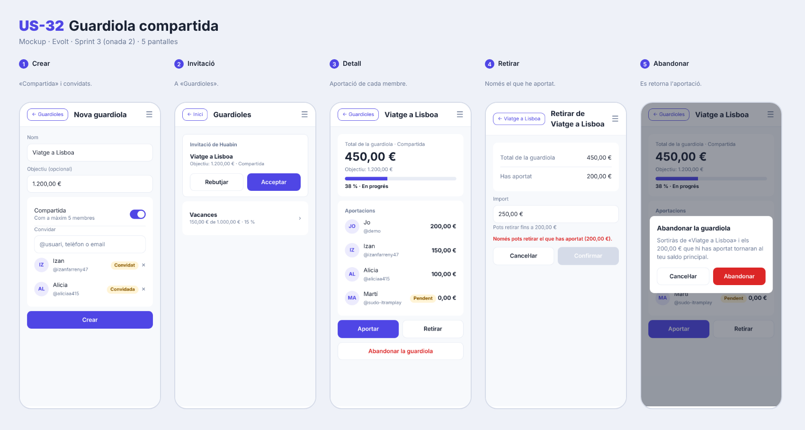

### US-32 · Guardiola compartida (SP 5 · VP 5 · Prioritat Mitjana)

COM: client estàndard
VULL: crear una guardiola amb altres usuaris
PER: estalviar junts per a un objectiu comú.

Perfil: client estàndard que vol estalviar amb altres usuaris de l'app.

Assumptes:
- Amplia les guardioles de la US-17 a la US-20
- Com a màxim 5 membres, comptant qui la crea
- Les aportacions donen XP com qualsevol aportació (US-23)

Criteris d'acceptació:
1. Al formulari «Nova guardiola» (US-17) hi ha l'interruptor «Compartida». En activar-lo surt «Convidar» amb la cerca de la US-13: cada usuari triat surt amb «Convidat» i «×». Amb 4 convidats, la cerca diu «Màxim 5 membres»
2. En crear-la, cada convidat rep a la bústia «<nom> et convida a la guardiola «Viatge a Lisboa».» i a la seva pantalla «Guardioles» li surt a dalt la targeta «Invitació de <nom>» amb el nom i l'objectiu, i els botons «Acceptar» (lila) i «Rebutjar»
3. «Acceptar» el fa membre i la guardiola surt a la seva llista amb l'etiqueta «Compartida». «Rebutjar» treu la invitació, i a qui l'ha creat li arriba «<nom> no s'ha afegit a «Viatge a Lisboa».»
4. El detall d'una guardiola compartida mostra el total, l'objectiu i el progrés (US-20), i la llista «Aportacions» amb una fila per membre (inicials, nom i el que ha aportat); els convidats que no han respost surten amb «Pendent» i 0,00 €
5. Qualsevol membre pot aportar del seu saldo principal (US-18). L'aportació suma al total i a la seva fila, i dona XP com qualsevol aportació (US-23)
6. «Retirar» deixa retirar com a màxim el que he aportat jo: a sota de l'import surt «Pots retirar fins a 200,00 €» i, si m'hi passo, «Només pots retirar el que has aportat (200,00 €).»
7. Un membre que no l'ha creada té «Abandonar la guardiola» (text vermell): obre el diàleg «Abandonar la guardiola» («Sortiràs de «Viatge a Lisboa» i els 200,00 € que hi has aportat tornaran al teu saldo principal.») amb «Cancel·lar» i «Abandonar». En abandonar, torna a «Guardioles», on ja no surt
8. Qui l'ha creada no la pot abandonar; només la pot eliminar, i en eliminar-la cada membre recupera el que hi havia aportat i rep a la bústia «S'ha eliminat la guardiola «Viatge a Lisboa». T'hem tornat 150,00 €.»
9. Aportar, retirar i abandonar mouen els dos saldos alhora (tot o res), i surten als moviments de cada membre com a la US-18 i la US-19
10. Error del servidor o de xarxa: «S'ha produït un error inesperat. Torna-ho a provar més tard.» / «No hi ha connexió amb el servidor. Torna-ho a provar.» sota el botó; cap saldo canvia

Casos especials:
- **Exemple:** «Viatge a Lisboa», objectiu 1.200,00 €. Jo hi aporto 200,00 €, Izan 150,00 € i Alicia 100,00 € → total 450,00 € (38 %). Jo puc retirar fins a 200,00 €; Izan, fins a 150,00 €
- Si Izan abandona, rep 150,00 € al seu saldo principal i el total baixa a 300,00 € (25 %)
- «Objectiu assolit» (+100 XP, US-23) el guanya el membre que fa l'aportació que hi arriba, una sola vegada per guardiola
- Una guardiola compartida no pot tenir aportació automàtica (US-21) en aquesta història
- Una guardiola normal no es pot convertir en compartida després de crear-la

Estimació: SP 5 · VP 5 · Prioritat Mitjana

Seguiment: issue #257 · èpica EP-09 (#270) · targeta del Trello US-32.

Revisió del 26/11 (TPO.1 #323): de Mitjana a Fina. Màxim 5 membres; la invitació s'accepta a «Guardioles»; les aportacions donen XP (US-23).

Mockups (fets abans de programar, 26/11/2026; HTML a `docs/us/_mockup/src/`, PNG a `docs/us/img/`):

1. **US-32-crear** — «Nova guardiola» amb «Compartida» i dos convidats.
2. **US-32-invitacio** — A «Guardioles» de qui és convidat: la invitació a dalt.
3. **US-32-detall** — Detall: total, objectiu i aportació de cada membre.
4. **US-32-retirar-limit** — Retirar més del que he aportat.
5. **US-32-abandonar** — Abandonar: es retorna el que has aportat.

