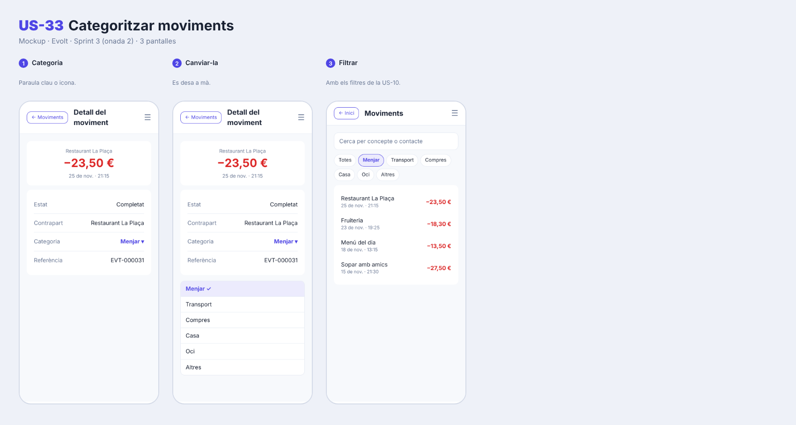

### US-33 · Categoritzar moviments (SP 3 · VP 5 · Prioritat Mitjana)

COM: client estàndard
VULL: que cada despesa tingui una categoria
PER: saber en què gasto.

Perfil: client estàndard amb moviments.

Assumptes:
- Categories fixes: Menjar, Transport, Compres, Casa, Oci i Altres
- Només tenen categoria les despeses del compte principal; els ingressos i les aportacions a guardioles, no
- La categoria automàtica surt primer de paraules clau del concepte i, si no n'hi ha cap, de la icona del moviment

Criteris d'acceptació:
1. Cada despesa del compte principal té una categoria de la llista fixa: Menjar, Transport, Compres, Casa, Oci i Altres. Els ingressos i les aportacions a guardioles no en tenen
2. La categoria es posa sola amb aquestes paraules clau del concepte (sense distingir majúscules ni accents): Menjar → restaurant, sopar, dinar, esmorzar, menú, cafeteria, cafè, fruiteria; Transport → taxi, tren, bitllet, abonament, bus, metro, gasolina; Compres → supermercat, botiga, llibreria, roba; Casa → lloguer, llum, aigua, gas, internet; Oci → cinema, gimnàs, concert, entrades
3. Si el concepte no té cap paraula clau, la categoria surt de la icona: food → Menjar, transport → Transport, shopping → Compres, i la resta (transfer, other) → Altres
4. A «Detall del moviment» (US-11), sota la contrapart, hi ha la fila «Categoria» amb el nom en lila i «▾». En tocar-la s'obre la llista de les 6 categories amb la triada marcada; en triar-ne una es tanca, es desa i surt «Categoria desada.»
5. Una categoria triada a mà no la torna a canviar la regla automàtica
6. A «Moviments», sota la cerca de la US-10, hi ha una fila de botons: «Totes» (per defecte) i les 6 categories. En triar-ne una, la llista només mostra les despeses d'aquella categoria, junt amb les dates, el tipus i la cerca de la US-10
7. «Esborrar filtres» (US-10) també torna la categoria a «Totes». Si no hi ha cap moviment que compleixi els filtres surt «No hi ha resultats»
8. Error del servidor o de xarxa: «S'ha produït un error inesperat. Torna-ho a provar més tard.» / «No hi ha connexió amb el servidor. Torna-ho a provar.» sota el botó en desar la categoria; es queda la que hi havia

Casos especials:
- **Seed de l'usuari demo:** «Restaurant La Plaça», «Menú del dia», «Cafeteria», «Sopar amb amics» i «Fruiteria» → Menjar; «Taxi», «Bitllet de tren» i «Abonament de transport» → Transport; «Supermercat», «Botiga de roba» i «Llibreria» → Compres; «Lloguer» → Casa; «Gimnàs» i «Cinema» → Oci; «Farmàcia», «Bizum enviat» i «Transferència enviada» → Altres
- La paraula clau guanya a la icona: «Lloguer» té la icona transfer però és Casa
- La categoria no es desa en crear el moviment: es calcula en llegir-lo, i només es desa quan es tria a mà

Estimació: SP 3 · VP 5 · Prioritat Mitjana

Seguiment: issue #258 · èpica EP-10 (#271) · targeta del Trello US-33.

Revisió del 26/11 (TPO.2 #324): de Mitjana a Fina. Llista de paraules clau per categoria i pas de les icones del seed a categories.

Mockups (fets abans de programar, 26/11/2026; HTML a `docs/us/_mockup/src/`, PNG a `docs/us/img/`):

1. **US-33-detall** — Detall del moviment amb la categoria posada per paraula clau («restaurant» → Menjar).
2. **US-33-canviar** — Canviar la categoria: la llista de les 6.
3. **US-33-filtre** — «Moviments» filtrat per Menjar.

