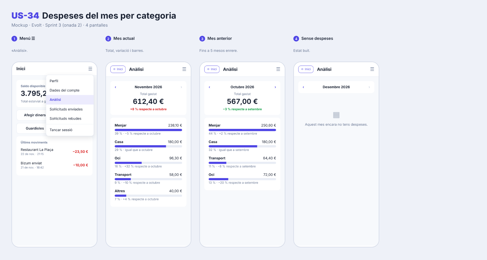

### US-34 · Despeses del mes per categoria (SP 3 · VP 5 · Prioritat Mitjana)

COM: client estàndard
VULL: veure un gràfic de les despeses del mes per categoria
PER: entendre on van els meus diners.

Perfil: client estàndard amb moviments.

Assumptes:
- Depèn de la US-33 (categories)
- Només compten les despeses amb categoria (no els ingressos ni les aportacions a guardioles)
- Es pot mirar el mes actual i els 5 anteriors

Criteris d'acceptació:
1. Al menú ☰ hi ha «Anàlisi», que obre la pantalla «Anàlisi» (capçalera «← Inici» · «Anàlisi»)
2. A dalt, la targeta del mes: «‹», el mes («Novembre 2026») i «›». Per defecte, el mes actual. «›» queda desactivat al mes actual i «‹» al cinquè mes anterior
3. Sota el mes, «Total gastat» i l'import en gran, i a sota la variació respecte al mes anterior en percentatge enter: en vermell «+8 % respecte a octubre» si he gastat més, en verd «−5 % respecte a octubre» si menys, i en gris «Igual que a octubre» si és el mateix
4. El gràfic és de barres horitzontals: una fila per categoria amb despesa aquell mes, de la que més a la que menys, amb el nom, l'import a la dreta, la barra lila (la més gran fa tot l'ample) i a sota en gris el percentatge del total i la variació de la categoria
5. En tocar una categoria s'obre «Moviments» amb aquella categoria i les dates del mes ja filtrades (US-33, US-10)
6. Un mes sense cap despesa mostra «Aquest mes encara no tens despeses.» en gris sota la targeta del mes
7. Si el mes anterior no té despeses, en lloc de la variació surt «Sense despeses a octubre»
8. Si no es pot carregar surt «S'ha produït un error inesperat. Torna-ho a provar més tard.» amb el botó «Reintentar»

Casos especials:
- **Exemple:** novembre 612,40 € i octubre 567,00 € → «+8 % respecte a octubre» (612,40 / 567,00 = 1,080). Menjar 238,10 € de 612,40 € → «39 %»
- Els percentatges s'arrodoneixen a l'enter, mig cap amunt (com a la US-20)
- Un mes va de l'1 a les 00:00 a l'últim dia a les 23:59, en hora de Madrid
- Una categoria canviada a mà (US-33) compta a la categoria nova

Estimació: SP 3 · VP 5 · Prioritat Mitjana

Seguiment: issue #259 · èpica EP-10 (#271) · targeta del Trello US-34.

Revisió del 26/11 (TPO.2 #324): de Mitjana a Fina. Gràfic de barres horitzontals; mes actual i 5 anteriors; variació en % enter.

Mockups (fets abans de programar, 26/11/2026; HTML a `docs/us/_mockup/src/`, PNG a `docs/us/img/`):

1. **US-34-acces-menu** — Menú ☰ amb «Anàlisi».
2. **US-34-analisi** — Mes actual: total, variació i barres per categoria.
3. **US-34-mes-anterior** — Un mes anterior amb «›» actiu.
4. **US-34-buit** — Un mes sense despeses.

