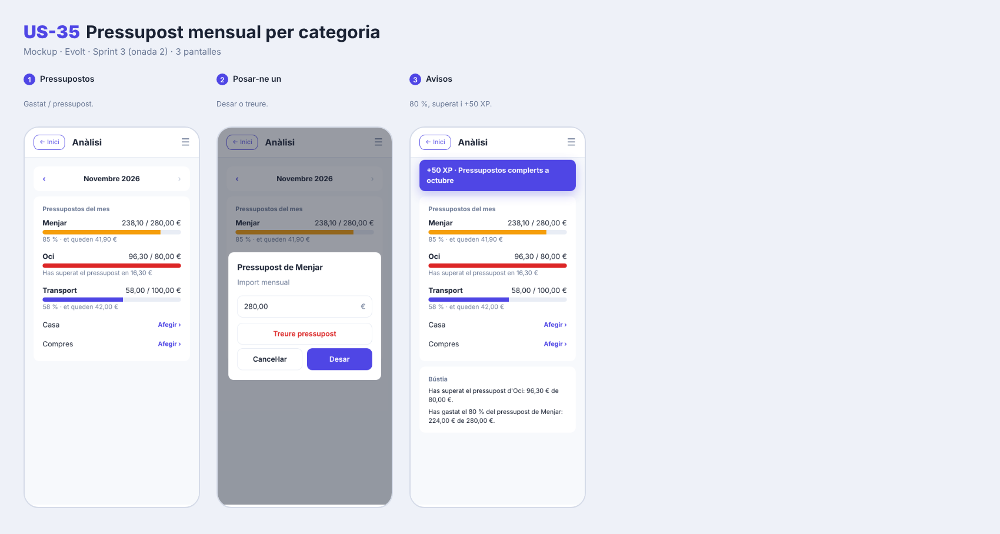

### US-35 · Pressupost mensual per categoria (SP 3 · VP 5 · Prioritat Mitjana)

COM: client estàndard
VULL: fixar un pressupost mensual per categoria
PER: no gastar més del que vull.

Perfil: client estàndard amb moviments.

Assumptes:
- Depèn de la US-33 i la US-34
- Un pressupost val per a tots els mesos fins que el canvio o el trec
- Els XP del mes complert van al mateix fitxer de configuració que els de la US-23

Criteris d'acceptació:
1. A «Anàlisi» (US-34), sota el gràfic, hi ha la targeta «Pressupostos del mes» amb una fila per categoria: les que tenen pressupost mostren el nom, «238,10 / 280,00 €», la barra i a sota «85 % · et queden 41,90 €»; les que no en tenen, el nom i «Afegir ›» en lila
2. La barra és lila fins al 79 %, taronja del 80 % al 100 % i vermella per sobre; per sobre del 100 % la barra queda plena i el text diu «Has superat el pressupost en 16,30 €»
3. «Afegir ›» o tocar una fila amb pressupost obre el diàleg «Pressupost de <categoria>» amb «Import mensual» (en euros), «Cancel·lar» i «Desar». Si ja en té, també surt «Treure pressupost» en vermell
4. Import buit: «Desar» desactivat. Import ≤ 0: «L'import ha de ser més gran que 0.» En desar surt «Pressupost desat.» i la fila s'actualitza; «Cancel·lar», Esc o clic fora tanquen sense canviar res
5. «Treure pressupost» el treu sense preguntar més, surt «Pressupost tret.» i la fila torna a «Afegir ›»
6. Quan una despesa fa arribar una categoria al 80 %, a la bústia arriba «Has gastat el 80 % del pressupost de Menjar: 224,00 € de 280,00 €.»; quan el supera, «Has superat el pressupost d'Oci: 96,30 € de 80,00 €.». Cada avís, com a màxim una vegada per categoria i mes
7. Si acabo un mes amb almenys un pressupost i sense superar-ne cap, la propera vegada que obro l'app guanyo +50 XP amb l'avís «+50 XP · Pressupostos complerts a novembre» (US-23)
8. Als mesos anteriors (US-34) els pressupostos es veuen però no es poden canviar: no surten «Afegir ›» ni el diàleg
9. Error del servidor o de xarxa: «S'ha produït un error inesperat. Torna-ho a provar més tard.» / «No hi ha connexió amb el servidor. Torna-ho a provar.» sota el botó del diàleg; el pressupost queda com estava

Casos especials:
- **Exemple:** Menjar amb 280,00 €. Al 80 % (224,00 €) arriba el primer avís; a 238,10 € la barra és taronja amb «85 % · et queden 41,90 €». Oci amb 80,00 € i 96,30 € gastats → barra vermella i «Has superat el pressupost en 16,30 €»
- Si canvio el pressupost a mig mes, els percentatges es tornen a calcular amb l'import nou; un avís ja enviat aquell mes no es torna a enviar
- Els XP del mes es donen una sola vegada per mes, encara que hi hagi diversos pressupostos
- Un mes sense cap pressupost no dona XP

Estimació: SP 3 · VP 5 · Prioritat Mitjana

Seguiment: issue #260 · èpica EP-10 (#271) · targeta del Trello US-35.

Revisió del 26/11 (TPO.2 #324): de Mitjana a Fina. Text dels avisos del 80 % i del 100 %; +50 XP per mes complert.

Mockups (fets abans de programar, 26/11/2026; HTML a `docs/us/_mockup/src/`, PNG a `docs/us/img/`):

1. **US-35-pressupostos** — Pressupostos del mes: lila, taronja (≥ 80 %) i vermell (superat).
2. **US-35-posar** — Diàleg per posar o canviar el pressupost.
3. **US-35-superat** — Avís de la bústia en superar un pressupost, i +50 XP en complir el mes.

