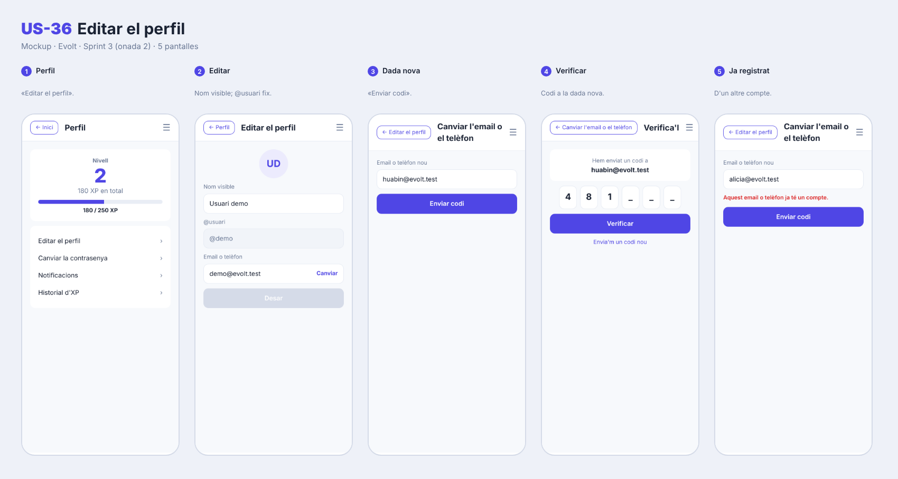

### US-36 · Editar el perfil (SP 3 · VP 4 · Prioritat Mitjana)

COM: client estàndard
VULL: canviar el meu nom visible i el meu email o telèfon
PER: mantenir les meves dades al dia.

Perfil: client estàndard.

Assumptes:
- «Perfil» és la pantalla de la US-24
- L'email o el telèfon és el que faig servir per entrar (US-3): canviar-lo demana un codi com a la US-2
- No hi ha foto (l'avatar continua sent les inicials) ni adreça: l'app no desa aquestes dades (decisió del PO, 26/11)

Criteris d'acceptació:
1. A «Perfil» (US-24) hi ha la fila «Editar el perfil ›», que obre «Editar el perfil» (capçalera «← Perfil» · «Editar el perfil») amb l'avatar d'inicials, «Nom visible», «@usuari» (gris, no editable) i «Email o telèfon» amb el botó «Canviar»
2. «Nom visible» admet d'1 a 40 caràcters. Buit: «El nom no pot estar buit.» i «Desar» desactivat. «Desar» queda desactivat mentre el nom no canvia
3. En desar surt «Perfil actualitzat.», torna a «Perfil» i el nom nou surt a tot arreu on surt el nom (Inici, cerca de la US-13, avisos)
4. «Canviar» obre «Canviar l'email o el telèfon» amb una casella i «Enviar codi». Si ja és d'un altre compte surt «Aquest email o telèfon ja té un compte.»; si és el mateix que tinc, «Aquest ja és el teu email o telèfon.»
5. «Enviar codi» envia un codi de 6 xifres a la dada nova i obre «Verifica'l» amb les 6 caselles, com a la US-2: caduca als 10 minuts, «Envia'm un codi nou» i, amb un codi dolent, «El codi no és correcte o ha caducat.»
6. Amb el codi correcte surt «Email actualitzat.» (o «Telèfon actualitzat.») i torna a «Editar el perfil». Des d'ara s'entra amb la dada nova; l'antiga ja no serveix
7. Després de 5 codis incorrectes, les caselles es bloquegen i surt «Has fet massa intents. Demana un codi nou», com a la US-2. La dada antiga continua funcionant
8. «← Perfil» torna sense desar i sense preguntar; un nom escrit i no desat es perd
9. Error del servidor o de xarxa: «S'ha produït un error inesperat. Torna-ho a provar més tard.» / «No hi ha connexió amb el servidor. Torna-ho a provar.» sota el botó; no canvia cap dada

Casos especials:
- El nom legal i la data de naixement de l'EP-14 no hi són perquè l'app no els té; tampoc la foto ni l'adreça (decisió del PO, 26/11). L'avatar sempre són les inicials del nom visible (sense nom, les de l'@usuari)
- **Exemple:** «Usuari demo» canvia el nom a «Huabin Fu» → a Inici i a la cerca de la US-13 surt «Huabin Fu»; l'avatar passa de «UD» a «HF»
- El codi s'envia a la dada nova (email o SMS segons el que sigui), mai a l'antiga
- Canviar el nom no tanca cap sessió; canviar l'email o el telèfon tampoc

Estimació: SP 3 · VP 4 · Prioritat Mitjana

Seguiment: issue #261 · èpica EP-14 (#275) · targeta del Trello US-36.

Revisió del 26/11 (TPO.3 #325): de Mitjana a Fina. Sense foto, adreça, nom legal ni data de naixement (l'app no els desa); el canvi d'email o telèfon es verifica amb codi.

Mockups (fets abans de programar, 26/11/2026; HTML a `docs/us/_mockup/src/`, PNG a `docs/us/img/`):

1. **US-36-perfil** — «Perfil» amb «Editar el perfil».
2. **US-36-editar** — Editar el nom visible; l'@usuari no es pot editar.
3. **US-36-canviar-email** — Escriure la dada nova i enviar el codi.
4. **US-36-verificar** — Verificar la dada nova amb el codi de 6 xifres.
5. **US-36-email-repetit** — La dada nova ja és d'un altre compte.

