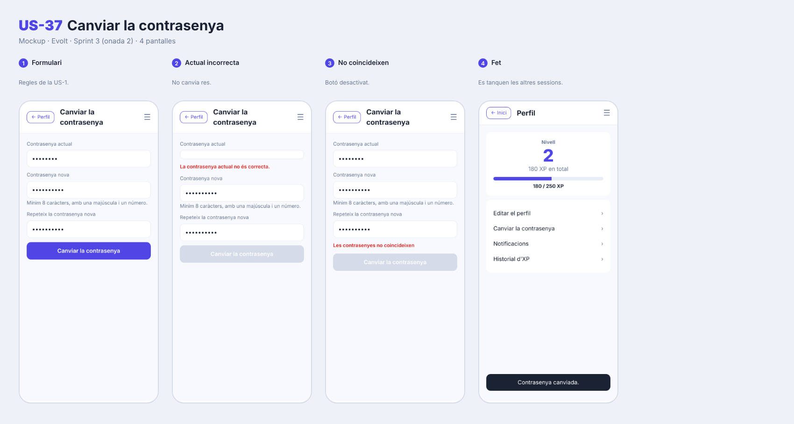

### US-37 · Canviar la contrasenya (SP 2 · VP 5 · Prioritat Mitjana)

COM: client estàndard
VULL: canviar la meva contrasenya
PER: mantenir el compte segur.

Perfil: client estàndard amb la sessió iniciada.

Assumptes:
- La contrasenya nova segueix les regles de la US-1
- Cal posar la contrasenya actual
- En canviar-la es tanquen les altres sessions, com a la US-4

Criteris d'acceptació:
1. A «Perfil» hi ha la fila «Canviar la contrasenya ›», que obre «Canviar la contrasenya» (capçalera «← Perfil») amb «Contrasenya actual», «Contrasenya nova» (a sota, en gris, «Mínim 8 caràcters, amb una majúscula i un número.»), «Repeteix la contrasenya nova» i el botó lila «Canviar la contrasenya»
2. El botó queda desactivat fins que les tres caselles estan plenes
3. Si la nova no compleix les regles surt sota la casella «La contrasenya ha de tenir 8 caràcters, una majúscula i un número.»; si les dues noves no coincideixen, «Les contrasenyes no coincideixen»; si la nova és igual que l'actual, «La contrasenya nova ha de ser diferent de l'actual.»
4. Si l'actual no és correcta surt «La contrasenya actual no és correcta.», no canvia res i la casella «Contrasenya actual» es buida
5. Després de 5 contrasenyes actuals incorrectes seguides es tanca la sessió i l'app torna a «Inicia sessió»
6. En canviar-la: torna a «Perfil» i a baix surt durant 2 s «Contrasenya canviada.». Aquesta sessió continua oberta i es tanquen les dels altres dispositius
7. A la bústia arriba «La contrasenya d'Evolt s'ha canviat. Si no has estat tu, recupera-la amb «He oblidat la contrasenya».»
8. «← Perfil» torna sense canviar res i sense preguntar
9. Error del servidor o de xarxa: «S'ha produït un error inesperat. Torna-ho a provar més tard.» / «No hi ha connexió amb el servidor. Torna-ho a provar.» sota el botó; la contrasenya no canvia

Casos especials:
- Els missatges de regles i de coincidència són els mateixos de la US-1 i la US-4 (el de coincidència no porta punt final, com ara a l'app)
- Les comprovacions de la nova es fan també al servidor (WEAK_PASSWORD), no només a la pantalla
- El comptador dels 5 errors es reinicia quan l'actual és correcta

Estimació: SP 2 · VP 5 · Prioritat Mitjana

Seguiment: issue #262 · èpica EP-14 (#275) · targeta del Trello US-37.

Revisió del 26/11 (TPO.3 #325): de Mitjana a Fina. Missatge de no coincidència de la US-1; es manté aquesta sessió i es tanquen les altres.

Mockups (fets abans de programar, 26/11/2026; HTML a `docs/us/_mockup/src/`, PNG a `docs/us/img/`):

1. **US-37-formulari** — Formulari amb l'actual, la nova i repetir-la.
2. **US-37-actual-incorrecta** — La contrasenya actual no és correcta.
3. **US-37-no-coincideixen** — Les dues contrasenyes noves no coincideixen.
4. **US-37-canviada** — Contrasenya canviada: torna a «Perfil».

