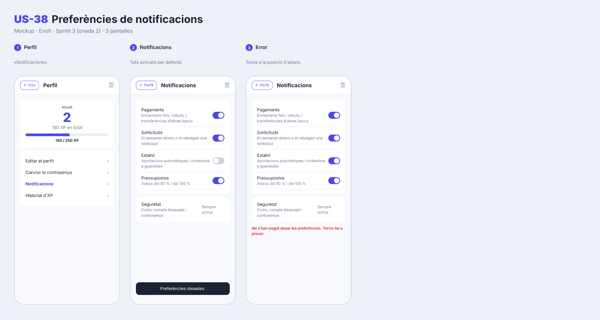

### US-38 · Preferències de notificacions (SP 2 · VP 3 · Prioritat Baixa)

COM: client estàndard
VULL: triar quins avisos rebo
PER: no rebre avisos que no m'interessen.

Perfil: client estàndard.

Assumptes:
- Els avisos són els de la bústia (email o SMS simulats)
- Per defecte, tots activats
- Els avisos de seguretat no es poden desactivar

Criteris d'acceptació:
1. A «Perfil» hi ha la fila «Notificacions ›», que obre «Notificacions» (capçalera «← Perfil») amb un interruptor per tipus i, a sota de cada nom, en gris, què inclou
2. Tipus: «Pagaments» (enviaments fets i rebuts, i transferències d'altres bancs), «Sol·licituds» (et demanen diners, et rebutgen una sol·licitud), «Estalvi» (aportacions automàtiques i invitacions a guardioles compartides) i «Pressupostos» (avisos del 80 % i del 100 %)
3. A sota, la fila «Seguretat» (codis, compte bloquejat, recuperar i canviar la contrasenya) amb «Sempre activa» en gris, sense interruptor
4. Un usuari nou té tots els interruptors activats
5. En tocar un interruptor canvia i es desa sol, i a baix surt durant 2 s «Preferències desades.»; no hi ha botó «Desar»
6. Amb un tipus desactivat, aquells avisos ja no arriben a la bústia; els que ja hi eren es queden
7. Les preferències es guarden al servidor: no canvien en tancar la sessió ni des d'un altre dispositiu
8. Si no es pot desar, l'interruptor torna a la posició d'abans i surt «No s'han pogut desar les preferències. Torna-ho a provar.»

Casos especials:
- **Exemple:** amb «Sol·licituds» desactivat, si Izan em demana 12,00 €, la sol·licitud surt igual a «Sol·licituds rebudes» (US-16), però no arriba «Izan et demana 12,00 €: …» a la bústia
- Desactivar un tipus no canvia res dins de l'app: només els avisos de la bústia
- Els avisos +XP de la US-23 són dins de l'app, no a la bústia, i no depenen d'aquestes preferències

Estimació: SP 2 · VP 3 · Prioritat Baixa

Seguiment: issue #263 · èpica EP-14 (#275) · targeta del Trello US-38.

Revisió del 26/11 (TPO.3 #325): de Mitjana a Fina. Tipus: Pagaments, Sol·licituds, Estalvi i Pressupostos; Seguretat sempre activa; tots activats per defecte.

Mockups (fets abans de programar, 26/11/2026; HTML a `docs/us/_mockup/src/`, PNG a `docs/us/img/`):

1. **US-38-acces** — «Perfil» amb «Notificacions».
2. **US-38-notificacions** — Un interruptor per tipus; es desa sol.
3. **US-38-error** — No s'ha pogut desar: l'interruptor torna on era.

