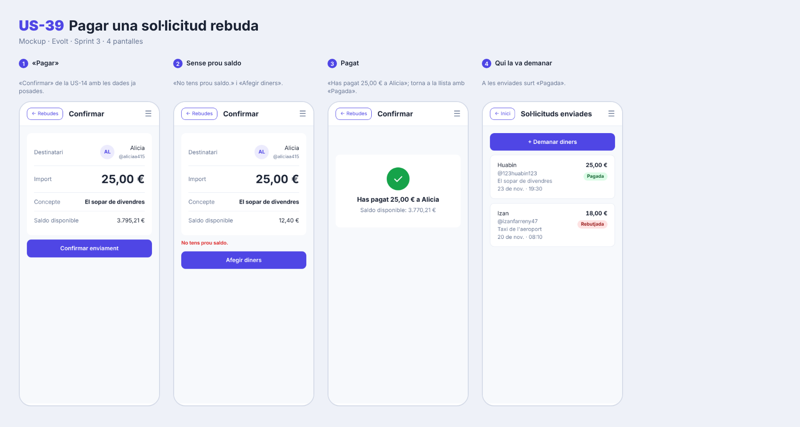

### US-39 · Pagar una sol·licitud rebuda (SP 2 · VP 6 · Prioritat Mitjana)

COM: client estàndard
VULL: pagar una sol·licitud que he rebut
PER: tornar els diners sense haver d'escriure res.

Perfil: client estàndard amb una sol·licitud «Pendent» a «Sol·licituds rebudes» (US-16).

Assumptes:
- Depèn de la US-16 (llista) i reutilitza «Confirmar» de la US-14
- Pagar és un enviament de la US-14: compta per al límit diari i envia els mateixos avisos
- Les sol·licituds són sempre en euros (US-15)

Criteris d'acceptació:
1. «Pagar» obre «Confirmar» de la US-14 amb el destinatari, l'import i el concepte ja posats, que no es poden canviar, i el «Saldo disponible». «← Rebudes» torna a la llista sense pagar
2. Si l'import supera el saldo, a «Confirmar» surt en vermell «No tens prou saldo.» i, en lloc de «Confirmar enviament», el botó lila «Afegir diners», que obre la recàrrega (US-09). La sol·licitud continua «Pendent»
3. Si l'import passa el límit diari de la US-14, surt en vermell «Has superat el límit diari de 1.000,00 €.» i no es pot confirmar
4. En confirmar: tic verd «Has pagat 25,00 € a Alicia» amb «Saldo disponible: …»; 1,5 s després torna a «Sol·licituds rebudes» amb la sol·licitud «Pagada» i sense botons
5. A «Sol·licituds enviades» de qui la va fer (US-15), la sol·licitud surt «Pagada»
6. El pagament és un enviament de la US-14: −25,00 € als moviments de qui paga, +25,00 € als de qui la va fer, amb el concepte de la sol·licitud, i els avisos de la US-14 a la bústia
7. Si en confirmar la sol·licitud ja no és pendent (ha caducat o s'ha respost en un altre dispositiu), surt «Aquesta sol·licitud ja no està pendent.», no es paga res i torna a la llista recarregada
8. Error del servidor o de xarxa: «S'ha produït un error inesperat. Torna-ho a provar més tard.» / «No hi ha connexió amb el servidor. Torna-ho a provar.» sota el botó; la sol·licitud continua «Pendent» i cap saldo canvia

Casos especials:
- Pagar una sol·licitud és un enviament de la US-14 lligat a la sol·licitud: l'enviament i el canvi d'estat a «Pagada» es fan en una sola transacció (tot o res)
- El límit diari de 1.000,00 € és el mateix de la US-14: un pagament de sol·licitud hi compta igual que un enviament
- «Afegir diners» porta a la recàrrega (US-09); després la sol·licitud continua «Pendent» i es pot tornar a pagar

Estimació: SP 2 · VP 6 · Prioritat Mitjana

Seguiment: issue #278 · èpica EP-03 (#266) · targeta del Trello US-39.

Revisió del 25/11: Ve de la US-16 original («Respondre a una sol·licitud»).

Mockups (fets abans de programar, 25/11/2026; HTML a `docs/us/_mockup/src/`, PNG a `docs/us/img/`):

1. **US-39-pagar-confirmar** — «Pagar» obre «Confirmar» de la US-14 amb les dades ja posades.
2. **US-39-sense-saldo** — Sense prou saldo: «No tens prou saldo.» i «Afegir diners», que obre la recàrrega.
3. **US-39-pagament-fet** — Èxit del pagament: tic verd i, 1,5 s després, torna a «Sol·licituds rebudes».
4. **US-39-enviades-pagada** — A «Sol·licituds enviades» de qui la va demanar: «Pagada».

