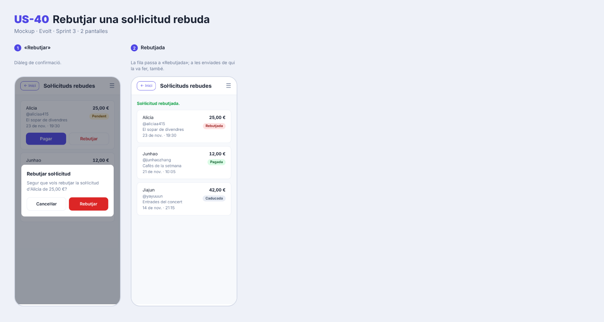

### US-40 · Rebutjar una sol·licitud rebuda (SP 1 · VP 4 · Prioritat Mitjana)

COM: client estàndard
VULL: rebutjar una sol·licitud que he rebut
PER: que qui me l'ha enviat sàpiga que no la pagaré.

Perfil: client estàndard amb una sol·licitud «Pendent» a «Sol·licituds rebudes» (US-16).

Assumptes:
- Depèn de la US-16 (llista)
- Rebutjar no mou cap diner
- No es demana cap motiu

Criteris d'acceptació:
1. «Rebutjar» obre el diàleg «Rebutjar sol·licitud» amb «Segur que vols rebutjar la sol·licitud de <nom> de X €?», «Cancel·lar» i «Rebutjar» (vermell). «Cancel·lar», Esc o clic fora el tanquen sense fer res
2. En confirmar surt a dalt «Sol·licitud rebutjada.» en verd i la targeta passa a «Rebutjada», sense botons
3. A «Sol·licituds enviades» de qui la va fer surt «Rebutjada», i a la seva bústia arriba «<nom> ha rebutjat la teva sol·licitud»
4. No es mou cap diner: els saldos i els moviments de tots dos no canvien
5. Si en confirmar la sol·licitud ja no és pendent, surt «Aquesta sol·licitud ja no està pendent.» i la llista es recarrega
6. Error del servidor o de xarxa: «S'ha produït un error inesperat. Torna-ho a provar més tard.» / «No hi ha connexió amb el servidor. Torna-ho a provar.» sota el botó; la sol·licitud continua «Pendent»

Casos especials:
- Rebutjar només canvia l'estat de la sol·licitud a «Rebutjada»: no crea cap moviment ni toca cap saldo
- Una sol·licitud rebutjada no es pot tornar a obrir

Estimació: SP 1 · VP 4 · Prioritat Mitjana

Seguiment: issue #279 · èpica EP-03 (#266) · targeta del Trello US-40.

Revisió del 25/11: Ve de la US-16 original («Respondre a una sol·licitud»).

Mockups (fets abans de programar, 25/11/2026; HTML a `docs/us/_mockup/src/`, PNG a `docs/us/img/`):

1. **US-40-rebutjar-confirmacio** — Diàleg «Rebutjar sol·licitud».
2. **US-40-sollicitud-rebutjada** — Després de rebutjar: la fila amb l'etiqueta «Rebutjada», sense botons.

