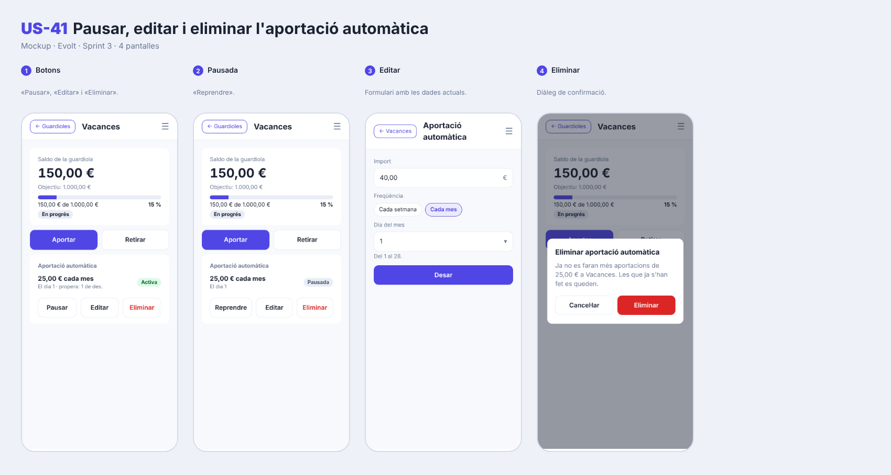

### US-41 · Pausar, editar i eliminar l'aportació automàtica (SP 2 · VP 4 · Prioritat Mitjana)

COM: client estàndard amb una aportació automàtica
VULL: pausar, canviar o eliminar l'aportació automàtica
PER: adaptar l'estalvi quan canvia la meva situació.

Perfil: client estàndard amb una aportació automàtica programada (US-21).

Assumptes:
- Depèn de la US-21
- Les aportacions que ja s'han fet no es toquen mai

Criteris d'acceptació:
1. La targeta d'una aportació automàtica té els botons «Pausar», «Editar» i «Eliminar» (aquest en vermell)
2. «Pausar» canvia l'etiqueta a «Pausada» i el botó a «Reprendre». Mentre està pausada no es fa cap aportació, ni tampoc després les dels dies que han passat en pausa
3. «Reprendre» torna l'etiqueta a «Activa»; la propera aportació és el primer dia programat a partir de demà. També es pot reprendre una aportació pausada per objectiu assolit (US-21)
4. «Editar» obre el formulari de la US-21 amb les dades actuals i el botó «Desar»; en desar surt «Aportació automàtica actualitzada.» i la propera aportació es torna a calcular amb la mateixa regla
5. «Eliminar» obre el diàleg «Eliminar aportació automàtica» («Ja no es faran més aportacions de X € a <nom>. Les que ja s'han fet es queden.») amb «Cancel·lar» i «Eliminar». En eliminar, la targeta torna a «Encara no n'has programat cap.»
6. Error del servidor o de xarxa: «S'ha produït un error inesperat. Torna-ho a provar més tard.» / «No hi ha connexió amb el servidor. Torna-ho a provar.» sota el botó; l'aportació automàtica queda com estava

Casos especials:
- Les aportacions dels dies que han passat en pausa no es recuperen mai
- Editar no fa cap aportació immediata: la propera es calcula amb la regla del primer dia de la US-21
- Eliminar l'aportació automàtica no esborra les aportacions ja fetes ni els seus moviments

Estimació: SP 2 · VP 4 · Prioritat Mitjana

Seguiment: issue #280 · èpica EP-04 (#267) · targeta del Trello US-41.

Revisió del 25/11: Ve de la US-21 original («Aportació periòdica automàtica»).

Mockups (fets abans de programar, 25/11/2026; HTML a `docs/us/_mockup/src/`, PNG a `docs/us/img/`):

1. **US-41-programada** — La targeta amb «Pausar», «Editar» i «Eliminar».
2. **US-41-pausada** — L'aportació pausada: «Pausada» i «Reprendre».
3. **US-41-editar** — «Editar»: el formulari amb les dades actuals i «Desar».
4. **US-41-eliminar-confirmacio** — Diàleg per eliminar l'aportació.

