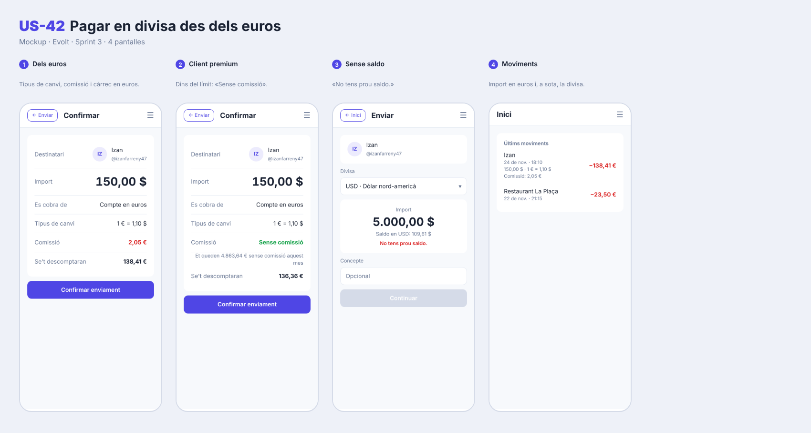

### US-42 · Pagar en divisa des dels euros (SP 3 · VP 6 · Prioritat Mitjana)

COM: client estàndard
VULL: enviar diners en una divisa encara que el meu subcompte no en tingui prou
PER: poder pagar igualment des dels meus euros.

Perfil: client estàndard o premium que paga en una divisa (US-28) sense prou saldo al subcompte.

Assumptes:
- Depèn de la US-28 (selector de divisa)
- Es fa servir el tipus de canvi i la comissió de la US-27 (1,5 %, mínim 0,50 €)
- Per al client premium compta com un canvi per al límit mensual sense comissió de la US-29
- Mai es barregen els dos orígens: o tot del subcompte o tot dels euros

Criteris d'acceptació:
1. Si el subcompte no en té prou però els euros sí, ja no surt «No tens prou saldo en USD.»: «Continuar» queda actiu i «Confirmar» mostra «Es cobra de: Compte en euros», el tipus de canvi («1 € = 1,10 $»), la comissió en vermell i «Se't descomptaran X €» (import en euros + comissió)
2. Si tampoc hi ha prou euros per a l'import i la comissió, a «Enviar» surt en vermell «No tens prou saldo.» i «Continuar» queda desactivat
3. Per al client premium, aquest pagament compta per al límit de 5.000,00 € al mes de la US-29, com un canvi: dins del límit, «Confirmar» diu «Sense comissió» en verd; si el passa, la comissió és només de la part que el passa
4. En confirmar: tic verd «Has enviat 150,00 $ a Izan» amb el saldo en euros que queda; 1,5 s després torna a Inici
5. Als moviments de qui paga surt a Inici i a Moviments en vermell l'import en euros («−138,41 €») i a sota, en gris, «150,00 $ · 1 € = 1,10 $» i «Comissió: 2,05 €» (sense comissió, aquesta última línia no surt)
6. Qui rep ho rep igual que a la US-28
7. El tipus de canvi i la comissió els calcula el servidor: si canvien entre «Continuar» i «Confirmar enviament», surt «El tipus de canvi ha canviat. Revisa l'import.» amb les xifres noves i no s'envia res fins que es torna a confirmar
8. Error del servidor o de xarxa: «S'ha produït un error inesperat. Torna-ho a provar més tard.» / «No hi ha connexió amb el servidor. Torna-ho a provar.» sota el botó; no canvia cap saldo

Casos especials:
- **Exemple estàndard:** 150,00 $ amb 1 € = 1,10 $ són 136,36 €; la comissió (1,5 %) és 2,05 €; «Se't descomptaran 138,41 €»
- **Exemple premium dins del límit:** el mateix pagament no té comissió; «Se't descomptaran 136,36 €» i el límit del mes baixa en 136,36 €
- **Premium que passa el límit:** la comissió només es calcula sobre la part que el passa, igual que a la US-29
- Cal saldo en euros per a l'import i la comissió; si no, «No tens prou saldo.»

Estimació: SP 3 · VP 6 · Prioritat Mitjana

Seguiment: issue #281 · èpica EP-06 (#269) · targeta del Trello US-42.

Revisió del 25/11: Ve de la US-28 original («Pagaments en divisa»). Defineix què paga el client premium.

Mockups (fets abans de programar, 25/11/2026; HTML a `docs/us/_mockup/src/`, PNG a `docs/us/img/`):

1. **US-42-confirmar-euros** — No hi ha prou dòlars: es cobra dels euros amb el canvi i la comissió.
2. **US-42-confirmar-euros-premium** — Client premium dins del límit mensual: sense comissió.
3. **US-42-sense-saldo-euros** — Ni dòlars ni euros suficients.
4. **US-42-moviment** — Inici: el càrrec en euros i, a sota, la divisa, el canvi i la comissió.

