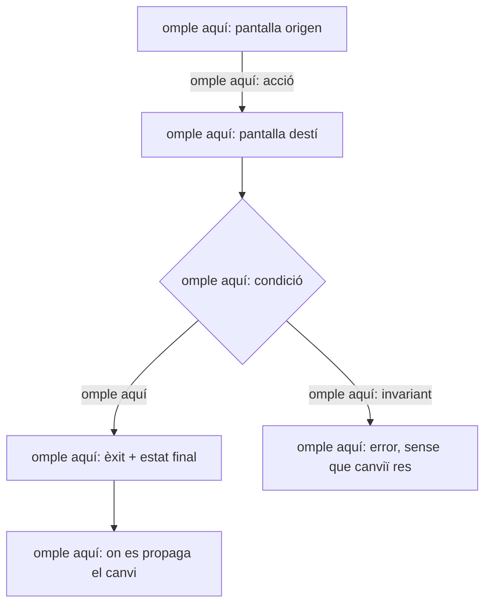
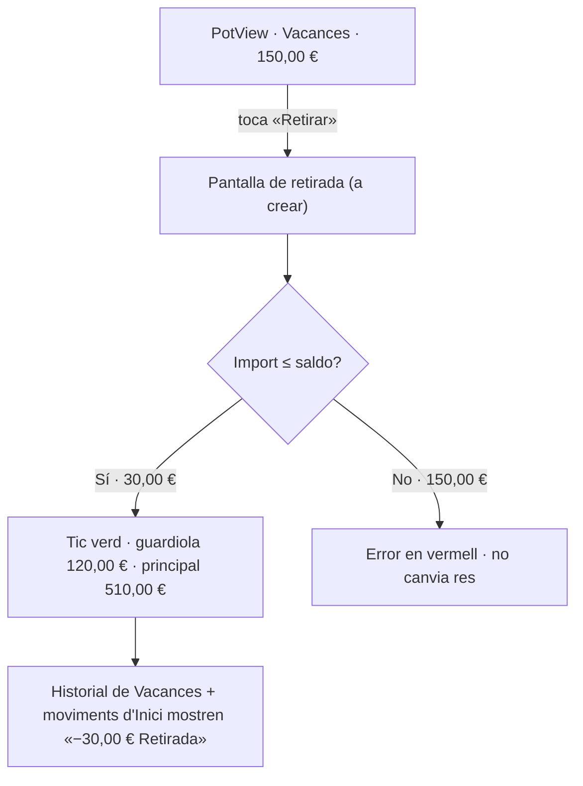

# Plantilla d'US — Sprint 2 (F3-Evolt)

> **Com fer servir aquest fitxer:** copia'l a `docs/us/US-XX.md`, canvia el títol pel de la teva US i omple cada secció seguint les instruccions en segona persona («omple aquí…»). **Esborra les instruccions i les files d'exemple buides quan acabis** — el document lliurat només pot contenir contingut farcit. Al final del fitxer tens l'**exemple farcit US-19 «Retirar de Vacances»** per copiar la *forma*, mai la inventis.
>
> **Regla d'or:** el professor va retreure que les US anteriors eren massa vagues. Cada frase ha de tenir **números, noms, colors i literals copiables**. Tot el que no existeix al repositori es marca **`a crear`**; tota decisió pendent del PO es marca **[PROPOSTA — pendent de validar]**. Els textos entre «» són literals exactes que es copien tal qual al codi.
>
> Convencions de format (única font: `frontend/src/models/money.ts` i `frontend/src/models/date.ts`):
> - Imports: `1.250,50 €` (ca-ES, coma decimal, **NBSP** abans de `€`).
> - Dates: `11 d’oct. · 21:15` (apòstrof tipogràfic **U+2019**).
> - Color principal (lila): `#4f46e5`. Fons de pantalla: `#f7f9fc`.
> - Ingressos: verd `#16a34a` amb `+`. Despeses i errors: vermell `#dc2626` amb `−` (**U+2212**, no un guió).

---

## 1. Value statement + assumptes / prèvies

Omple aquí el value statement en el **format obligatori** de `docs/P1/AGENTS.md` («User Stories — format obligatori»): `AS A (QUI)` / `I WANT TO (QUÈ)` / `SO I CAN / IN ORDER TO (PER QUÈ)`, en anglès. L'ordre no es pot canviar: QUI primer, després QUÈ, després PER QUÈ. Si la card del Trello porta la versió COM/VULL/PER en català, aquesta és el text de la card (secció 12); al document de la US no cal cap línia de traducció a sota.

```
AS A: <qui és l'usuari: perfil de la llista de perfils del Trello>
I WANT TO: <una sola acció, sense detalls de pantalla ni de tècnica>
SO I CAN: <el benefici, en infinitiu>
```

A sota, la llista d'**assumptes / prèvies** (una llista de vinyetes, cada una verificable). Cada assumpte ha de dir quina dada hi ha al seed o quin estat previ cal:

- **Perfil d'usuari:** omple aquí quin perfil afecta (visitant / client nou / client estàndard / client premium) i què necessita tenir (saldo, guardioles, objectiu…).
- **Estats previs:** omple aquí quines pantalles ja han de funcionar i quina sessió cal (sessió iniciada, `accessGuard` actiu).
- **Dades seed:** omple aquí els saldos i registres exactes del seed que la US fa servir (p. ex. «saldo principal 480,00 €», «guardiola Vacances amb 150,00 €»).
- Omple aquí més assumptes: límits, valors per defecte, cosa que NO fa aquesta US (marxa a una altra US).

## 2. Taula de pantalles

Omple aquí una fila **per cada pantalla** que toca aquesta US. Les rutes han de ser les reals de `frontend/src/router/index.ts`; si la pantalla no existeix encara, marca-ho **`a crear`** a la columna Vista i a Ruta. No inventis ruts que no estan al router.

| Ruta (Vue router) | Vista/component Vue | Punt d'entrada | Sortida |
|---|---|---|---|
| omple aquí (`/pots/:potId`) | omple aquí (`PotView.vue`, existeix) | omple aquí (botó «…» a la targeta de la guardiola) | omple aquí (torna a `/pots/:potId` amb l'estat actualitzat) |
| omple aquí (`a crear`) | omple aquí (`a crear`) | omple aquí | omple aquí |

Rutes que **ja existeixen** (no les marquis com a noves): `/`, `/movements`, `/movements/:movementId`, `/movements/:movementId/report`, `/topup`, `/pots`, `/pots/new`, `/pots/:potId`, `/pots/:potId/contribute`, `/login`, `/register`, `/verify`, `/forgot-password`, `/nova-contrasenya`. Les pantalles de **Pagaments / Enviar / Sol·licituds / Divises / Canviar / Retirar NO existeixen** → sempre **`a crear`**.

## 3. Flux d'interacció numerat

Omple aquí el flux **pas a pas, des de dins de l'app**, descrivint exactament què veu i a què toca l'usuari. Cap pas vague del tipus «l'usuari fa l'operació». Cada pas: *veu X → toca Y → apareix Z*. Numerats des de l'1.

1. L'usuari és a omple aquí (pantalla), veu omple aquí (què hi ha a la vista).
2. Toca omple aquí (element concret i literal del botó/enllaç) → el router navega a omple aquí.
3. La pantalla nova mostra omple aquí (contingut, valors inicials amb format).
4. L'usuari introdueix omple aquí → mentre escriu, la UI omple aquí (validació en viu, botó des/activat).
5. Toca omple aquí → la UI mostra omple aquí (estat de càrrega o confirmació).
6. El servidor respon omple aquí → la UI omple aquí (tic verd, redirecció, toast).
7. L'usuari torna a omple aquí i veu omple aquí (el resultat, amb xifres).

## 4. Matriu d'estats

Omple aquí, **per cada pantalla de la secció 2**, què es mostra exactament a cada estat. Un estat sense content concret és un estat vague: escriu el text literal, el color i què passa amb el botó principal.

| Pantalla | Carregant | Buit | Error | Èxit | Deshabilitat |
|---|---|---|---|---|---|
| omple aquí | omple aquí (spinner o skeleton; el botó principal desactivat mentre carrega) | omple aquí (missatge literal exacte + què pot fer l'usuari) | omple aquí (missatge literal exacte en vermell `#dc2626`; cap canvi de saldo) | omple aquí (tic verd `#16a34a` + text literal + redirecció) | omple aquí (quan el botó queda inactiu i per què: saldo 0,00 €, camp buit…) |

## 5. Còpia d'UI literal

Omple aquí **TOTS els textos** de la pantalla. Si un text apareix a l'app, ha d'estar en aquesta taula amb el string exacte entre «». Copia el símbol correcte: apòstrof tipogràfic `’` a dates, `−` (U+2212) a despeses, NBSP abans de `€`.

| Element | String literal exacte |
|---|---|
| Títol de pantalla | «omple aquí» |
| Botó principal | «omple aquí» |
| Botó secundari / enllaç | «omple aquí» |
| Placeholder del camp | «omple aquí» |
| Ajuda / text secundari | «omple aquí» |
| Missatge d'estat buit | «omple aquí» |
| Toast d'èxit | «omple aquí» (p. ex. amb import formatat `30,00 €`) |
| Toast d'error | «omple aquí» |
| Import mostrat | omple aquí (`150,00 €`, format ca-ES amb NBSP) |
| Data mostrada | omple aquí (`11 d’oct. · 21:15`) |

## 6. Taula de validacions

Omple aquí cada regla de validació **amb el missatge literal exacte** i el moment exacte en què es dispara (en viu mentre escriu, en tocar «Continuar», o en respondre el servidor). El missatge ha de coincidir amb el que la UI mostra a la secció 4.

| Camp | Regla | Missatge literal exacte | Quan es dispara |
|---|---|---|---|
| omple aquí | omple aquí (> 0, ≤ saldo, mínim/màxim…) | «omple aquí» | omple aquí (en viu / en enviar / resposta del servidor) |

Recorda: la validació del **backend sempre guanya** (`AGENTS.md` §2.6); la del ViewModel només és per respondre més ràpid en pantalla.

## 7. Integració API

Omple aquí un bloc **per cada crida**. Mira `docs/api.md`: només existeixen els endpoints que hi surten; si el teu endpoint no hi és, escriu **`a crear`** i proposa el contracte [PROPOSTA — pendent de validar]. Cap camp vague: JSON sencer, camps amb valors reals del seed.

**Crida 1 — omple aquí (nom)**
- Mètode + endpoint: omple aquí (`POST /api/…`, `a crear` si cal)
- Request:

```json
omple aquí
```

- Response (2xx):

```json
omple aquí
```

- Codis d'error → reacció UI:

| Codi HTTP | Codi d'error | Reacció UI exacta |
|---|---|---|
| omple aquí | omple aquí (`VALIDATION_ERROR`, `INSUFFICIENT_BALANCE`, …) | omple aquí (missatge literal en vermell, cap canvi a la pantalla) |

## 8. Acció → reacció UI → resposta → toast/redirecció

Omple aquí la taula resum de cada interacció: què fa la UI **abans** de parlar amb el servidor, què fa en rebre la resposta per cada cas, i on acaba l'usuari. Si el resultat és «no canvia res», escriu-ho literalment: és un requisit d'atomicitat.

| Acció de l'usuari | Reacció UI immediata | Resposta del servidor | Toast / redirecció |
|---|---|---|---|
| omple aquí (tocar «…») | omple aquí (botó desactivat, spinner…) | omple aquí (201 / 422 + codi) | omple aquí (tic verd + «…» i tornar a X / missatge vermell «…» i quedar a la mateixa pantalla **sense que canviï res**) |

## 9. No funcionals

Omple aquí (esborra les files que no apliquin, però justifica-ho):

- **Accessibilitat:** omple aquí (etiquetes de camp lligades, focus visible, `aria-live` per a toasts i errors, navegació amb teclat fins a confirmar).
- **Contrast:** omple aquí (text principal gris fosc sobre blanc; verd `#16a34a` i vermell `#dc2626` sobre fons `#f7f9fc` compleixen AA 4,5:1; verificar el text gris secundari).
- **Objectius tàctils:** omple aquí (tots els botons i files clicables ≥ 44×44 px, inclosa la «x» del toast).
- **Responsive:** omple aquí (comportament a ~360 px i a desktop: on va el botó, si el flux és una columna, com es comporta el teclat numèric).
- **Rendiment:** omple aquí (la pantalla no fa més d'una crida per acció; el tic verd surt en < 500 ms amb mocks; sense layout shift en carregar).

## 10. Criteris d'acceptació en Gherkin

**Regla vinculant: EXACTAMENT 3 AC. Mai més.** 3 AC forts valen més que 6 febles. Cada AC: `Given/When/Then`, **independentment** passable o fallable, i verificable pel PO al navegador en **menys d'1 minut** (estat concret del seed + acció + resultat observable).

Els 3 AC cobreixen, **en aquest ordre**, tres angles complementaris:

1. **Happy path de punta a punta:** un escenari complet amb xifres i noms concrets i l'estat final esperat (quants queden on).
2. **Invariant / protecció:** l'operació il·legal es refusa **i no canvia res** (atòmic: saldo insuficient, duplicat, destí prohibit, límit superat…). El «no canvia res» és part del Then, no un AC a part.
3. **Estat / persistència / propagació:** el canvi es veu a **tots els llocs on ha de veure's** (una altra vista, l'historial, el compte de l'altre usuari, un % recalculat) **i sobreviu a una recàrrega** de la pàgina.

**Prohibit com a AC** (cosmètica de presentació — això viu a les seccions 4–8 del cos de la US, no aquí): «el botó es posa vermell», «surt l'etiqueta En progrés», «apareix el toast», «queda com el mockup», colors i strings exactes com a fi en si mateixos.

**Permesos com a AC** (exemples que sí que compten): els diners s'han mogut realment, els dos saldos han canviat de manera atòmica, el registre ha quedat desat, l'operació il·legal s'ha refusat i no ha canviat res, la sol·licitud caducada es calcula com a caducada, el mateix usuari no surt a la seva cerca, es refusa una divisa repetida en el mateix compte, només es pot cancel·lar una sol·licitud pendent.

> La **spec de pantalla** (estats, còpia literal, validacions, reaccions a errors) viu a les **seccions 4–8** del cos de la US, **NO com a AC extra**. Els AC descriuen el Què verificable, no el Com ni la pell.

Omple aquí els 3 AC (esborra aquesta instrucció):

```gherkin
AC1 — omple aquí (títol del happy path)
Given omple aquí (estat del seed amb xifres)
When omple aquí (acció concreta)
Then omple aquí (estat final amb xifres)

AC2 — omple aquí (títol de l'invariant)
Given omple aquí
When omple aquí (l'operació il·legal)
Then omple aquí (refusada I cap canvi a cap saldo, llista o contador)

AC3 — omple aquí (títol de propagació/persistència)
Given omple aquí
When omple aquí
Then omple aquí (el canvi és visible a les altres vistes I es manté després de recarregar)
```

## 11. Wireframes/mockups + diagrama Mermaid

Omple aquí:

- Les imatges viuen a `docs/us/img/US-XX-*.png`, una per pantalla/estat clau (mínim: pantalla principal, estat d'error o buit, estat d'èxit).
- Es generen des de `docs/us/_mockup/src/US-XX-*.html` amb `docs/us/_mockup/render.sh` (mai captures a mà: mateix fons `#f7f9fc`, mateix lila `#4f46e5`, mateixos literals que la secció 5).
- Llista aquí cada fitxer amb el nom exacte: `docs/us/img/US-XX-omple-aqui.png` ← `src/US-XX-omple-aqui.html`.

Diagrama de flux (esquelet — omple els nodes i para'ls als estats de la secció 4):



## 12. Enllaços + Definition of Done

Omple aquí (convenció: el mateix identificador vincula els tres llocs):

- **Trello:** card `US-XX` al tauler (bloc omple aquí: P2 Estalvi, P4 Moviments…), descripció i checklist `Acceptance Criteria` copiats literalment d'aquest document (vegeu `docs/P1/trello-backlog.md` / guia de cards). Sense import automàtic: enganxar a mà.
- **GitHub issue:** issue `US-XX`, titulada igual que la card, enllaçada a la card del Trello al cos.
- **PR:** una US per PR, branca `feature/omple-aqui-slug`, base **`develop`**, títol `<type>(<scope>): <subject> US-XX`, cos amb el mapatge dels AC i captures si hi ha UI.

**Definition of Done** (adaptada de `docs/P1/AGENTS.md`, «Definition of Done», línies 138–144, i `AGENTS.md` §6):

- [ ] Codi fet i *checked in* (commit amb referència `US-XX`)
- [ ] Tests de desenvolupador en verd (pytest + Vitest)
- [ ] Els **3 AC d'aquest document** verificats, cadascun Pass/Fall independent
- [ ] Help / doc text actualitzat si afecta l'usuari (còpia de la secció 5 al codi)
- [ ] Arquitectura respectada: View → ViewModel → Service → API; sense `fetch` a cap `.vue`
- [ ] CI en verd al PR (GitHub Actions `ci`), i com a comprovació local `vitest` i `pytest` en verd
- [ ] Revisió d'un company al PR
- [ ] Sense bugs crítics oberts d'aquesta story
- [ ] **El Product Owner l'accepta al navegador** (executant els 3 AC en < 1 min cadascun)

---

# Exemple farcit — US-19 «Retirar de Vacances» (copiar la FORMA, no el contingut)

> Cas concret: guardiola **Vacances**, saldo guardiola **150,00 €**, saldo principal **480,00 €**. Cada secció de sota és una versió curta de la mateixa secció de dalt: mira com cada frase porta números i literals.

## 1. Value statement + assumptes

```
AS A: a standard client with pots
I WANT TO: withdraw money from a pot back to my main balance
SO I CAN: use my savings when I need them.
```

- **Perfil:** client estàndard amb almenys una guardiola amb saldo > 0,00 €.
- **Estats previs:** sessió iniciada; la guardiola Vacances existeix al seed.
- **Dades seed:** guardiola **Vacances** amb **150,00 €**; saldo principal **480,00 €**.
- NO fa: retirar amb comissió, tancar la guardiola, retirades parcials programades.

## 2. Taula de pantalles

| Ruta (Vue router) | Vista/component Vue | Punt d'entrada | Sortida |
|---|---|---|---|
| `/pots/:potId` | `PotView.vue` (existeix) | Botó «Retirar» a `PotView` (`a crear`, part de la US-19) | Torna a `/pots/:potId` amb els saldos nous |
| `a crear` | `a crear` (vista de retirada) | Botó «Retirar» a `PotView` (`a crear`, part de la US-19) | Redirecció a `/pots/:potId` amb tic verd |

## 3. Flux d'interacció numerat

1. L'usuari és a `/pots/pot-01` i veu «Vacances» amb «Saldo 150,00 €».
2. Toca el botó «Retirar» a `PotView` (`a crear`, part de la US-19) → s'obre la pantalla de retirada `a crear`, amb el saldo de la guardiola a dalt («150,00 €») i un teclat numèric.
3. Introdueix `30,00 €` → el botó «Confirmar» passa a actiu (lila `#4f46e5`).
4. Toca «Confirmar» → el botó es desactiva i mostra el carregament.
5. El servidor respon `201` → tic verd amb «Has retirat 30,00 € de Vacances» i l'app torna a `/pots/pot-01`.
6. La guardiola mostra «120,00 €» i, a `/`, el saldo principal mostra «510,00 €».

## 4. Matriu d'estats

| Pantalla | Carregant | Buit | Error | Èxit | Deshabilitat |
|---|---|---|---|---|---|
| Retirada (`a crear`) | Botó «Confirmar» desactivat amb spinner | «Aquesta guardiola no té diners» | «No es pot retirar més del que té la guardiola» en vermell `#dc2626` | Tic verd «Has retirat 30,00 € de Vacances» | Amb guardiola a 0,00 €, el botó «Retirar» de `PotView` (`a crear`, part de la US-19) surt gris inactiu |

## 5. Còpia d'UI literal

| Element | String literal exacte |
|---|---|
| Títol de pantalla | «Retirar de Vacances» |
| Botó principal | «Confirmar» |
| Placeholder del camp | «Quants diners vols retirar?» |
| Missatge d'estat buit | «Aquesta guardiola no té diners» |
| Toast d'èxit | «Has retirat 30,00 € de Vacances» |
| Import mostrat | `150,00 €` (NBSP abans de `€`) |
| Moviment a l'historial | «−30,00 € Retirada» (vermell `#dc2626`, U+2212) |
| Data del moviment | `11 d’oct. · 21:15` (U+2019) |

## 6. Taula de validacions

| Camp | Regla | Missatge literal exacte | Quan es dispara |
|---|---|---|---|
| Import | > 0,00 € | «L'import ha de ser més gran que 0» | En viu mentre escriu |
| Import | ≤ saldo de la guardiola (150,00 €) | «No es pot retirar més del que té la guardiola» | En viu i també al servidor (`INSUFFICIENT_BALANCE`, el servidor sempre guanya) |

## 7. Integració API

- Mètode + endpoint: `POST /api/pots/pot-01/withdrawals` — **`a crear`**, pendent del contracte T19.1 (no surt a `docs/api.md`; allà només hi ha `GET /api/pots`, `POST /api/pots`, `POST /api/pots/{potId}/contributions`, `GET /api/pots/{potId}/movements`). [PROPOSTA — pendent de validar]
- Request:

```json
{ "amount": 3000 }
```

- Response `201` (saldo anterior del compte: `48000`; saldo anterior de la guardiola: `15000`):

```json
{
  "balance": 51000,
  "pot": {
    "id": "pot-01",
    "name": "Vacances",
    "balance": 12000,
    "target": 100000,
    "color": "blue"
  },
  "movement": {
    "id": "mov-99",
    "amount": 3000,
    "concept": "Retirada",
    "date": "2026-10-11T21:15:00+02:00",
    "type": "income",
    "icon": "savings",
    "counterparty": null,
    "status": "completed",
    "reference": "EVT-000099"
  }
}
```

L'`amount` és **sempre positiu** i en cèntims (`docs/api.md` §1); el sentit el dona `type: "income"`, perquè els diners entren al compte principal. El moviment té el mateix embolcall que l'aportació de l'apartat 9.4 (`{ balance, pot, movement }`) i tots els camps obligatoris de l'objecte `Movement` de l'apartat 3 (`icon: "savings"` és un valor d'icona, no un tipus de moviment; `counterparty: null`, `status` i `reference` sempre presents).

| Codi HTTP | Codi d'error | Reacció UI exacta |
|---|---|---|
| 422 | `INVALID_AMOUNT` | «L'import ha de ser més gran que 0» en vermell; cap canvi de saldo |
| 422 | `INSUFFICIENT_BALANCE` | «No es pot retirar més del que té la guardiola» en vermell; cap canvi |

## 8. Acció → reacció UI → resposta → toast/redirecció

| Acció de l'usuari | Reacció UI immediata | Resposta del servidor | Toast / redirecció |
|---|---|---|---|
| Toca «Confirmar» amb 30,00 € | Botó desactivat + spinner | 201 amb saldos nous | Tic verd «Has retirat 30,00 € de Vacances» → `/pots/pot-01` |
| Toca «Confirmar» amb 150,00 € (després d'haver retirat 30,00 €) | Validació en viu ja el marca en vermell | 422 `INSUFFICIENT_BALANCE` | Missatge vermell; **cap canvi** a cap saldo ni cap moviment nou |

## 9. No funcionals

- **Accessibilitat:** el camp d'import té etiqueta lligada; el tic verd i l'error s'anuncien amb `aria-live="polite"`.
- **Contrast:** vermell `#dc2626` sobre blanc del missatge d'error compleix AA 4,5:1 sobre fons `#f7f9fc`.
- **Objectius tàctils:** botó «Confirmar» i tecles numèriques ≥ 44×44 px.
- **Responsive:** a ~360 px el flux és una columna amb el teclat numèric fix a baix; a desktop centrat a 480 px.
- **Rendiment:** una sola crida per confirmació; tic verd < 500 ms amb mocks.

## 10. Criteris d'acceptació en Gherkin (EXACTAMENT 3)

```gherkin
AC1 — Retirada feliç de punta a punta
Given la guardiola Vacances té 150,00 € i el saldo principal és 480,00 €
When el client retira 30,00 € de Vacances i toca «Confirmar»
Then la guardiola queda amb 120,00 €, el saldo principal amb 510,00 €
    i queda registrat el moviment «−30,00 € Retirada»

AC2 — Invariant: no es pot retirar més del que té la guardiola
Given la guardiola Vacances té 120,00 € i el saldo principal 510,00 €
When el client intenta retirar 150,00 € de Vacances
Then el servidor refusa l'operació i no canvia res:
    la guardiola segueix amb 120,00 €, el saldo principal segueix amb 510,00 €
    i no apareix cap moviment nou

AC3 — Propagació i persistència
Given la guardiola Vacances té 120,00 €, el saldo principal 510,00 €
    i el moviment «−30,00 € Retirada» ja és registrat
When el client obre la llista de moviments d'Inici i el detall de Vacances,
    i després recarrega la pàgina
Then la llista de moviments d'Inici i l'historial de Vacances mostren
    «−30,00 € Retirada», l'estat es manté després de recarregar,
    i la suma saldo + guardioles no canvia (630,00 € abans i després)
```

Per què aquests tres i cap més: AC1 verifica el resultat final amb xifres; AC2 verifica que la regla de negoci es protegeix de manera **atòmica** («no canvia res»); AC3 verifica que el canvi es propaga a les altres vistes i sobreviu a la recàrrega. Els textos de botons, colors i toasts no són AC: són spec de pantalla i viuen a les seccions 4–8.

## 11. Wireframes + Mermaid

- `docs/us/img/US-19-retirada-import.png` ← `src/US-19-retirada-import.html`
- `docs/us/img/US-19-retirada-error.png` ← `src/US-19-retirada-error.html`
- `docs/us/img/US-19-exit-tic-verd.png` ← `src/US-19-exit-tic-verd.html`



## 12. Enllaços + DoD

- **Trello:** card `US-19` (bloc P2 Estalvi), descripció i checklist d'AC copiats d'aquest document.
- **GitHub issue:** `US-19`, titulada «Retirar de Vacances», enllaçada a la card.
- **PR:** `feature/withdraw-from-pot` → base `develop`, títol `feat(savings): withdraw from pot US-19`.
- **DoD:** la checklist de la secció 12 de dalt, marcada índex a índex amb enllaç a l'evidència (PR, CI, execució dels 3 AC).
